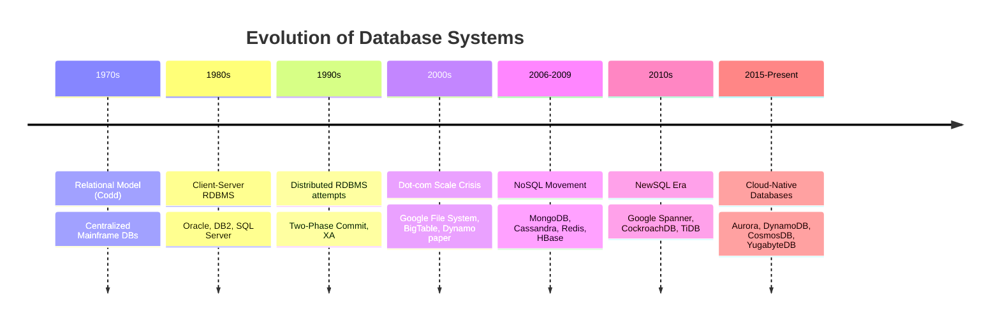
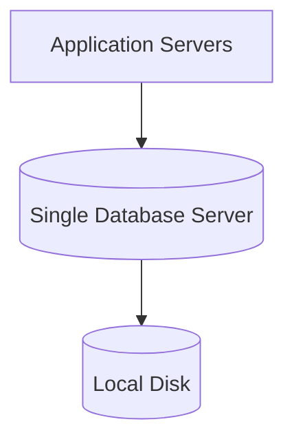
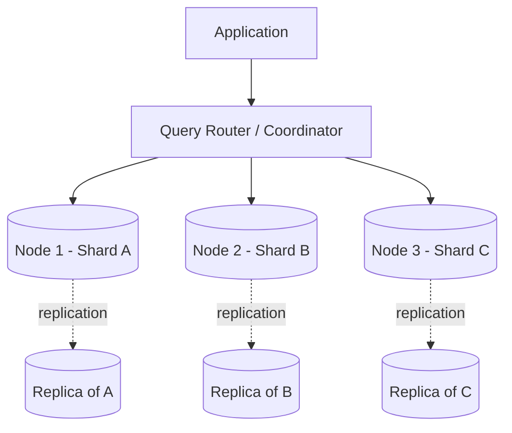
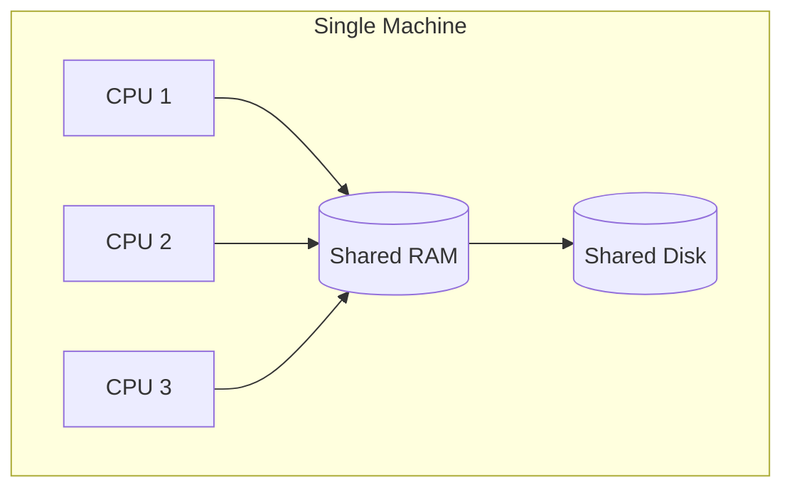
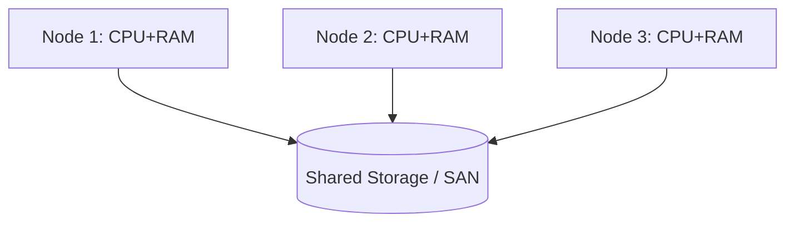
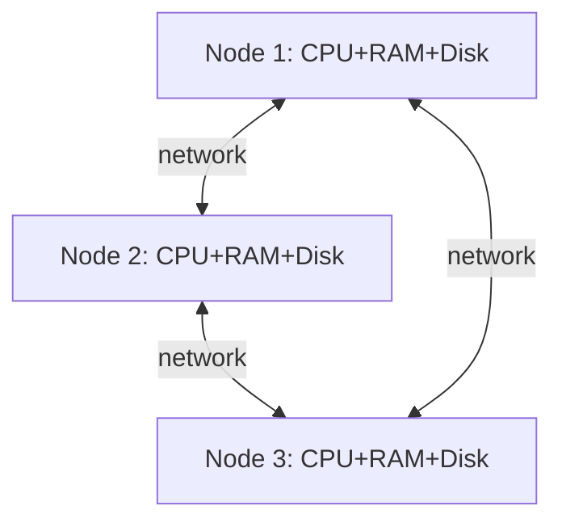
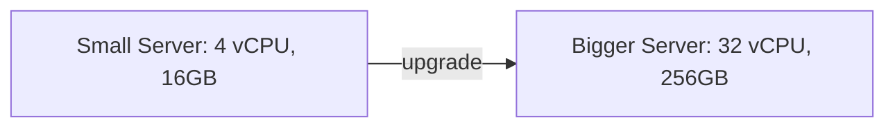
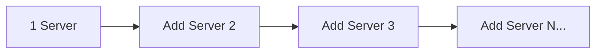

# Part 11 — Distributed Databases, Replication, Sharding & Modern Architectures

> **Prerequisite:** This part assumes you have completed Parts 1–10 (Storage Engines, Indexing, Query Optimization, Transactions, ACID, WAL, MVCC, Recovery, Concurrency Control).

---

# Module 1 — Distributed Database Fundamentals

## 1.1 Why Distributed Databases Exist

### The Problem With a Single Machine

Every database ultimately runs on hardware, and hardware has hard physical limits:

- A single machine has finite CPU cores, RAM, and disk I/O bandwidth.
- A single machine is a **single point of failure** — if it dies, the whole system dies.
- A single machine sitting in one data center is far from users on the other side of the planet, so every query pays a **speed-of-light tax**.
- A single machine can only hold so much data before disks fill up or backups take too long.

As applications grew from "a few hundred users" to "billions of users" (Google, Amazon, Facebook, Netflix), a single centralized database became physically impossible to scale further just by buying a bigger box. This gave birth to **distributed databases** — databases whose data and processing are spread across multiple machines (nodes), often in multiple data centers, that cooperate to look like *one logical database* to the application.

**Analogy:** A single database server is like one clerk at a bank counter. As the number of customers grows, the queue becomes unbearable no matter how fast that one clerk works. The solution is to open more counters (scale out) rather than trying to make one clerk work at superhuman speed forever (scale up).

### What Problem Does It Solve?

| Problem | Distributed DB Solution |
|---|---|
| Too much data for one disk | Split data across many machines (sharding) |
| Too many queries for one CPU | Spread reads/writes across many nodes |
| Server crashes → downtime | Replicate data so other nodes take over |
| Users far from data center | Place data copies closer to users (geo-replication) |
| Need 24/7 uptime | Eliminate single points of failure |

---

## 1.2 Evolution of Databases (Timeline)

Key milestones every interview candidate should know:
- **1970**: E.F. Codd's relational model — foundation of SQL databases.
- **2006**: Google publishes the **BigTable** paper — inspired HBase, Cassandra's column model.
- **2007**: Amazon publishes the **Dynamo** paper — inspired Cassandra, Riak, Voldemort (leaderless replication, consistent hashing).
- **2012**: Google publishes the **Spanner** paper — globally consistent distributed SQL using atomic clocks (TrueTime).
- **2010s onward**: "NewSQL" tries to give you SQL + ACID + horizontal scale at once (CockroachDB, TiDB, YugabyteDB).

---

## 1.3 Centralized vs Distributed DBMS

### Centralized DBMS

All data, processing, and control reside on **one machine** (or one tightly coupled cluster acting as a single unit, e.g., a primary with local disks).

**Characteristics:**
- Single point of control — easy to reason about consistency.
- Single point of failure — no server, no database.
- Scaling means buying bigger hardware (vertical scaling).
- Simpler transactions — no network involved between data copies.

### Distributed DBMS

Data and/or computation are spread across multiple nodes, which may be in the same rack, same data center, or different continents — but the system presents a unified logical view to applications.

### Comparison Table

| Aspect | Centralized DBMS | Distributed DBMS |
|---|---|---|
| Failure impact | Total outage | Partial — other nodes continue |
| Scaling | Vertical (bigger machine) | Horizontal (more machines) |
| Consistency | Trivial (one copy of truth) | Hard (network delays, partitions) |
| Latency for global users | High (one location) | Low (data near users) |
| Complexity | Low | High (CAP tradeoffs, coordination) |
| Cost model | Big expensive server | Many commodity servers |
| Examples | Single-instance MySQL/Postgres | Cassandra, Spanner, CockroachDB, sharded MongoDB |

---

## 1.4 Goals of Distributed Databases

1. **Transparency** — the distribution should be invisible to the application wherever possible (you shouldn't need to know which physical node holds which row).
2. **Scalability** — add nodes to handle more data/traffic linearly (ideally).
3. **Availability** — system keeps serving requests despite node/network failures.
4. **Fault Tolerance** — no single node failure should bring down the whole system.
5. **Performance** — lower latency by placing data close to where it's used.
6. **Autonomy** — nodes can operate somewhat independently (especially in federated systems).

## 1.5 Challenges of Distributed Databases

1. **Network is unreliable** — packets get lost, delayed, or arrive out of order (this is the root of almost every distributed systems problem you'll be asked about in interviews).
2. **Clocks are unreliable** — different machines' clocks drift; you cannot fully trust wall-clock time for ordering events across nodes.
3. **Partial failures** — unlike a single process crashing entirely, in a distributed system *some* nodes fail while others keep running, and you often can't immediately tell whether a node is dead or just slow.
4. **Consistency vs Availability tradeoffs** — you cannot always have perfectly up-to-date data on every node **and** stay available during a network split (this is the essence of the CAP theorem, covered in Module 6).
5. **Distributed transactions are expensive** — coordinating a transaction across multiple nodes needs protocols like Two-Phase Commit (Module 5), which add latency and can block.
6. **Debugging is hard** — a bug might only reproduce under specific network timing across multiple machines.

## 1.6 Advantages and Disadvantages

### Advantages
- Massive horizontal scalability (petabytes of data, millions of QPS).
- High availability — survives data center outages.
- Lower latency for geographically distributed users.
- Incremental capacity growth — add nodes as you grow, no forklift upgrades.
- Fault isolation — a bug or crash on one shard doesn't necessarily take down all shards.

### Disadvantages
- Operational complexity (monitoring, deployment, upgrades across many nodes).
- Harder to reason about correctness (network partitions, clock skew).
- Distributed transactions are slower and more complex than local ones.
- Data modeling constraints (e.g., you often must pick a good shard/partition key up front).
- Debugging and testing distributed failure modes is significantly harder.

---

## 1.7 Distributed Architectures: Shared Nothing, Shared Disk, Shared Memory, Hybrid

This is one of the **most frequently asked conceptual questions** in distributed systems / database interviews.

### Shared Memory Architecture

All CPUs share the same RAM and access the same disk. This is essentially a **single powerful machine** with many cores.

- **Pros:** Simple programming model, fast inter-process communication (just memory access).
- **Cons:** Doesn't scale beyond one machine's memory bus; still a single point of failure.
- **Used by:** Traditional SMP database servers (not truly "distributed").

### Shared Disk Architecture

Multiple independent machines (each with their own CPU and RAM) all access a **common shared storage** (typically a SAN — Storage Area Network).

- **Pros:** Any node can serve any data; adding compute nodes is easy; storage is centrally managed.
- **Cons:** Shared storage can become a bottleneck and single point of failure; needs distributed lock management to prevent nodes from corrupting shared data concurrently.
- **Used by:** Oracle RAC (Real Application Clusters), Amazon Aurora (compute/storage separation, though Aurora's storage layer is itself distributed and replicated).

### Shared Nothing Architecture

Each node has its **own CPU, RAM, and disk**. Nodes communicate only via network messages; no shared hardware resource at all.

- **Pros:** Best horizontal scalability — no shared bottleneck; each node can be commodity hardware; failure of one node is isolated.
- **Cons:** Data must be partitioned across nodes (sharding); cross-node queries/joins are expensive (need network hops); rebalancing data when adding nodes is nontrivial.
- **Used by:** Cassandra, MongoDB (sharded), Google Spanner, CockroachDB, most modern NoSQL/NewSQL systems.

### Hybrid Architecture

Combines elements — for example, groups of nodes share disk within a rack (shared disk) while different racks are shared-nothing relative to each other. Many real cloud databases (e.g., Aurora, Google Spanner's storage layer) are hybrids: compute is shared-nothing while storage is a separately-scaled, replicated distributed layer.

### Comparison Table

| Model | Scalability | Fault Isolation | Complexity | Real Examples |
|---|---|---|---|---|
| Shared Memory | Low (one box) | None | Low | Single-server MySQL/Postgres |
| Shared Disk | Medium | Medium | Medium-High | Oracle RAC |
| Shared Nothing | High | High | High | Cassandra, Spanner, CockroachDB |
| Hybrid | High | High | Very High | Amazon Aurora, Google Spanner |

**Interview tip:** If asked "how would you design a database that scales to petabytes," shared-nothing is almost always the expected answer, followed by a discussion of sharding strategy (Module 4) and replication (Module 3).

---

## 1.8 Horizontal Scaling vs Vertical Scaling

### Vertical Scaling ("Scale Up")

Add more resources (CPU, RAM, faster SSD) to a **single existing machine**.

- **Pros:** No application changes needed; no distributed complexity; transactions stay simple (single-node ACID).
- **Cons:** Hard physical ceiling (you eventually run out of bigger machines to buy); expensive at the high end; still a single point of failure; usually requires downtime to upgrade.

### Horizontal Scaling ("Scale Out")

Add **more machines** and distribute data/load across them.

- **Pros:** Near-limitless scaling (add nodes as needed); improves both storage capacity and throughput; better fault tolerance (no single node holds everything).
- **Cons:** Requires distributed system design (sharding, replication, consensus); application/queries must be aware of distribution (or use a smart router); operational overhead.

### Comparison Table

| Aspect | Vertical Scaling | Horizontal Scaling |
|---|---|---|
| Method | Bigger machine | More machines |
| Ceiling | Hardware limit | Practically unlimited |
| Downtime to scale | Often yes | Usually no (rolling add) |
| Cost curve | Exponential at high end | Roughly linear |
| Complexity | Low | High |
| Failure domain | Single point of failure | Isolated per node |
| Typical use | Traditional RDBMS early stage | Web-scale systems (Google, Amazon, Netflix) |

**Rule of thumb interviewers expect:** "Scale up until it's cheaper/easier to scale out, then move to horizontal scaling with sharding + replication."

---

## 1.9 Cross-References to Earlier Parts

- **ACID (Part on Transactions):** In distributed systems, maintaining ACID across nodes requires protocols like Two-Phase Commit (Module 5) — much harder than single-node ACID guaranteed by WAL + locking.
- **WAL (Write-Ahead Log):** Distributed replication (Module 3) is often built by **shipping the WAL** (or an equivalent operation log) from a leader to replicas — e.g., PostgreSQL streaming replication ships WAL segments.
- **MVCC:** Distributed databases like CockroachDB and Spanner extend MVCC concepts across nodes with distributed timestamps to give snapshot isolation cluster-wide.
- **Query Optimization:** In distributed databases, the optimizer must also decide **where** to run each part of a query (which node/shard), not just which index to use — this is called *distributed query planning*.
- **Storage Engines:** Each node in a shared-nothing cluster still runs a local storage engine (e.g., Cassandra uses an LSM-tree-based engine, similar in spirit to what was covered in the Storage Engines module).

---

## 1.10 Failure Scenarios in Distributed Systems (Preview)

| Failure Type | Description | Handled By |
|---|---|---|
| Node crash | A machine goes down entirely | Replication + failover |
| Network partition | Nodes can't talk to each other but are alive | CAP theorem tradeoffs, quorum |
| Disk failure | Local storage corrupted/lost | Replication, backups |
| Slow node (not dead) | Node is alive but responding very slowly | Timeouts, heartbeats — hard to distinguish from crash |
| Data center outage | Entire region goes down | Multi-region replication |
| Split brain | Two nodes both think they're the leader | Consensus algorithms (Module 8), fencing tokens |

These will be explored in depth throughout this Part.

---

## 1.11 Industry Usage Snapshot

| Company | Distributed DB Choice | Why |
|---|---|---|
| Google | Spanner, BigTable | Global consistency + massive scale |
| Amazon | DynamoDB | Leaderless, highly available for shopping cart-like data |
| Netflix | Cassandra | Write-heavy, multi-region availability |
| Uber | MySQL (sharded) + Cassandra/Docstore | Mixed workloads |
| Meta/Facebook | MySQL (heavily sharded) + TAO (graph cache) | Massive social graph reads |
| Discord | Cassandra → ScyllaDB | High write throughput for messages |

(Full architecture deep-dives are in Module 16.)

---

## 1.12 Interview Questions — Module 1

### Beginner
1. What is a distributed database? How is it different from a centralized one?
2. Give two real-world reasons a company might move from a single database server to a distributed one.
3. Define horizontal scaling and vertical scaling with one example each.

### Intermediate
4. Compare shared-nothing and shared-disk architectures. Which is more common in modern web-scale systems and why?
5. Why is vertical scaling eventually insufficient for very large-scale systems?
6. What new problems appear in distributed databases that don't exist in centralized ones? (Expect: network unreliability, clock skew, partial failure.)

### Senior SDE-2/SDE-3
7. You are designing a system expected to grow from 1M to 500M users. Walk through how your database architecture would evolve, and at what points you'd choose vertical vs horizontal scaling.
8. Why can't you simply "shard" a traditional single-node RDBMS overnight? What application-level and transactional guarantees break?
9. Explain why "partial failure" is considered one of the hardest problems in distributed systems design, with an example where a node is slow rather than dead.

### GATE-style / MCQ
10. Which of the following is NOT an advantage of a distributed database?
    a) Improved availability
    b) Simpler transaction management
    c) Horizontal scalability
    d) Reduced single point of failure
    *(Answer: b)*

11. In a shared-nothing architecture, what do nodes NOT share?
    a) Network
    b) CPU, RAM, and Disk
    c) Application code
    d) None of the above
    *(Answer: b)*

---

## 1.13 Exercises

**Beginner**
- Draw a diagram of a centralized database serving 3 application servers.
- List 3 companies you know that likely use distributed databases and guess why.

**Intermediate**
- Design (on paper) a shared-nothing cluster of 4 nodes for a simple e-commerce order table. Where would you put the "customers" table vs the "orders" table?

**Advanced / Production Scenario**
- Your single Postgres instance is at 95% CPU utilization during peak hours, with mostly read traffic. Propose a step-by-step scaling plan, starting with the cheapest option.

**Whiteboard Interview Problem**
- "Design the data architecture for a ride-sharing app expected to operate in 50 countries." Discuss centralized vs distributed choices, and horizontal vs vertical scaling at each layer (user profiles, trip records, real-time location data).

**Case Study**
- Research how Instagram scaled Postgres sharding in its early years (a well-known engineering blog post) and summarize the architecture decisions in your own words.

---

## 1.14 Practice Resources

- PostgreSQL Documentation — High Availability, Load Balancing, and Replication: https://www.postgresql.org/docs/current/high-availability.html
- MySQL Documentation — Scaling: https://dev.mysql.com/doc/refman/8.0/en/mysql-cluster.html
- Google Cloud — Spanner overview: https://cloud.google.com/spanner/docs/whitepapers
- CockroachDB Docs — Architecture overview: https://www.cockroachlabs.com/docs/stable/architecture/overview
- LeetCode Database problems: https://leetcode.com/studyplan/top-sql-50/
- GATE Overflow (Databases): https://gateoverflow.in/

---

## 1.15 Cheat Sheet — Module 1

- **Centralized DB** = one machine, single point of failure, easy consistency.
- **Distributed DB** = many machines, higher availability/scale, harder consistency.
- **Vertical scaling** = bigger machine; **Horizontal scaling** = more machines.
- **Shared Nothing** = each node owns its CPU/RAM/disk → best for horizontal scale (Cassandra, Spanner).
- **Shared Disk** = compute nodes share common storage (Oracle RAC).
- **Shared Memory** = multiple CPUs, one RAM (single powerful machine).
- Core distributed challenges: **unreliable networks, clock skew, partial failures**.
- CAP theorem tradeoffs exist *because* of these challenges — covered next in Module 6, but Module 2–5 build the foundation first (design, replication, sharding, transactions).

---

**End of Module 1.**

Reply with "continue" or "next module" to proceed to **Module 2: Distributed Database Design (Fragmentation & Transparency)**.
