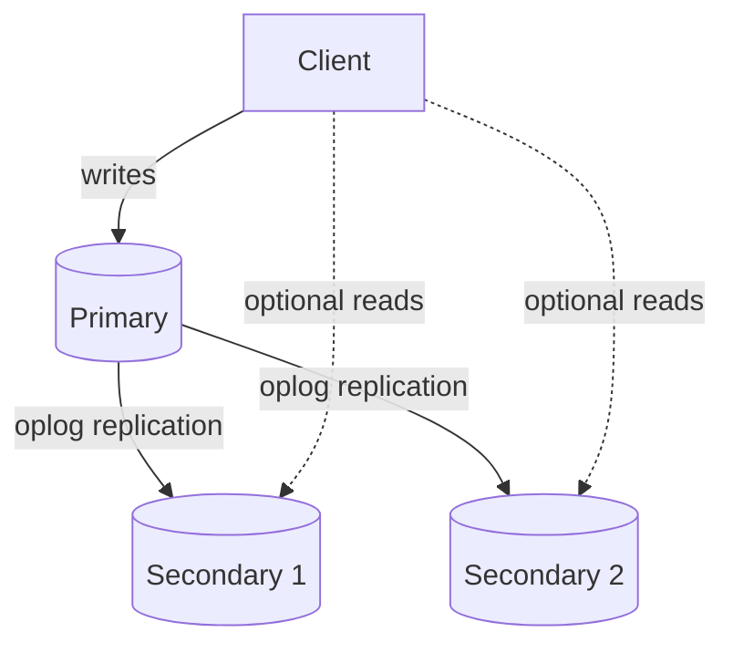
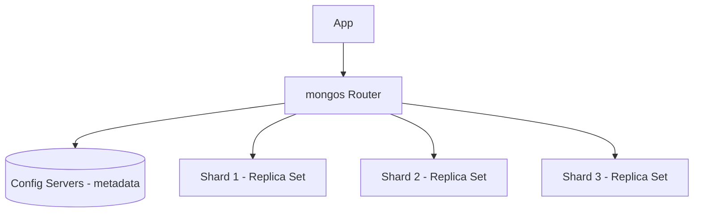

# Module 10 — MongoDB

> A deep dive into the most widely used document database, applying the general concepts from Modules 1–9 (replication, sharding, CAP, document model) to a real, production-grade system.

---

## 10.1 What Is MongoDB?

MongoDB is a **document-oriented NoSQL database** (Module 9) that stores data as **BSON documents** grouped into **collections**, designed from the ground up for horizontal scalability (sharding), high availability (replica sets), and flexible schemas.

**Why was it invented?** Early web/mobile applications needed a database that could store naturally hierarchical, evolving data (user profiles, product catalogs with varying attributes) without the friction of relational schema migrations, while also scaling horizontally more easily than traditional RDBMS setups.

---

## 10.2 BSON

**What is it?** **BSON (Binary JSON)** is MongoDB's binary-encoded serialization format, used to store documents on disk and transmit them over the wire.

### Why Not Plain JSON?

| Aspect | JSON | BSON |
|---|---|---|
| Format | Text | Binary |
| Parsing speed | Slower (text parsing) | Faster (direct binary decode) |
| Extra types | Only strings, numbers, booleans, null, arrays, objects | Adds Date, ObjectId, Binary data, Decimal128, Int32/Int64 distinction, etc. |
| Traversability | Must scan/parse | Includes length prefixes, enabling faster field skipping |

**Why it matters:** BSON lets MongoDB store richer, more precise types (e.g., distinguishing a 32-bit integer from a 64-bit one, or storing exact dates) and process documents more efficiently internally than if it stored plain text JSON.

---

## 10.3 Collections and Documents

- A **document** is the basic unit of data — analogous to a "row" in a relational database, but structured as a JSON/BSON object, and every document has a unique `_id` field (auto-generated as an `ObjectId` if not provided).
- A **collection** is a group of documents — analogous to a "table," but **without a fixed schema**: different documents in the same collection can have different fields (schema-on-read, from Module 9).

```json
// Collection: "users"
{ "_id": ObjectId("..."), "name": "Asha", "age": 29, "city": "Bengaluru" }
{ "_id": ObjectId("..."), "name": "Ravi", "email": "ravi@example.com" }  // different fields — this is OK
```

**Cross-reference to Module 2 (Fragmentation):** A MongoDB collection, once sharded, is essentially a horizontally fragmented table — the fragmentation predicate is the shard key (Section 10.7).

---

## 10.4 CRUD Operations

| Operation | MongoDB Command | Relational Equivalent |
|---|---|---|
| Create | `db.users.insertOne({...})` | `INSERT INTO users ...` |
| Read | `db.users.find({ age: { $gt: 25 } })` | `SELECT * FROM users WHERE age > 25` |
| Update | `db.users.updateOne({ _id: ... }, { $set: { age: 30 } })` | `UPDATE users SET age=30 WHERE id=...` |
| Delete | `db.users.deleteOne({ _id: ... })` | `DELETE FROM users WHERE id=...` |

### Query Operators (Common Ones)

| Operator | Meaning |
|---|---|
| `$eq`, `$ne` | equal / not equal |
| `$gt`, `$gte`, `$lt`, `$lte` | comparisons |
| `$in`, `$nin` | value in / not in a list |
| `$and`, `$or`, `$not` | logical combinators |
| `$exists` | field presence check |
| `$set`, `$unset`, `$inc`, `$push` | update operators (set a field, remove a field, increment a number, append to an array) |

---

## 10.5 Aggregation Pipeline

**What is it?** MongoDB's framework for performing multi-stage data transformations and analytics — conceptually similar to a SQL query with `GROUP BY`, `HAVING`, `JOIN`, and computed columns, but expressed as a **pipeline of stages**, each stage transforming the output of the previous one.

### Common Stages

| Stage | Purpose | SQL Analogy |
|---|---|---|
| `$match` | Filter documents | `WHERE` |
| `$group` | Group and aggregate (sum, avg, count) | `GROUP BY` |
| `$sort` | Sort documents | `ORDER BY` |
| `$project` | Reshape/select fields | `SELECT specific columns` |
| `$lookup` | Join with another collection | `JOIN` |
| `$unwind` | Flatten an array field into multiple documents | (no direct SQL equivalent — array expansion) |
| `$limit` / `$skip` | Pagination | `LIMIT` / `OFFSET` |

### Example Pipeline

```javascript
db.orders.aggregate([
  { $match: { status: "completed" } },
  { $group: { _id: "$customerId", totalSpent: { $sum: "$amount" } } },
  { $sort: { totalSpent: -1 } },
  { $limit: 10 }
])
```

**Step-by-step execution:**
1. `$match` filters to only completed orders.
2. `$group` buckets remaining documents by `customerId`, summing `amount` per bucket.
3. `$sort` orders the results by total spend, descending.
4. `$limit` returns only the top 10 spenders.

**Performance note:** Placing `$match` (and `$sort` if it can use an index) as **early as possible** in the pipeline is a key optimization — it reduces the number of documents flowing into later, more expensive stages (directly analogous to query optimizer "predicate pushdown" concepts from earlier Query Optimization modules).

---

## 10.6 Indexes

Just like relational databases (covered in earlier Indexing modules), MongoDB uses indexes to avoid full collection scans.

| Index Type | Description |
|---|---|
| Single field | Index on one field, e.g., `{ age: 1 }` |
| Compound | Index on multiple fields, e.g., `{ city: 1, age: -1 }` — order matters for which queries can use it |
| Multikey | Automatically created when indexing an array field — indexes each array element |
| Text | Supports full-text search on string fields |
| Geospatial (2dsphere) | Supports location-based queries |
| Hashed | Used for hash-based sharding (Module 4) — hashes the indexed field's value |
| TTL (Time-To-Live) | Automatically deletes documents after a specified time — useful for session data, logs |

**Cross-reference:** MongoDB's default storage engine, **WiredTiger**, uses B-tree indexes (same fundamental structure covered in earlier Indexing/Storage Engine modules) and an LSM-tree-like approach isn't the default, though WiredTiger does use MVCC internally for concurrency control (also covered earlier).

**Common mistake:** Forgetting to create an index on a field used heavily in `$match` or query filters, causing a `COLLSCAN` (collection scan) — the equivalent of a relational full table scan, and just as costly at scale.

---

## 10.7 Replication in MongoDB

MongoDB uses **replica sets**: a single **primary** (leader, Module 3) accepting all writes, and multiple **secondaries** replicating from it via the **oplog** (operations log — MongoDB's equivalent of a WAL/binlog for replication purposes).



### Election

If the primary becomes unreachable, remaining secondaries hold an election (using a **Raft-inspired protocol**, Module 8) to choose a new primary — the candidate with the most up-to-date oplog and sufficient votes wins.

### Read Preference (Tunable Consistency, tying to Modules 6–7)

| Read Preference | Behavior |
|---|---|
| `primary` (default) | Always read from primary — strongest consistency |
| `primaryPreferred` | Read from primary if available, else a secondary |
| `secondary` | Always read from a secondary — may be stale (replica lag, Module 3) |
| `secondaryPreferred` | Prefer secondary, fall back to primary |
| `nearest` | Read from whichever member has lowest network latency |

### Write Concern

Controls how many replica set members must acknowledge a write before it's considered successful — directly implementing the synchronous/asynchronous replication tradeoff (Module 3) and the EC/EL tradeoff (Module 7):

| Write Concern | Meaning | PACELC Lean |
|---|---|---|
| `w: 1` | Only primary must acknowledge | EL (fast, risk of loss if primary fails before replicating) |
| `w: "majority"` | Majority of replica set must acknowledge | EC (safer, higher latency) |
| `w: 0` | Fire-and-forget, no acknowledgment | Maximum EL, maximum risk |

---

## 10.8 Sharding in MongoDB

Recall Module 4's general sharding concepts — MongoDB implements them concretely:

### Components

- **Shard**: a replica set holding a subset of the sharded collection's data.
- **`mongos`**: a stateless query router that clients connect to; it routes queries to the correct shard(s) based on the shard key.
- **Config servers**: store metadata about which shard owns which chunk of data (itself a small replica set for high availability).



### Shard Keys and Strategies

- **Ranged sharding**: data split into contiguous ranges of the shard key (Module 4's range sharding) — chunks are automatically split and migrated by MongoDB's **balancer** as they grow.
- **Hashed sharding**: MongoDB hashes the shard key before assigning chunks — avoids the hot-shard problem of monotonically increasing keys (Module 4's hot partition discussion).

### Chunk Splitting and the Balancer

MongoDB automatically splits a growing chunk once it exceeds a size threshold, and a background **balancer** process migrates chunks between shards to keep data (and load) evenly distributed — a built-in, automated version of the "rebalancing" concept from Module 4.

---

## 10.9 Transactions in MongoDB

Since MongoDB 4.0, **multi-document ACID transactions** are supported, including across sharded clusters (since 4.2) — implemented internally using a **two-phase commit-like protocol** across the relevant shards (Module 5's 2PC directly applied).

```javascript
const session = client.startSession();
session.startTransaction();
try {
  await orders.insertOne({ ... }, { session });
  await inventory.updateOne({ ... }, { $inc: { stock: -1 } }, { session });
  await session.commitTransaction();
} catch (e) {
  await session.abortTransaction();
}
```

**Design guidance MongoDB itself gives (and interviewers expect you to know):** because multi-document/cross-shard transactions carry real performance overhead (echoing Module 5's discussion of 2PC's cost), MongoDB's data modeling philosophy generally favors **embedding related data within a single document** (avoiding the need for a transaction at all) over normalizing data across collections and relying on transactions to keep them consistent.

---

## 10.10 Change Streams

**What is it?** An API that lets applications **subscribe to real-time changes** (inserts, updates, deletes) happening in a collection, database, or entire cluster, without polling.

```javascript
const changeStream = db.collection("orders").watch();
changeStream.on("change", (change) => {
  console.log("Something changed:", change);
});
```

**Internal working:** Change streams are built on top of the **oplog** (Section 10.7) — the same replication log used to keep secondaries in sync is also exposed as a consumable event stream.

**Cross-reference:** This is conceptually identical to the **Outbox Pattern's underlying mechanism** (Module 5) and to **Change Data Capture (CDC)** tools used with relational databases — change streams essentially give MongoDB users CDC as a first-class, built-in feature.

**Use cases:** real-time dashboards, triggering downstream microservice events (can replace an application-level outbox table in some architectures), cache invalidation, search index synchronization.

---

## 10.11 MongoDB Atlas

**What is it?** MongoDB's official **fully managed cloud database service** — handles provisioning, scaling, backups, replication, and sharding configuration through a managed control plane, across AWS, Azure, and Google Cloud.

**Why it matters for interviews:** Atlas is now the most common way MongoDB is deployed in industry, so system design discussions increasingly assume a managed cloud deployment (with built-in automated failover, point-in-time backups, and auto-scaling) rather than a hand-rolled self-managed cluster.

---

## 10.12 Failure Scenarios

| Scenario | Impact | Mitigation |
|---|---|---|
| Primary crash | Writes unavailable until election completes | Raft-inspired automatic election (Module 8 applied) |
| Replica lag on secondaries | Stale reads if using `secondary` read preference | Use `majority` read concern or `primary` read preference for freshness-sensitive reads |
| Poor shard key choice | Hot shard, uneven chunk distribution | Use hashed sharding or a higher-cardinality compound shard key |
| Cross-shard transaction | Higher latency (2PC-style coordination) | Design schema to minimize cross-shard transactions; embed related data |
| `mongos` router down | Application loses ability to route queries (if not load-balanced across multiple `mongos` instances) | Deploy multiple `mongos` instances behind a load balancer |
| Config server unavailable | Cluster metadata inaccessible — chunk migrations/routing degrade | Config servers run as their own replica set for HA |

---

## 10.13 Interview Questions — Module 10

### Beginner
1. What is BSON, and why does MongoDB use it instead of plain JSON?
2. What is the difference between a MongoDB collection and a relational table?
3. Name three aggregation pipeline stages and their SQL equivalents.

### Intermediate
4. Explain the role of the oplog in both replication and change streams.
5. What is the difference between read preference and write concern, and how do they relate to the CAP/PACELC tradeoffs from Modules 6–7?
6. Why does MongoDB recommend embedding related data in a single document rather than relying on multi-document transactions?

### Senior SDE-2/SDE-3
7. Design the sharding strategy (shard key, sharding type) for a multi-tenant SaaS application's `events` collection, considering both write distribution and common query patterns (per-tenant queries).
8. A production MongoDB cluster experiences a primary failure during peak traffic. Walk through, step by step, what happens from failure detection to a new primary accepting writes, referencing Module 8's Raft-like election mechanics.
9. Your team wants to build real-time cache invalidation when product data changes. Compare using Change Streams versus an application-level Outbox Pattern (Module 5) for this use case.

### GATE-style / MCQ
10. Which MongoDB component is responsible for routing client queries to the correct shard?
    a) Config server
    b) mongos
    c) Primary
    d) Oplog
    *(Answer: b)*

11. Which write concern favors lowest latency at the cost of potential data loss on primary failure?
    a) w: "majority"
    b) w: 1
    c) w: 0
    d) All are equally safe
    *(Answer: c)*

---

## 10.14 Exercises

**Beginner**
- Write an aggregation pipeline that finds the top 5 products by total quantity sold from an `orders` collection with embedded line items.

**Intermediate**
- Design a compound index for a query that filters by `status` and sorts by `createdAt` descending. Explain why field order in the index matters.

**Advanced / Production Scenario**
- Your sharded MongoDB cluster shows one shard consistently at 90% CPU while others sit at 20%. Diagnose likely causes and propose a fix (referencing Module 4's hot partition concepts).

**Whiteboard Interview Problem**
- "Design a MongoDB schema and sharding strategy for a ride-sharing app's `trips` collection, supporting both 'get all trips for a rider' and 'get all trips near a given location right now' query patterns."

**Case Study**
- Research how a well-known company (e.g., eBay, Adobe, or Cisco — all public MongoDB case studies) restructured its data model when migrating from a relational database to MongoDB, and summarize the key schema design changes.

---

## 10.15 Practice Resources

- MongoDB University (free courses): https://learn.mongodb.com/
- MongoDB Docs — Data Modeling: https://www.mongodb.com/docs/manual/data-modeling/
- MongoDB Docs — Aggregation Pipeline: https://www.mongodb.com/docs/manual/core/aggregation-pipeline/
- MongoDB Docs — Sharding: https://www.mongodb.com/docs/manual/sharding/
- MongoDB Docs — Replication: https://www.mongodb.com/docs/manual/replication/
- MongoDB Docs — Change Streams: https://www.mongodb.com/docs/manual/changeStreams/

---

## 10.16 Cheat Sheet — Module 10

- **BSON**: binary JSON with richer types, faster to parse/traverse than text JSON.
- **Collections/Documents**: schema-on-read, `_id` field required, flexible per-document structure.
- **Aggregation Pipeline**: multi-stage transform (`$match`, `$group`, `$sort`, `$lookup`, etc.) — put `$match` early for performance.
- **Indexes**: single, compound, multikey, text, geospatial, hashed, TTL — missing indexes cause costly `COLLSCAN`s.
- **Replication**: replica sets, primary + secondaries, oplog-based, Raft-inspired election; tunable via read preference + write concern.
- **Sharding**: `mongos` router + config servers + shard replica sets; ranged or hashed shard keys; automatic chunk splitting/balancing.
- **Transactions**: multi-document ACID, cross-shard via 2PC-like coordination — expensive, so MongoDB favors embedding over normalization where possible.
- **Change Streams**: real-time subscription to oplog-derived changes — MongoDB's built-in CDC, related to the Outbox Pattern (Module 5).
- **Atlas**: MongoDB's managed cloud service — the most common production deployment model today.

---

**End of Module 10.**

Reply with "continue" or "next module" to proceed to **Module 11: Redis**.
