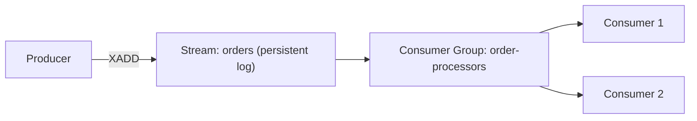
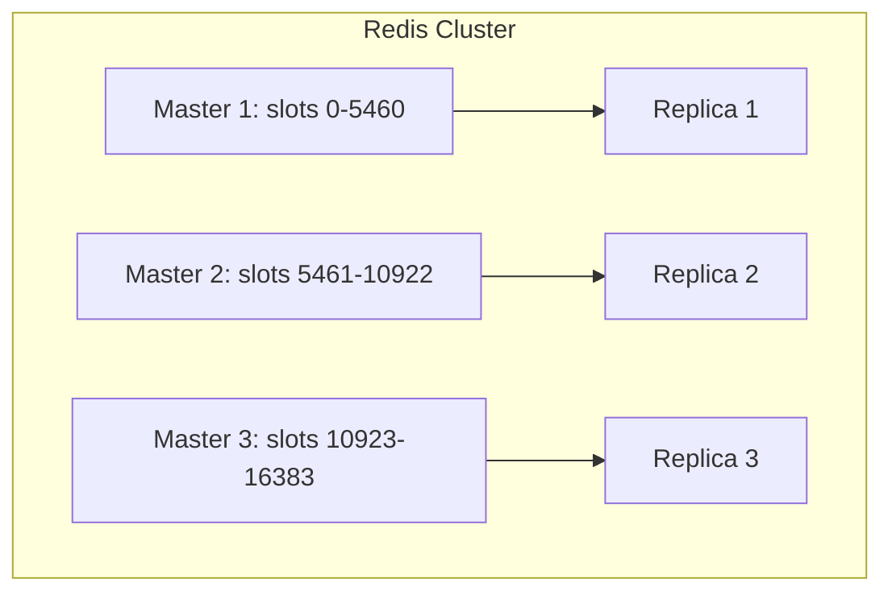
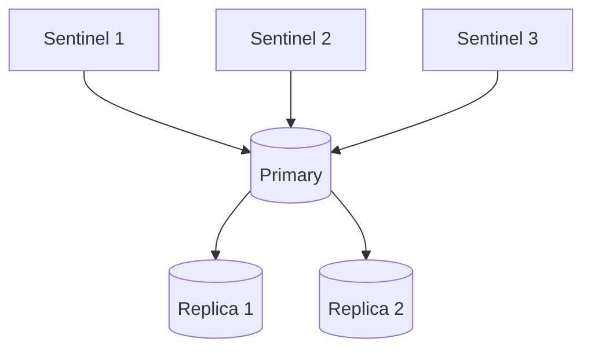
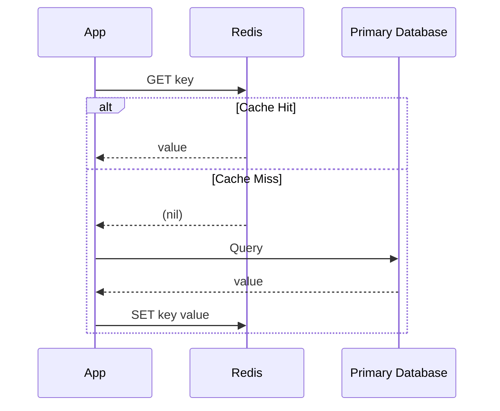

# Module 11 — Redis

> Redis is the canonical **key-value store** (Module 9) — but its rich data structures, persistence options, and clustering model make it worth an entire dedicated module.

---

## 11.1 What Is Redis?

**Redis (REmote DIctionary Server)** is an **in-memory** key-value data store that supports rich data structures beyond simple strings, optional persistence to disk, replication, clustering, and pub/sub messaging.

**Why was it invented?** Traditional disk-based databases, even well-indexed ones, cannot match the raw speed of keeping "hot" data entirely in RAM. Redis was built to be the fastest possible data store for use cases where **sub-millisecond latency** matters more than the durability guarantees of a full disk-based ACID database — caching, session storage, real-time leaderboards, rate limiting, and message brokering.

**Real-life analogy:** If a disk-based database is a library where you must walk to a shelf to retrieve a book, Redis is a single desk with your most-used books already stacked in front of you — retrieval is nearly instantaneous, but the desk has limited space (RAM is far more expensive and limited than disk).

---

## 11.2 Data Structures

Unlike plain key-value stores that only store opaque blobs, Redis natively understands and can operate on structured values:

| Data Structure | Description | Common Commands | Example Use Case |
|---|---|---|---|
| String | Simple binary-safe string (or number) | `SET`, `GET`, `INCR` | Caching, counters |
| List | Ordered, linked list of strings | `LPUSH`, `RPUSH`, `LRANGE` | Queues, activity feeds |
| Set | Unordered collection of unique strings | `SADD`, `SISMEMBER`, `SINTER` | Tags, unique visitor tracking |
| Sorted Set (ZSet) | Set with a score attached to each member, kept sorted | `ZADD`, `ZRANGE`, `ZRANK` | Leaderboards, priority queues |
| Hash | Field-value pairs within a single key (like a mini-document) | `HSET`, `HGET`, `HGETALL` | Representing an object (e.g., a user record) |
| Bitmap | Bit-level operations on strings | `SETBIT`, `BITCOUNT` | Feature flags, analytics (e.g., daily active user tracking) |
| HyperLogLog | Probabilistic structure for approximate cardinality counting | `PFADD`, `PFCOUNT` | Approximate unique visitor counts at massive scale, tiny memory footprint |
| Geospatial | Stores coordinates, supports radius queries | `GEOADD`, `GEOSEARCH` | "Find nearby drivers/restaurants" |
| Stream | Append-only log of entries with IDs (Section 11.5) | `XADD`, `XREAD`, `XRANGE` | Event sourcing, message queues |

**Mathematical intuition — Sorted Sets:** Internally implemented as a **skip list** plus a hash table, giving `O(log n)` insertion/lookup by score while still allowing `O(1)` lookup by member name — this dual structure is precisely why sorted sets can efficiently answer both "what's Asha's rank?" and "who's in the top 10?" simultaneously.

---

## 11.3 Persistence

Since Redis is primarily an in-memory store, it needs a strategy to avoid **losing everything** on a restart or crash — this directly parallels the WAL/checkpoint concepts from earlier Storage Engine/Recovery modules.

### 11.3.1 RDB (Redis Database File) — Snapshotting

Periodically saves a **point-in-time snapshot** of the entire dataset to disk (similar to a checkpoint).

- **Pros:** Compact single file, fast to load on restart, good for backups.
- **Cons:** Data written since the last snapshot is lost on a crash (potential data loss window).

### 11.3.2 AOF (Append-Only File) — Operation Logging

Logs **every write operation** to an append-only file, which can be replayed to reconstruct the dataset — directly analogous to a **Write-Ahead Log (WAL)** from earlier modules.

- **Pros:** Much lower data-loss window (configurable fsync policy — every write, every second, or OS-controlled).
- **Cons:** Larger file size than RDB; slower to load/replay on restart (mitigated by periodic AOF rewriting/compaction).

### Comparison Table

| Aspect | RDB | AOF |
|---|---|---|
| Data loss window | Minutes (time since last snapshot) | Configurable — as low as ~1 second, or every write |
| File size | Compact | Larger (logs every operation) |
| Restart speed | Fast | Slower (must replay log), improved by compaction |
| Best for | Backups, disaster recovery snapshots | Minimizing data loss |

**Common production setup:** use **both** — RDB for periodic compact backups, AOF for minimizing data loss between snapshots — Redis supports combining them.

---

## 11.4 Pub/Sub

**What is it?** A messaging pattern where publishers send messages to **channels**, and any number of subscribers listening to that channel receive them in real time — with **no persistence**: if no one is subscribed when a message is published, it's lost forever.

```mermaid
graph LR
    Pub[Publisher] -->|PUBLISH "news"| Channel[Channel: news]
    Channel --> Sub1[Subscriber 1]
    Channel --> Sub2[Subscriber 2]
```

- **Use cases:** real-time notifications, chat applications, live dashboards.
- **Limitation:** since messages aren't stored, a subscriber that connects late or briefly disconnects **misses** messages published during that gap — for durable messaging, use **Streams** instead.

---

## 11.5 Streams

**What is it?** An append-only log data structure (added in Redis 5.0) that, unlike Pub/Sub, **persists messages** and supports **consumer groups** — multiple consumers can read from the same stream with load-balanced, at-least-once delivery and explicit acknowledgment.



- **Why it matters:** Streams give Redis message-queue-like durability and delivery guarantees that Pub/Sub explicitly lacks — closer in spirit to Kafka than to simple Pub/Sub.
- **Key commands:** `XADD` (append), `XREAD` (read), `XRANGE` (range query by ID), `XGROUP`/`XREADGROUP` (consumer groups), `XACK` (acknowledge processing).

---

## 11.6 Transactions

Redis supports **transactions** via `MULTI`/`EXEC`, queuing a batch of commands and executing them atomically (no other client's commands can be interleaved in between).

```
MULTI
SET account:1:balance 400
SET account:2:balance 600
EXEC
```

**Important nuance (a favorite interview trap):** Redis transactions provide **atomicity of execution** (nothing is interleaved) but **not rollback on a runtime error** — if one command in the queued batch fails (e.g., wrong data type for an operation), the other commands **still execute**; Redis transactions only guard against a syntax-level queuing error, not a logic-level failure mid-transaction. This is different from traditional ACID rollback semantics covered in earlier Transactions modules.

### Optimistic Locking with WATCH

`WATCH` lets a client monitor keys for changes; if a watched key is modified by another client before `EXEC`, the transaction aborts — implementing an optimistic-concurrency pattern conceptually similar to MVCC's write-conflict detection (from earlier modules), but at the application/command level rather than the storage engine level.

---

## 11.7 Lua Scripting

**What is it?** Redis allows executing **Lua scripts** on the server, which run **atomically** (the entire script executes as a single, uninterruptible operation, since Redis itself is largely single-threaded for command execution).

```lua
-- Example: atomic "increment if below limit" script
local current = tonumber(redis.call('GET', KEYS[1]) or "0")
if current < tonumber(ARGV[1]) then
    return redis.call('INCR', KEYS[1])
else
    return -1
end
```

**Why it matters:** Complex multi-step logic that would otherwise require multiple round-trips (and risk race conditions between them) can be executed as a **single atomic unit** server-side — a common pattern for implementing rate limiters, distributed locks, and other logic that must be race-condition-free without needing full ACID transactions.

---

## 11.8 Clustering

**Redis Cluster** provides automatic **sharding** (Module 4) across multiple nodes, without needing a separate proxy layer.

### Hash Slots

Redis Cluster divides the keyspace into **16,384 fixed hash slots**. Each key is assigned to a slot via `CRC16(key) % 16384`, and each slot is owned by exactly one master node (with optional replicas).



**Why 16,384 fixed slots (instead of pure consistent hashing, Module 4)?** This design makes resharding simpler to reason about and communicate: slots (not individual keys) are the unit of migration, and a modest, fixed number of slots keeps cluster metadata (which node owns which slots) small enough to gossip efficiently between nodes, even as the number of physical nodes grows.

### Multi-Key Operations and Hash Tags

Because keys are distributed across slots, operations spanning multiple keys (like `MULTI`/`EXEC` transactions, or Lua scripts touching multiple keys) only work if **all involved keys map to the same slot**. Redis supports **hash tags** — using `{...}` in a key name — to force related keys into the same slot:

```
user:{1001}:profile   → hashed on "1001"
user:{1001}:sessions   → hashed on "1001" (same slot as above, since only the {1001} part is hashed)
```

This directly parallels Module 2's **derived fragmentation** concept — co-locating related data so multi-key operations don't need cross-shard coordination.

---

## 11.9 Sentinel

**Redis Sentinel** provides **high availability** for non-clustered (single-primary + replicas) Redis deployments — monitoring, automatic failover, and configuration management, without the full sharding of Redis Cluster.

### How It Works

1. Multiple Sentinel processes monitor the primary and its replicas via periodic heartbeats.
2. If a majority (quorum, Module 8) of Sentinels agree the primary is unreachable, they initiate a **failover**: promote a replica to primary.
3. Sentinels then reconfigure remaining replicas to follow the new primary and notify connected clients of the change.



**Cross-reference:** This is a direct application of Module 3's failover concept and Module 8's quorum-based decision-making, applied specifically to Redis's simpler (non-sharded) replication topology.

**Sentinel vs Cluster:** Sentinel gives you **high availability** (survive a primary failure) without sharding; Cluster gives you **both sharding and high availability**, but is more operationally complex. Choose Sentinel when your dataset fits comfortably on one primary node; choose Cluster when you need to scale beyond a single node's capacity.

---

## 11.10 Cache Patterns

Redis's most common production role is as a **cache** in front of a slower, disk-based primary database. Several standard patterns:

### Cache-Aside (Lazy Loading)


- Application checks cache first; on a miss, reads from the database and populates the cache.
- **Pros:** Only requested data is cached (efficient use of memory). **Cons:** First request after a miss is always slow (cold cache); cache can become stale if the DB changes underneath it.

### Write-Through

Every write goes to the cache **and** the database synchronously, keeping them always in sync.
- **Pros:** Cache is never stale. **Cons:** Every write pays the latency cost of writing to both systems.

### Write-Behind (Write-Back)

Writes go to the cache immediately (fast), and are asynchronously flushed to the database later.
- **Pros:** Very fast writes. **Cons:** Risk of data loss if the cache crashes before flushing to the database (an availability/durability tradeoff, echoing Module 7's Latency vs Consistency discussion).

### Comparison Table

| Pattern | Write Latency | Staleness Risk | Data Loss Risk |
|---|---|---|---|
| Cache-Aside | N/A for cache (only affects reads) | Possible (DB changes not auto-reflected) | None (DB is source of truth) |
| Write-Through | Higher (writes to both) | None | None |
| Write-Behind | Lowest | None (eventually consistent) | Possible (if cache crashes before flush) |

---

## 11.11 Failure Scenarios

| Scenario | Impact | Mitigation |
|---|---|---|
| Redis instance crash (no persistence) | All in-memory data lost | Enable RDB/AOF; use replicas |
| AOF/RDB disabled entirely | Full data loss on restart | Always enable at least one persistence mechanism for non-pure-cache use cases |
| Primary failure (non-clustered) | Writes unavailable | Sentinel-managed automatic failover |
| Cluster node failure | Its hash slots become unavailable until replica promotion | Cluster automatically promotes a replica for the affected slots |
| Hot key (e.g., viral post counter) | Single slot/node overloaded | Client-side sharding of the hot key (similar to Module 4's salting technique), or local caching in front of Redis |
| Lua script with infinite loop or very slow logic | Blocks the single-threaded command loop, stalling all clients | Keep scripts short and bounded; use `SCRIPT KILL` cautiously as a last resort |

---

## 11.12 Interview Questions — Module 11

### Beginner
1. Name four Redis data structures and one use case for each.
2. What is the difference between RDB and AOF persistence?
3. What is the key limitation of Redis Pub/Sub that Streams solve?

### Intermediate
4. Explain why Redis transactions (`MULTI`/`EXEC`) don't roll back if one command fails mid-batch.
5. Why does Redis Cluster use 16,384 fixed hash slots instead of pure consistent hashing?
6. Compare cache-aside, write-through, and write-behind caching patterns in terms of latency and data-loss risk.

### Senior SDE-2/SDE-3
7. Design a real-time leaderboard for a game with 50 million players using Redis. Which data structure would you use, and how would you handle a hot key if one player's updates spike in frequency?
8. Your team uses Redis purely as a cache (no persistence), but after a recent outage, the cold cache caused a "thundering herd" of requests hitting the primary database simultaneously. Propose a mitigation strategy.
9. Explain the difference between Redis Sentinel and Redis Cluster, and describe a scenario where you'd choose one over the other.

### GATE-style / MCQ
10. Which Redis persistence mechanism is most analogous to a Write-Ahead Log?
    a) RDB
    b) AOF
    c) Pub/Sub
    d) Lua scripting
    *(Answer: b)*

11. In Redis Cluster, what mechanism ensures related keys are co-located on the same hash slot?
    a) Consistent hashing
    b) Hash tags (`{...}`)
    c) Sentinel quorum
    d) AOF rewriting
    *(Answer: b)*

---

## 11.13 Exercises

**Beginner**
- Use Redis sorted sets to design a leaderboard supporting "get top 10" and "get a specific player's rank" queries.

**Intermediate**
- Write a Lua script that atomically checks a rate limit (max 5 requests per 60 seconds per user) and increments the count if under the limit.

**Advanced / Production Scenario**
- Your write-behind cache setup lost 30 seconds of writes when the Redis instance crashed unexpectedly. Propose an architectural change to reduce this risk without fully reverting to write-through.

**Whiteboard Interview Problem**
- "Design a distributed lock using Redis (e.g., for ensuring only one worker processes a given job at a time), addressing what happens if the lock holder crashes without releasing it."

**Case Study**
- Research the "Redlock" algorithm (Redis's proposed distributed locking approach) and the well-known critique of it by Martin Kleppmann; summarize both sides of the debate.

---

## 11.14 Practice Resources

- Redis Documentation — Data Types: https://redis.io/docs/latest/develop/data-types/
- Redis Documentation — Persistence: https://redis.io/docs/latest/operate/oss_and_stack/management/persistence/
- Redis Documentation — Cluster Specification: https://redis.io/docs/latest/operate/oss_and_stack/reference/cluster-spec/
- Redis Documentation — Sentinel: https://redis.io/docs/latest/operate/oss_and_stack/management/sentinel/
- Redis University (free courses): https://university.redis.com/

---

## 11.15 Cheat Sheet — Module 11

- **Redis**: in-memory key-value store with rich data structures (strings, lists, sets, sorted sets, hashes, bitmaps, HyperLogLog, geospatial, streams).
- **RDB** = periodic snapshot (compact, some data loss risk); **AOF** = operation log (WAL-like, lower data loss, larger file) — often used together.
- **Pub/Sub** = fire-and-forget real-time messaging, no persistence, missed if no subscriber listening.
- **Streams** = persistent, replayable log with consumer groups — closer to a message queue than Pub/Sub.
- **Transactions (`MULTI`/`EXEC`)**: atomic execution, but no rollback on runtime errors mid-batch; `WATCH` enables optimistic concurrency.
- **Lua scripting**: server-side atomic execution of multi-step logic, avoiding race conditions across round-trips.
- **Redis Cluster**: 16,384 fixed hash slots, sharded automatically; hash tags (`{...}`) co-locate related keys for multi-key operations.
- **Sentinel**: HA (automatic failover) for non-clustered deployments via quorum-based monitoring — no sharding.
- **Cache patterns**: cache-aside (most common), write-through (always fresh, slower writes), write-behind (fastest writes, data-loss risk).

---

**End of Module 11.**

Reply with "continue" or "next module" to proceed to **Module 12: Cassandra**.
