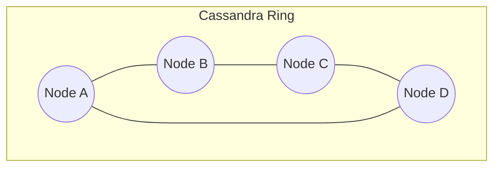
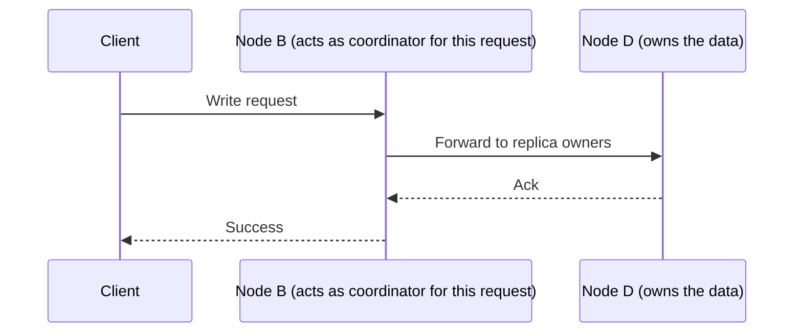
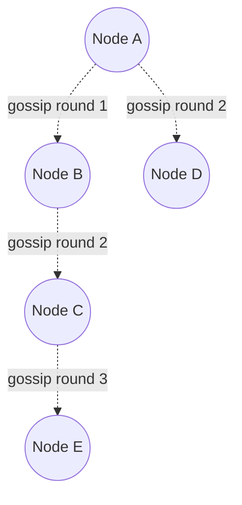
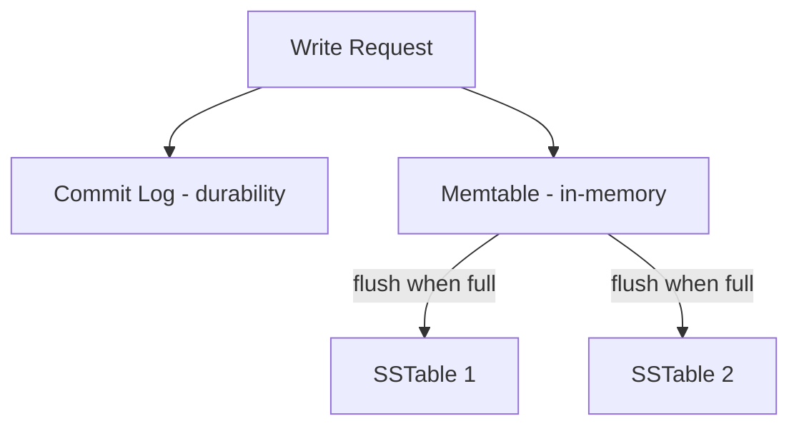
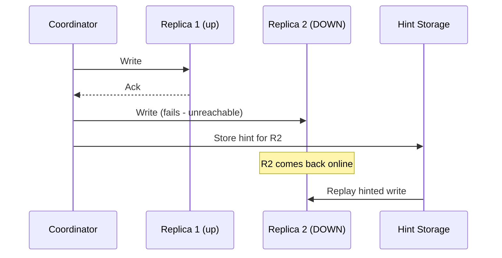
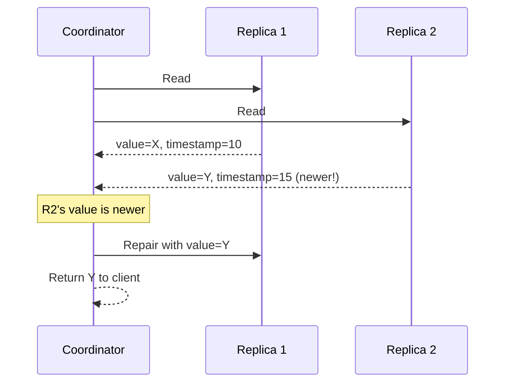

# Module 12 — Cassandra

> Apache Cassandra is the archetypal **column-family, leaderless** NoSQL database (Modules 3, 9) — directly implementing the Dynamo paper's leaderless replication combined with BigTable's column-family data model.

---

## 12.1 What Is Cassandra?

Cassandra is a **wide-column, leaderless, masterless distributed database** designed for extremely high write throughput, linear horizontal scalability, and multi-datacenter availability with **no single point of failure** — every node is functionally identical (no leader/follower distinction at the cluster level).

**Why was it invented?** Facebook originally built Cassandra to power its Inbox Search feature, explicitly combining **Amazon Dynamo's** leaderless replication/partitioning model with **Google BigTable's** column-family data model — designed from day one for the AP/PA-EL (Modules 6–7) side of the tradeoff spectrum: always available, low latency, tunable consistency.

---

## 12.2 Architecture — The Ring

Cassandra arranges all nodes in a cluster into a **logical ring**, using consistent hashing (Module 4) to determine which node(s) own which data.



**Key architectural principle:** there is **no leader, no coordinator node, no single metadata service** at the cluster level — any node can receive a client request and act as the **coordinator for that request**, forwarding it to whichever nodes actually own the relevant data.



---

## 12.3 Tokens and Partitioners

### Tokens

Each node in the ring is assigned one or more **tokens** — positions on the hash ring (directly implementing Module 4's consistent hashing + virtual nodes, called `vnodes` in Cassandra terminology). A row's partition key is hashed to a token value, and it's stored on the node(s) owning that token range.

### Partitioners

The **partitioner** is the function used to hash a partition key into a token.

| Partitioner | Description |
|---|---|
| Murmur3Partitioner (default) | Uses the MurmurHash3 algorithm — fast, good distribution, the modern default |
| RandomPartitioner (legacy) | Uses MD5 hashing — older, slower, mostly superseded by Murmur3 |
| ByteOrderedPartitioner | Preserves key ordering on the ring (enables range scans) but risks severe hot spots (Module 4) — rarely recommended |

**Why Murmur3 is the default:** It provides an excellent, fast, uniform hash distribution across the ring, directly supporting Cassandra's design goal of even load distribution (avoiding the hot-spot risks of range-preserving partitioners).

---

## 12.4 Replication Factor (RF)

**What is it?** The number of copies of each piece of data Cassandra keeps across the cluster — set **per keyspace** (Cassandra's term for a logical database/namespace).

```
CREATE KEYSPACE my_app WITH replication = {
  'class': 'NetworkTopologyStrategy',
  'datacenter1': 3,
  'datacenter2': 2
};
```

- `RF=3` in `datacenter1` means every row is stored on 3 different nodes within that data center.
- **NetworkTopologyStrategy** (shown above) lets you set a **different replication factor per data center** — critical for multi-region deployments, letting you, e.g., keep full replicas in your primary region and fewer in a disaster-recovery region.
- **SimpleStrategy** is a simpler (single-datacenter-only) alternative, mainly used for testing.

**Cross-reference:** This is a direct, concrete implementation of Module 2's "Fragment Allocation & Replication" and Module 3's "Leaderless Replication" concepts.

---

## 12.5 Consistency Levels

Cassandra exposes **per-query tunable consistency** (Modules 3, 6, 7) via **consistency levels** — the client chooses, for each read or write, how many replicas must respond.

| Consistency Level | Meaning |
|---|---|
| `ONE` | Only 1 replica must respond |
| `QUORUM` | A majority of replicas (per Module 8's majority math) must respond |
| `ALL` | Every replica must respond |
| `LOCAL_QUORUM` | Majority within the local data center only (avoids cross-datacenter latency) |
| `EACH_QUORUM` | Majority within **every** data center |
| `ANY` | (Writes only) — accepted even if only a hinted handoff (Section 12.9) occurs, no live replica needed |

### The Quorum Formula (Module 3 Applied)

```
Quorum = floor(RF / 2) + 1
```

**Strong consistency guarantee**, exactly as in Module 3's leaderless replication section:

```
R (read consistency) + W (write consistency) > RF
```

**Example:** With `RF=3`, `QUORUM = 2`. If you write with `QUORUM` (2 replicas) and read with `QUORUM` (2 replicas), then `2 + 2 = 4 > 3`, guaranteeing the read sees the latest write (pigeonhole principle, same math as Modules 3 and 8).

### Comparison Table

| Consistency Level Choice | Latency | Consistency Guarantee | Availability if a Replica Down |
|---|---|---|---|
| `ONE` (read & write) | Lowest | Weakest (may read stale data) | Highest |
| `QUORUM` (read & write) | Medium | Strong (R+W>RF) | Tolerates some replica failures |
| `ALL` (read & write) | Highest | Strongest (all replicas current) | Lowest (any replica down blocks the operation) |

---

## 12.6 Gossip Protocol

**What is it?** The mechanism nodes use to discover and share cluster state (which nodes are up/down, their tokens, load, schema version) **without any central coordinator** — directly enabling the leaderless, masterless architecture.

### How It Works

1. Every node periodically (roughly once per second) picks a few random other nodes and exchanges state information with them.
2. This information includes **heartbeats** (Module 8) and metadata, tagged with version numbers so nodes can tell which information is newer.
3. Over multiple rounds, information propagates through the cluster **epidemically** — like a rumor spreading through a population, reaching all nodes exponentially fast without needing every node to talk to every other node directly.



**Mathematical intuition:** If each node gossips with a few random peers per round, the number of nodes that have heard a given piece of information grows roughly **exponentially** with each round (similar to how a rumor or a virus spreads) — reaching the entire cluster in `O(log N)` rounds rather than requiring `O(N)` direct connections from any single node.

**Why it matters:** Gossip is what lets Cassandra detect failed nodes and route around them **without a consensus algorithm (Module 8) or a single metadata service** — a deliberate architectural choice favoring availability (AP, Module 6) over the strict coordination overhead of a Raft/Paxos-style system for this particular purpose (Cassandra does use lightweight transactions with Paxos for specific compare-and-set operations, but not for general cluster membership).

---

## 12.7 SSTables (Sorted String Tables)

**What is it?** Cassandra's on-disk storage format — **immutable**, sorted files that store key-value data, forming the foundation of its **LSM-tree** (Log-Structured Merge-tree) based storage engine (cross-referencing earlier Storage Engine modules).

### Write Path

1. A write first goes to an in-memory structure called a **Memtable** (plus a **commit log** on disk for durability, directly analogous to a WAL from earlier modules).
2. When the Memtable reaches a size threshold, it's **flushed** to disk as a new, immutable **SSTable**.
3. Over time, many SSTables accumulate on disk.



### Read Path

A read may need to check the Memtable **and multiple SSTables** (since a key's most recent value could be in any of them) — Cassandra uses **Bloom filters** (a probabilistic structure, likely covered in earlier Indexing modules) per SSTable to quickly skip SSTables that definitely don't contain a given key, minimizing unnecessary disk reads.

---

## 12.8 Compaction

**What is it?** The background process of merging multiple SSTables into fewer, larger SSTables — removing obsolete/overwritten data and deleted (tombstoned) rows in the process.

**Why it's needed:** Because SSTables are immutable, an update to an existing key doesn't modify the old SSTable — it just writes a new value to a new SSTable. Without compaction, reads would need to check an ever-growing number of SSTables, and obsolete data would accumulate forever, wasting disk space.

### Compaction Strategies

| Strategy | Description | Best For |
|---|---|---|
| Size-Tiered Compaction Strategy (STCS) | Merges SSTables of similar size together | Write-heavy workloads |
| Leveled Compaction Strategy (LCS) | Organizes SSTables into levels, each level being roughly 10x the size of the one before, bounding how many SSTables a read must check | Read-heavy workloads, reduces read amplification |
| Time-Window Compaction Strategy (TWCS) | Groups SSTables by time windows | Time-series data with TTL-based expiration |

**Tradeoff (a classic LSM-tree discussion, tying back to earlier Storage Engine content):** compaction trades **write amplification** (rewriting data multiple times as it moves through compaction rounds) for **reduced read amplification** (fewer SSTables to check per read) — the right compaction strategy depends on whether your workload is more read-heavy or write-heavy.

---

## 12.9 Hinted Handoff

**What is it?** A mechanism to keep a write "in flight" for a temporarily unreachable replica, so it can be delivered once that replica recovers — instead of the write simply failing.

### Step-by-Step

1. A coordinator node tries to write to all replicas responsible for a key.
2. One replica is down/unreachable.
3. **Another node** (often the coordinator itself) stores a **hint** — essentially "deliver this write to Node X once it's back."
4. When the down replica comes back online, nodes holding hints for it **replay** those writes to it.



**Cross-reference:** This directly parallels the leaderless replication discussion in Module 3 — hinted handoff is one of the key mechanisms (alongside quorum writes and read repair) that lets a leaderless system tolerate temporary node failures without blocking writes (an AP-favoring design, Module 6).

**Limitation:** hints have a configurable expiration window (e.g., 3 hours by default) — if a node is down longer than that, hints are discarded, and the node must catch up via **read repair** or an explicit **repair** operation instead.

---

## 12.10 Read Repair

**What is it?** A mechanism that detects and fixes **inconsistencies between replicas** at read time.

### Step-by-Step

1. A read is issued at, say, `QUORUM` consistency — the coordinator queries multiple replicas.
2. If the replicas return **different versions** of the data (e.g., due to a previous write that didn't reach all replicas), the coordinator identifies the most recent version (via timestamps).
3. The coordinator sends the correct, up-to-date value back to any replicas that had a stale version — "repairing" them.



**Cross-reference:** This is the same "read repair" concept introduced in Module 3's leaderless replication section — Cassandra is the canonical real-world implementation of it, working hand-in-hand with hinted handoff and periodic anti-entropy repair (a full, scheduled reconciliation process using Merkle trees to efficiently compare replica data) to keep all replicas eventually consistent.

---

## 12.11 Failure Scenarios

| Scenario | Impact | Mitigation |
|---|---|---|
| A replica node goes down temporarily | Writes to it are missed | Hinted handoff stores writes for later replay |
| Node down longer than hint window | Hints discarded, node falls further behind | Anti-entropy repair (Merkle-tree-based) reconciles it |
| Replicas disagree on a read | Client could see stale data | Read repair on the affected replicas |
| Poor partition key choice | Hot partition (Module 4) | Composite keys, better key design |
| Too many small SSTables accumulate | Slower reads (must check many SSTables) | Compaction merges and prunes them |
| Network partition splits the cluster | Depends on consistency level chosen — `ONE` keeps working on both sides (risking divergence); `QUORUM`/`ALL` may become unavailable on the minority side | Choose consistency level matching business tolerance for staleness vs availability (Module 6/7) |

---

## 12.12 Cassandra vs Other Systems (Quick Recap)

| Aspect | Cassandra | MongoDB | Traditional RDBMS |
|---|---|---|---|
| Architecture | Leaderless, masterless ring | Single-leader replica sets + sharding | Centralized or leader-based |
| Consistency | Tunable per-query (Module 3/6/7) | Tunable (read pref/write concern) | Strong (ACID) by default |
| Write throughput | Extremely high (LSM-tree based) | Good, but leader-bound | Generally lower at scale |
| Best for | Time-series, messaging, write-heavy at massive scale | Flexible document data, moderate scale | Transactional, relational integrity |

---

## 12.13 Interview Questions — Module 12

### Beginner
1. What makes Cassandra "leaderless," and how is that different from MongoDB's replica set model?
2. What is a partitioner, and what does the default Murmur3Partitioner do?
3. Define hinted handoff in one sentence.

### Intermediate
4. Explain the quorum formula `floor(RF/2)+1` and how choosing `QUORUM` for both reads and writes guarantees strong consistency.
5. Why does Cassandra use an immutable SSTable model instead of updating data in place? What tradeoff does this create, and how does compaction address it?
6. How does the gossip protocol let Cassandra detect node failures without a consensus algorithm?

### Senior SDE-2/SDE-3
7. Design a Cassandra data model and consistency-level strategy for a global IoT sensor ingestion pipeline that must never lose writes but can tolerate slightly stale reads.
8. A Cassandra cluster shows degraded read performance over time despite stable write volume. Diagnose likely causes (referencing SSTables/compaction) and propose fixes.
9. Compare read repair and hinted handoff — under what specific failure scenario does each one activate, and why does Cassandra need both?

### GATE-style / MCQ
10. With `RF=5`, what is the minimum QUORUM value?
    a) 2
    b) 3
    c) 4
    d) 5
    *(Answer: b — floor(5/2)+1 = 3)*

11. Which Cassandra mechanism reconciles a replica that missed writes for longer than the hint window allows?
    a) Read repair only
    b) Anti-entropy repair (Merkle-tree based)
    c) Gossip protocol
    d) Compaction
    *(Answer: b)*

---

## 12.14 Exercises

**Beginner**
- Given `RF=3`, compute the QUORUM value and verify that `QUORUM read + QUORUM write > RF`.

**Intermediate**
- Design a Cassandra table schema (partition key + clustering columns) for storing chat messages per conversation, optimized for "get the last 50 messages in conversation X."

**Advanced / Production Scenario**
- Your write-heavy Cassandra cluster (using STCS) is experiencing high read latency due to too many SSTables per read. Propose a compaction strategy change and explain the tradeoff.

**Whiteboard Interview Problem**
- "Design the Cassandra data model and consistency-level choices for a multi-datacenter e-commerce order tracking system, considering both write availability during a datacenter outage and read consistency for order status."

**Case Study**
- Research how Netflix uses Cassandra for its viewing history and recommendation data, and summarize their reasoning for consistency-level and replication-factor choices (from public Netflix tech blog posts).

---

## 12.15 Practice Resources

- Apache Cassandra Documentation — Architecture: https://cassandra.apache.org/doc/latest/cassandra/architecture/index.html
- Apache Cassandra Documentation — Data Modeling: https://cassandra.apache.org/doc/latest/cassandra/data_modeling/index.html
- DataStax Academy (free Cassandra courses): https://www.datastax.com/dev
- Amazon Dynamo Paper (foundational reading): https://www.allthingsdistributed.com/files/amazon-dynamo-sosp2007.pdf

---

## 12.16 Cheat Sheet — Module 12

- **Cassandra**: leaderless, masterless, ring-based, wide-column store — combines Dynamo's replication model with BigTable's data model.
- **Tokens/Partitioner**: Murmur3Partitioner (default) hashes keys onto ring positions (consistent hashing + vnodes, Module 4).
- **Replication Factor (RF)**: number of copies per keyspace, configurable per data center (NetworkTopologyStrategy).
- **Consistency Levels**: `ONE`, `QUORUM`, `ALL`, `LOCAL_QUORUM`, etc. — tunable per query; `QUORUM = floor(RF/2)+1`; `R+W>RF` guarantees strong consistency.
- **Gossip Protocol**: epidemic, decentralized state propagation for cluster membership/failure detection — no consensus algorithm needed for this.
- **SSTables**: immutable, sorted on-disk files (LSM-tree based); writes go to Memtable + commit log first, then flush to SSTable.
- **Compaction**: merges SSTables, removes obsolete data; STCS (write-heavy), LCS (read-heavy), TWCS (time-series).
- **Hinted Handoff**: temporarily stores writes for unreachable replicas, replayed once they recover (bounded by a hint window).
- **Read Repair**: detects and fixes stale replicas at read time by comparing timestamps across replicas.

---

**End of Module 12.**

Reply with "continue" or "next module" to proceed to **Module 13: Graph Databases**.
