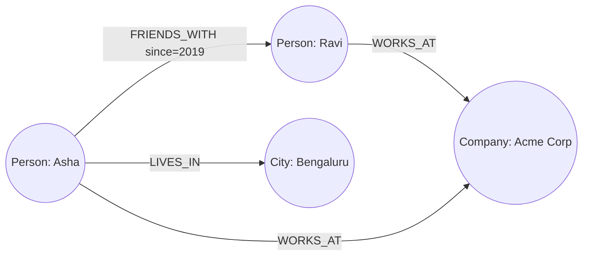
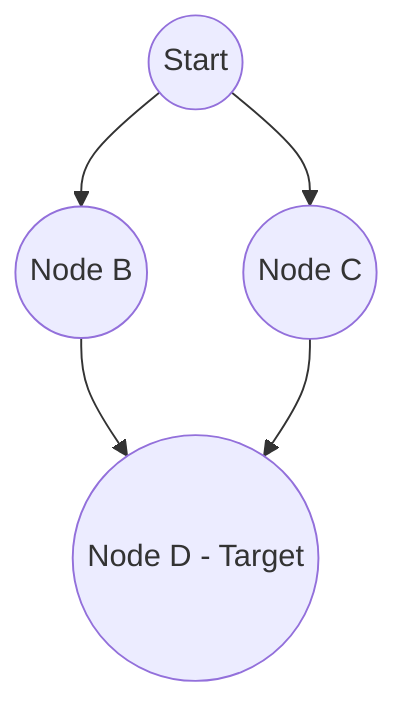
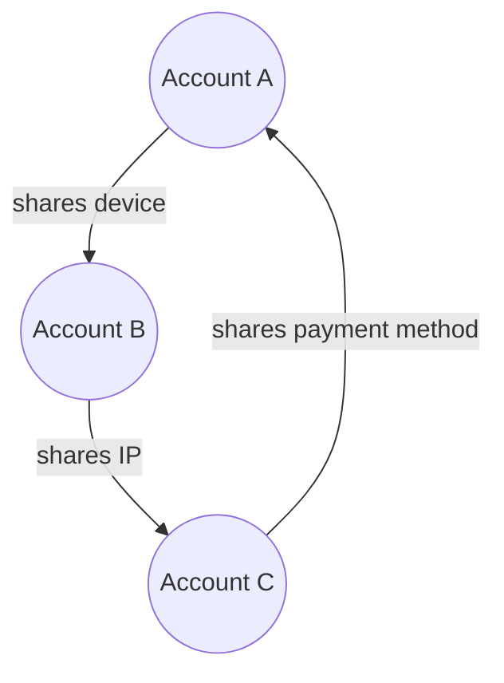

# Module 13 — Graph Databases

> Builds on Module 9's introduction to graph databases as a NoSQL type. Here we go deep on the leading implementation, **Neo4j**, and the algorithms that make graph traversal powerful.

---

## 13.1 Recap: Why Graph Databases?

As covered in Module 9, graph databases model data as **nodes** (entities) and **relationships/edges** (connections), with **index-free adjacency** — relationships are physically stored as direct pointers, so traversing them doesn't require a join/index lookup the way relational databases do.

**Why does this matter enough for a dedicated module?** Certain problems are fundamentally about **relationships and paths**, not isolated records — social networks, fraud rings, recommendation engines, and knowledge graphs. Relational databases model these with foreign keys and joins, but performance degrades sharply as **traversal depth** increases (a "friends of friends of friends" query might require 3+ expensive joins, each potentially scanning large intermediate result sets). Graph databases are purpose-built to make deep traversals fast and natural.

---

## 13.2 Neo4j — The Leading Graph Database

Neo4j is the most widely adopted native graph database, storing data as a **property graph**: nodes and relationships can both have labels/types and arbitrary key-value properties.



### Nodes

Represent entities. Each node can have:
- One or more **labels** (e.g., `Person`, `Company`) — analogous to a "type" or "table."
- **Properties** — key-value pairs (e.g., `name: "Asha"`, `age: 29`).

### Relationships

Represent connections between nodes. Each relationship:
- Has exactly **one type** (e.g., `FRIENDS_WITH`, `WORKS_AT`) and a **direction** (though queries can traverse in either direction).
- Can also carry **properties** (e.g., `since: 2019` on a `FRIENDS_WITH` relationship).

**Key architectural point:** unlike a relational foreign key (which is just a value that must be looked up via an index at query time), a Neo4j relationship is a **physical record on disk** directly linking two node records — traversing it is a direct pointer dereference, not a search.

---

## 13.3 Cypher — Neo4j's Query Language

**What is it?** A declarative query language designed to visually resemble the graph patterns it's querying — using ASCII-art-like syntax: `()` for nodes, `-->` for relationships.

### Basic Query Examples

```cypher
// Find a person named Asha
MATCH (p:Person { name: "Asha" })
RETURN p

// Find Asha's friends
MATCH (p:Person { name: "Asha" })-[:FRIENDS_WITH]->(friend:Person)
RETURN friend.name

// Find friends-of-friends (2-hop traversal) who are not already Asha's friends
MATCH (p:Person { name: "Asha" })-[:FRIENDS_WITH]->()-[:FRIENDS_WITH]->(fof:Person)
WHERE NOT (p)-[:FRIENDS_WITH]->(fof) AND fof <> p
RETURN DISTINCT fof.name

// Create a new node and relationship
CREATE (p:Person { name: "Meera", age: 25 })-[:FRIENDS_WITH { since: 2024 }]->(existing:Person { name: "Asha" })
```

### Why This Query Style Matters for Interviews

The 2-hop "friends of friends" query above would require **two self-joins** in a relational database (joining a `friendships` table to itself twice) — each join potentially scanning large intermediate sets. In Cypher/Neo4j, it's a **direct graph pattern match**, and internally it's executed via **index-free adjacency traversal** (following physical pointers), which stays efficient even as you add more hops — this is the single most important performance distinction to articulate in an interview.

---

## 13.4 Traversal

**What is it?** The process of moving from node to node along relationships to answer a query — the fundamental operation in any graph database.

### Traversal Types

| Type | Description | Use Case |
|---|---|---|
| Breadth-First Search (BFS) | Explore all neighbors at the current depth before going deeper | Shortest path, "friends within 2 hops" |
| Depth-First Search (DFS) | Explore as far as possible along one path before backtracking | Path existence checks, cycle detection |
| Shortest Path | Find the minimum-hop (or minimum-weight) path between two nodes | Recommendation ("how are we connected?"), routing |



**Performance intuition:** Traversal cost in a native graph database scales with the **size of the traversed subgraph** (number of nodes/relationships actually visited), **not** the total size of the entire dataset — this is the key reason deep traversals remain fast even in graphs with billions of nodes, as long as the relevant neighborhood being explored is small.

---

## 13.5 Graph Algorithms

Beyond simple traversal, graph databases (and dedicated graph analytics libraries, e.g., Neo4j's Graph Data Science library) support classic graph algorithms directly on stored data:

| Algorithm | Purpose | Example Use Case |
|---|---|---|
| Shortest Path (Dijkstra/A*) | Find minimum-cost path between two nodes | Navigation, network routing |
| PageRank | Measure node "importance" based on incoming connections | Ranking influential users, web page ranking |
| Community Detection (Louvain, Label Propagation) | Identify clusters of densely connected nodes | Fraud rings, social communities, market segmentation |
| Centrality (Betweenness, Degree, Closeness) | Identify influential/bottleneck nodes | Identifying key influencers, critical infrastructure nodes |
| Connected Components | Find isolated subgraphs (groups with no path between them) | Detecting disconnected clusters, data quality checks |

### Real-World Example: Fraud Ring Detection


Community detection or connected-components analysis on a graph of accounts linked by shared devices/IPs/payment methods can surface **rings** of accounts working together fraudulently — a pattern that's extremely difficult to spot with relational joins/aggregations, but a natural fit for graph traversal and community-detection algorithms.

---

## 13.6 Use Cases

| Use Case | Why Graph Databases Fit |
|---|---|
| Social networks | Relationships (follows, friends, likes) are the core data, not an afterthought |
| Recommendation engines | "Customers who bought X also bought Y" is naturally a graph traversal (shared purchase/interest patterns) |
| Fraud detection | Fraud rings are literally connected subgraphs hidden in transaction/account data |
| Knowledge graphs | Entities and their relationships (e.g., "Person born in City, City located in Country") are naturally graph-shaped |
| Network/IT infrastructure mapping | Servers, dependencies, and network topology are graphs by nature |
| Identity and access management | "Which roles/permissions does this user inherit through group memberships?" is a traversal problem |

---

## 13.7 Comparison: Graph Database vs Relational (Recap + Depth)

| Aspect | Relational Database | Graph Database |
|---|---|---|
| Relationship storage | Foreign keys, resolved via index lookup + join at query time | Physical pointers, resolved via direct traversal (index-free adjacency) |
| Deep multi-hop queries | Slow (multiple joins, worse as hops increase) | Fast (traversal cost scales with subgraph size, not total data size) |
| Schema flexibility | Rigid, requires migration for new relationship types | Flexible — new relationship types/labels can be added without migration |
| Aggregate/tabular analytics (e.g., "total sales this month") | Excellent (this is what SQL/relational engines are optimized for) | Weaker — not the natural strength of the model |
| Sharding across nodes | Well-established (Module 4) | Notoriously difficult — relationships can span arbitrary parts of the graph, making clean partitioning hard |

**Important interview nuance:** Graph databases are **not** a universal replacement for relational databases — they excel specifically at relationship-heavy, traversal-centric queries, but are a poor fit for bulk aggregate reporting, which relational (or column-family/analytical) databases handle far better.

---

## 13.8 Failure Scenarios and Challenges

| Scenario | Impact | Mitigation |
|---|---|---|
| Extremely high-degree "super nodes" (e.g., a celebrity with millions of followers) | Traversals touching that node become slow (must examine millions of relationships) | Special-case handling, pagination of relationship traversal, or denormalized precomputed aggregates for known super-nodes |
| Attempting to shard a graph across machines | Relationships spanning shard boundaries require cross-node traversal (expensive, similar to Module 4's cross-shard query problem, but harder since relationships are unpredictable in direction) | Many graph databases (including Neo4j Community/early Enterprise editions) historically ran as a single powerful machine rather than sharding; modern solutions use careful graph-partitioning algorithms or accept some cross-partition traversal cost |
| Complex analytical/aggregate queries forced onto a graph database | Poor performance compared to purpose-built analytical engines | Use a graph database for traversal-heavy queries, and a separate analytical/column-family store for aggregate reporting (polyglot persistence, Module 9) |

---

## 13.9 Interview Questions — Module 13

### Beginner
1. What are the two core building blocks of a property graph model?
2. What does "index-free adjacency" mean, and why does it make traversals fast?
3. Name two real-world use cases naturally suited to graph databases.

### Intermediate
4. Why is a "friends of friends" query expensive in a relational database but efficient in a graph database?
5. What is community detection, and how is it used in fraud detection?
6. Why is sharding a graph database across multiple nodes considered a hard problem, compared to sharding a relational or document database?

### Senior SDE-2/SDE-3
7. Design a recommendation engine using a graph database for an e-commerce platform. Walk through the graph schema (nodes, relationship types) and a sample Cypher-style traversal query.
8. A social network's "mutual friends" feature is slow for a small number of extremely high-degree accounts (celebrities). Diagnose the "super node" problem and propose a mitigation.
9. A team wants to replace their relational reporting database entirely with a graph database "because relationships are important everywhere." Critique this decision and propose a polyglot alternative.

### GATE-style / MCQ
10. In a property graph model, what can carry properties (key-value pairs)?
    a) Only nodes
    b) Only relationships
    c) Both nodes and relationships
    d) Neither — properties are stored separately
    *(Answer: c)*

11. Which graph algorithm is best suited for detecting clusters of tightly connected accounts, useful in fraud detection?
    a) Shortest path
    b) PageRank
    c) Community detection
    d) Breadth-first search
    *(Answer: c)*

---

## 13.10 Exercises

**Beginner**
- Model a simple "Person FOLLOWS Person" and "Person LIKES Post" graph schema, and write a Cypher query to find all posts liked by people that a given user follows.

**Intermediate**
- Write a Cypher query to find the shortest path between two people in a social graph, and explain what algorithm Neo4j likely uses internally.

**Advanced / Production Scenario**
- Your fraud detection graph has a few "super nodes" (shared shipping addresses used by thousands of legitimate customers, e.g., a large office building) that create false-positive fraud ring signals. Propose a way to exclude or de-weight such nodes in your community-detection analysis.

**Whiteboard Interview Problem**
- "Design the graph schema and query strategy for a professional networking site's 'people you may know' feature, using mutual connections, shared employers, and shared education as signals."

**Case Study**
- Research how LinkedIn's "People You May Know" or similar large-scale graph-based recommendation systems are architected (public engineering blog posts), and summarize their approach to scaling graph traversal.

---

## 13.11 Practice Resources

- Neo4j Documentation — Getting Started: https://neo4j.com/docs/getting-started/
- Neo4j Documentation — Cypher Manual: https://neo4j.com/docs/cypher-manual/current/
- Neo4j Graph Data Science Library Docs: https://neo4j.com/docs/graph-data-science/current/
- Amazon Neptune Documentation: https://docs.aws.amazon.com/neptune/

---

## 13.12 Cheat Sheet — Module 13

- **Graph database**: nodes + relationships, both can have labels/types and properties (property graph model).
- **Index-free adjacency**: relationships are physically stored as direct pointers, making traversal cost scale with subgraph size, not total dataset size.
- **Cypher**: Neo4j's declarative, pattern-matching query language — visually mirrors the graph shape being queried.
- **Traversal types**: BFS (shortest path, level-by-level), DFS (path existence, backtracking).
- **Graph algorithms**: shortest path, PageRank (importance), community detection (clusters/fraud rings), centrality (influence/bottlenecks).
- **Best use cases**: social networks, recommendations, fraud detection, knowledge graphs, IAM/permission inheritance.
- **Weaknesses**: bulk aggregate/analytical queries, sharding across nodes (relationships can span shard boundaries unpredictably), "super node" traversal performance.
- Graph databases are a **complement** to relational/column-family databases in a polyglot architecture (Module 9), not a universal replacement.

---

**End of Module 13.**

Reply with "continue" or "next module" to proceed to **Module 14: Cloud Databases**.
