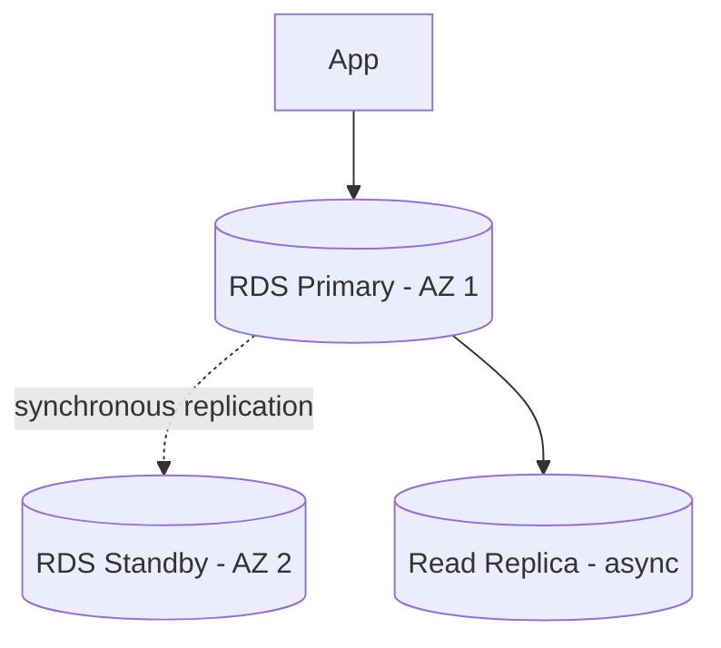
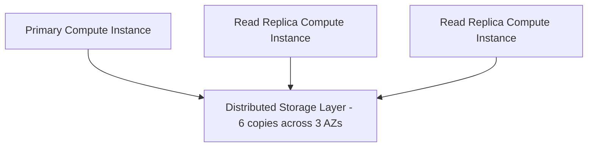
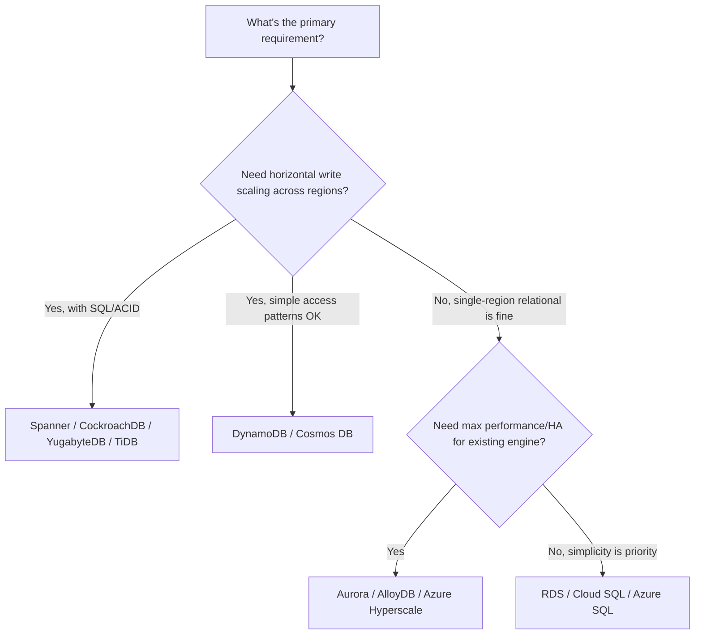

# Module 14 — Cloud Databases

> Builds on everything so far — cloud databases are where replication (Module 3), sharding (Module 4), consensus (Module 8), CAP/PACELC (Modules 6-7), and NoSQL models (Module 9) get packaged into managed, production-grade services.

---

## 14.1 Why Cloud Databases?

**What problem do they solve?** Running a distributed database yourself means managing replication, failover, backups, patching, monitoring, and scaling — all the operational complexity discussed throughout Modules 1–13. Cloud databases are **managed services** that handle this operational burden, letting teams focus on their application rather than database infrastructure.

**Why it matters for interviews:** Modern system design interviews increasingly assume you'll use (or at least discuss) a managed cloud database rather than "roll your own" cluster — you're expected to know the tradeoffs between different managed offerings, not just the underlying theory.

---

## 14.2 Amazon RDS (Relational Database Service)

**What is it?** A managed service for running traditional relational engines (PostgreSQL, MySQL, MariaDB, Oracle, SQL Server) with automated backups, patching, and **Multi-AZ** failover.

### Architecture

- **Multi-AZ deployment**: a synchronously replicated standby in a different Availability Zone — this is essentially Module 3's "synchronous single-leader replication" as a managed feature, providing automatic failover (Module 3's failover concept, fully automated).
- **Read replicas**: asynchronous, for read scaling (Module 3) — can even be cross-region.

### Tradeoffs
- **Pros:** Fully managed patching/backups; familiar relational engines; good for lift-and-shift migrations.
- **Cons:** Still fundamentally a **single-writer, vertically-scaled** architecture under the hood — write scaling requires sharding at the application layer (RDS doesn't do this for you), unlike the NewSQL systems in Section 14.9.

---

## 14.3 Amazon Aurora

**What is it?** AWS's cloud-native relational database, **compatible with MySQL and PostgreSQL wire protocols**, but with a fundamentally re-architected storage layer.

### Architecture — Decoupled Compute and Storage

- Unlike traditional single-node RDBMS (where compute and local disk are tightly coupled), Aurora **separates compute from storage**: the storage layer is itself a distributed, self-healing system that keeps **6 copies of data across 3 Availability Zones**, and only requires **4 out of 6** copies to acknowledge a write (a quorum, Module 8's majority concept — though tuned for a specific 6-copy/3-AZ topology rather than a simple majority-of-N).
- The database engine only ships the **redo log (WAL, from earlier modules)** to the storage layer — not full data pages — dramatically reducing network traffic compared to traditional replication.
- This is a concrete real-world example of Module 1's **Shared Disk / Hybrid architecture**: compute nodes are effectively "shared nothing" relative to each other, but they all share a common, separately-scaled, replicated storage layer.

### Tradeoffs
- **Pros:** Much better performance and availability than plain RDS for the same relational engines; fast failover (new replica promoted in seconds, since it doesn't need to re-fetch all data — it already shares the storage layer); read replicas share storage with the primary (near-zero replication lag for reads compared to traditional physical replication).
- **Cons:** Still fundamentally single-writer per cluster (like RDS) — true multi-region *active-active* writes aren't natively supported the way NewSQL systems provide (Aurora Global Database supports cross-region read replicas and fast promotion, but not simultaneous multi-region writes to the same table).

---

## 14.4 Amazon DynamoDB

**What is it?** AWS's fully managed, serverless **key-value/document NoSQL database** (Module 9), directly descended from the original Dynamo paper's leaderless replication design (Module 3).

### Architecture
- Data is automatically **partitioned** (Module 4) based on the partition key, using consistent hashing internally.
- Each partition is replicated across multiple Availability Zones.
- Supports both **eventually consistent reads** (default, lower latency/cost) and **strongly consistent reads** (opt-in, higher latency/cost) — a direct, user-facing exposure of the CAP/PACELC tradeoff (Modules 6-7).
- **On-demand or provisioned capacity modes** — auto-scales throughput, or you pre-provision read/write capacity units.

### Tradeoffs
- **Pros:** Virtually unlimited horizontal scale with no manual sharding; extremely low, predictable latency; fully serverless (no instances to manage).
- **Cons:** Limited query flexibility (no arbitrary joins/ad-hoc queries — access patterns must be designed around the partition/sort key upfront, similar to Cassandra's data modeling philosophy, Module 12); can become expensive for read/write-heavy workloads at scale if access patterns aren't optimized.

---

## 14.5 Google Cloud SQL

**What is it?** Google Cloud's managed relational database service (MySQL, PostgreSQL, SQL Server) — conceptually similar to Amazon RDS: managed patching, backups, and **high-availability configuration** using a standby replica in another zone.

### Tradeoffs
- **Pros:** Simple, familiar relational engines with minimal operational overhead; good for moderate-scale applications not requiring global distributed-SQL capabilities.
- **Cons:** Same fundamental single-writer scaling ceiling as RDS — for true horizontal write scaling or global distribution, Google recommends **Spanner** (Section 14.7) or **AlloyDB** (below) instead.

---

## 14.6 AlloyDB

**What is it?** Google Cloud's PostgreSQL-compatible database, positioned as a higher-performance alternative to Cloud SQL for PostgreSQL — architecturally similar in spirit to Amazon Aurora (disaggregated storage layer, intelligent caching tier).

### Architecture Highlights
- Separates compute from a **distributed, log-based storage layer** (similar philosophy to Aurora's redo-log shipping).
- Includes a specialized **columnar accelerator** for analytical queries (transparently speeds up analytical/aggregate queries on the same transactional data, blending OLTP and OLAP-style performance).

### Tradeoffs
- **Pros:** Significant performance improvement over stock PostgreSQL/Cloud SQL for both transactional and analytical workloads; full PostgreSQL compatibility (extensions, tooling).
- **Cons:** Still primarily single-region-writer oriented (similar to Aurora) rather than a globally-distributed multi-write architecture like Spanner.

---

## 14.7 Google Cloud Spanner

**What is it?** Google's globally distributed, strongly consistent **NewSQL** database (Section 14.9/Module 15 preview) — the system that essentially proved you *can* get horizontal scalability, SQL, ACID transactions, and strong global consistency simultaneously, using a novel time-synchronization approach.

### Architecture Highlights (Preview of Module 15)
- Data is automatically sharded into "splits," each replicated (typically via a **Paxos-based** consensus group, Module 8) across multiple zones/regions.
- Uses **TrueTime**, a globally synchronized clock API (backed by atomic clocks and GPS receivers in Google's data centers) with a bounded uncertainty interval, to assign globally consistent transaction timestamps **without needing a round-trip consensus check for every ordering decision**.
- Provides full **external consistency** (a strong form of consistency, stronger than typical linearizability guarantees in most distributed databases) across the entire globally distributed system.

### Tradeoffs
- **Pros:** True global ACID transactions with strong consistency, horizontal scalability, and SQL support simultaneously — a rare combination (this is precisely why Spanner is a landmark system, and a frequent case study in senior distributed systems interviews).
- **Cons:** Higher write latency for cross-region transactions (must wait out TrueTime's uncertainty window and achieve Paxos consensus across replicas, Module 8); more expensive and complex than simpler managed relational offerings; classified as **PC/EC** (Modules 6-7) — prioritizes consistency over minimizing latency/availability during partitions.

---

## 14.8 Azure Cosmos DB

**What is it?** Microsoft Azure's globally distributed, **multi-model** database — supports key-value, document, column-family, and graph APIs on top of a single underlying distributed engine, with a distinctive feature: **five selectable consistency levels**.

### The Five Consistency Levels (A Direct, Explicit Spectrum Along Modules 6-7's Tradeoff)

| Level | Guarantee | PACELC Lean |
|---|---|---|
| Strong | Linearizable — always the latest write | EC (highest latency) |
| Bounded Staleness | Reads lag writes by at most a configurable time/version bound | EC-leaning |
| Session | Consistent within a single client's session (read-your-writes) | Balanced |
| Consistent Prefix | Reads never see out-of-order writes (but may be stale) | EL-leaning |
| Eventual | No ordering guarantee at all, fastest | EL (lowest latency) |

**Why this matters for interviews:** Cosmos DB makes the PACELC spectrum (Module 7) **explicit and selectable** as a first-class product feature — a great concrete example to cite when discussing how theoretical tradeoffs manifest in real cloud offerings.

### Architecture Highlights
- Automatic global replication across any number of configured Azure regions.
- Automatic partitioning (sharding, Module 4) based on a chosen partition key.
- Multi-region **active-active writes** supported (with configurable conflict resolution, similar in spirit to Module 3's multi-leader replication).

### Tradeoffs
- **Pros:** Extremely flexible (multi-model, tunable consistency, active-active multi-region); good SLAs on latency and availability.
- **Cons:** Cost can scale significantly with throughput/storage; the flexibility (many APIs, many consistency levels) adds a real design-decision burden compared to more opinionated systems.

---

## 14.9 Azure SQL Database

**What is it?** Microsoft's managed relational database service (SQL Server-compatible) — analogous to RDS/Cloud SQL, with managed high availability, automated backups, and **Hyperscale** tier for very large databases using a similarly disaggregated storage architecture to Aurora/AlloyDB.

### Tradeoffs
- **Pros:** Deep integration with the Microsoft ecosystem; strong tooling; Hyperscale tier removes traditional storage size limits.
- **Cons:** Like RDS/Cloud SQL, fundamentally single-writer per database for standard tiers — true horizontal write scaling still requires the Hyperscale/distributed tiers or application-level sharding.

---

## 14.10 PlanetScale

**What is it?** A managed database service built on **Vitess** (the MySQL-sharding middleware originally built at YouTube, mentioned in Module 2/4) — providing MySQL compatibility with built-in horizontal sharding, non-blocking schema changes, and branching/deployment workflows inspired by software version control.

### Architecture Highlights
- Vitess sits in front of sharded MySQL instances, providing **fragmentation/location transparency** (Module 2) to applications — queries look like they're hitting a single MySQL database, but are transparently routed to the correct shard.
- **Online schema changes** without locking tables — a major operational pain point in traditional sharded MySQL deployments.
- "Database branching" — create a copy-on-write branch of your schema for testing changes safely, then merge (a distinctive developer-experience feature, less about distributed systems theory and more about workflow).

### Tradeoffs
- **Pros:** Familiar MySQL compatibility with real horizontal scaling; excellent developer experience for schema evolution.
- **Cons:** Sharding still requires choosing a good shard key (Module 4) upfront; cross-shard queries/transactions carry the same fundamental costs discussed in Modules 4-5.

---

## 14.11 NewSQL Cloud Databases: CockroachDB, YugabyteDB, TiDB (Preview of Module 15)

These three are grouped here because they share a common goal — **horizontally scalable SQL with strong consistency, "born distributed"** — and will be covered in full depth in **Module 15: NewSQL**. Brief architectural previews:

| System | Consensus Protocol | Key Distinctive Feature |
|---|---|---|
| CockroachDB | Raft (Module 8) per data range | Inspired directly by the Spanner paper; automatic range-based sharding and rebalancing; geo-partitioning support |
| YugabyteDB | Raft per tablet | PostgreSQL-compatible query layer on top of a distributed storage layer (DocDB), plus a separate Cassandra-compatible API |
| TiDB | Raft (via the underlying TiKV storage engine) | Separates SQL layer (TiDB) from storage layer (TiKV), plus a dedicated analytical engine (TiFlash) for hybrid transactional/analytical workloads (HTAP) |

**Why grouped separately in Module 15:** These deserve dedicated depth on TrueTime-like mechanisms, distributed SQL query planning, and range-splitting internals — treated fully in the next module.

---

## 14.12 Comparison Table — Cloud Database Landscape

| System | Model | Write Scaling | Consistency | Best For |
|---|---|---|---|---|
| Amazon RDS | Relational | Vertical only (single writer) | Strong (ACID) | Lift-and-shift, moderate scale |
| Amazon Aurora | Relational (disaggregated storage) | Vertical (single writer, fast failover) | Strong (ACID) | High-performance single-region relational workloads |
| Amazon DynamoDB | Key-Value/Document | Horizontal (auto-sharded) | Tunable (eventual or strong per-read) | Massive scale, simple access patterns |
| Google Cloud SQL | Relational | Vertical only | Strong (ACID) | Moderate-scale relational workloads |
| Google AlloyDB | Relational (disaggregated + columnar accelerator) | Vertical (single writer) | Strong (ACID) | High-performance PostgreSQL, mixed OLTP/OLAP |
| Google Spanner | NewSQL (globally distributed) | Horizontal | Strong, globally (external consistency) | Global-scale ACID transactions |
| Azure Cosmos DB | Multi-model | Horizontal (auto-sharded) | Tunable (5 levels) | Flexible global apps, multi-region active-active |
| Azure SQL Database | Relational | Vertical (Hyperscale adds disaggregated storage) | Strong (ACID) | Microsoft ecosystem relational workloads |
| PlanetScale | Relational (Vitess-sharded MySQL) | Horizontal (via sharding) | Strong (ACID, within shard) | MySQL-compatible horizontal scale with good DX |
| CockroachDB / YugabyteDB / TiDB | NewSQL | Horizontal | Strong (ACID), distributed | Global-scale SQL with born-distributed architecture |

---

## 14.13 Decision Framework for Choosing a Cloud Database

---

## 14.14 Failure Scenarios and Operational Considerations

| Scenario | RDS/Cloud SQL/Azure SQL | Aurora/AlloyDB | DynamoDB/Cosmos DB | Spanner/NewSQL |
|---|---|---|---|---|
| Primary AZ failure | Automated failover to standby (Multi-AZ), brief downtime | Fast failover (shared storage layer, seconds) | No concept of "primary" at this level — auto-handles via partition replication | Automatic, since consensus-replicated ranges tolerate a minority failure (Module 8) |
| Sudden traffic spike | May need manual instance resize | May need manual instance resize (though storage auto-scales) | Auto-scales (on-demand mode) | Auto-scales (add nodes/ranges) |
| Cross-region disaster recovery | Manual setup (cross-region read replica + manual promotion) | Aurora Global Database (fast cross-region promotion) | Native global tables (multi-region) | Native (data is already globally distributed) |

---

## 14.15 Interview Questions — Module 14

### Beginner
1. What is the main difference between Amazon RDS and Amazon Aurora's storage architecture?
2. Why is DynamoDB considered horizontally scalable "by default," unlike RDS?
3. Name the five Cosmos DB consistency levels in order from strongest to weakest.

### Intermediate
4. Explain how Aurora's separation of compute and storage improves failover speed compared to traditional physical replication (RDS Multi-AZ).
5. How does Google Spanner use TrueTime to achieve global consistency without a full consensus round-trip for every ordering decision?
6. Why would a team choose PlanetScale over plain Amazon RDS for a MySQL-compatible application expecting rapid growth?

### Senior SDE-2/SDE-3
7. Design the cloud database architecture for a global social media app requiring both a strongly consistent user-account/auth system and a highly available, low-latency activity feed. Which specific managed services would you choose for each, and why?
8. Compare Google Spanner and Amazon Aurora at an architectural level. Why can Spanner support multi-region active-active writes with strong consistency while Aurora (in standard configuration) cannot?
9. A startup is choosing between DynamoDB and Cosmos DB for a globally distributed e-commerce catalog with occasional complex queries. Walk through the tradeoffs and make a recommendation.

### GATE-style / MCQ
10. Which AWS service separates compute from a distributed, self-healing storage layer while remaining MySQL/PostgreSQL-compatible?
    a) Amazon RDS
    b) Amazon Aurora
    c) Amazon DynamoDB
    d) Amazon Redshift
    *(Answer: b)*

11. Which technology does Google Spanner use to assign globally consistent transaction timestamps?
    a) Vector clocks
    b) TrueTime
    c) Lamport timestamps only
    d) NTP alone
    *(Answer: b)*

---

## 14.16 Exercises

**Beginner**
- List three managed cloud databases that offer tunable/adjustable consistency levels, and name the specific setting for each.

**Intermediate**
- Given a workload needing MySQL compatibility and expecting to outgrow a single writer within a year, compare Amazon Aurora vs PlanetScale as migration targets.

**Advanced / Production Scenario**
- Your global e-commerce app currently uses DynamoDB with eventually consistent reads, and customers occasionally see incorrect "in stock" status leading to overselling. Propose a targeted fix using DynamoDB's tunable consistency, referencing Modules 6-7.

**Whiteboard Interview Problem**
- "Design the database architecture for a ride-sharing platform operating in 30 countries, addressing driver location updates (high-frequency, latency-sensitive), trip/payment records (strong consistency needed), and analytics/reporting (aggregate queries)."

**Case Study**
- Research a public engineering blog post from a company that migrated from a self-managed sharded MySQL setup to a NewSQL cloud database (e.g., CockroachDB or Spanner case studies), and summarize their stated motivations and tradeoffs.

---

## 14.17 Practice Resources

- Amazon Aurora Documentation — Architecture: https://docs.aws.amazon.com/AmazonRDS/latest/AuroraUserGuide/Aurora.Overview.html
- Amazon DynamoDB Developer Guide: https://docs.aws.amazon.com/amazondynamodb/latest/developerguide/Introduction.html
- Google Cloud Spanner Documentation & Whitepapers: https://cloud.google.com/spanner/docs/whitepapers
- Google Cloud AlloyDB Documentation: https://cloud.google.com/alloydb/docs
- Azure Cosmos DB Documentation — Consistency Levels: https://learn.microsoft.com/en-us/azure/cosmos-db/consistency-levels
- PlanetScale Documentation: https://planetscale.com/docs

---

## 14.18 Cheat Sheet — Module 14

- **RDS/Cloud SQL/Azure SQL**: managed traditional relational engines, single-writer, Multi-AZ for HA — good for moderate scale.
- **Aurora/AlloyDB/Azure Hyperscale**: disaggregated compute + distributed storage layer (shared redo log shipping) — faster failover, better performance, still single-writer per cluster.
- **DynamoDB**: serverless, auto-sharded key-value/document store, tunable eventual/strong consistency per read.
- **Cosmos DB**: multi-model, 5 explicit tunable consistency levels, native multi-region active-active writes.
- **Google Spanner**: globally distributed NewSQL, TrueTime for global consistency without full consensus round-trips per operation, true global ACID transactions.
- **PlanetScale**: Vitess-based sharded MySQL with online schema changes and branching workflows.
- **CockroachDB/YugabyteDB/TiDB**: "born distributed" NewSQL systems, covered fully in Module 15.
- General pattern: **traditional managed relational = vertical scaling with HA; key-value/document cloud stores = horizontal scaling with tunable consistency; NewSQL = horizontal scaling + strong consistency + SQL, at higher latency/complexity cost.**

---

**End of Module 14.**

Reply with "continue" or "next module" to proceed to **Module 15: NewSQL**.
