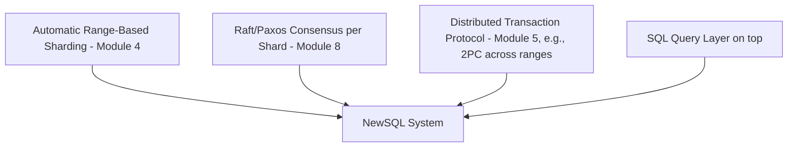
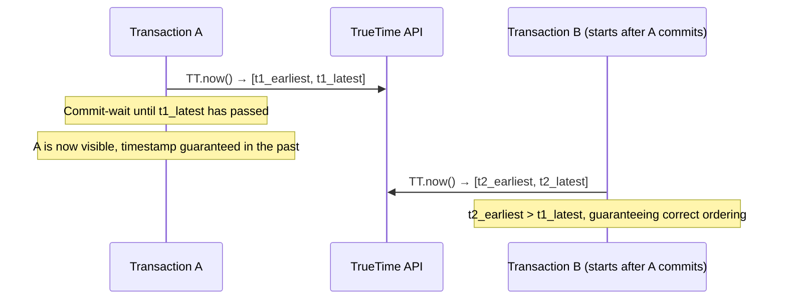
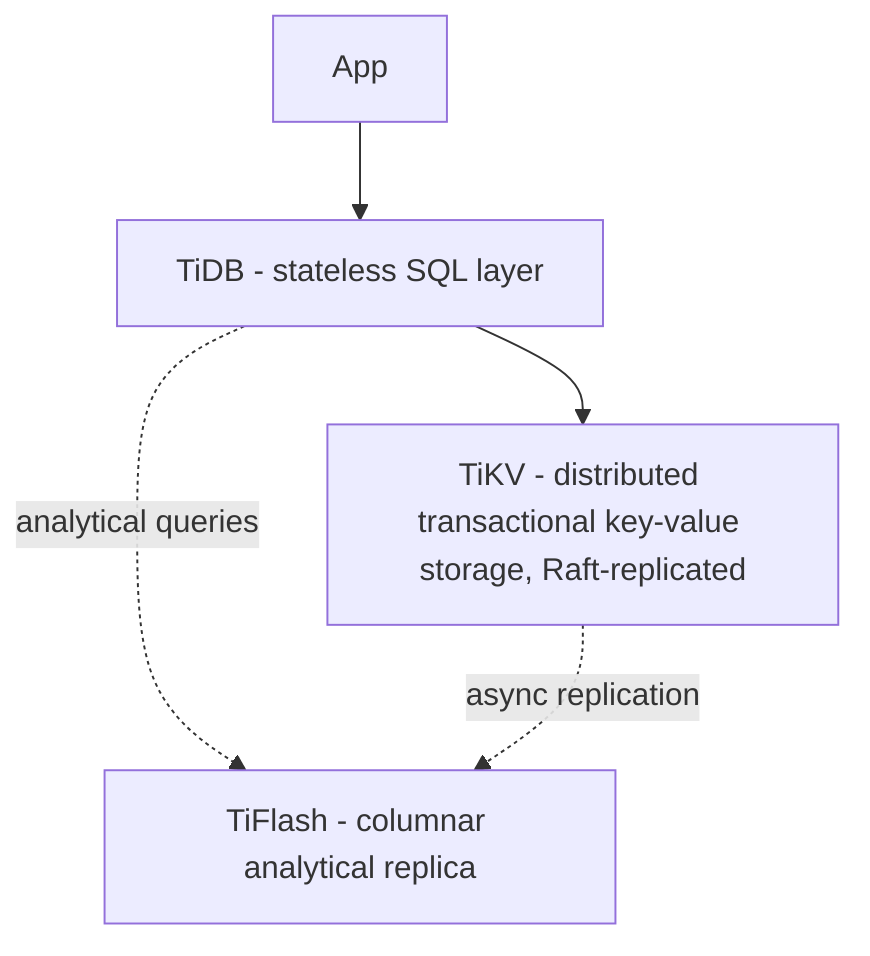
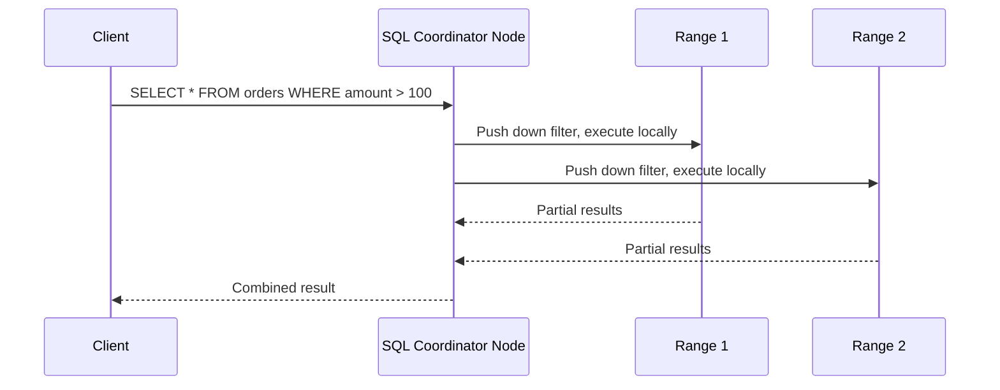
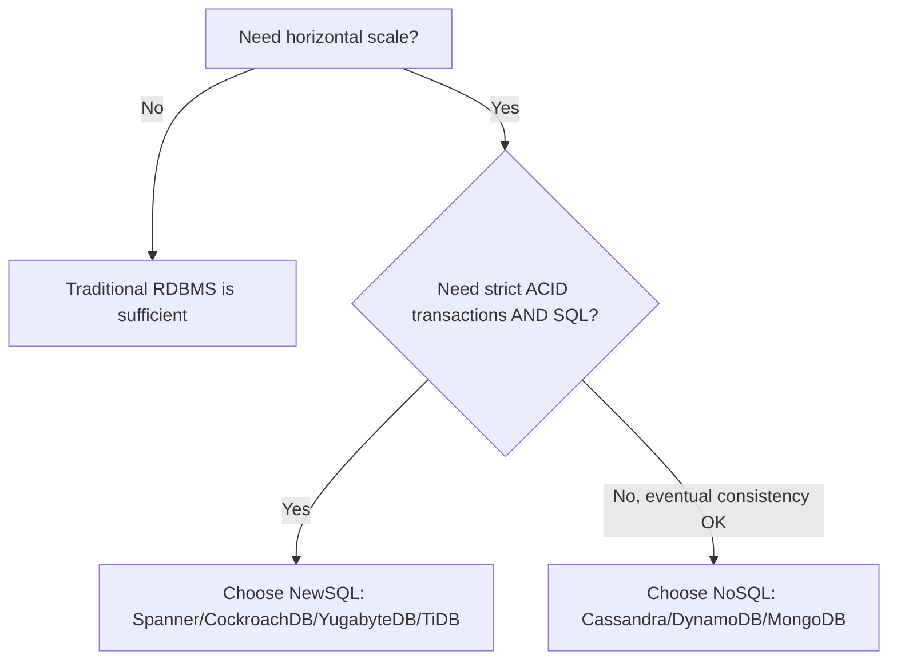

# Module 15 — NewSQL

> Builds on nearly every prior module — NewSQL is the synthesis of Sharding (4), Distributed Transactions (5), CAP/PACELC (6-7), and Consensus (8), applied to give back the SQL/ACID guarantees that early NoSQL systems (Module 9) deliberately gave up.

---

## 15.1 What Is NewSQL?

**What is it?** NewSQL is a class of database systems that aim to provide the **horizontal scalability of NoSQL systems** together with the **strong consistency, ACID transactions, and SQL query interface of traditional relational databases** — "born distributed" from the ground up, rather than a single-node RDBMS with sharding bolted on afterward (like Vitess/PlanetScale from Module 14), and rather than a NoSQL system that sacrifices SQL/strong consistency for scale (like Cassandra/DynamoDB).

## 15.2 Why NewSQL?

Recall the historical arc from Module 1 and Module 9: relational databases gave strong consistency but struggled to scale horizontally; NoSQL databases scaled horizontally but sacrificed SQL joins, strong consistency, or both. By the 2010s, many organizations found themselves wanting **both** — e.g., a global bank needs ACID transactions (can't lose or double-count money) **and** the ability to scale horizontally across data centers worldwide. NewSQL systems emerged specifically to fill this gap.

**Analogy:** If NoSQL databases are like specialized delivery vehicles (motorcycles — fast, agile, but limited cargo and rules), and traditional RDBMS are like a single large, reliable freight train (huge capacity, strict rules, but fixed track and limited flexibility), NewSQL is like a fleet of freight trucks that can be added on demand across many highways (horizontal scale) while still each following the same strict traffic laws (ACID/SQL) as the original train.

---

## 15.3 The Core Architectural Recipe

Nearly every NewSQL system combines the same set of building blocks covered in earlier modules:

1. **Data is automatically split into small ranges/tablets** (Module 4's range sharding, but managed transparently by the system, not manually chosen by the application).
2. **Each range is replicated via a consensus protocol** (Raft or Paxos, Module 8) — typically 3 or 5 replicas, tolerating 1 or 2 failures.
3. **Transactions spanning multiple ranges use a distributed commit protocol** (2PC-style, Module 5), often layered on top of the per-range consensus groups.
4. **A SQL query layer** sits on top, parsing and planning queries, deciding which ranges to touch, and coordinating distributed execution — directly analogous to earlier Query Optimization module concepts, but now distributed across the cluster.

---

## 15.4 Google Spanner (Deep Dive)

Introduced briefly in Module 14 — here we go deeper into the mechanism that makes it special.

### The Problem Spanner Solves

In a globally distributed system, if you want to know "did transaction A happen before transaction B?", you normally need some form of communication/consensus between nodes to establish ordering (since clocks on different machines can't be perfectly synchronized — recall Module 1's "clocks are unreliable" challenge). This ordering step usually adds latency to every transaction.

### TrueTime

**What is it?** A globally available clock API, `TT.now()`, that doesn't return a single timestamp but an **interval** `[earliest, latest]`, guaranteed to contain the true current time — backed by GPS receivers and atomic clocks distributed across Google's data centers, bounding the maximum clock uncertainty (typically just a few milliseconds).

### Step-by-Step: Commit-Wait

1. When Spanner commits a transaction, it assigns it a timestamp `t` using `TT.now()`.
2. Critically, Spanner **waits** until it's certain that `t` has definitely passed in real time — i.e., it waits out the uncertainty interval (`commit-wait`) before allowing the transaction's effects to become visible to other transactions.
3. This guarantees that if transaction B starts **after** transaction A commits (in real, external time), B is guaranteed to be assigned a **later** timestamp — giving Spanner **external consistency**: transaction ordering matches real-world (wall-clock) causality, globally, without needing every transaction to run a global consensus round just to determine ordering.

**Mathematical intuition:** the size of the uncertainty interval directly determines the commit-wait latency cost — the tighter the clock synchronization (achieved via Google's specialized hardware), the smaller this "tax" on every transaction. This is precisely why Spanner requires specialized infrastructure (atomic clocks/GPS) that's hard to replicate outside Google's own data centers — a point often raised when comparing Spanner to open-source alternatives (Section 15.5).

### Spanner's Replication and Sharding

- Data is divided into **splits** (Module 4's range sharding, automated).
- Each split is replicated across multiple zones/regions using **Paxos** (Module 8).
- Cross-split transactions use a **two-phase commit** (Module 5) coordinated across the relevant Paxos groups.

---

## 15.5 CockroachDB

**What is it?** An open-source, PostgreSQL-wire-compatible distributed SQL database explicitly inspired by the Spanner paper, designed to achieve similar guarantees **without requiring specialized atomic-clock hardware**.

### Key Architectural Choices

- Uses **Raft** (Module 8), not Paxos, for per-range replication — chosen for the same understandability reasons discussed in Module 8.
- Since CockroachDB can't rely on Spanner's tightly-bounded TrueTime, it uses **hybrid logical clocks (HLC)** — a combination of physical clock time and a logical counter — to order events, combined with an **uncertainty interval** approach similar in spirit to TrueTime but with looser bounds (since commodity NTP-synchronized clocks have more drift than Google's specialized infrastructure). This can mean slightly more conservative waiting/retry behavior on transactions that fall within the uncertainty window, but does not require special hardware.
- Automatic **range splitting and rebalancing** as data grows — directly implementing Module 4's online resharding concepts as a fully automated background process.
- Supports **geo-partitioning**: pinning specific ranges (e.g., data for EU customers) to nodes in specific geographic regions, for both latency and regulatory (data residency) reasons — directly applying Module 2's allocation transparency concepts.

### Tradeoffs
- **Pros:** Open-source, runs on commodity infrastructure/any cloud, PostgreSQL compatibility (easier migration), strong consistency with horizontal scale.
- **Cons:** Cross-range transactions still carry higher latency than single-node transactions (fundamental cost of distributed consensus + 2PC, Modules 5/8); write latency for geographically distant ranges is bounded by network round-trip physics, same as any distributed consensus system.

---

## 15.6 YugabyteDB

**What is it?** An open-source distributed SQL database with **two query API layers** on top of a shared distributed storage engine (called **DocDB**, itself built on a modified RocksDB, an LSM-tree storage engine referenced in earlier Storage Engine modules):
- **YSQL** — PostgreSQL-compatible relational API.
- **YCQL** — Cassandra Query Language-compatible API (for teams migrating from Cassandra, Module 12, but wanting stronger consistency).

### Architecture Highlights
- Data is split into **tablets** (Module 4's range/hash sharding), each replicated via **Raft** (Module 8).
- Because both YSQL and YCQL sit on the same underlying DocDB storage/replication layer, YugabyteDB effectively lets teams choose their query interface without changing the underlying distributed guarantees.

### Tradeoffs
- **Pros:** Flexibility of two query APIs on one engine; strong PostgreSQL compatibility; good for teams migrating from either relational or Cassandra-style backgrounds.
- **Cons:** Newer/smaller community than CockroachDB or established cloud offerings; same fundamental cross-tablet transaction latency costs as any Raft+2PC-based NewSQL system.

---

## 15.7 TiDB

**What is it?** An open-source distributed SQL database that explicitly **separates the SQL layer from the storage layer**, with a third, optional layer for analytics — designed for **HTAP** (Hybrid Transactional/Analytical Processing) workloads.

### Architecture — Three Layers

- **TiDB (SQL layer)**: stateless, horizontally scalable query processing/planning nodes — you can add more TiDB nodes purely to handle more concurrent queries, without touching the storage layer.
- **TiKV (storage layer)**: a distributed, Raft-replicated (Module 8) transactional key-value store — the source of truth, row-oriented storage optimized for OLTP.
- **TiFlash (analytical layer, optional)**: a **columnar** replica of the data (asynchronously kept in sync with TiKV), allowing analytical/aggregate queries (the kind relational databases traditionally excel at, per Module 9's comparison table) to run efficiently **on the same live transactional data**, without needing a separate ETL pipeline into a data warehouse.

### Why HTAP Matters

Traditionally, companies run **OLTP** (transactional, e.g., processing an order) on one database and **OLAP** (analytical, e.g., "total revenue by region this quarter") on a separate data warehouse, requiring an ETL pipeline to move data between them (introducing latency and operational complexity). TiDB's TiFlash layer lets analytical queries run directly and efficiently against near-real-time transactional data, closing that gap.

### Tradeoffs
- **Pros:** Clean separation of concerns (scale SQL processing and storage independently); built-in HTAP capability avoids separate analytical infrastructure for many use cases.
- **Cons:** Operationally more complex (three distinct layers to run/monitor); TiFlash adds resource overhead if analytical workloads are heavy.

---

## 15.8 Distributed SQL — What Makes Query Processing Different

Recall earlier Query Optimization modules: a single-node optimizer decides join order, index usage, and access paths. A **distributed SQL** query planner must additionally decide:

1. **Which ranges/shards contain the relevant rows** (similar to Module 2's fragmentation transparency).
2. **Where to execute each part of the query** — should a join be executed by pulling all data to one coordinator node, or pushed down and executed partially on each range's node, with only partial results shipped back (**predicate/join pushdown**, minimizing network traffic)?
3. **How to combine partial results** from multiple ranges into a final answer (scatter-gather, echoing Module 4's discussion of cross-shard queries).

**Performance principle (universal across all NewSQL systems):** pushing as much filtering/aggregation down to the individual range/shard as possible, and shipping only the minimal necessary partial results back to a coordinator, is the single biggest lever for distributed SQL query performance — directly extending the "predicate pushdown" concept from single-node query optimization to a distributed setting.

---

## 15.9 Global Transactions

"Global transactions" in NewSQL context means ACID transactions that may span **multiple ranges, potentially across regions**, while still providing the same atomicity/isolation guarantees a single-node database would.

### How It Typically Works (Generalized Across Systems)

1. Client begins a transaction, potentially reading/writing rows that live in different ranges (each its own Raft/Paxos consensus group).
2. The system coordinates a **2PC-style commit** (Module 5) across the involved ranges' leaders.
3. Timestamp assignment (via TrueTime in Spanner, or Hybrid Logical Clocks in CockroachDB/others) ensures a consistent, globally-agreed ordering of the transaction relative to others.
4. Once all participating ranges agree to commit (their Raft/Paxos groups have durably replicated the relevant log entries), the transaction is considered committed.

### The Latency Cost

Every additional consensus round-trip (across ranges, and potentially across regions) adds latency — this is why **geo-partitioning** (keeping related data in the same region as its primary users, similar to Module 2's allocation strategy) is such an important design lever in NewSQL systems: transactions that only touch data within a single region/range avoid the extra cross-region round-trips entirely.

---

## 15.10 Comparison Table

| Aspect | Google Spanner | CockroachDB | YugabyteDB | TiDB |
|---|---|---|---|---|
| Consensus | Paxos | Raft | Raft | Raft (via TiKV) |
| Clock mechanism | TrueTime (atomic clocks/GPS) | Hybrid Logical Clocks + uncertainty intervals | Hybrid Logical Clocks | Timestamp Oracle (centralized timestamp service, TSO) |
| Open source | No (managed GCP service only) | Yes | Yes | Yes |
| SQL compatibility | Google SQL dialect (Cloud Spanner) | PostgreSQL wire-compatible | PostgreSQL (YSQL) + Cassandra-style (YCQL) | MySQL wire-compatible |
| Special feature | Strongest external consistency guarantee, globally | Geo-partitioning, easy self-hosting | Dual query API on shared storage | Built-in HTAP via TiFlash |

---

## 15.11 Failure Scenarios

| Scenario | Impact | Mitigation |
|---|---|---|
| A range's leader fails | Brief unavailability for that range's data only (not the whole cluster) | Raft/Paxos election promotes a new leader for that range (Module 8) |
| Cross-region transaction during a region-wide outage | Transaction blocks until quorum is restored or reroutes to remaining region replicas | Design schema/geo-partitioning to minimize how often transactions must span the affected region |
| Clock drift beyond expected bounds (rare hardware fault) | Risk of incorrect transaction ordering if not properly bounded | TrueTime enforces a maximum uncertainty bound and commit-wait; CockroachDB-style systems use uncertainty retries and NTP monitoring/alerts |
| Poorly chosen shard key causing hot ranges | Similar to Module 4's hot-partition problem, but for a distributed SQL range | Choose high-cardinality keys, use hash-sharded indexes where supported |

---

## 15.12 When to Choose NewSQL (vs NoSQL vs Traditional RDBMS)

**Interview framing:** NewSQL is the right answer specifically when a candidate needs to argue for **both** horizontal scale **and** strict transactional/relational guarantees simultaneously — e.g., a global financial ledger, a global inventory system that must never oversell, or a multi-tenant SaaS platform needing relational integrity at scale. If eventual consistency is acceptable, plain NoSQL (Module 9) is usually simpler and cheaper.

---

## 15.13 Interview Questions — Module 15

### Beginner
1. What problem does NewSQL solve that neither traditional RDBMS nor early NoSQL databases solved on their own?
2. What consensus algorithm does CockroachDB use, and why?
3. Name the three architectural layers in TiDB and their purposes.

### Intermediate
4. Explain TrueTime's uncertainty interval and the "commit-wait" mechanism, and why they together guarantee external consistency.
5. Why can't CockroachDB use TrueTime directly, and what does it use instead?
6. What is geo-partitioning, and why does it reduce transaction latency in NewSQL systems?

### Senior SDE-2/SDE-3
7. Design a global banking ledger system using a NewSQL database. Discuss shard/range key choice, geo-partitioning strategy, and how you'd minimize cross-region transaction latency.
8. Compare Google Spanner and CockroachDB's approach to achieving strong consistency without a single global clock authority. What are the latency/hardware tradeoffs?
9. A team is deciding between DynamoDB (Module 14) and CockroachDB for a multi-region e-commerce inventory system that must never oversell an item. Recommend one and justify using CAP/PACELC (Modules 6-7) reasoning.

### GATE-style / MCQ
10. What does Google Spanner's "commit-wait" mechanism specifically wait for?
    a) A response from all replicas
    b) The TrueTime uncertainty interval to definitely pass in real time
    c) A client acknowledgment
    d) A background compaction to finish
    *(Answer: b)*

11. Which NewSQL system is specifically designed for HTAP (hybrid transactional/analytical processing)?
    a) CockroachDB
    b) YugabyteDB
    c) TiDB
    d) Google Spanner
    *(Answer: c)*

---

## 15.14 Exercises

**Beginner**
- Compare CockroachDB and traditional sharded MySQL (via Vitess/PlanetScale, Module 14) in terms of how "automatic" the sharding and rebalancing is.

**Intermediate**
- Design a geo-partitioning scheme for a NewSQL-backed multi-national HR system, where each country's employee data must legally reside within that country, while still allowing a global "total headcount" query.

**Advanced / Production Scenario**
- Your CockroachDB-backed application shows high latency specifically for transactions that update both a US-based user record and an EU-based order record. Diagnose the root cause and propose a schema/partitioning fix.

**Whiteboard Interview Problem**
- "Design the database architecture for a global multiplayer game's player-inventory and matchmaking system, considering both the need for strict consistency (no duplicated in-game items) and low-latency regional matchmaking."

**Case Study**
- Research a public case study of a company migrating from sharded PostgreSQL/MySQL to CockroachDB or YugabyteDB, and summarize their stated reasons and the operational challenges they encountered.

---

## 15.15 Practice Resources

- Google Spanner Paper ("Spanner: Google's Globally-Distributed Database"): https://research.google/pubs/pub39966/
- CockroachDB Documentation — Architecture: https://www.cockroachlabs.com/docs/stable/architecture/overview
- YugabyteDB Documentation — Architecture: https://docs.yugabyte.com/preview/architecture/
- TiDB Documentation — Architecture: https://docs.pingcap.com/tidb/stable/tidb-architecture
- Google Cloud Spanner Whitepapers: https://cloud.google.com/spanner/docs/whitepapers

---

## 15.16 Cheat Sheet — Module 15

- **NewSQL** = horizontal scale + strong consistency + SQL, "born distributed" (unlike NoSQL trading consistency for scale, or RDBMS+sharding-middleware bolting scale onto a single-node design).
- **Common recipe**: automatic range sharding (Module 4) + per-range Raft/Paxos consensus (Module 8) + cross-range 2PC-style transactions (Module 5) + a distributed SQL query layer.
- **Google Spanner**: uses **TrueTime** (bounded clock uncertainty + commit-wait) for external consistency without per-transaction global consensus; requires specialized hardware.
- **CockroachDB**: Raft-based, PostgreSQL-compatible, open-source, uses Hybrid Logical Clocks + uncertainty intervals instead of TrueTime; supports geo-partitioning.
- **YugabyteDB**: Raft-based, dual query API (YSQL/YCQL) on shared DocDB storage layer.
- **TiDB**: separates SQL layer (TiDB), transactional storage (TiKV, Raft-replicated), and analytical columnar replica (TiFlash) — built-in HTAP.
- **Distributed SQL query processing**: push filters/aggregation down to ranges/shards; minimize data shipped to a coordinator (extending single-node predicate pushdown to a distributed setting).
- **Geo-partitioning**: keep data close to its primary region to minimize cross-region consensus/transaction latency.
- Choose NewSQL when you need **both** horizontal scale **and** strict ACID/SQL — otherwise plain NoSQL (Module 9) or traditional RDBMS may be simpler and cheaper.

---

**End of Module 15.**

Reply with "continue" or "next module" to proceed to **Module 16: Industry Architectures**.
