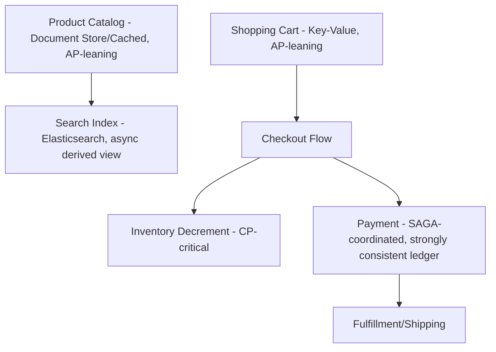

# Module 16 — Industry Architectures

> Synthesis module: applying every concept from Modules 1–15 (replication, sharding, CAP/PACELC, consensus, NoSQL, cloud/NewSQL) to real production architectures at scale. This is where interviewers test whether you can *combine* concepts, not just recite them individually.

---

## 16.1 How to Approach These Case Studies (Interview Framing)

For every system below, the same analytical lens applies — and is exactly what senior system design interviews expect you to walk through out loud:

1. **What is the core data access pattern?** (read-heavy vs write-heavy, point lookups vs range scans vs graph traversal)
2. **What consistency does the business actually require?** (Module 6/7 — is staleness acceptable, or is correctness non-negotiable?)
3. **How is data partitioned?** (Module 4 — by user, by region, by entity type?)
4. **What replication/availability strategy is used?** (Module 3 — leader-based, leaderless, multi-region?)
5. **Where do NoSQL vs relational vs NewSQL choices show up, and why?** (Modules 9, 14, 15)

---

## 16.2 Netflix

### Core Challenge
Serve personalized video recommendations and playback state to hundreds of millions of users globally, with extremely high read volume and tolerance for eventual consistency (nobody notices if a "continue watching" position is a few seconds stale).

### Architecture Highlights
- **Apache Cassandra** (Module 12) is used extensively for viewing history, user preferences, and other high-write-volume, availability-critical data — a natural fit given Cassandra's AP/leaderless design (Modules 3, 6) and Netflix's tolerance for eventual consistency in these domains.
- **Multi-region active-active deployment**: Netflix famously operates across multiple AWS regions simultaneously, with Cassandra's multi-datacenter replication (`NetworkTopologyStrategy`, Module 12) keeping each region's data in sync, so a full regional outage doesn't take down the whole service.
- **EVCache** (a Memcached-based distributed caching layer) sits in front of many backend services for extremely low-latency reads — a large-scale application of the cache-aside pattern (Module 11).
- **Billing and account/subscription data**, where correctness is non-negotiable, uses more strongly consistent relational stores — a clear example of **polyglot persistence** (Module 9): different consistency requirements for different parts of the same overall product.

### Key Lesson
Netflix exemplifies choosing **AP-leaning, leaderless** systems specifically for use cases (recommendations, viewing history) where the business impact of staleness is near-zero, while reserving stronger consistency for billing/account data — precisely the PACELC-informed, use-case-by-use-case decision-making discussed in Modules 6-7.

---

## 16.3 Uber

### Core Challenge
Track real-time, high-frequency location updates from millions of drivers/riders, match riders to nearby drivers with low latency, and process trips/payments with strong consistency.

### Architecture Highlights
- **Sharded MySQL** historically formed the backbone for core trip and trip-state data — sharded (Module 4) by a key like `trip_id` or `city_id`, since Uber's business is naturally geographically partitioned (many workloads are inherently regional — most trips start and end within one city).
- **Schemaless** (Uber's custom datastore, built on top of sharded MySQL) provided a document-like, flexible-schema layer (Module 9's document model) while retaining MySQL's operational maturity underneath — an example of building NoSQL-like flexibility on top of relational infrastructure rather than adopting a separate NoSQL engine wholesale.
- **Real-time location data** (driver GPS pings) is extremely high-volume and short-lived — well suited to in-memory/key-value stores (Module 11's Redis-like patterns) or purpose-built geospatial indexes, prioritizing low latency over long-term durability for the raw ping stream.
- **Geo-sharding** (Module 4): matching riders to nearby drivers is fundamentally a geographic query, so partitioning by geographic cell (e.g., using a spatial indexing scheme like S2 or H3 cells) lets Uber route "find nearby drivers" queries to a small, relevant subset of the data rather than scanning globally.

### Key Lesson
Uber's architecture demonstrates **geo-sharding as a first-class design decision** (Module 4), driven directly by the fundamentally regional nature of the business — and a pragmatic layering of flexible-schema (NoSQL-like) capabilities atop a mature relational engine rather than a wholesale migration.

---

## 16.4 Amazon

### Core Challenge
Support massive e-commerce catalog browsing, a highly available shopping cart, and strongly consistent order/payment processing, all at global scale, for one of the largest e-commerce platforms in the world.

### Architecture Highlights
- **DynamoDB** (Module 14) was born directly out of Amazon's own internal needs: the original **Dynamo paper** (referenced throughout Modules 3, 9, 12) was written specifically to solve Amazon's shopping cart availability problem — the business explicitly decided that **availability** (never showing an error when adding to cart) was more important than perfect consistency (occasionally needing to merge duplicate cart entries client-side) — a textbook AP choice (Module 6).
- **Product catalog** data (read-heavy, tolerant of slight staleness) is heavily cached and served from read-optimized stores, echoing Module 11's caching patterns at extreme scale.
- **Order processing and payments** require strong consistency and often involve **SAGA-like patterns** (Module 5) — an order touches inventory, payment, and shipping services, each with its own local transaction and compensating actions on failure (e.g., refunding a charge if inventory reservation fails).
- **Extensive use of microservices**, each often owning its own datastore (a "database per service" pattern) — meaning cross-service consistency is deliberately handled at the application/workflow level (SAGA, Module 5) rather than via a single shared distributed transaction across the entire order pipeline.

### Key Lesson
Amazon's architecture is the origin story for **leaderless, AP-favoring replication** (Modules 3, 6) at scale, and a strong real-world example of the **SAGA pattern over 2PC** (Module 5) for complex, multi-service order workflows where blocking distributed transactions would be too slow/fragile.

---

## 16.5 Google

### Core Challenge
Operate at a scale beyond almost any other organization — web-scale search index, planet-scale ad serving, and internal infrastructure requiring both massive analytical processing and strongly consistent transactional systems.

### Architecture Highlights
- **BigTable** (the paper that inspired Cassandra and HBase, Module 9/12) — a column-family store used internally for massive-scale, semi-structured data (web crawl data, indexing metadata).
- **Spanner** (Module 14/15) — built specifically because Google needed **globally distributed, strongly consistent, SQL-capable** storage for systems like its advertising platform (F1, built on top of Spanner), where financial-grade correctness at global scale was non-negotiable.
- **Google File System (GFS)** and its successor Colossus underpin much of Google's storage infrastructure — a distributed file system providing the durable storage layer that higher-level systems like BigTable and Spanner build upon (conceptually similar to Amazon Aurora's disaggregated storage layer, Module 14, but originating earlier and at even larger scale).
- **Paxos** (Module 8) is used pervasively across Google's infrastructure (Chubby lock service, Spanner) for consensus — Google is, in many ways, the origin of much of the consensus and distributed storage theory covered throughout this Part.

### Key Lesson
Google's architecture demonstrates that the same organization can and does run **both** ends of the CAP/PACELC spectrum (Modules 6-7) simultaneously — BigTable-style AP-leaning systems for massive-scale semi-structured data, and Spanner-style CP/globally-consistent systems for financial-grade correctness — chosen deliberately per use case, not as a single company-wide standard.

---

## 16.6 Meta (Facebook)

### Core Challenge
Serve the social graph (who's friends with whom, likes, comments) — a fundamentally graph-shaped problem (Module 13) — at a scale of billions of users and trillions of edges, with extremely high read volume.

### Architecture Highlights
- **MySQL, heavily sharded**, remains a core backbone for much of Facebook's data — notably, Facebook does **not** primarily use a dedicated graph database (Module 13) for its social graph at web scale; instead, it built **TAO** (The Associations and Objects), a **graph-shaped caching and access layer on top of sharded MySQL**.
- **TAO**: presents a graph API (objects and associations, i.e., nodes and edges) to application developers, but underneath, it's backed by a distributed caching tier plus sharded MySQL for durability — giving the *developer experience* of a graph database (Module 13's node/edge model) without needing a dedicated graph engine to scale to Facebook's traffic volume.
- **Memcached at massive scale**: Facebook's use of Memcached (a huge, heavily-optimized deployment) for caching is one of the most well-documented large-scale cache-aside (Module 11) implementations in the industry, including custom protocol optimizations and lease mechanisms to prevent thundering-herd problems (Module 11's cache-stampede concerns).
- **Sharding strategy**: user data is typically sharded by `user_id` (Module 4), with derived fragmentation (Module 2) co-locating related data (e.g., a user's posts) with the user's primary shard where possible to minimize cross-shard queries.

### Key Lesson
Meta's TAO is a landmark case study in choosing **pragmatic infrastructure reuse** (sharded MySQL + a custom caching/graph-API layer) over adopting a "purpose-built" solution (a dedicated graph database) — demonstrating that at extreme scale, the *access pattern* (graph-like reads) can sometimes be served by a well-designed caching layer atop existing, well-understood infrastructure (MySQL) rather than requiring a wholesale migration to new database technology.

---

## 16.7 WhatsApp

### Core Challenge
Deliver billions of real-time messages daily with very high reliability and relatively modest engineering headcount (WhatsApp was famous for running at massive scale with a small team, prior to its acquisition and later re-architecture within Meta).

### Architecture Highlights
- Historically built on **Erlang** (a language/runtime designed for massive concurrency and fault tolerance) — the choice of runtime itself reflects a deep alignment with distributed systems principles (process isolation, "let it crash" fault tolerance) covered conceptually in Module 1's discussion of partial failures.
- Message storage and delivery require **durability guarantees** (a message must not be lost) combined with high write throughput — historically leaning on a mix of Mnesia (Erlang's built-in distributed database) for certain state, alongside more conventional storage for message history at scale as the system evolved.
- **At-least-once delivery with deduplication**: like many messaging systems, WhatsApp's delivery guarantees require the same **idempotency** principles discussed in Module 5 — a message might be delivered more than once due to network retries, and clients must handle this gracefully (e.g., via message IDs).

### Key Lesson
WhatsApp demonstrates that **extreme scale doesn't always require the most exotic distributed database technology** — a well-chosen concurrency-oriented runtime plus disciplined engineering (idempotent delivery, careful state management) can achieve massive scale with a comparatively simple, well-understood stack.

---

## 16.8 Banking Systems

### Core Challenge
Absolute correctness is non-negotiable — money must never be created or destroyed, balances must always be accurate, and regulatory/audit requirements demand strong consistency and durability.

### Architecture Highlights
- **Strong preference for ACID-compliant relational databases** (or NewSQL systems, Module 15, when horizontal scale is needed) for core ledger/balance data — this is a domain where the **CP** side of CAP (Module 6) and **EC** side of PACELC (Module 7) are almost always the correct choice, even at the cost of latency/availability.
- **Distributed transactions** (2PC, Module 5) or **NewSQL global transactions** (Module 15) are used for cross-account transfers, particularly when accounts live on different shards/branches.
- **Double-entry bookkeeping** principles (a debit and a credit recorded together, atomically) map directly onto the atomicity guarantees discussed since early parts of this handbook (ACID) — a transaction that only records half of a transfer would violate fundamental accounting correctness.
- **Audit logs and immutability**: banking systems typically maintain **append-only, immutable transaction logs** (conceptually similar to a WAL, from earlier modules, but retained permanently for regulatory/audit purposes) rather than only storing current-state balances.
- **Idempotency** (Module 5) is critical for payment retries — a network timeout during a transfer must never result in the transfer being applied twice.

### Key Lesson
Banking is the canonical **CP/EC** (Modules 6-7) domain — nearly every architectural decision prioritizes correctness over latency/availability, in sharp contrast to Netflix's or Amazon's cart/catalog systems.

---

## 16.9 Payment Gateways

### Core Challenge
Process payment transactions reliably, exactly-once (from the business's perspective), often integrating with multiple external banks/card networks, while handling extremely bursty traffic (e.g., flash sales, festival shopping days).

### Architecture Highlights
- **Idempotency keys** (Module 5) are a first-class API concept in virtually every major payment gateway (Stripe, Razorpay, etc.) — clients are required to supply a unique idempotency key per logical payment attempt, so a network retry doesn't result in a duplicate charge.
- **SAGA-like workflows** (Module 5): a payment might involve reserving funds, calling an external bank API, and updating internal ledgers — each step is a local transaction, with compensating actions (refund/reversal) if a later step fails.
- **Outbox pattern** (Module 5): reliably publishing "payment succeeded"/"payment failed" events to downstream systems (order fulfillment, notifications) without risking the dual-write problem between the payment gateway's own database and its message queue.
- **Strong consistency for the ledger itself**, but **asynchronous, eventually-consistent notifications** to downstream systems — again, a PACELC-informed (Module 7) split between the parts of the system where correctness is non-negotiable (the ledger) and parts where a slight delay is acceptable (webhook notifications).

### Key Lesson
Payment gateways are a rich, concentrated example of nearly every Module 5 concept (2PC/SAGA, idempotency, outbox pattern) working together in a single real-world system.

---

## 16.10 E-Commerce Platforms (General Pattern)

### Core Challenge
Balance a read-heavy, availability-critical product catalog and browsing experience against a smaller but correctness-critical checkout/inventory/payment path.

### Architecture Highlights
- **Product catalog**: document stores (Module 9/10) or heavily cached relational data — read-heavy, tolerant of staleness, optimized for flexible/evolving product attributes.
- **Search**: typically a dedicated search engine (e.g., Elasticsearch) rather than the primary transactional database — a form of polyglot persistence (Module 9) where the search index is an asynchronously-updated derived view of the catalog data.
- **Shopping cart**: often a key-value store (Module 11, or DynamoDB-style, Module 14) prioritizing availability — echoing Amazon's original Dynamo motivation directly (Section 16.4).
- **Inventory/stock decrement**: frequently the **single most consistency-critical piece** of the entire platform — a classic **CP** decision point (Module 6) even within an otherwise AP-leaning overall architecture, since overselling a physical product has real business/legal consequences.
- **Checkout/order/payment**: relational or NewSQL, often using SAGA patterns (Module 5) to coordinate across inventory, payment, and shipping microservices.

### Key Lesson
A single e-commerce platform typically spans **the entire CAP/PACELC spectrum** across its different components — this is the single most important takeaway for a system design interview: **the right consistency model is a per-component decision, not a single company-wide or even single-application-wide choice.**

---

## 16.11 Cross-Cutting Comparison Table

| Company/System | Primary DB Choice(s) | CAP Lean | Key Distributed Concept Highlighted |
|---|---|---|---|
| Netflix | Cassandra, EVCache | AP (viewing data), CP (billing) | Multi-region active-active, polyglot persistence |
| Uber | Sharded MySQL, Schemaless, in-memory geospatial | Mixed (CP for trips/payments, low-latency for location) | Geo-sharding |
| Amazon | DynamoDB, microservice-owned datastores | AP (cart/catalog), CP (orders/payments) | SAGA pattern, origin of Dynamo/leaderless replication |
| Google | BigTable, Spanner, GFS/Colossus | Mixed (AP for BigTable, CP for Spanner) | Consensus (Paxos) at massive scale |
| Meta | Sharded MySQL + TAO (graph cache layer) | AP-leaning (social graph reads) | Graph-shaped access pattern via caching, not a graph DB |
| WhatsApp | Erlang/Mnesia + message stores | Durability-focused | Idempotent, at-least-once delivery |
| Banking | Relational/NewSQL | CP/EC | Distributed transactions, immutable audit logs |
| Payment Gateways | Relational + message queues | CP for ledger, AP for notifications | Idempotency, SAGA, outbox pattern |
| E-commerce (general) | Polyglot (document + KV + relational/NewSQL) | Spans full spectrum by component | Per-component CAP/PACELC decisions |

---

## 16.12 Interview Questions — Module 16

### Beginner
1. Why does Netflix use Cassandra for viewing history but a stronger-consistency store for billing?
2. What problem did Amazon's original Dynamo paper set out to solve?
3. What is TAO, and why did Facebook build it instead of adopting a dedicated graph database?

### Intermediate
4. Explain why Uber's architecture relies heavily on geo-sharding, referencing the nature of its core business.
5. Why do payment gateways treat idempotency keys as a first-class API concept?
6. Why might a single e-commerce platform use three or more different types of databases simultaneously?

### Senior SDE-2/SDE-3
7. Design the high-level data architecture for a food delivery platform (similar to Uber Eats), addressing restaurant catalog browsing, real-time order tracking, and payment processing, explicitly assigning a CAP/PACELC classification to each component.
8. A candidate claims "we should just use one type of database everywhere for consistency of tooling." Critique this position using at least two of the industry examples in this module.
9. Explain how TAO's design reflects a deliberate tradeoff between "using the theoretically ideal data model" (graph database) and "using well-understood, provenly scalable infrastructure" (sharded MySQL + caching).

### GATE-style / MCQ
10. Which company's shopping cart use case directly motivated the original Dynamo paper's leaderless, AP-favoring design?
    a) Netflix
    b) Amazon
    c) Google
    d) Meta
    *(Answer: b)*

11. Facebook's TAO is best described as:
    a) A dedicated graph database replacing MySQL
    b) A graph-shaped caching/access layer built on top of sharded MySQL
    c) A NewSQL system
    d) A column-family store
    *(Answer: b)*

---

## 16.13 Exercises

**Beginner**
- For each of Netflix, Uber, and Amazon, list one specific feature/component and classify it as CP or AP, with justification.

**Intermediate**
- Design a simplified version of Facebook's TAO: describe the caching layer's role and how it presents a graph-like API over sharded MySQL underneath.

**Advanced / Production Scenario**
- You're designing a food delivery platform's live order-tracking feature (driver location + order status). Propose which database type(s) you'd use for each sub-component, referencing at least three prior modules.

**Whiteboard Interview Problem**
- "Design the complete backend data architecture for a global e-commerce platform like Amazon, explicitly identifying which components are AP and which are CP, and justify each choice."

**Case Study**
- Research and summarize, in your own words, one public engineering blog post from any of the companies in this module (Netflix Tech Blog, Uber Engineering, Meta Engineering, etc.) describing a specific database architecture decision.

---

## 16.14 Practice Resources

- Netflix Technology Blog: https://netflixtechblog.com/
- Uber Engineering Blog: https://www.uber.com/blog/engineering/
- Meta Engineering Blog (including historical TAO paper): https://engineering.fb.com/
- Amazon Dynamo Paper: https://www.allthingsdistributed.com/files/amazon-dynamo-sosp2007.pdf
- Google Research Publications (BigTable, Spanner papers): https://research.google/pubs/

---

## 16.15 Cheat Sheet — Module 16

- **Netflix**: Cassandra (AP) for viewing data + multi-region active-active; stronger consistency for billing — polyglot persistence in action.
- **Uber**: Sharded MySQL + Schemaless + geo-sharding for location/matching — business is inherently regional.
- **Amazon**: Origin of Dynamo/leaderless replication (cart availability); SAGA pattern for order workflows.
- **Google**: BigTable (AP-leaning) and Spanner (CP/globally consistent) coexist, chosen per use case; heavy internal use of Paxos.
- **Meta**: TAO — graph-shaped API over sharded MySQL + caching, not a dedicated graph database.
- **WhatsApp**: concurrency-oriented runtime (Erlang) + idempotent, at-least-once message delivery.
- **Banking**: CP/EC by default — ACID, double-entry bookkeeping, immutable audit logs, idempotent transfers.
- **Payment Gateways**: idempotency keys, SAGA workflows, outbox pattern — Module 5 concepts concentrated in one domain.
- **E-commerce (general)**: catalog/cart lean AP, inventory decrement and payments lean CP — consistency choices are made **per component**, not company-wide.
- **Universal interview lesson**: the "right" database/consistency choice is always a function of the specific access pattern and business tolerance for staleness — never a single one-size-fits-all answer.

---

**End of Module 16.**

Reply with "continue" or "next module" to proceed to **Module 17: Interview Mastery**.
