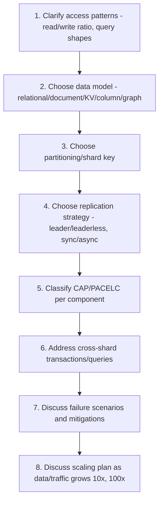

# Module 17 — Interview Mastery

> A consolidated, rapid-fire review across every topic in this Part (Modules 1–16), organized by category, plus system design discussion frameworks and whiteboard problems calibrated up to Senior SDE-3 level.

---

## 17.1 How to Use This Module

This is not new material — it's a **structured drilling ground**. For each category below:
1. Try to answer the question **out loud, in under 2 minutes**, as if in a live interview.
2. Cross-check against the module referenced in brackets.
3. For "System Design Discussions," practice **drawing the architecture** (whiteboard or paper) while explaining tradeoffs — interviewers weight the reasoning process far more than the final diagram.

---

## 17.2 CAP Theorem Questions

1. State CAP theorem precisely — what's the common misconception people have about "pick any 2 of 3"? [Module 6]
2. Walk through, step by step, why a node facing a partition must choose between responding with stale data or refusing to respond. [Module 6]
3. Classify Cassandra, MongoDB (majority writes), and Spanner using CAP. Justify each. [Modules 6, 10, 12, 14]
4. Why is "CA without partition tolerance" not realistic for a truly distributed system? [Module 6]
5. A system needs to serve a banking balance and a "like count" simultaneously — should both be CP, both AP, or different? Justify. [Module 6]

---

## 17.3 PACELC Questions

6. Explain PACELC's "Else" branch and why CAP alone doesn't capture it. [Module 7]
7. Classify DynamoDB and Google Spanner using PA/EL vs PC/EC. [Module 7]
8. Why does achieving strong consistency during normal (non-partitioned) operation still cost latency? [Module 7]
9. Give an example of a feature within the same application that should be EL, and one that should be EC. [Module 7]

---

## 17.4 Replication Questions

10. Compare single-leader, multi-leader, and leaderless replication — write scalability, conflict handling, and failover complexity for each. [Module 3]
11. Derive and explain the quorum condition `W + R > N`. [Modules 3, 8, 12]
12. What is replica lag, and how would you implement "read-your-writes" consistency on top of asynchronous replication? [Module 3]
13. Walk through a full failover sequence for a single-leader system, including the risk of split brain. [Modules 3, 8]
14. Compare synchronous, asynchronous, and semi-synchronous replication in terms of data-loss risk and latency. [Module 3]

---

## 17.5 Sharding Questions

15. Compare range, hash, directory-based, and geo-sharding — when would you pick each? [Module 4]
16. Explain why naive `hash(key) % N` sharding is dangerous when scaling a cluster, and how consistent hashing fixes it. [Module 4]
17. What are virtual nodes, and why are they needed even with consistent hashing? [Module 4]
18. Design a hot-partition mitigation strategy for a viral social media post's comment section. [Module 4]
19. Walk through the steps of an online (zero-downtime) resharding operation. [Module 4]

---

## 17.6 MongoDB Questions

20. Explain the role of the oplog in both replication and change streams. [Module 10]
21. What is the difference between read preference and write concern? [Module 10]
22. Why does MongoDB favor embedding over normalization + multi-document transactions? [Module 10]
23. Walk through what happens, step by step, when a MongoDB replica set's primary crashes during peak traffic. [Modules 8, 10]
24. Design a sharding strategy for a multi-tenant SaaS `events` collection. [Modules 4, 10]

---

## 17.7 Redis Questions

25. Compare RDB and AOF persistence in terms of data-loss window and restart speed. [Module 11]
26. Why don't Redis transactions roll back on a runtime error mid-batch? [Module 11]
27. Explain Redis Cluster's 16,384 hash slots and why hash tags are needed for multi-key operations. [Module 11]
28. Compare cache-aside, write-through, and write-behind patterns. [Module 11]
29. Design a distributed rate limiter using Redis and Lua scripting. [Module 11]

---

## 17.8 Cassandra Questions

30. Explain Cassandra's leaderless, ring-based architecture and how the gossip protocol enables failure detection without consensus. [Module 12]
31. Derive the quorum formula for `RF=5` and explain what consistency level combination guarantees strong consistency. [Module 12]
32. Why does Cassandra use immutable SSTables, and what problem does compaction solve? [Module 12]
33. Compare hinted handoff and read repair — what failure scenario triggers each? [Modules 3, 12]
34. Design a Cassandra table schema for a chat application optimized for "last 50 messages per conversation." [Module 12]

---

## 17.9 Distributed Transaction Questions

35. Walk through 2PC's two phases and explain the blocking problem when the coordinator crashes. [Module 5]
36. Why is 3PC rarely used despite theoretically solving 2PC's blocking issue? [Module 5]
37. Compare 2PC and the SAGA pattern — what does SAGA sacrifice in exchange for avoiding cross-node locks? [Module 5]
38. Explain the dual-write problem and how the outbox pattern solves it. [Module 5]
39. Why is idempotency essential in distributed transaction/retry scenarios? Give a concrete example. [Module 5]

---

## 17.10 Consensus Questions

40. Explain why consensus algorithms require a majority rather than all nodes or a single node. [Module 8]
41. Walk through Raft's leader election process, including the role of randomized timeouts. [Module 8]
42. Compare Raft and Multi-Paxos — why did Raft become more popular for new systems? [Module 8]
43. What is a fencing token, and what specific failure scenario does it protect against that majority-based election alone does not? [Module 8]
44. In a 7-node Raft cluster, how many node failures can it tolerate, and why? [Module 8]

---

## 17.11 System Design Discussion Frameworks

For any distributed database system design question, walk through this checklist out loud:

### Practice Prompts (Senior SDE-3 Whiteboard-Style)

1. **"Design a URL shortener"** — focus on: hash-based sharding of the short-code-to-URL mapping, hot-key mitigation for viral links, read-heavy caching strategy (Modules 4, 11).
2. **"Design a distributed rate limiter"** — focus on: Redis + Lua atomicity (Module 11), or a sliding-window counter, and how you'd handle it across multiple API gateway instances.
3. **"Design Twitter's home timeline"** — focus on: fan-out-on-write vs fan-out-on-read tradeoffs, hot-user (celebrity) handling, mixing key-value (Module 11) and graph-like (Module 13/16 TAO) access patterns.
4. **"Design a global inventory system for an e-commerce flash sale"** — focus on: CP-critical stock decrement (Module 6), hot-partition mitigation for a single trending SKU (Module 4), and SAGA-based order coordination (Module 5).
5. **"Design a distributed lock service"** — focus on: consensus-based coordination (Module 8, Raft/Zab), fencing tokens, and comparing a Redis-based (Redlock-style) vs a ZooKeeper/etcd-based approach.
6. **"Design a globally distributed banking ledger"** — focus on: NewSQL (Module 15) vs traditional sharded RDBMS with 2PC (Module 5), geo-partitioning, and strict CP/EC classification (Modules 6-7).
7. **"Design a real-time multiplayer game's leaderboard"** — focus on: Redis sorted sets (Module 11), eventual consistency tolerance, and hot-key handling for viral players.
8. **"Design a fraud detection system"** — focus on: graph database use for ring detection (Module 13), combined with a stream-processing pipeline for real-time scoring.
9. **"Design a notification/messaging delivery system"** — focus on: at-least-once delivery + idempotency (Module 5), durable queues vs Redis Streams/Pub-Sub (Module 11).
10. **"Design a multi-region SaaS application with data residency requirements"** — focus on: geo-sharding/geo-partitioning (Modules 4, 15), allocation transparency (Module 2), and NewSQL vs Cosmos DB-style tunable consistency (Module 14).

---

## 17.12 Common Interview Traps and How to Avoid Them

| Trap | Why Candidates Fall Into It | Correct Framing |
|---|---|---|
| "CAP means pick any 2 of 3" | Oversimplified popular phrasing | Partition tolerance is mandatory in real distributed systems; the actual choice is C vs A, only during a partition (Module 6) |
| "NoSQL is always eventually consistent" | Confusing historical AP-leaning defaults with a universal rule | Many NoSQL systems (MongoDB w/ majority concern, Cassandra w/ QUORUM) can be tuned to strong consistency (Modules 6, 9-12) |
| "2PC guarantees availability" | Confusing atomicity with availability | 2PC sacrifices availability (blocks) on coordinator failure — it's a CP mechanism (Modules 5, 6) |
| "Consistent hashing means data never moves" | Overgeneralizing the benefit | Consistent hashing minimizes data movement on resize — it doesn't eliminate it entirely (Module 4) |
| "SAGA provides ACID guarantees" | Assuming all "distributed transaction patterns" are equivalent | SAGA provides eventual consistency with compensations, not true isolation/atomicity (Module 5) |
| "More replicas always means better consistency" | Confusing replica count with quorum configuration | Consistency depends on the R/W or read/write concern *quorum settings*, not simply having more replicas (Modules 3, 10, 12) |
| "Sharding and replication are alternatives" | Treating them as competing choices | They're complementary — most production systems shard for scale AND replicate each shard for availability (Modules 3, 4) |

---

## 17.13 Rapid-Fire MCQ Bank (Mixed Topics)

1. In a 9-node Raft cluster, what is the minimum majority? *(Answer: 5)*
2. Which replication mode risks data loss on leader crash immediately after acknowledging a write? *(Answer: Asynchronous)*
3. Which sharding strategy is best for range queries but worst for avoiding hot spots with sequential keys? *(Answer: Range sharding)*
4. Which CAP-classified system type refuses requests during a partition rather than risk stale data? *(Answer: CP)*
5. What does Cassandra's `QUORUM` consistency level require for `RF=7`? *(Answer: 4)*
6. What Redis persistence mechanism is most analogous to a Write-Ahead Log? *(Answer: AOF)*
7. Which pattern solves the dual-write problem between a database and a message queue? *(Answer: Outbox Pattern)*
8. Which Google technology allows Spanner to achieve external consistency without per-transaction global consensus? *(Answer: TrueTime)*
9. Which NoSQL type uses index-free adjacency? *(Answer: Graph databases)*
10. Which AWS service separates compute from a distributed storage layer while remaining MySQL/PostgreSQL-compatible? *(Answer: Amazon Aurora)*

---

## 17.14 Senior SDE-3 "Explain Like You're Teaching" Prompts

These simulate the toughest interview format: explaining a concept clearly enough that a junior engineer would understand it, while an interviewer probes for depth.

1. "Explain to a junior engineer why we can't just add more read replicas to fix a write-scaling problem." [Module 3]
2. "Explain why a distributed database with 5 nodes is often preferred over one with 4 nodes, despite having more hardware." [Module 8]
3. "Explain to a product manager why our shopping cart shows availability over consistency, using a concrete example of what could go wrong either way." [Modules 6, 16]
4. "Explain why Facebook built TAO instead of switching their entire social graph to a graph database." [Modules 13, 16]
5. "Explain the difference between what Two-Phase Commit guarantees and what the SAGA pattern guarantees, in terms a new hire could understand within 5 minutes." [Module 5]

---

## 17.15 Debugging / Production Incident Exercises

1. **Incident:** After a leader failover, some writes that were acknowledged to clients are missing on the new leader. Diagnose and propose a fix. [Modules 3, 8]
2. **Incident:** A sharded cluster shows one shard at 95% CPU while others sit idle. Diagnose and propose a fix. [Module 4]
3. **Incident:** A 2PC-coordinated payment transaction has left several database rows locked for 20 minutes after a coordinator crash. Diagnose and propose an architectural change. [Module 5]
4. **Incident:** Users occasionally see their own just-uploaded profile picture disappear briefly after upload. Diagnose and propose a fix. [Module 3]
5. **Incident:** A Cassandra cluster's read latency has been steadily increasing over months despite stable write volume. Diagnose and propose a fix. [Module 12]

---

## 17.16 Full-Length Case Study Practice (Combine Everything)

**Prompt:** *"Design the complete backend data architecture for a ride-sharing platform operating in 40 countries, covering: (a) real-time driver location tracking, (b) rider-driver matching, (c) trip and payment records, (d) driver ratings/reviews, and (e) analytics/reporting for the business. For each component, specify: data model, partitioning strategy, replication approach, and CAP/PACELC classification — and justify why each choice differs from the others within the same platform."*

**Model answer structure (how a strong candidate would organize the response):**

| Component | Data Model | Partitioning | Replication | CAP/PACELC |
|---|---|---|---|---|
| Driver location | Key-value / geospatial index | Geo-sharded (by city/region) | Leaderless, low-latency | AP/EL |
| Rider-driver matching | In-memory + geospatial | Geo-sharded | Leaderless | AP/EL |
| Trip & payment records | Relational/NewSQL | Sharded by trip_id or region | Leader-based, sync-ish (or NewSQL consensus) | CP/EC |
| Ratings/reviews | Document store | Sharded by driver_id | Leader-based replica set | AP-leaning (staleness tolerable) |
| Analytics/reporting | Column-family or data warehouse | Derived, asynchronously ETL'd | N/A (analytical, often batch) | AP (staleness expected/acceptable) |

This table format — **component-by-component justification** — is exactly what distinguishes a senior-level answer from a junior one: junior candidates pick "one database for everything," while senior candidates explicitly reason about *why each component has different requirements*.

---

## 17.17 Final Self-Assessment Checklist

Before an interview, confirm you can do **all** of the following without notes:

- [ ] Derive the quorum overlap condition (`W+R>N` or majority math) from first principles.
- [ ] Draw a Raft election sequence diagram from memory.
- [ ] Explain 2PC's blocking problem and why SAGA avoids it (and what SAGA gives up in exchange).
- [ ] Classify at least 5 real systems using CAP and PACELC, with justification.
- [ ] Explain consistent hashing and virtual nodes well enough to whiteboard it.
- [ ] Walk through MongoDB replica set election, Cassandra hinted handoff/read repair, and Redis Cluster hash slots without hesitation.
- [ ] Justify, for at least 3 different features of the same hypothetical app, why they'd use different consistency models.
- [ ] Explain TrueTime's commit-wait mechanism and why CockroachDB uses a different approach.
- [ ] Name and briefly explain all four NoSQL types with one real system each.
- [ ] Walk through a full production incident (like Section 17.15) and reason about root cause live.

---

## 17.18 Practice Resources — Consolidated

- LeetCode Database: https://leetcode.com/studyplan/top-sql-50/
- HackerRank SQL: https://www.hackerrank.com/domains/sql
- DataLemur (SQL/analytics interview questions): https://datalemur.com/
- GATE Overflow (Databases): https://gateoverflow.in/
- MongoDB University: https://learn.mongodb.com/
- Raft visualization: https://raft.github.io/
- System Design Primer (community-maintained interview resource): search "System Design Primer GitHub"

---

## 17.19 Cheat Sheet — Module 17 (Meta-Cheat-Sheet)

- **CAP**: partition-time tradeoff, C vs A only.
- **PACELC**: adds the normal-operation L vs C tradeoff.
- **Replication**: single-leader (simple, write-bound), multi-leader (regional, conflict-prone), leaderless (quorum-tunable, most available).
- **Sharding**: range (range queries, hot-spot risk), hash (even, poor range queries), consistent hashing + vnodes (minimal rebalancing).
- **Distributed Transactions**: 2PC (strong, blocking), SAGA (available, eventual, needs compensations).
- **Consensus**: majority quorum prevents split brain; Raft = understandable, Paxos = foundational, Zab = ZooKeeper-specific.
- **NoSQL**: KV (simplest, fastest), Document (flexible), Column-Family (write-heavy scale), Graph (relationship-heavy).
- **Cloud/NewSQL**: managed relational (vertical), disaggregated storage (Aurora/AlloyDB), tunable NoSQL (DynamoDB/Cosmos), born-distributed SQL (Spanner/CockroachDB/YugabyteDB/TiDB).
- **Golden interview rule**: the right database/consistency choice is always **per-component**, driven by actual access patterns and business tolerance for staleness — never a single universal answer.

---

**End of Module 17.**

Reply with "continue" or "next module" to proceed to **Module 18: Preview of Part 12**.
