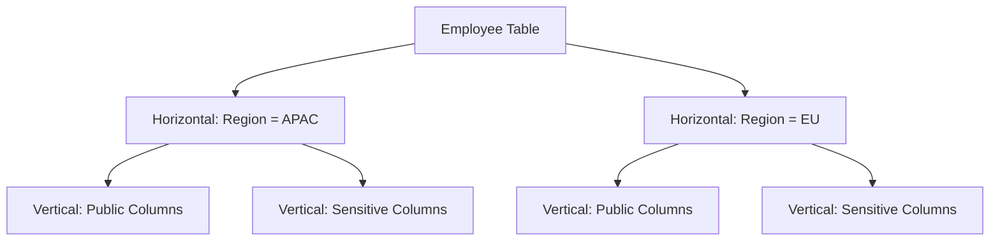
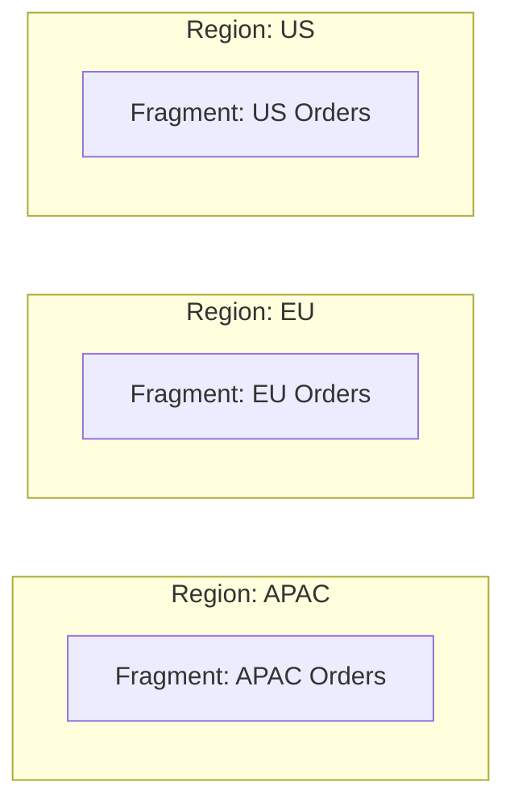
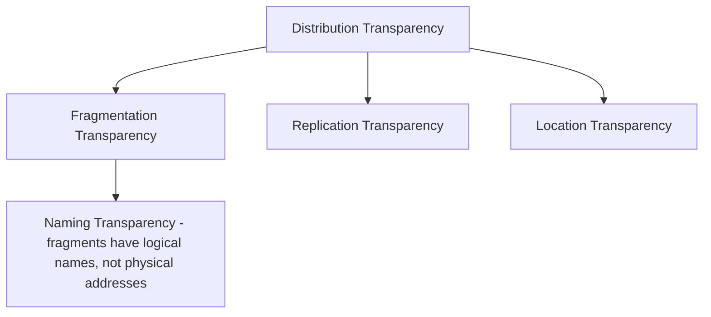
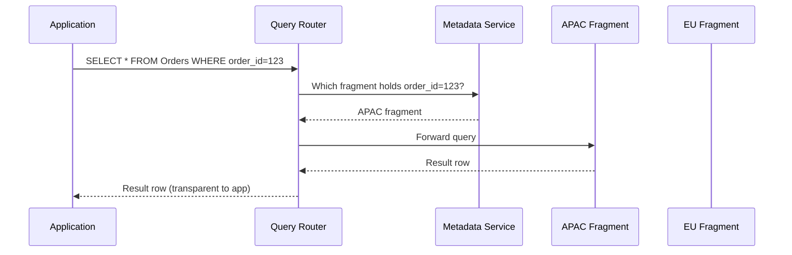

# Module 2 — Distributed Database Design

> Builds on Module 1 (Distributed Fundamentals). Here we answer: *given that we want to spread data across multiple nodes, how exactly do we decide what goes where, and how do we hide that complexity from the application?*

---

## 2.1 What Is Distributed Database Design?

Distributed database design is the process of deciding:

1. **How to split up the data** (fragmentation)
2. **Where each piece should physically live** (allocation)
3. **How many copies of each piece to keep, and where** (replication)
4. **How to make all of this invisible to the application** (transparency)

**Why was this invented?** Once you accept a shared-nothing architecture (Module 1), you cannot just "put the whole database on every node" — that wastes storage and doesn't help write scalability. You need a principled way to break the database into pieces that are placed intelligently, based on how data is actually accessed.

**Real-life analogy:** Think of a large retail chain with warehouses in different cities. Instead of stocking every product in every warehouse, the company:
- Splits inventory by category or by region (**fragmentation**)
- Decides which warehouse stocks which category (**allocation**)
- Keeps duplicate stock of fast-moving items in multiple warehouses (**replication**)
- A customer just orders from the app without knowing which warehouse fulfills it (**transparency**)

---

## 2.2 Data Fragmentation

Fragmentation means breaking a logical table into smaller pieces (fragments), each of which can be stored on a different node.

### Why Fragment Data?

- **Locality of reference**: most transactions only need a subset of a table (e.g., a query for "orders in India" doesn't need US orders nearby).
- **Parallelism**: fragments on different nodes can be processed concurrently.
- **Reduced fragment size** improves cache-hit ratio and query performance per node.
- **Security**: sensitive fragments (e.g., financial data) can be isolated to specific nodes/regions (also helps with regulations like GDPR data residency).

### 2.2.1 Horizontal Fragmentation

Splits a table **by rows**. Each fragment has the same schema (columns) but a different subset of rows, usually based on a predicate.

```
Orders Table (logical)
+----+----------+---------+
| id | country  | amount  |
+----+----------+---------+
| 1  | India    | 500     |
| 2  | USA      | 700     |
| 3  | India    | 300     |
| 4  | Germany  | 900     |
+----+----------+---------+

Horizontal Fragmentation by country:

Fragment 1 (India)        Fragment 2 (USA)         Fragment 3 (Germany)
+----+---------+          +----+---------+          +----+---------+
| id | amount  |          | id | amount  |          | id | amount  |
| 1  | 500     |          | 2  | 700     |          | 4  | 900     |
| 3  | 300     |          +----+---------+          +----+---------+
+----+---------+
```

- **Primary Horizontal Fragmentation**: fragmentation predicate is defined directly on the table itself (e.g., `WHERE country = 'India'`).
- **Derived Horizontal Fragmentation**: a table is fragmented based on the fragmentation of a *related* table (e.g., fragment `OrderItems` based on how `Orders` is fragmented, so an order and its items stay on the same node).

This is conceptually the same mechanism used later in **Sharding** (Module 4) — fragmentation is the *design-level theory*, sharding is the *practical implementation* in modern distributed/NoSQL systems.

### 2.2.2 Vertical Fragmentation

Splits a table **by columns**. Each fragment contains a subset of columns (plus usually the primary key, so fragments can be rejoined).

```
Employee Table (logical)
+----+--------+--------+----------+-------------+
| id | name   | salary | ssn      | department  |
+----+--------+--------+----------+-------------+

Vertical Fragmentation:

Fragment 1 (Public Info)     Fragment 2 (Sensitive Info)
+----+--------+-----------+  +----+--------+----------+
| id | name   | department|  | id | salary | ssn      |
+----+--------+-----------+  +----+--------+----------+
```

**Why?** Some columns are accessed far more often than others (e.g., `name`, `department`), while others are sensitive or rarely queried (`salary`, `ssn`). Splitting lets you:
- Store frequently-accessed columns on faster / more available nodes.
- Apply stricter access control to sensitive-column fragments.
- Reduce I/O — queries that only need `name` don't have to read `salary` and `ssn` off disk.

### 2.2.3 Hybrid (Mixed) Fragmentation

Combines horizontal and vertical fragmentation — e.g., first split rows by region (horizontal), then within each region split columns by sensitivity (vertical). Real production schemas often use hybrid fragmentation without explicitly naming it that way.



### Comparison Table

| Type | Splits By | Use Case | Rejoin Method |
|---|---|---|---|
| Horizontal | Rows | Regional/tenant data, parallel scans | UNION of fragments |
| Vertical | Columns | Access-frequency or sensitivity separation | JOIN on primary key |
| Hybrid | Both | Complex, large-scale, multi-region + multi-sensitivity systems | UNION + JOIN |

### Correctness Rules for Any Fragmentation

A fragmentation design must satisfy three formal properties (classic distributed-DB theory, useful for GATE/exams):

1. **Completeness** — every data item in the original relation must map to at least one fragment (no data lost).
2. **Reconstruction** — it must be possible to rebuild the original relation from its fragments (via UNION for horizontal, JOIN for vertical).
3. **Disjointness** — for horizontal fragmentation, fragments should not overlap (each row belongs to exactly one fragment), so there's no ambiguity about where a row lives. (Vertical fragmentation makes an exception: the primary key is duplicated across fragments to allow reconstruction.)

---

## 2.3 Fragment Allocation

Once data is fragmented, we must decide **which physical node(s)** store each fragment.

### Allocation Strategies

| Strategy | Description | Tradeoff |
|---|---|---|
| Centralized | All fragments on one site | Simple but no scaling/availability benefit |
| Partitioned (non-replicated) | Each fragment on exactly one node | Best storage efficiency, worst availability |
| Fully Replicated | Every fragment copied to every node | Best availability/read performance, worst write cost & storage |
| Selectively Replicated | Popular/critical fragments replicated; others not | Balanced — most real systems use this |

### Decision Factors

- **Read/write ratio**: read-heavy fragments benefit from more replicas; write-heavy fragments should minimize replicas (each write must propagate to all replicas).
- **Data locality of users**: place a fragment near the majority of users who query it (e.g., EU customer data in an EU data center).
- **Regulatory constraints**: some jurisdictions require data to physically reside within country borders (data residency laws — GDPR-adjacent concerns).
- **Load balancing**: avoid "hot" nodes by spreading heavily-accessed fragments out.



---

## 2.4 Fragment Replication

Replication (deep dive in Module 3) intersects with fragmentation design here: once you decide *what* the fragments are, you decide *how many copies* of each fragment to keep and where.

- **Why replicate fragments?** Availability (if a node dies, a replica serves requests) and read scaling (spread read load across replicas).
- **Cost:** every write to a fragment must now propagate to all its replicas — this is the fundamental tension covered in the CAP theorem (Module 6).

---

## 2.5 Transparency

Transparency is the principle that **the application/programmer should not need to know the physical details of how and where data is distributed.** This is arguably the most important conceptual theme of distributed database *design* (as opposed to implementation).

### 2.5.1 Distribution Transparency (umbrella term)

The general idea that a distributed database should "look like" a single database to the user, hiding fragmentation, replication, and location details. It's typically broken down into three sub-types:

### 2.5.2 Fragmentation Transparency

The user writes queries **as if the table were not fragmented at all**. The database system internally figures out which fragments to query and how to recombine results.

```
User writes:
    SELECT * FROM Orders WHERE country = 'India';

System internally:
    - Knows Orders is horizontally fragmented by country
    - Routes query only to the India fragment/node
    - Returns combined result transparently
```

### 2.5.3 Replication Transparency

The user does not need to know that multiple copies of data exist. The system decides which replica to read from and how to keep replicas in sync — the user just sees "the data."

### 2.5.4 Location Transparency

The user doesn't need to know **which physical node/data center** holds a fragment or replica. Commands work the same regardless of where data actually resides — as if there were a single global namespace.

### The Transparency Hierarchy



### Levels of Transparency (in practice, from most to least transparent)

| Level | What the user must know | Example System |
|---|---|---|
| Full transparency | Nothing about distribution | Google Spanner (mostly), CockroachDB |
| Fragmentation-aware | That data is split, but not how or where | Some sharded MongoDB apps using the mongos router |
| Location-aware | Which node/cluster to query | Manually-sharded MySQL without a routing layer |
| No transparency | Application manually manages everything | Home-grown legacy sharding schemes |

**Interview framing:** Full transparency is the *ideal*, but it costs performance and flexibility (the system needs a router/coordinator layer, global metadata, etc.). Many real production systems intentionally sacrifice *some* transparency for performance — e.g., choosing a good shard key still requires the application developer to understand the underlying fragmentation, even in "transparent" systems like MongoDB or Cassandra.

---

## 2.6 Putting It All Together — End-to-End Example

**Scenario:** A global e-commerce company has an `Orders` table.

1. **Fragmentation decision**: Horizontally fragment `Orders` by `region` (APAC, EU, US).
2. **Allocation decision**: Place the APAC fragment in a Mumbai data center, EU fragment in Frankfurt, US fragment in Virginia.
3. **Replication decision**: Each regional fragment gets 2 additional replicas within the same region (for availability) plus one cross-region replica for disaster recovery.
4. **Transparency layer**: A query router (e.g., a smart proxy or the database driver itself) accepts `SELECT * FROM Orders WHERE order_id = 123` and, using fragment metadata, determines which region's fragment holds `order_id = 123`, routes the query there, and returns results — the calling application never sees any of this complexity.



---

## 2.7 Failure Scenarios in Fragmentation Design

| Scenario | Impact | Mitigation |
|---|---|---|
| Poor fragmentation key chosen | "Hot" fragment overloaded (e.g., all data lands in one region) | Choose keys with even, predictable distribution (see Module 4: Hot Partitions) |
| Derived fragmentation misaligned | Related data (orders + order items) split across nodes → expensive cross-node joins | Co-locate related fragments using the same fragmentation key |
| Metadata service down | Router can't determine fragment location → total outage | Replicate metadata service; cache fragment maps at routers |
| Fragment reconstruction failure | Missing fragment due to node failure → incomplete UNION results | Replication + quorum reads (Module 3, 6) |

---

## 2.8 Interview Questions — Module 2

### Beginner
1. What is the difference between horizontal and vertical fragmentation? Give one example each.
2. What are the three correctness rules a fragmentation scheme must satisfy?
3. Define distribution transparency in one sentence.

### Intermediate
4. Why is "derived horizontal fragmentation" important when two tables have a foreign key relationship?
5. What tradeoff exists between full replication and partitioned (non-replicated) allocation?
6. Explain the difference between fragmentation transparency and location transparency with an example.

### Senior SDE-2/SDE-3
7. You're designing fragmentation for a multi-tenant SaaS product. Would you fragment horizontally by tenant ID, or use another strategy? Justify with tradeoffs (hot tenants, cross-tenant queries, compliance).
8. A junior engineer proposes vertically fragmenting a `Users` table by putting `email` and `password_hash` in a separate fragment from `bio` and `preferences`. Critique this design — what's the benefit, and what new failure modes does it introduce?
9. Design a fragmentation + allocation + replication strategy for a banking system that must comply with "data must stay within the country of the account holder."

### GATE-style / MCQ
10. Which correctness property ensures no data item is lost during fragmentation?
    a) Disjointness
    b) Completeness
    c) Reconstruction
    d) Transparency
    *(Answer: b)*

11. In vertical fragmentation, what column(s) must typically be included in every fragment to allow reconstruction?
    a) All indexed columns
    b) The primary key
    c) Foreign keys only
    d) None — vertical fragments never overlap
    *(Answer: b)*

---

## 2.9 Exercises

**Beginner**
- Take a `Products` table with columns `id, name, price, description, warehouse_region`. Propose one horizontal and one vertical fragmentation scheme.

**Intermediate**
- Given `Orders(order_id, customer_id, region, amount)` and `OrderItems(item_id, order_id, product_id, qty)`, design a *derived* horizontal fragmentation so that an order and its items always live on the same node.

**Advanced / Production Scenario**
- Your fragmentation-by-region design results in the "US" fragment holding 80% of all data while "APAC" and "EU" fragments hold 10% each. Propose two different fixes.

**Whiteboard Interview Problem**
- "Design the fragmentation and transparency layer for a multi-region social media 'Posts' table, considering both write-heavy home regions and read-heavy global feed queries."

**Case Study**
- Read about how Vitess (YouTube's MySQL sharding middleware) provides transparency to applications, and summarize which transparency types it implements.

---

## 2.10 Practice Resources

- PostgreSQL Docs — Table Partitioning (a practical form of horizontal fragmentation): https://www.postgresql.org/docs/current/ddl-partitioning.html
- MySQL Docs — Partitioning: https://dev.mysql.com/doc/refman/8.0/en/partitioning.html
- Vitess Documentation (sharding transparency layer for MySQL): https://vitess.io/docs/
- GATE Overflow — Distributed Databases: https://gateoverflow.in/
- MongoDB University — Data Modeling course: https://learn.mongodb.com/

---

## 2.11 Cheat Sheet — Module 2

- **Horizontal fragmentation** = split by rows (like sharding). **Vertical fragmentation** = split by columns.
- **Hybrid fragmentation** = both, applied in sequence.
- Fragmentation must be **complete, reconstructible, and disjoint** (for horizontal).
- **Allocation** = deciding which node(s) hold which fragment (centralized, partitioned, fully replicated, selectively replicated).
- **Transparency** = hiding distribution details from the application:
  - **Fragmentation transparency** — user doesn't know data is split.
  - **Replication transparency** — user doesn't know multiple copies exist.
  - **Location transparency** — user doesn't know physical node/location.
- Real systems (Cassandra, MongoDB, Spanner) implement varying *degrees* of transparency — full transparency is the ideal but costs performance/flexibility.
- Derived fragmentation is key to avoiding expensive cross-node joins for related tables.

---

**End of Module 2.**

Reply with "continue" or "next module" to proceed to **Module 3: Replication**.
