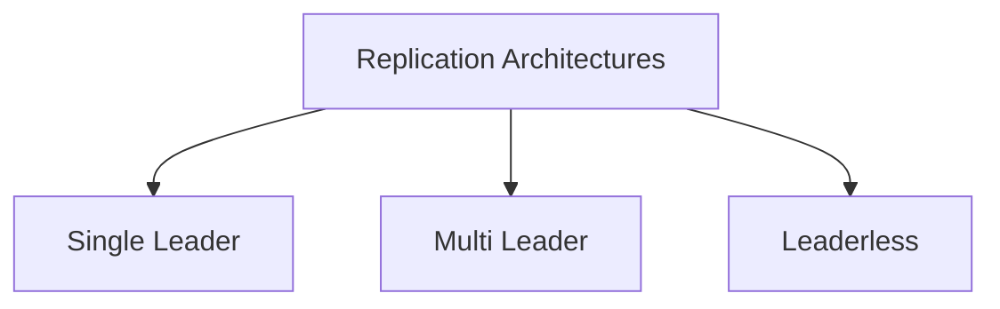
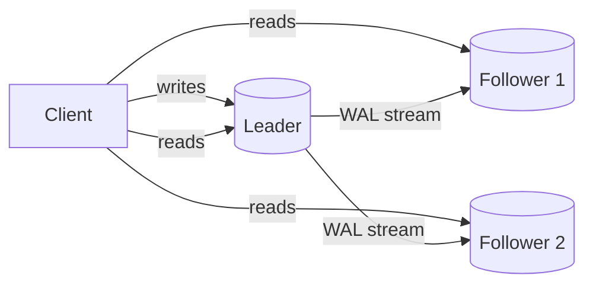
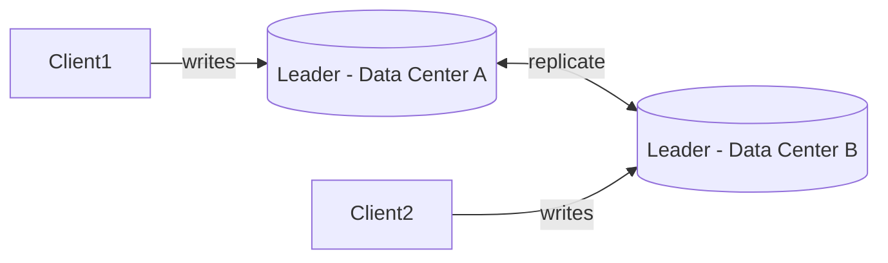
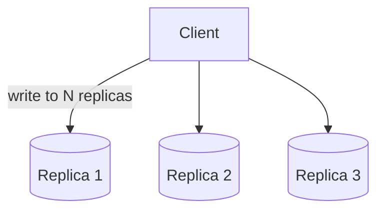
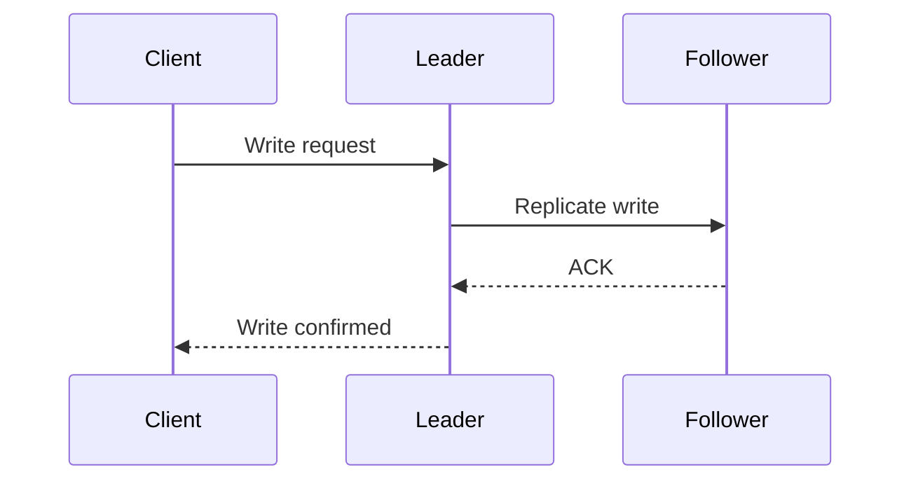
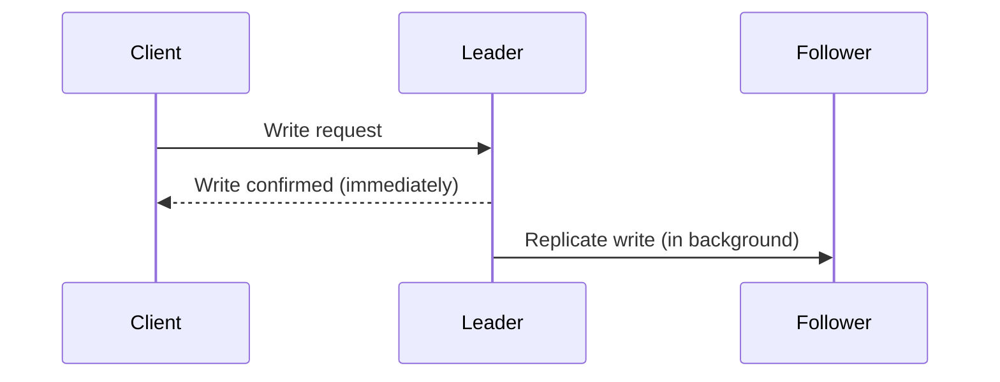
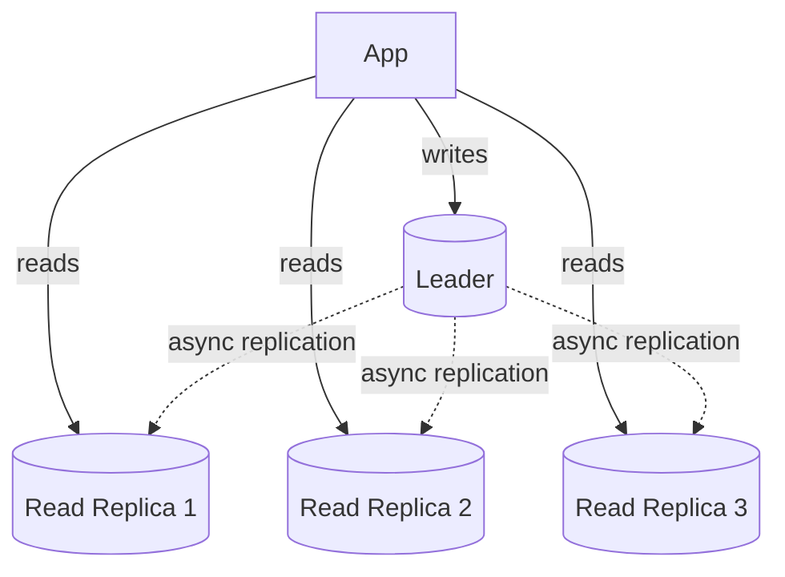
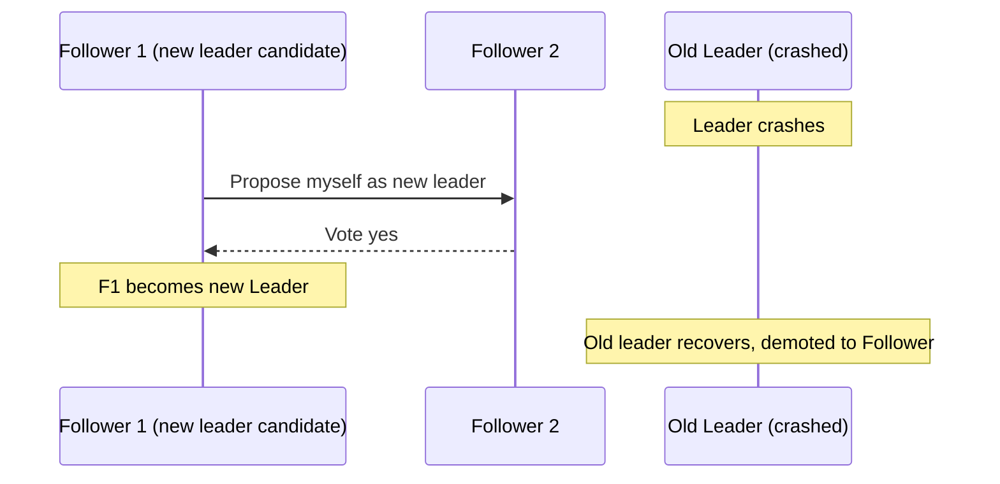

# Module 3 — Replication

> Builds on Modules 1–2. Fragmentation decided *what* data lives where; Replication decides *how many copies* exist and *how they stay in sync*.

---

## 3.1 What Is Replication?

Replication is the process of **keeping copies of the same data on multiple nodes** so that:
- If one node fails, another has the same data and can take over.
- Read traffic can be spread across multiple copies.
- Data can be placed physically closer to users in different regions.

**Analogy:** Think of a popular restaurant chain publishing the same menu (the "source of truth") to every branch. If one branch closes for the day, customers can still get the same food at another branch with the same menu. But if the head office changes a price, every branch needs to update its menu — and until they all do, some branches might briefly show the old price. That brief inconsistency window is exactly what replication lag is (Section 3.9).

## 3.2 Why Replication? (Problems It Solves)

| Problem | How Replication Helps |
|---|---|
| Node crashes → data lost or unavailable | Another replica has the same data, takes over |
| Too many reads for one node | Route reads to multiple replicas |
| Users far from the primary data center | Place a replica near them |
| Planned maintenance / upgrades | Failover to a replica during upgrade |
| Disaster recovery (data center burns down) | Geo-replicated copy in another region |

Cross-reference: Replication is deeply connected to the **WAL (Write-Ahead Log)** covered in earlier parts — most replication mechanisms work by **shipping the WAL (or an equivalent change stream)** from the primary to replicas, which then **replay** it to reconstruct the same state.

---

## 3.3 Replication Architectures — Overview

## 3.4 Single Leader Replication (Primary-Replica / Master-Slave)

### How It Works

One node is designated the **leader** (primary/master). All writes go through the leader. The leader then streams its changes (via WAL or an operation log) to one or more **followers** (replicas/slaves), which apply changes in the same order.

### Step-by-Step Execution

1. Client sends a write (e.g., `UPDATE accounts SET balance = balance - 100 WHERE id = 5`) to the leader.
2. Leader applies the write locally and appends it to its WAL.
3. Leader ships the WAL entry to all followers (synchronously or asynchronously — Section 3.6).
4. Each follower applies the WAL entry in the **exact same order** it was generated, ensuring followers converge to the same state as the leader.
5. Client reads can be served by the leader (always fresh) or by followers (may lag — Section 3.9).

### Advantages
- Simple mental model — one place all writes go, no write-write conflicts to resolve.
- Reads can scale horizontally by adding more followers.
- Well understood, mature tooling (PostgreSQL streaming replication, MySQL binlog replication).

### Disadvantages
- **Leader is a bottleneck for writes** — you cannot scale write throughput just by adding followers.
- **Leader is a single point of failure for writes** — if it dies, you need failover (Section 3.11), during which writes may be unavailable.
- Followers may serve **stale data** (replication lag).

### Real Examples
- **PostgreSQL**: streaming replication ships WAL segments from primary to standby servers; supports both synchronous and asynchronous modes.
- **MySQL**: uses the **binary log (binlog)** — replicas read and re-execute (or apply row-based) events from the primary's binlog.
- **MongoDB**: uses **replica sets** — a single primary accepts writes, secondaries replicate via the **oplog** (operation log), and automatic election picks a new primary on failure.

---

## 3.5 Multi Leader Replication (Master-Master)

### How It Works

Multiple nodes can each accept writes ("leaders"), and each leader propagates its writes to all other leaders.

### Why Use Multi Leader?

- Useful when you have **multiple data centers** and want each region to accept local writes with low latency, rather than sending every write across the ocean to a single leader.
- Useful for **offline-capable clients** (e.g., a calendar app on your phone that syncs later — your phone is essentially a "leader" while offline).

### The Core Problem: Write Conflicts

Since two leaders can accept writes to the *same* piece of data **independently and concurrently**, conflicts are possible: e.g., User A in Data Center 1 updates a record at the same moment User B in Data Center 2 updates the same record.

### Conflict Resolution Strategies

| Strategy | Description |
|---|---|
| Last Write Wins (LWW) | Attach a timestamp to each write; the latest timestamp wins. Simple but can silently lose data. |
| Application-level merge | Application logic decides how to merge conflicting versions (e.g., merge two shopping carts by union). |
| Custom conflict resolution logic | Database exposes conflicting versions to the application to resolve explicitly. |
| CRDTs (Conflict-free Replicated Data Types) | Specially designed data structures that mathematically guarantee convergence without conflict, regardless of write order (e.g., counters, sets). |

### Advantages
- Low write latency per region (writes served locally).
- Tolerates entire data center failure — other leaders keep accepting writes.

### Disadvantages
- Conflict resolution complexity.
- Harder to reason about consistency — application must be conflict-aware.

### Real Examples
- **MySQL Group Replication** (multi-primary mode).
- **CouchDB** — designed explicitly for multi-leader, offline-first replication with conflict resolution.
- Multi-region deployments of many databases used for active-active setups.

---

## 3.6 Leaderless Replication

### How It Works

There is no designated leader. **Any replica can accept a write directly from a client.** The client (or a coordinator) sends the write to **multiple replicas** simultaneously, and reads are also sent to multiple replicas — the correct/latest value is determined using **quorums** and versioning.

### Quorum-Based Reads/Writes

Given `N` replicas:
- `W` = number of replicas that must acknowledge a write for it to succeed.
- `R` = number of replicas that must respond to a read for it to be considered valid.
- **Rule of thumb for strong consistency:** `W + R > N` guarantees that any read quorum and any write quorum overlap in at least one replica, so a read will see the latest write.

**Mathematical intuition:** If `N = 3`, `W = 2`, `R = 2`, then `W + R = 4 > N = 3`. Any 2-out-of-3 write set and any 2-out-of-3 read set must share at least one common replica (pigeonhole principle), guaranteeing the read sees the latest write.

### Read Repair and Hinted Handoff

Covered in depth in Module 12 (Cassandra), but the core idea:
- **Read repair**: when a read discovers replicas have different versions of data, the newest version is written back to the stale replicas.
- **Hinted handoff**: if a replica is temporarily down during a write, another node stores a "hint" and delivers the write once the replica comes back online.

### Advantages
- No single point of failure at all (no leader to fail over).
- Highly available — writes can succeed even if some replicas are down (as long as quorum `W` is met).
- Tunable consistency per operation (choose stronger or weaker `R`/`W` based on the use case).

### Disadvantages
- More complex client/coordinator logic.
- Conflicts still possible if quorums don't overlap correctly, or under network partitions.
- Higher write latency in the worst case (must wait for `W` acknowledgments across the network).

### Real Examples
- **Amazon DynamoDB** (inspired by the original Dynamo paper).
- **Apache Cassandra** — tunable consistency levels (`ONE`, `QUORUM`, `ALL`).
- **Riak**.

---

## 3.7 Comparison Table: Single Leader vs Multi Leader vs Leaderless

| Aspect | Single Leader | Multi Leader | Leaderless |
|---|---|---|---|
| Write path | Only through leader | Through any leader | Through any/multiple replicas |
| Write scalability | Limited by leader | Better (per-region) | Best (fully distributed) |
| Conflict handling | None needed (one leader) | Required (LWW, CRDTs, app logic) | Required (versioning, quorums) |
| Failover complexity | Needs leader election | Simpler (no single leader to lose) | None (no leader concept) |
| Consistency model | Strong (if sync) | Eventual (usually) | Tunable (via R/W quorum) |
| Best for | Traditional OLTP apps | Multi-region active-active apps | Massive-scale, highly available systems |
| Examples | PostgreSQL, MySQL (default), MongoDB replica set | CouchDB, MySQL Group Replication | DynamoDB, Cassandra, Riak |

---

## 3.8 Synchronous vs Asynchronous vs Semi-Synchronous Replication

### Synchronous Replication

The leader waits for **acknowledgment from replica(s)** before confirming the write to the client.

- **Pros:** Guarantees replicas are fully up to date at commit time — no data loss if leader dies immediately after acknowledging.
- **Cons:** Write latency = time for slowest required replica to respond; if that replica is down, writes can stall or fail.

### Asynchronous Replication

The leader confirms the write to the client **immediately**, without waiting for followers to apply it.

- **Pros:** Low latency, leader failure of a follower doesn't block writes.
- **Cons:** If the leader crashes before replicating, **acknowledged writes can be lost** (this is why it's called "eventual" consistency in this context).

### Semi-Synchronous Replication

A middle ground: the leader waits for acknowledgment from **at least one** follower (not all), then confirms to the client; remaining followers replicate asynchronously.

- **Pros:** Balances safety (at least one durable copy) and performance (doesn't wait for every replica).
- **Cons:** Still slightly higher latency than pure async; doesn't guarantee *all* replicas are current.

### Comparison Table

| Mode | Data Loss Risk on Leader Crash | Write Latency | Availability if Follower Down |
|---|---|---|---|
| Synchronous (all followers) | None | Highest | Writes blocked |
| Semi-synchronous (1 follower) | Low | Medium | Mostly available |
| Asynchronous | Possible | Lowest | Fully available |

**Interview tip:** This tradeoff is a direct instance of the **CAP/PACELC** tradeoffs covered in Modules 6–7 — synchronous replication favors consistency at the cost of latency/availability; asynchronous favors latency/availability at the cost of potential data loss (a consistency violation on failure).

---

## 3.9 Read Replicas, Replica Lag, Read/Write Scaling

### Read Replicas

Followers used specifically to **serve read traffic**, offloading the leader. Extremely common pattern: "1 leader (handles writes) + N read replicas (handle reads)."

### Replica Lag

The delay between a write being committed on the leader and that write becoming visible on a follower (common with asynchronous replication).

**Why it matters (Read-Your-Writes problem):** A user updates their profile picture, then immediately reloads the page — if the read is routed to a lagging replica, they might see their **old** picture. This is a classic distributed systems consistency bug asked about in interviews.

**Mitigations:**
- Route a user's own reads to the leader for a short window after they write ("read-your-writes consistency").
- Use "sticky sessions" so a user's reads always hit the same replica they last wrote to.
- Track a logical timestamp/version and refuse to read from a replica that hasn't caught up to it yet.

### Write Scaling

Single-leader replication does **not** scale writes (all writes funnel through one node). To scale writes, you need either:
- Multi-leader/leaderless replication, or
- **Sharding** (Module 4) — splitting write load across independent leaders for different data subsets.

---

## 3.10 Failover and Failback

### Failover

The process of promoting a replica to become the new leader when the current leader fails.

**Step-by-step:**
1. **Detect failure** — usually via missed heartbeats/timeouts (hard to distinguish a truly dead node from a slow/network-partitioned one — Module 1's "partial failure" problem).
2. **Choose a new leader** — often the replica with the most up-to-date data (least lag) is chosen; may involve a consensus algorithm (Module 8) for correctness.
3. **Reconfigure**: other replicas and clients are told to point to the new leader.
4. **Old leader recovery**: if/when the old leader comes back, it must recognize it's no longer the leader and become a follower (or risk **split brain** — two nodes both acting as leader).

### Failback

The (optional) process of returning the system to its original leader once it recovers and has caught up — not always done automatically, since it introduces another disruptive transition; many systems just let the newly-promoted leader stay leader.

### Failover Risks
- **Split brain**: if failure detection is wrong (network partition, not a real crash), you might end up with two leaders accepting writes simultaneously — a serious consistency violation. Prevented using **fencing tokens** and **consensus algorithms** (Module 8).
- **Data loss**: if failover picks a replica that hadn't received the most recent writes (common with async replication), those writes are lost.

---

## 3.11 Replication in Real Systems

### PostgreSQL
- **Streaming replication**: ships WAL records over the network to standby servers, which continuously replay them.
- Can be synchronous (`synchronous_commit`) or asynchronous.
- Logical replication (row-level, more flexible) also supported, separate from physical WAL shipping.

### MySQL
- **Binlog-based replication**: primary writes changes to a binary log; replicas (via an I/O thread) copy the binlog and (via an SQL thread) apply it.
- Supports asynchronous (default), semi-synchronous, and Group Replication (multi-primary) modes.

### MongoDB
- **Replica Sets**: one primary + multiple secondaries, using the **oplog** (a capped collection recording all writes).
- Automatic **election** among secondaries if the primary becomes unreachable (uses a Raft-like consensus protocol internally).
- Read preference can be configured (primary, primary-preferred, secondary, nearest) — directly exposing the read-replica-lag tradeoff to the application.

---

## 3.12 Failure Scenarios Summary

| Scenario | Consequence | Mitigation |
|---|---|---|
| Leader crash | Writes unavailable until failover | Automated failover + consensus-based leader election |
| Async replica lag | Stale reads | Read-your-writes tracking, sticky sessions |
| Network partition between leader and followers | Possible split brain if followers wrongly promote a new leader | Fencing tokens, quorum-based election (Module 8) |
| Slow synchronous follower | All writes stall | Semi-synchronous mode, timeouts with fallback |
| Conflicting writes (multi-leader) | Data divergence | LWW, CRDTs, app-level merge |

---

## 3.13 Interview Questions — Module 3

### Beginner
1. What is the difference between synchronous and asynchronous replication?
2. What is replica lag, and why can it cause a "read-your-writes" bug?
3. Name the three replication topologies (single leader, multi leader, leaderless).

### Intermediate
4. Explain the quorum condition `W + R > N` and why it guarantees strong consistency in leaderless replication.
5. Why doesn't single-leader replication solve the write-scalability problem?
6. Compare failover risks in single-leader vs leaderless architectures.

### Senior SDE-2/SDE-3
7. Design a replication strategy for a global chat application where users in different continents need low-latency writes. Would you choose single-leader, multi-leader, or leaderless? Justify with conflict-handling implications.
8. A production incident: after a leader crash and automatic failover, some recently "successful" writes are missing on the new leader. Explain what likely happened and how you'd prevent it going forward.
9. How would you implement "read-your-writes" consistency on top of an asynchronously replicated read-replica architecture, without forcing all reads to the leader?

### GATE-style / MCQ
10. In a leaderless system with N=5, W=3, what is the minimum R needed to guarantee strong consistency?
    a) 1
    b) 2
    c) 3
    d) 5
    *(Answer: c — since W+R > N → 3+R>5 → R≥3)*

11. Which replication mode risks losing acknowledged writes if the leader crashes immediately after responding to the client?
    a) Synchronous
    b) Semi-synchronous
    c) Asynchronous
    d) None of the above
    *(Answer: c)*

---

## 3.14 Exercises

**Beginner**
- Set up (conceptually or in a sandbox) a PostgreSQL primary with one streaming replica; describe what happens to a write when `synchronous_commit = on` vs `off`.

**Intermediate**
- Given N=7 replicas in a leaderless system, propose W and R values that (a) favor read latency, and (b) favor write latency, while maintaining `W+R>N`.

**Advanced / Production Scenario**
- Your MongoDB replica set primary fails during peak traffic. Walk through, step by step, what happens from the moment of failure to a new primary serving writes, and identify the write-loss window.

**Whiteboard Interview Problem**
- "Design the replication topology for a banking ledger service that must never lose an acknowledged transaction, even in a data-center failure, while keeping write latency reasonable." (Expect discussion of synchronous replication to a nearby data center + async to a far one.)

**Case Study**
- Research how Instagram/Facebook use MySQL semi-synchronous replication in production and summarize their reasoning.

---

## 3.15 Practice Resources

- PostgreSQL Docs — Streaming Replication: https://www.postgresql.org/docs/current/warm-standby.html#STREAMING-REPLICATION
- MySQL Docs — Replication: https://dev.mysql.com/doc/refman/8.0/en/replication.html
- MongoDB Docs — Replica Sets: https://www.mongodb.com/docs/manual/replication/
- MongoDB University: https://learn.mongodb.com/
- Amazon Dynamo Paper (leaderless/quorum foundations): https://www.allthingsdistributed.com/files/amazon-dynamo-sosp2007.pdf

---

## 3.16 Cheat Sheet — Module 3

- **Single Leader**: all writes via one node; simple; write bottleneck; needs failover.
- **Multi Leader**: multiple write-accepting nodes; needs conflict resolution (LWW, CRDTs); good for multi-region active-active.
- **Leaderless**: no leader; quorum reads/writes; `W + R > N` for strong consistency; used by Dynamo, Cassandra.
- **Sync replication** = safe, slower. **Async replication** = fast, risk of data loss. **Semi-sync** = balance.
- **Replica lag** causes stale reads — mitigate with read-your-writes tracking.
- **Failover** = promoting a replica to leader on failure; risk of **split brain** and **data loss**; consensus algorithms (Module 8) make this safe.
- Real systems: PostgreSQL/MySQL = single-leader with WAL/binlog shipping; MongoDB = replica sets with oplog + election; Cassandra/DynamoDB = leaderless with tunable quorums.

---

**End of Module 3.**

Reply with "continue" or "next module" to proceed to **Module 4: Sharding**.
