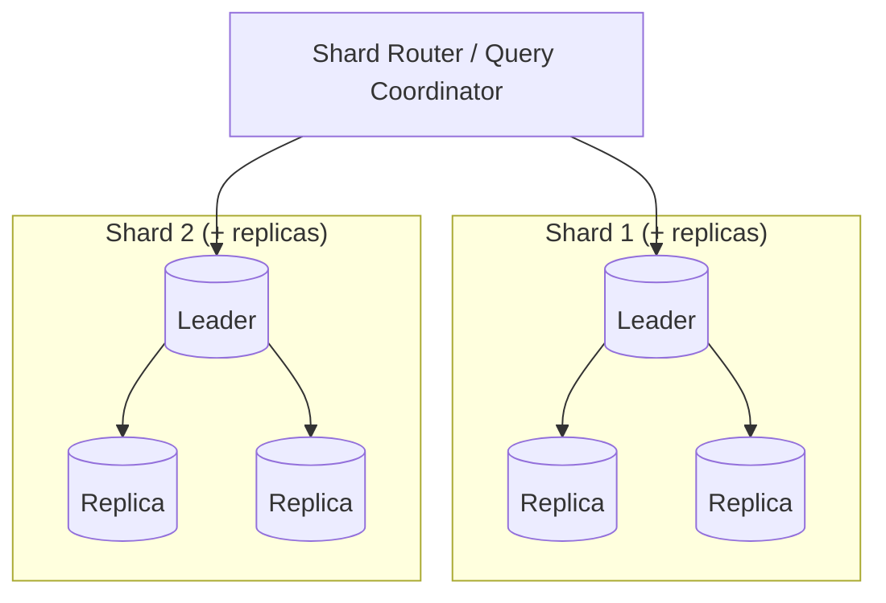
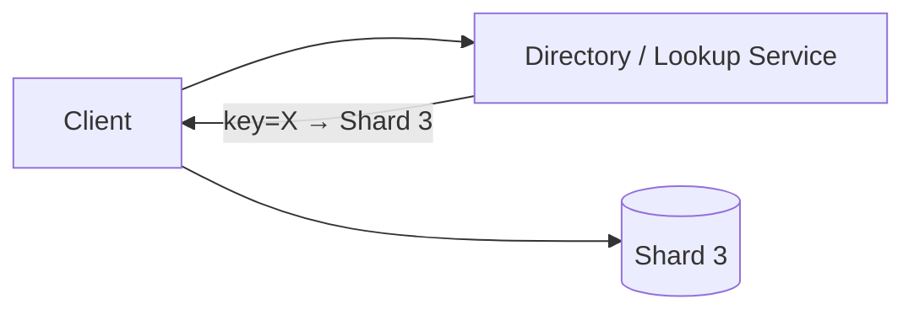
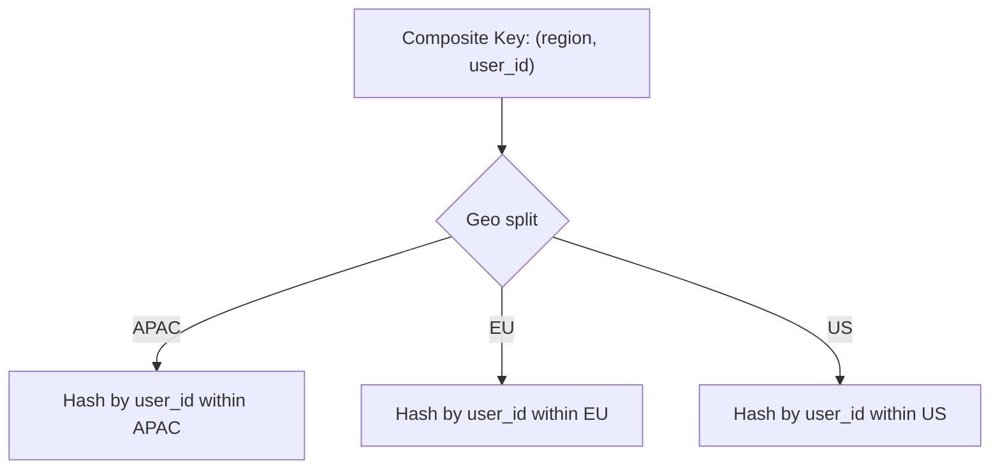
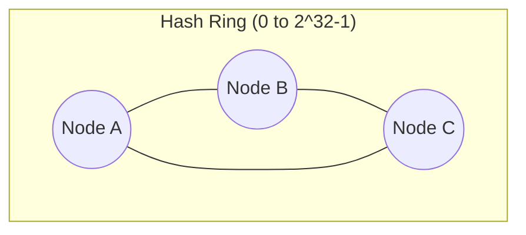
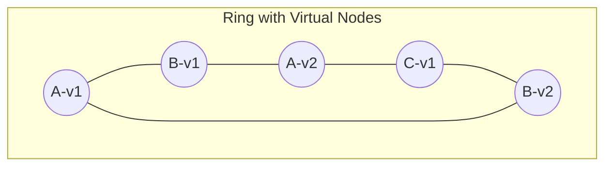
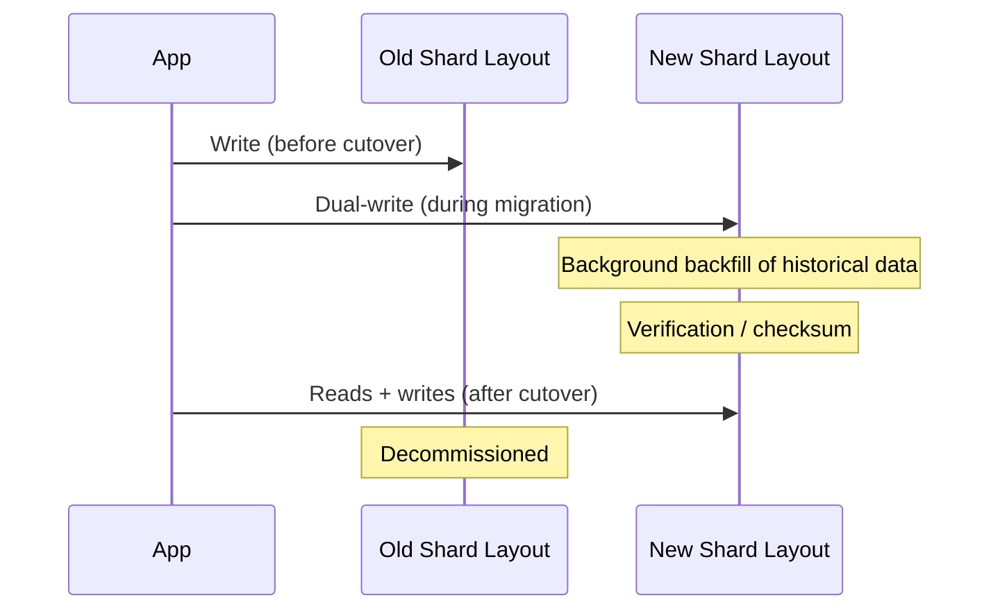
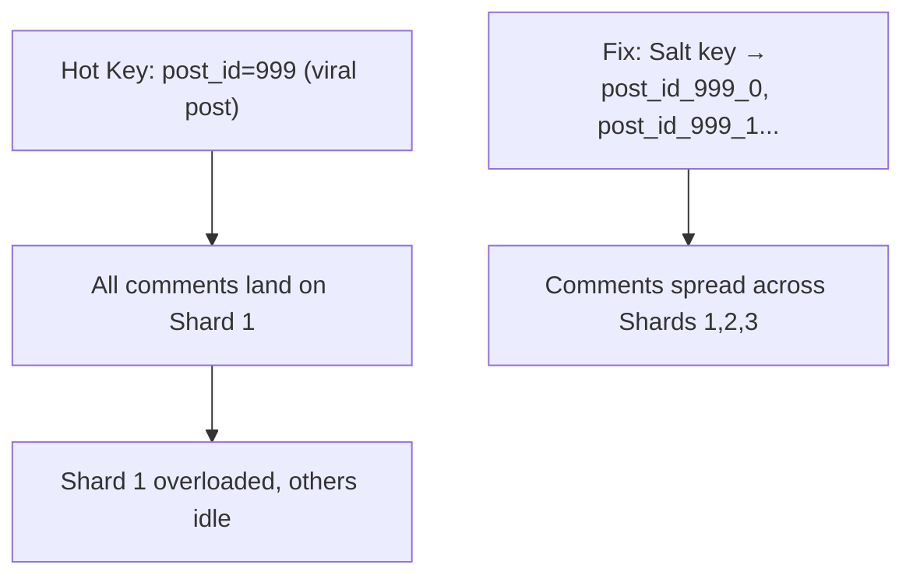

# Module 4 — Sharding

> Builds on Modules 1–3. Fragmentation (Module 2) is the theory; **Sharding** is the practical, industry term for horizontal fragmentation applied to scale out both storage *and* write throughput, each shard typically living on its own node (or set of replicated nodes).

---

## 4.1 What Is Sharding?

Sharding is the practice of splitting a large dataset into smaller, independent pieces called **shards**, each stored on a separate node (or replica set), such that together they hold the complete dataset.

**Why was it invented?** Replication (Module 3) solves availability and read-scaling, but a single leader still holds **100% of the data** and handles **100% of the writes**. Once a dataset is too large for one machine, or write throughput exceeds what one leader can handle, you must split the data itself — that's sharding.

**Analogy:** Imagine a library with 10 million books. Instead of cramming every book onto one giant shelf (impossible) and making one librarian handle every checkout (impossible), the library is split into sections (Fiction, Science, History...) across different floors, each with its own librarian. Each floor is a "shard" — together they form the whole library.

## 4.2 Why Sharding? (Problems It Solves)

| Problem | Sharding Solution |
|---|---|
| Dataset too large for one disk | Split across many disks/nodes |
| Write throughput exceeds one node's capacity | Each shard has its own write path |
| Query latency degrades as table grows (index depth, cache misses) | Smaller per-shard tables = faster local queries |
| Need geographic data locality | Shard by region |

Cross-reference: Sharding is the deployment of **horizontal fragmentation** (Module 2) at scale, and each shard often has its own **replica set** (Module 3) for availability — so sharding and replication are typically combined, not alternatives.



---

## 4.3 Partition Keys (Shard Keys)

The **partition key** (or shard key) is the field (or combination of fields) used to decide which shard a given row/document belongs to. Choosing this key well is one of the most consequential decisions in a sharded system's design.

**Good partition key properties:**
- **High cardinality** — many distinct values, so data spreads evenly.
- **Even access distribution** — no single value is accessed disproportionately (avoids hot partitions, Section 4.7).
- **Aligns with common query patterns** — ideally most queries include the shard key, so they can be routed to a single shard (avoiding expensive **scatter-gather** queries across all shards).

---

## 4.4 Sharding Strategies

### 4.4.1 Range Sharding

Data is split into contiguous ranges of the shard key. E.g., `user_id 1–1,000,000` → Shard 1, `user_id 1,000,001–2,000,000` → Shard 2.

```
Shard 1: [A - H]     Shard 2: [I - P]     Shard 3: [Q - Z]
(customer names alphabetically)
```

- **Pros:** Efficient **range queries** (e.g., "all orders between Jan 1 and Jan 31" stay on one or few shards); simple to reason about.
- **Cons:** Prone to **hot spots** — if recent data (e.g., timestamps, auto-incrementing IDs) is the shard key, all new writes pile onto the *same* shard (the one holding the latest range), defeating the purpose of sharding.
- **Used by:** MongoDB (range-based sharding option), HBase, Bigtable-style systems.

### 4.4.2 Hash Sharding

The shard key is passed through a **hash function**, and the hash value (often modulo the number of shards) determines the target shard.

```
shard_id = hash(shard_key) % num_shards
```

- **Pros:** Distributes data (and thus write load) evenly, avoiding hot spots from sequential keys.
- **Cons:** Destroys the natural ordering of data — range queries (e.g., "all orders in January") now require querying **every** shard (scatter-gather), since consecutive keys land on random shards.
- **Used by:** Cassandra (via partitioner), DynamoDB, MongoDB (hashed sharding option).

### 4.4.3 Directory-Based Sharding

A separate **lookup service** (directory) maintains an explicit mapping from key → shard, rather than computing it algorithmically.



- **Pros:** Maximum flexibility — can rebalance by simply updating mapping entries, without needing to physically move ranges in a predictable pattern; can handle uneven shard sizes gracefully.
- **Cons:** The directory itself becomes a critical dependency — needs to be highly available and fast (often cached aggressively at clients); an extra network hop for lookups (unless cached).
- **Used by:** Many custom/large-scale systems (e.g., early Facebook/Google internal systems, some multi-tenant SaaS platforms mapping tenant → shard).

### 4.4.4 Geo-Sharding (Geo-Partitioning)

Data is sharded based on **geographic location** (region, country) rather than a hash or range of an arbitrary key.

- **Pros:** Keeps data physically close to the users who access it most (lower latency); can help satisfy data-residency/regulatory requirements (Module 2's allocation discussion).
- **Cons:** Uneven load if some regions have far more users than others; users who travel (e.g., roaming) complicate "which shard is my data on" logic.
- **Used by:** Global systems like Google Spanner (multi-region configs), CockroachDB (geo-partitioning feature), large e-commerce platforms.

### 4.4.5 Composite Sharding

Combines multiple fields as the shard key, e.g., `(region, hash(user_id))` — geo-shard first for locality, then hash within region to avoid hot spots.



- **Pros:** Gets locality benefits of geo-sharding *and* even-distribution benefits of hash sharding.
- **Cons:** More complex routing logic; must still choose good sub-keys.

### Comparison Table

| Strategy | Range Queries | Even Load Distribution | Hot Spot Risk | Rebalancing Difficulty | Example Systems |
|---|---|---|---|---|---|
| Range | Excellent | Poor (if sequential keys) | High | Medium | HBase, MongoDB (range) |
| Hash | Poor (scatter-gather) | Excellent | Low | Medium-High | Cassandra, DynamoDB |
| Directory-based | Depends on mapping | Flexible (manual control) | Low (if managed well) | Low (just update mapping) | Custom large-scale systems |
| Geo-based | Good within region | Poor if regions uneven | Medium | High (data must move) | Spanner, CockroachDB |
| Composite | Good within sub-key | Excellent | Low | Medium | Large multi-region platforms |

---

## 4.5 Consistent Hashing and Virtual Nodes

### The Problem With Naive Hash Sharding

With plain `hash(key) % num_shards`, **adding or removing a single node changes the modulus**, which reshuffles almost *every* key's assignment — causing a massive, unnecessary data migration.

**Mathematical intuition:** If you have 4 shards and add a 5th, `hash(key) % 4` vs `hash(key) % 5` produce completely different results for most keys — potentially requiring ~80% of all data to move, just to add one node.

### Consistent Hashing — The Solution

Instead of `% N`, map both **shard/node IDs** and **data keys** onto the same circular hash space (a "ring," typically 0 to 2^32-1). Each key is assigned to the **first node clockwise** from its position on the ring.



**Step-by-step:**
1. Hash each node's identifier onto the ring → gives each node a position.
2. Hash each data key onto the ring.
3. Walk clockwise from the key's position until you hit the first node — that node owns the key.
4. **Adding a node**: it only takes over keys between itself and the *previous* node on the ring — only a small fraction of keys move, not all of them.
5. **Removing a node**: its keys move to the *next* node clockwise — again, only a fraction of the ring is affected.

### Virtual Nodes (VNodes)

Problem with plain consistent hashing: with only a few physical nodes, their positions on the ring might be uneven, causing some nodes to own much larger key ranges than others (imbalance).

**Solution:** Each physical node is assigned **many virtual positions ("virtual nodes")** on the ring instead of just one.



- Distributes load much more evenly across physical nodes.
- When a physical node is added/removed, its *many small* virtual-node ranges are spread across many other nodes (not dumped onto just one neighbor), smoothing out rebalancing load.
- **Used by:** Cassandra (tokens per node, configurable `num_tokens`), DynamoDB internally, many consistent-hashing based systems.

### Why This Matters for Interviews

Consistent hashing + virtual nodes is a **top-tier system design interview topic** (asked in "design a distributed cache," "design DynamoDB," "design Cassandra" questions). Be ready to explain:
1. Why naive `% N` hashing fails at scale.
2. How consistent hashing minimizes data movement on resize.
3. Why virtual nodes are needed on top of basic consistent hashing.

---

## 4.6 Rebalancing and Resharding

### Rebalancing

The process of moving data between shards/nodes to restore an even distribution — needed when:
- Nodes are added or removed.
- Data grows unevenly (some shard keys become far more popular than others).

**Rebalancing strategies:**

| Strategy | Description | Tradeoff |
|---|---|---|
| Fixed number of shards, uneven nodes | Have many more logical shards than physical nodes; move whole shards between nodes as needed | Simple; requires deciding shard count upfront |
| Consistent hashing (with vnodes) | Adding/removing a node moves only its share of the ring | Minimal data movement; more moving parts |
| Directory-based reassignment | Update the directory mapping and physically move data in the background | Maximum flexibility; directory becomes critical path |

### Resharding

The broader process of changing the *sharding scheme itself* — e.g., increasing the number of shards, or switching partition key entirely. This is one of the **highest-risk operations** in a distributed database's lifecycle.

### Online Resharding

Performing resharding **without downtime**, while the system continues serving live traffic.

**Step-by-step (typical approach, e.g., as used by MongoDB's online resharding or Vitess):**
1. Start dual-writing: new writes go to both old and new shard layouts.
2. Backfill: copy existing data from old shards into the new shard layout in the background.
3. Verify: compare/checksum old vs new to ensure consistency.
4. Cut over: switch reads (and eventually writes) to the new shard layout.
5. Decommission: stop dual-writing, remove old shard layout.



- **Pros:** No downtime, safer rollback if issues found before final cutover.
- **Cons:** Complex to implement correctly; requires careful handling of writes that happen *during* backfill (to avoid lost updates); temporary extra storage and write amplification (dual writes).

---

## 4.7 Hot Partitions (Hot Spots)

A **hot partition** is a shard that receives disproportionately more traffic (reads/writes) than others, becoming a bottleneck even though the *overall* system has capacity.

### Common Causes

| Cause | Example |
|---|---|
| Sequential/monotonic shard key | Auto-incrementing IDs or timestamps with range sharding → all new writes hit the "latest" shard |
| Celebrity/skewed key | A viral social media post's comments all shard to the same partition (post_id as key) |
| Poor key cardinality | Sharding by `country` when 90% of users are in one country |
| Popular tenant in multi-tenant systems | One large customer generates far more traffic than shard key distribution assumed |

### Mitigations

- Use **hash sharding** or **composite keys** (e.g., append a random suffix or secondary attribute) to break up sequential/skewed keys.
- **Salting**: append a small random or rotating value to a hot key so writes for that key spread across multiple shards, then merge on read.
- **Split hot shards further** (sub-shard just the hot range).
- **Cache aggressively** in front of the hot shard for read-heavy hot spots.
- Detect hot spots via per-shard metrics/monitoring and rebalance proactively.



---

## 4.8 Failure Scenarios in Sharded Systems

| Scenario | Impact | Mitigation |
|---|---|---|
| Poor shard key choice | Permanent hot partition, uneven growth | Careful key design upfront; composite/hash keys |
| Cross-shard transaction needed | Slower, needs distributed transaction protocol (Module 5) | Design schema to minimize cross-shard transactions; co-locate related data |
| Cross-shard query (no shard key in filter) | Scatter-gather across all shards — slow | Add secondary indexes/directory service, or accept latency for rare queries |
| Resharding mid-flight failure | Partial migration, data inconsistency | Dual-write + verification + safe rollback plan |
| Router/directory service down | Entire cluster unreachable (single point of failure at routing layer) | Replicate the router/directory itself; cache mappings at clients |

---

## 4.9 Sharding in Real Systems

| System | Sharding Approach |
|---|---|
| MongoDB | Range-based or hashed sharding on a chosen shard key; a `mongos` router directs queries; a config server stores chunk metadata |
| Cassandra | Consistent hashing with virtual nodes (tokens); partitioner (e.g., Murmur3Partitioner) determines placement |
| DynamoDB | Hash-based partitioning on the partition key; auto-manages partition splits |
| Vitess (MySQL sharding) | Range or custom "vindexes" (similar to directory-based) on top of unmodified MySQL instances |
| CockroachDB / Spanner | Automatic range-based sharding, splitting/merging "ranges" as data grows, fully transparent to the application |

---

## 4.10 Interview Questions — Module 4

### Beginner
1. What is sharding, and how is it different from replication?
2. Define range sharding and hash sharding with one example each.
3. What is a hot partition, and give one common cause.

### Intermediate
4. Why does naive `hash(key) % N` sharding cause massive data movement when a node is added? How does consistent hashing fix this?
5. What are virtual nodes, and why are they needed even with consistent hashing?
6. Compare directory-based sharding with hash sharding — when would you choose directory-based?

### Senior SDE-2/SDE-3
7. Design the sharding strategy for a URL shortener service with 10 billion URLs and heavy read traffic on a small percentage of "viral" short links. Address hot partitions explicitly.
8. Walk through, step by step, how you would perform online resharding (doubling shard count) on a live production system with zero downtime.
9. Your system shards by `user_id`, but a new feature requires querying "all transactions in the last hour across all users." How do you handle this without scanning every shard on every request?

### GATE-style / MCQ
10. Which sharding strategy is most vulnerable to hot spots when using sequential/auto-incrementing keys?
    a) Hash sharding
    b) Range sharding
    c) Directory-based sharding
    d) Consistent hashing
    *(Answer: b)*

11. What is the main benefit of virtual nodes in consistent hashing?
    a) Faster hash computation
    b) More even load distribution across physical nodes
    c) Eliminates the need for replication
    d) Removes the need for a partition key
    *(Answer: b)*

---

## 4.11 Exercises

**Beginner**
- Given shard key `order_id` (auto-incrementing), explain why range sharding would create a hot partition, and propose a hash-based alternative.

**Intermediate**
- Draw a consistent hashing ring with 4 physical nodes, each assigned 3 virtual nodes. Show what happens (which keys move) when you add a 5th physical node.

**Advanced / Production Scenario**
- Your e-commerce system shards `Orders` by `customer_id` using hash sharding. A single enterprise customer now generates 40% of all order volume, overloading one shard. Propose two different fixes.

**Whiteboard Interview Problem**
- "Design the sharding scheme for a global messaging app's `Messages` table, considering both per-conversation read patterns and even write distribution across shards."

**Case Study**
- Research how MongoDB's chunk-splitting and balancer work internally, and summarize how it avoids the "reshuffle everything" problem of naive hash sharding.

---

## 4.12 Practice Resources

- MongoDB Docs — Sharding: https://www.mongodb.com/docs/manual/sharding/
- Cassandra Docs — Data Distribution and Replication: https://cassandra.apache.org/doc/latest/cassandra/architecture/dynamo.html
- Vitess Docs — Sharding: https://vitess.io/docs/design-docs/sharding/
- Amazon DynamoDB Developer Guide — Partitions: https://docs.aws.amazon.com/amazondynamodb/latest/developerguide/HowItWorks.Partitions.html
- Consistent Hashing (original paper reference via Google Scholar / ACM): search "Consistent Hashing and Random Trees, Karger et al. 1997"

---

## 4.13 Cheat Sheet — Module 4

- **Sharding** = horizontal fragmentation deployed for scale; each shard often has its own replica set.
- **Range sharding**: great for range queries, prone to hot spots with sequential keys.
- **Hash sharding**: even distribution, poor range-query support (scatter-gather).
- **Directory-based sharding**: maximum flexibility via explicit key→shard mapping, but directory is a critical dependency.
- **Geo-sharding**: locality + compliance benefits, uneven regional load risk.
- **Consistent hashing**: minimizes data movement when nodes are added/removed (only a fraction of the ring is affected, not everything).
- **Virtual nodes**: multiple ring positions per physical node → smoother, more even rebalancing.
- **Hot partitions**: caused by skewed/sequential keys; fixed via salting, better key design, or sub-sharding.
- **Online resharding**: dual-write → backfill → verify → cutover → decommission, all without downtime.

---

**End of Module 4.**

Reply with "continue" or "next module" to proceed to **Module 5: Distributed Transactions**.
