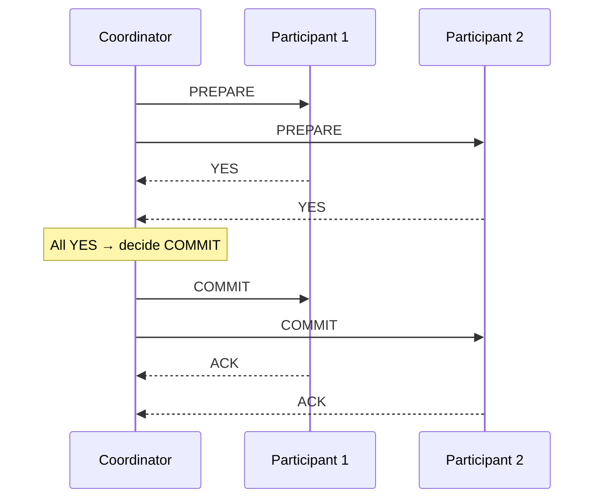
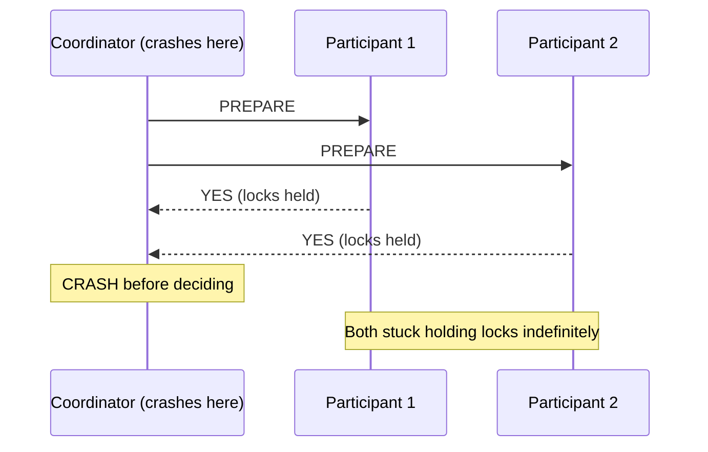
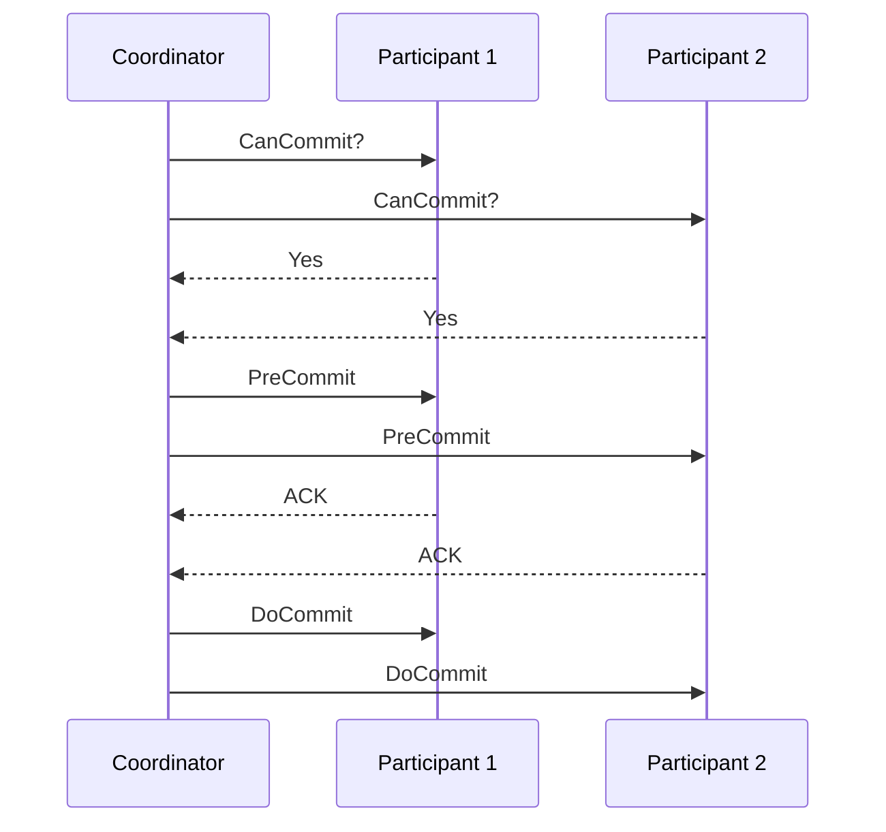
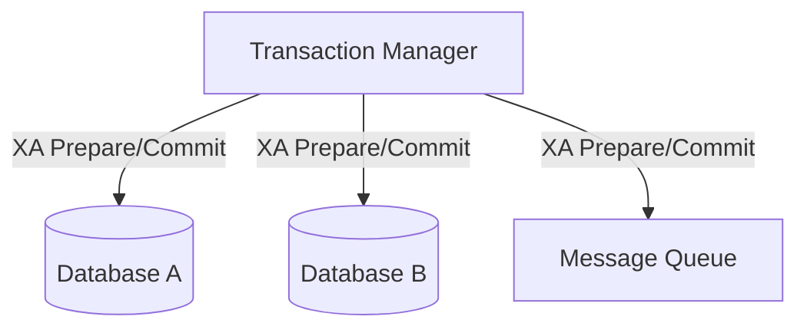
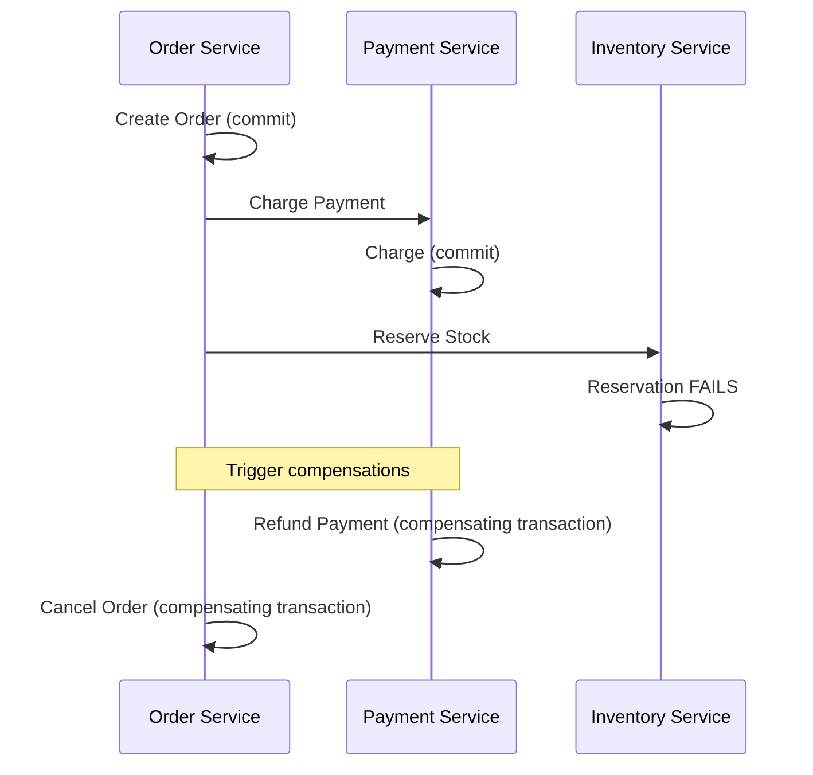
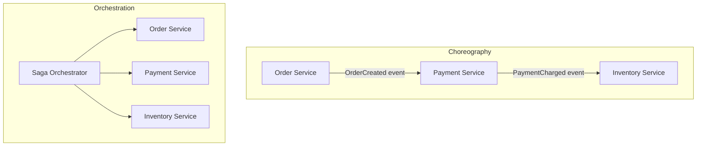
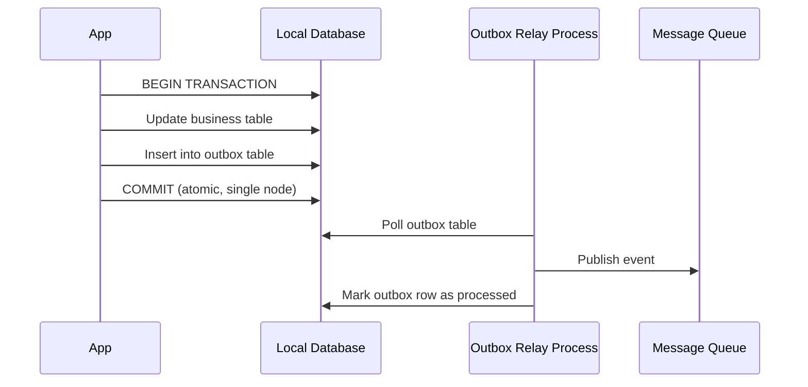

# Module 5 — Distributed Transactions

> Builds on Modules 1–4 and cross-references ACID/WAL/MVCC from earlier parts. Here we ask: once data is sharded across nodes (Module 4), how do we make a transaction that touches **multiple shards** behave atomically?

---

## 5.1 The Problem: Distributed ACID

Recall from earlier parts that a single-node transaction guarantees **ACID** (Atomicity, Consistency, Isolation, Durability) using mechanisms like WAL and locking/MVCC — all within one process with direct memory/disk access.

**What breaks in a distributed setting?** If a transaction needs to update data on **Node A** and **Node B** simultaneously (e.g., "transfer money from an account on Shard 1 to an account on Shard 2"), we need **all-or-nothing** behavior across *two independent machines connected only by an unreliable network*.

**Why was this invented?** Without a protocol, Node A might commit its part while Node B fails/rolls back — leaving the system in an inconsistent state (money debited from Shard 1's account but never credited to Shard 2's account). Distributed transaction protocols exist to prevent exactly this.

**Analogy:** Two people at different bank branches need to complete a wire transfer at the *exact same instant* — either both branches update their books, or neither does. If the phone line drops halfway through, they need an agreed protocol for what happens next (retry, cancel, or assume success) rather than each branch guessing independently.

---

## 5.2 Two-Phase Commit (2PC)

The classical protocol for atomic commits across multiple nodes.

### Roles

- **Coordinator**: the node that manages the transaction and drives the protocol.
- **Participants**: the nodes holding the actual data being modified.

### Step-by-Step Execution

**Phase 1 — Prepare (Voting Phase)**
1. Coordinator sends a `PREPARE` message to all participants.
2. Each participant does whatever work is needed to be *able* to commit (writes to its own local WAL, acquires locks) but does **not** commit yet.
3. Each participant replies `YES` (ready to commit) or `NO` (cannot commit, e.g., constraint violation).

**Phase 2 — Commit/Abort (Decision Phase)**
4. If **all** participants voted `YES`, coordinator sends `COMMIT` to everyone.
5. If **any** participant voted `NO` (or timed out), coordinator sends `ABORT` to everyone.
6. Each participant commits or aborts locally and acknowledges back to the coordinator.



### Mathematical / Logical Intuition

2PC guarantees atomicity by ensuring the *decision* (commit or abort) is made **once**, by a single coordinator, only after unanimous agreement — this converts an "all machines must agree independently" problem into a single point of decision, at the cost of making that single point critical.

### The Blocking Problem

If the **coordinator crashes after sending `PREPARE` but before sending the final decision**, participants that already voted `YES` are stuck: they've promised to commit (and are holding locks) but don't know whether the final answer was `COMMIT` or `ABORT`. They **cannot safely proceed alone** — they must block, holding locks, until the coordinator recovers.



This is the single biggest criticism of 2PC and a very common interview discussion point: **2PC sacrifices availability during coordinator failure** — participants cannot unilaterally decide, so the system blocks.

### Advantages
- Strong guarantee: true atomicity across nodes (all commit or all abort).
- Conceptually simple, well-understood, standardized (see XA below).

### Disadvantages
- **Blocking** on coordinator failure (as above).
- High latency — an extra round trip (prepare, then commit) before any node can finalize.
- Locks held across the network during the prepare phase reduce concurrency/throughput.
- Coordinator is a single point of failure for the whole transaction.

---

## 5.3 Three-Phase Commit (3PC)

An attempt to fix 2PC's blocking problem by adding an extra phase, giving participants enough information to make progress even if the coordinator fails.

### Phases

1. **CanCommit?** — coordinator asks participants if they *could* commit (a pre-check, no locks yet).
2. **PreCommit** — if all say yes, coordinator tells everyone to enter a "pre-commit" state (locks acquired, but still not committed) — critically, this phase also has a **timeout-based fallback**: if a participant doesn't hear from the coordinator, it can safely assume the transaction should proceed (since reaching PreCommit implies everyone already agreed to commit).
3. **DoCommit** — coordinator sends the final commit instruction.



### Why 3PC Is Rarely Used in Practice

- It assumes a **synchronous network with bounded delays** (i.e., you can reliably tell the difference between "message delayed" and "node crashed" using timeouts) — a very unrealistic assumption in real-world networks (recall the "unreliable network" theme from Module 1).
- Under network partitions, 3PC can still make **incorrect decisions** (e.g., different sides of a partition might independently proceed with contradictory choices), which is arguably worse than blocking.
- In practice, most systems either accept 2PC's blocking risk (with recovery procedures) or use entirely different patterns like **SAGA** (Section 5.5) instead of 3PC.

### Comparison: 2PC vs 3PC

| Aspect | 2PC | 3PC |
|---|---|---|
| Phases | 2 (prepare, commit) | 3 (can-commit, pre-commit, do-commit) |
| Blocking on coordinator failure | Yes | Reduced, but not eliminated |
| Network assumption | Any | Requires synchronous/bounded-delay network |
| Real-world adoption | Common (XA, JTA) | Rare — mostly academic/theoretical |
| Failure correctness | Safe but blocks | Can make wrong decisions under partition |

---

## 5.4 XA Transactions

**XA** is a standard (from The Open Group) that defines how a **transaction manager** coordinates multiple **resource managers** (databases, message queues, etc.) using a 2PC-style protocol, so that a single application-level transaction can span multiple heterogeneous systems (e.g., a relational database *and* a message queue).



- **Pros:** Standardized, works across heterogeneous systems (not just multiple shards of the same DB), supported by many enterprise Java (JTA) and .NET frameworks.
- **Cons:** Inherits all of 2PC's blocking/latency problems; adds operational complexity (transaction manager becomes critical infrastructure); many modern NoSQL/cloud databases don't support XA at all, favoring different patterns (below).

---

## 5.5 SAGA Pattern

A completely different philosophy for distributed "transactions" that avoids blocking locks across a network entirely, favoring eventual consistency with explicit compensating actions.

### What Is a Saga?

A saga breaks a distributed transaction into a sequence of **local transactions**, each committing independently on its own node. If a later step fails, the saga runs **compensating transactions** to undo the effects of the already-completed steps — rather than using a single atomic all-or-nothing commit.

**Analogy:** Booking a trip involves booking a flight, then a hotel, then a rental car — each is a separate, independent booking (local transaction). If the rental car booking fails, you don't need a global lock across all three companies; you just **cancel** the flight and hotel bookings you already made (compensating actions).

### Step-by-Step Execution (Order Processing Example)

1. **Step 1**: Order Service creates an order (local transaction, commits immediately).
2. **Step 2**: Payment Service charges the customer (local transaction, commits immediately).
3. **Step 3**: Inventory Service reserves stock (local transaction, commits immediately).
4. If Step 3 fails (out of stock): trigger **compensating transactions** — refund the payment (compensates Step 2), cancel the order (compensates Step 1).



### Two Coordination Styles

| Style | Description | Tradeoff |
|---|---|---|
| **Choreography** | Each service listens for events and reacts, publishing its own events in turn — no central controller | Decoupled, but hard to trace/debug overall flow across many services |
| **Orchestration** | A central "saga orchestrator" explicitly tells each service what to do next and handles failures/compensations | Easier to understand/debug, but the orchestrator becomes a critical component |



### Advantages
- No cross-node locks held over the network — each local transaction commits fast and independently.
- Scales well, works naturally with microservices architectures.
- No single blocking coordinator holding resources hostage (unlike 2PC).

### Disadvantages
- **No true isolation** — other transactions can see partially-completed saga state (e.g., an order marked "created" before payment succeeds) — this is a real tradeoff vs classic ACID isolation.
- Compensating transactions must be carefully designed — not all actions are trivially reversible (e.g., you can refund money, but you can't always "un-send" an email).
- More complex application-level logic (need explicit compensation code for every step).

### Compensating Transactions

A compensating transaction is an operation that **semantically undoes** the effect of a previously committed local transaction — it's not a true rollback (the original transaction already committed), but a *new* transaction that reverses the business effect (e.g., "refund" reverses "charge," rather than literally erasing the charge from history).

---

## 5.6 Outbox Pattern

A pattern to reliably publish events/messages **as part of** a local database transaction, avoiding the classic "dual-write problem."

### The Dual-Write Problem

If a service needs to (a) write to its database AND (b) publish an event to a message queue, doing these as two separate operations risks inconsistency: what if the DB write succeeds but the message publish fails (or vice versa)? There's no shared transaction across a database and a message broker.

### The Outbox Solution

1. Within the **same local database transaction**, write both the business data change *and* a row representing the event into an `outbox` table.
2. A separate background process (or change-data-capture/CDC tool) reads new rows from the `outbox` table and publishes them to the message queue.
3. Once published successfully, the outbox row is marked as processed (or deleted).



- **Why it works:** Both the data change and the "intent to publish an event" are committed **atomically in a single local transaction** (something a single node *can* do reliably, per earlier ACID/WAL modules) — the actual publishing to the external message queue happens afterward, and is safely retryable since the outbox row persists until confirmed published.
- **Used heavily** in SAGA orchestration/choreography (Section 5.5) to reliably emit the events that drive the next step of a saga.

---

## 5.7 Idempotency

Because distributed operations (retries, at-least-once message delivery, network timeouts causing duplicate requests) can cause the **same operation to be executed more than once**, operations used in distributed transactions/sagas must often be **idempotent** — executing them multiple times produces the same result as executing them once.

### Why It Matters

- A client times out waiting for a response and retries a "charge $100" request — if the original request actually succeeded server-side, a naive retry would double-charge the customer.
- Message queues in SAGA choreography typically guarantee **at-least-once delivery**, meaning consumers *will* occasionally see duplicate messages.

### How to Achieve Idempotency

| Technique | Description |
|---|---|
| Idempotency keys | Client generates a unique key per logical operation; server stores/checks it before processing, ignoring duplicates |
| Natural idempotency | Design the operation itself to be safe to repeat (e.g., "set balance to $500" instead of "add $100," or "mark order as shipped" instead of "increment ship count") |
| Deduplication tables | Server records processed request/message IDs and skips already-processed ones |

**Example:**
```
Non-idempotent: "Increase inventory count by 5" (running it twice adds 10, not 5)
Idempotent:     "Set inventory count to 45" (running it twice still results in 45)
```

---

## 5.8 Comparison: 2PC vs SAGA

| Aspect | 2PC | SAGA |
|---|---|---|
| Atomicity | True (all-or-nothing) | Eventual (compensations undo partial work) |
| Isolation | Full (locks held until commit) | None/weak — intermediate states visible |
| Availability during failure | Poor (blocking) | Good (no cross-node locks) |
| Complexity location | Infrastructure/protocol level | Application/business-logic level (compensations) |
| Best for | Few participants, need strict atomicity (e.g., XA across 2 DBs) | Many services/microservices, long-running workflows |
| Failure recovery | Coordinator recovery procedures | Explicit compensating transactions |

---

## 5.9 Failure Scenarios

| Scenario | Impact | Mitigation |
|---|---|---|
| Coordinator crash mid-2PC | Participants block holding locks | Coordinator recovery log + timeout/recovery procedures |
| Participant crash after voting YES | Coordinator can't get ACK, must retry | Coordinator retries commit indefinitely (participant must remember its vote) |
| Saga step fails after several steps committed | Need to run compensations for all prior steps | Explicit compensating transaction for every step, executed in reverse order |
| Duplicate message delivery in saga | Step executed twice | Idempotency keys / deduplication |
| Dual-write to DB and message queue done separately | Message lost or duplicated relative to DB state | Outbox pattern |

---

## 5.10 Interview Questions — Module 5

### Beginner
1. What problem does Two-Phase Commit solve?
2. What are the two phases in 2PC, and what happens in each?
3. What is a compensating transaction, and how is it different from a rollback?

### Intermediate
4. Explain the blocking problem in 2PC. Why can't a participant just decide on its own after voting YES?
5. Why doesn't the SAGA pattern provide true isolation? Give an example of a visible intermediate state.
6. What is the dual-write problem, and how does the outbox pattern solve it?

### Senior SDE-2/SDE-3
7. Design a distributed transaction strategy for an e-commerce checkout flow spanning Order, Payment, and Inventory microservices. Would you use 2PC or SAGA? Justify, including how you'd handle a failed inventory reservation after payment succeeded.
8. Your team is debating orchestration vs choreography for a SAGA-based order flow. Present the tradeoffs and recommend one for a team of 15 engineers across 5 services.
9. Explain why 3PC is rarely used in production distributed databases despite theoretically solving 2PC's blocking problem.

### GATE-style / MCQ
10. In 2PC, what does the coordinator do if even one participant votes "NO" during the prepare phase?
    a) Commit anyway
    b) Wait indefinitely
    c) Send ABORT to all participants
    d) Retry the prepare phase
    *(Answer: c)*

11. Which pattern avoids the dual-write problem between a database and a message queue?
    a) Two-Phase Commit
    b) SAGA
    c) Outbox Pattern
    d) Consistent Hashing
    *(Answer: c)*

---

## 5.11 Exercises

**Beginner**
- Write out, in your own words, the sequence of messages exchanged in a successful 2PC transaction across 3 participants.

**Intermediate**
- Design compensating transactions for a "book a flight + hotel + rental car" saga where the rental car booking fails after the other two succeed.

**Advanced / Production Scenario**
- A payment service using 2PC across two shards has its coordinator crash while participants are in the "prepared" state, holding row locks for 10 minutes, causing a production incident. Propose an architectural change to prevent this from recurring.

**Whiteboard Interview Problem**
- "Design the transactional flow for transferring money between two bank accounts that live on different shards, ensuring no money is ever created or destroyed even under node failures."

**Case Study**
- Research how Uber's or Netflix's engineering blogs describe their use of the SAGA pattern (or similar) for multi-service workflows, and summarize their compensation strategy.

---

## 5.12 Practice Resources

- The Open Group — XA Specification: https://www.opengroup.org/onlinepubs/009680699/toc.pdf
- Microservices.io — Saga Pattern: https://microservices.io/patterns/data/saga.html
- Microservices.io — Transactional Outbox Pattern: https://microservices.io/patterns/data/transactional-outbox.html
- AWS — SAGA pattern for microservices: search "AWS Step Functions saga pattern documentation"

---

## 5.13 Cheat Sheet — Module 5

- **2PC**: Prepare (vote) → Commit/Abort (decide). Strong atomicity, but **blocks** on coordinator failure.
- **3PC**: Adds a pre-commit phase to reduce blocking, but requires unrealistic synchronous-network assumptions — rarely used in practice.
- **XA**: Standardized 2PC across heterogeneous resource managers (DBs, queues); inherits 2PC's blocking issues.
- **SAGA**: Sequence of local transactions + compensating transactions on failure; no locks held across network; no true isolation.
  - **Choreography**: event-driven, decentralized, harder to trace.
  - **Orchestration**: central controller, easier to reason about, becomes critical component.
- **Outbox Pattern**: write business data + event intent atomically in one local transaction; separate relay process publishes reliably — solves the dual-write problem.
- **Idempotency**: essential in distributed systems because retries/at-least-once delivery cause duplicate operations; achieved via idempotency keys, natural idempotent design, or deduplication tables.

---

**End of Module 5.**

Reply with "continue" or "next module" to proceed to **Module 6: CAP Theorem**.
