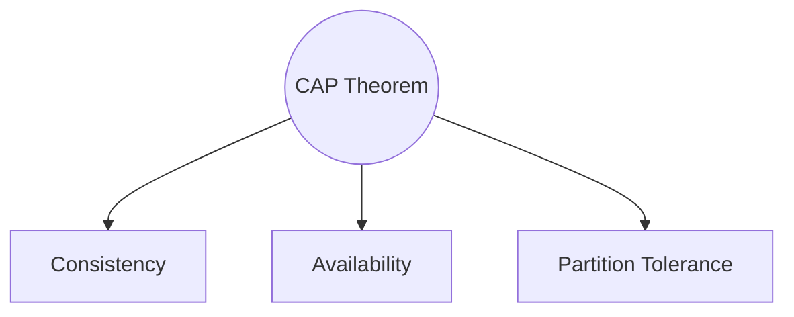
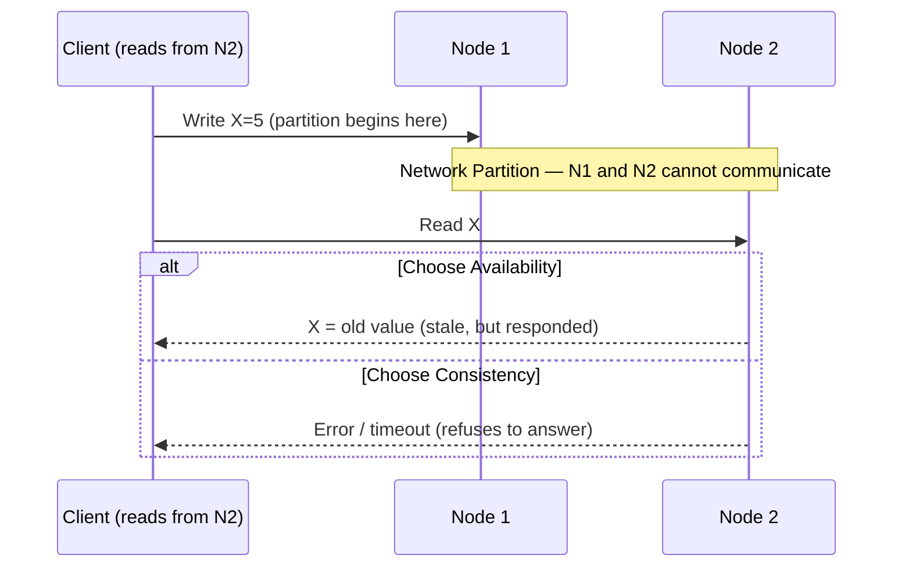
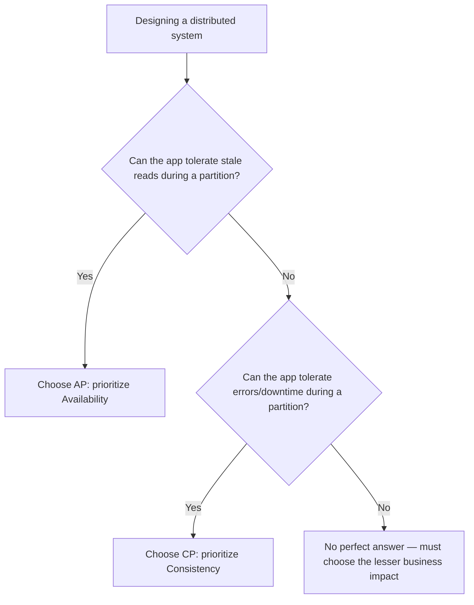

# Module 6 — CAP Theorem

> Builds on Modules 1–5. Having seen replication, sharding, and distributed transactions, we now formalize *why* certain tradeoffs (sync vs async replication, 2PC blocking, quorum choices) are fundamentally unavoidable — not just engineering inconveniences.

---

## 6.1 History

The CAP theorem was first conjectured by **Eric Brewer** in a 2000 keynote talk, and later formally proven by **Seth Gilbert and Nancy Lynch** in 2002. It's one of the most cited (and most misunderstood) results in distributed systems, and is an almost-guaranteed topic in senior backend/distributed systems interviews.

**Why was it invented/formalized?** As distributed databases proliferated in the early 2000s (Module 1's evolution timeline), engineers needed a rigorous way to explain **why you can't have a distributed database that is simultaneously perfectly consistent, always available, and tolerant of network failures** — CAP gives a crisp, provable boundary around what's achievable.

---

## 6.2 Brewer's Theorem — The Three Properties

### Consistency (C)

Every read receives the **most recent write** (or an error) — all nodes see the same data at the same time. (Note: this is a *different, stricter* notion of consistency than the "C" in ACID — CAP's consistency specifically means **linearizability**: operations appear to happen atomically at some single point in time, consistent with real-time ordering.)

### Availability (A)

Every request to a non-failing node receives a **response** (not necessarily the most recent data, but *some* valid response, not an error/timeout).

### Partition Tolerance (P)

The system continues to operate **despite arbitrary message loss or delay** between nodes (i.e., despite a network partition — some nodes cannot communicate with others).

## 6.3 The Theorem Itself

**In the presence of a network partition, a distributed system must choose between Consistency and Availability — it cannot have both.**

### Why This Is True (Intuition, Not Just a Slogan)

Imagine two nodes, N1 and N2, holding a replica of the same data, and a network partition separates them (they cannot talk to each other).

1. A client writes a new value to N1.
2. Another client, at the same time, sends a **read** to N2.
3. N2 cannot reach N1 (partition), so it doesn't know about the new write.
4. N2 now has exactly two choices:
   - **Respond with its old (stale) value** → this violates **Consistency** (the client didn't get the latest write), but the system remains **Available**.
   - **Refuse to respond / return an error** until it can confirm with N1 → this preserves **Consistency**, but sacrifices **Availability** (the client gets no answer).

There is no third option — N2 **must** do one or the other during the partition. This is the entire proof in a nutshell.

### An Important Clarification (Frequently Misunderstood)

**Partition tolerance is not really a "choice"** the way C and A are — network partitions **will happen** in any real distributed system (cables get cut, switches fail, packets get dropped). So in practice, the real-world tradeoff is:

> **"Given that partitions are inevitable (P is mandatory), do you prioritize C or A when one occurs?"**

CAP is often mis-stated as "pick any 2 of 3" — that's misleading because **you cannot opt out of partition tolerance in a real distributed system**; the actual choice is only between C and A, and only *during* an actual partition (in the absence of a partition, you can often have both).

---

## 6.4 Practical Examples

### CP Systems (Consistency + Partition Tolerance, sacrifice Availability during partition)

- Example: A leader-based system using **synchronous replication with a quorum**, e.g., **Google Spanner**, **HBase**, **MongoDB** in certain configurations (with majority write concern) — if a quorum can't be reached during a partition, the system refuses to serve requests rather than return stale/conflicting data.
- **Behavior during partition:** returns errors/timeouts to preserve correctness rather than risk showing stale data.

### AP Systems (Availability + Partition Tolerance, sacrifice strict Consistency during partition)

- Example: **Cassandra**, **DynamoDB**, **CouchDB** (leaderless/multi-leader designs from Module 3) — every reachable node keeps answering reads/writes even during a partition, accepting that different nodes might temporarily disagree.
- **Behavior during partition:** keeps responding (often with "eventual consistency" — replicas converge later once the partition heals, using techniques like read repair from Module 3/12).

### CA Systems (Consistency + Availability, no Partition Tolerance)

- Only meaningful for **single-node** systems, or systems explicitly deployed within a single, highly-reliable network where partitions are assumed not to occur (e.g., a traditional single-instance RDBMS, or a tightly coupled cluster on one rack with redundant networking). In a **truly distributed** system spanning unreliable networks, "CA" isn't a real option — partitions *will* eventually happen.

---

## 6.5 Database Classification Table

| System | Typical Classification | Behavior During Partition |
|---|---|---|
| Single-node PostgreSQL/MySQL | CA (not really distributed) | N/A — no partition possible within one node |
| Google Spanner | CP (with very high availability in practice) | Rejects requests that can't reach quorum |
| HBase | CP | Regions become unavailable if their RegionServer is unreachable |
| MongoDB (majority write concern) | CP-leaning | Writes fail if a majority of replica set members are unreachable |
| Cassandra | AP (tunable) | Keeps serving with configurable consistency level, converges later |
| DynamoDB | AP (tunable) | Keeps serving; supports both eventually-consistent and strongly-consistent reads per request |
| CouchDB | AP | Multi-leader, resolves conflicts after partition heals |
| Zookeeper | CP | Prioritizes correctness for coordination use cases (leader election, config) |

**Important nuance:** Many modern systems (Cassandra, DynamoDB, MongoDB) are **tunable** — the CAP classification isn't fixed at the database level, but can be chosen **per operation** via consistency levels/read-write concerns (recall the quorum `W`/`R` settings from Module 3).

---

## 6.6 CAP Tradeoffs — Decision Tree

**Interview framing:** The right answer is almost never "always pick CP" or "always pick AP" — it depends on the **business/domain requirement**:
- Banking ledger balance? Usually **CP** — better to show an error than an incorrect balance.
- Social media "like" count or shopping cart? Usually **AP** — better to show a slightly stale count than an error page.
- Inventory count for the *last* item of a flash sale? Contested — often modeled as CP for the final decrement, AP for browsing.

---

## 6.7 CAP and Its Relationship to Earlier Modules

- **Replication (Module 3):** Synchronous replication favors **C** (all replicas confirmed before ack); asynchronous replication favors **A** (fast response, risk of stale/lost data) — CAP is the theoretical justification for that tradeoff.
- **Distributed Transactions (Module 5):** 2PC's blocking behavior is a **CP choice** — the system refuses to let participants proceed independently (sacrificing availability) to preserve atomic consistency.
- **Sharding (Module 4):** partition tolerance concerns are per-shard — if a shard's nodes can't reach quorum, only that shard's data is affected (not the whole cluster), which is one reason sharding + replication combos are common.
- **Consensus Algorithms (Module 8, next-but-one):** systems like Raft/Paxos are explicitly **CP** — they refuse to make progress without a majority quorum, by design.

---

## 6.8 Failure Scenarios Through a CAP Lens

| Scenario | CP System Behavior | AP System Behavior |
|---|---|---|
| Network partition splits cluster into two halves | Minority side stops accepting writes/reads (no quorum) | Both sides keep accepting writes/reads independently |
| Partition heals | No conflict — minority side simply resumes, catching up | Must reconcile divergent writes (conflict resolution, Module 3) |
| Single node slow (not fully partitioned) | May incorrectly treat it as failed, reducing effective quorum | Keeps serving from other replicas, largely unaffected |

---

## 6.9 Interview Questions — Module 6

### Beginner
1. State the CAP theorem in one sentence.
2. Define Consistency, Availability, and Partition Tolerance as used in CAP.
3. Give one real database example each for a CP system and an AP system.

### Intermediate
4. Why is "CA" (Consistency + Availability without Partition Tolerance) not a realistic option for a truly distributed system?
5. Explain, with a concrete example, what happens to a CP system versus an AP system when a network partition occurs.
6. Why are many modern databases described as having a "tunable" CAP classification rather than a fixed one?

### Senior SDE-2/SDE-3
7. You're designing the backend for a banking application's account balance service and its "recent transactions" activity feed. Would you make each CP or AP? Justify separately for each.
8. A candidate says "our system is both perfectly consistent and always available, even during network partitions." How would you respond, referencing the CAP theorem's proof sketch?
9. Explain how quorum-based leaderless replication (Module 3) lets a single database product support both CP-like and AP-like behavior depending on configured `R`/`W` values.

### GATE-style / MCQ
10. According to CAP, during an active network partition, a distributed system must sacrifice:
    a) Partition tolerance
    b) Either consistency or availability
    c) Both consistency and availability
    d) Durability
    *(Answer: b)*

11. Which of these is generally considered a CP system?
    a) Cassandra with consistency level ONE
    b) DynamoDB with eventually consistent reads
    c) Google Spanner
    d) CouchDB
    *(Answer: c)*

---

## 6.10 Exercises

**Beginner**
- Classify these systems as CP or AP and justify in one sentence each: (a) Zookeeper, (b) Cassandra with QUORUM consistency, (c) a single-node MySQL instance.

**Intermediate**
- Draw the sequence diagram (like Section 6.3) for a 3-node cluster where a partition isolates 1 node from the other 2, showing both the CP and AP responses to a client read on the isolated node.

**Advanced / Production Scenario**
- Your e-commerce checkout service currently uses an AP database for inventory counts, and customers occasionally see "in stock" for items that are actually sold out, leading to cancelled orders. Propose a CAP-aware redesign for just the "final stock decrement" step.

**Whiteboard Interview Problem**
- "A ride-sharing app needs to track driver availability status globally. Discuss whether this should be a CP or AP system, and how your answer might change between 'is this driver currently online' vs 'has this ride been paid for.'"

**Case Study**
- Research how Amazon's original Dynamo paper justified choosing AP (availability) for its shopping cart use case, and summarize the business reasoning in your own words.

---

## 6.11 Practice Resources

- Gilbert & Lynch, "Brewer's Conjecture and the Feasibility of Consistent, Available, Partition-Tolerant Web Services" (2002) — search via ACM Digital Library or Google Scholar.
- MongoDB Docs — Read/Write Concern (tunable consistency): https://www.mongodb.com/docs/manual/reference/write-concern/
- Apache Cassandra Docs — Consistency: https://cassandra.apache.org/doc/latest/cassandra/architecture/dynamo.html#tunable-consistency
- Amazon DynamoDB — Read Consistency: https://docs.aws.amazon.com/amazondynamodb/latest/developerguide/HowItWorks.ReadConsistency.html

---

## 6.12 Cheat Sheet — Module 6

- **CAP Theorem**: during a network partition, a distributed system must choose between **Consistency** and **Availability** — it cannot have both.
- **Partition Tolerance is mandatory** in any real distributed system — the actual engineering choice is C vs A, only during an active partition.
- **CP systems** (Spanner, HBase, Zookeeper, MongoDB w/ majority concern): refuse requests rather than risk stale/incorrect data.
- **AP systems** (Cassandra, DynamoDB, CouchDB): keep answering requests, accept temporary staleness, reconcile later.
- **CA is not realistic** for truly distributed systems — only applies to single-node or non-partition-prone deployments.
- Many modern databases are **tunable** (per-operation consistency levels) rather than fixed CP or AP.
- CAP explains *why* tradeoffs seen in Replication (sync vs async), Distributed Transactions (2PC blocking), and Consensus (quorum requirement) are fundamental, not incidental engineering choices.

---

**End of Module 6.**

Reply with "continue" or "next module" to proceed to **Module 7: PACELC Theorem**.
