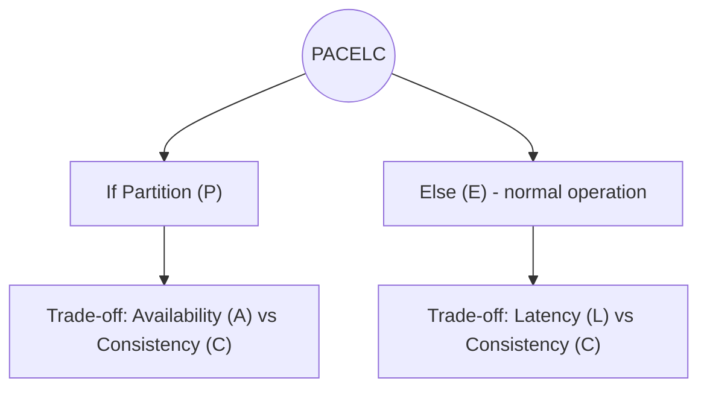
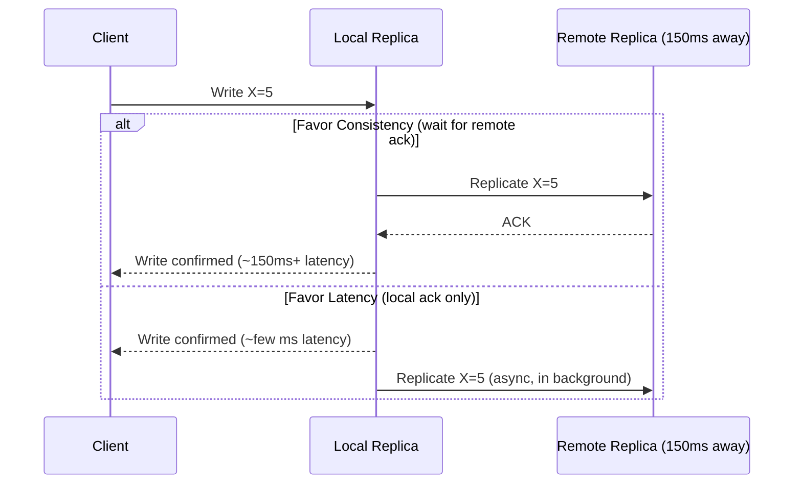
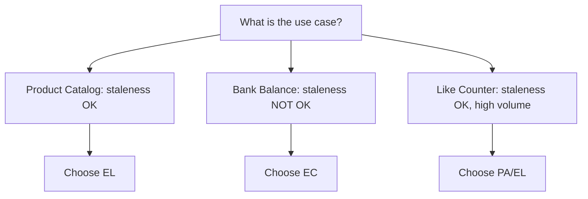

# Module 7 — PACELC Theorem

> Builds directly on Module 6 (CAP). CAP only describes behavior **during a network partition** — PACELC extends the discussion to cover the **much more common case: normal operation, with no partition at all.**

---

## 7.1 Why PACELC?

CAP theorem tells us: *if there's a partition (P), choose between Consistency (C) and Availability (A).* But real systems spend the **vast majority of their time NOT partitioned** — partitions are relatively rare events. So what tradeoff applies during normal, healthy operation?

**The gap CAP leaves open:** Even with no partition at all, a distributed database still has to decide: *"Do I wait for all replicas to confirm a write (favoring consistency), or respond immediately using just the nearest replica (favoring low latency)?"* This is a tradeoff CAP simply doesn't address, because CAP is entirely about partition scenarios.

**PACELC**, introduced by **Daniel Abadi** in 2010, fills this gap:

> **PACELC: if there is a Partition (P), a system must trade off Availability (A) and Consistency (C); Else (E) — i.e., during normal operation — it must trade off Latency (L) and Consistency (C).**

**Why it matters for interviews:** PACELC is considered a more *complete* and *practically useful* framework than CAP alone, because it acknowledges that consistency/performance tradeoffs exist **even when everything is working normally** — which is the state your system is in almost all the time.

---

## 7.2 Breaking Down the Acronym

| Letter | Meaning |
|---|---|
| **P** | Partition (is there a network partition?) |
| **A** | Availability (trade-off choice during a partition) |
| **C** | Consistency (trade-off choice — appears twice, once for each branch) |
| **E** | Else (i.e., no partition — normal operation) |
| **L** | Latency (trade-off choice during normal operation) |

Read as: **"P**AC / **E**LC" — **if Partition**: (A)vailability vs (C)onsistency; **Else**: (L)atency vs (C)onsistency.

---

## 7.3 The "Else" Branch — Latency vs Consistency

This is the genuinely new insight PACELC adds. During normal operation (no partition):

- To achieve **strong consistency**, a write typically must be confirmed by **multiple replicas** (recall synchronous/semi-synchronous replication and quorum writes from Module 3) — this **adds latency**, because the client waits for network round-trips to remote replicas.
- To achieve **low latency**, a system can respond after writing to just **one replica** (or the local/nearest one) and propagate to others asynchronously — but this means a subsequent read (especially from a different replica) might see **stale data**.

### Mathematical/Practical Intuition

If a write must get acknowledgment from a replica in a distant data center (say, 150ms round trip), then:
- **Strong consistency configuration**: write latency ≈ 150ms+ (must wait for that replica).
- **Low latency configuration**: write latency ≈ a few ms (local acknowledgment only), but the distant replica might serve a stale read for some period afterward (replica lag, Module 3).

This is precisely the **quorum tuning** discussed in Module 3 (`W`, `R` values) and Module 6 (tunable CP/AP classification) — PACELC formalizes *why* that tuning knob exists at all, even absent any partition.

---

## 7.4 PACELC Classification of Real Systems

| System | Partition Behavior (PA/PC) | Normal Operation Behavior (EL/EC) | Overall Classification |
|---|---|---|---|
| Cassandra (default settings) | PA — stays available, may serve stale data | EL — favors low latency over strict consistency | **PA/EL** |
| DynamoDB | PA — stays available | EL — eventually consistent reads by default (tunable to strong) | **PA/EL** (tunable toward PC/EC) |
| MongoDB (majority read/write concern) | PC — sacrifices availability for correctness | EC — favors consistency, accepts extra latency for majority acknowledgment | **PC/EC** |
| Google Spanner | PC — unavailable rather than inconsistent | EC — uses TrueTime + synchronous commit protocols, prioritizing consistency even at latency cost | **PC/EC** |
| HBase | PC | EC | **PC/EC** |
| Traditional single-leader RDBMS with sync replication (e.g., PostgreSQL sync mode) | PC (writes block if replica unreachable) | EC (waits for replica ack) | **PC/EC** |
| PostgreSQL/MySQL with async replication | PC-ish on the leader itself but weaker guarantees on failover | EL (replicas lag, but writes are fast) | **PA/EL-leaning** in practice for the replicas |

**Interview-ready summary:** Most systems fall into one of two common "quadrants":
- **PA/EL** — availability & low latency prioritized both during partitions and normal operation (Cassandra, DynamoDB by default).
- **PC/EC** — consistency prioritized both during partitions and normal operation, accepting higher latency and reduced availability (Spanner, HBase, MongoDB with majority concern).

Mixed classifications (e.g., PA/EC or PC/EL) are less common but possible depending on configuration.

---

## 7.5 CAP vs PACELC — Side-by-Side

| Aspect | CAP Theorem | PACELC |
|---|---|---|
| Scope | Only describes behavior **during a partition** | Describes behavior **during a partition AND during normal operation** |
| Tradeoff during partition | Consistency vs Availability | Same (inherited as the "PAC" part) |
| Tradeoff with no partition | Not addressed | Latency vs Consistency (the "ELC" part) |
| Practical usefulness | Explains rare/extreme events | Explains everyday, constant-operation tradeoffs |
| Common criticism | Oversimplified ("pick 2 of 3" is misleading, per Module 6) | More nuanced, but less famous/less commonly taught |

**Why PACELC is considered an improvement:** CAP is technically correct but describes an *edge case* (an active partition, which for many systems is rare). PACELC captures the tradeoff that's *always* present, every single time a write happens — making it arguably more relevant to day-to-day system design decisions like "should I use synchronous or asynchronous replication for this service?" (Module 3).

---

## 7.6 Practical Examples Applying PACELC

### Example 1: Global E-Commerce Product Catalog
- Reads vastly outnumber writes; slight staleness (a product description updated a few seconds ago) is harmless.
- **Choice:** EL (favor latency) during normal operation — serve reads from the nearest replica without waiting for global consistency.

### Example 2: Bank Account Balance
- Showing a stale balance could let a user overdraw or make a decision based on wrong information.
- **Choice:** EC (favor consistency) during normal operation — accept extra latency to ensure the balance read is authoritative, and PC during partitions (refuse to serve if unable to confirm).

### Example 3: Social Media Like Counter
- Approximate counts are acceptable; nobody notices or cares if a "like count" is briefly off by a few during high concurrency.
- **Choice:** PA/EL — always available, low latency, eventually consistent count.

---

## 7.7 Cross-References

- **Module 3 (Replication):** synchronous replication = EC-leaning; asynchronous replication = EL-leaning. PACELC formally names this everyday tradeoff.
- **Module 6 (CAP):** PACELC's "PAC" half is literally CAP theorem restated; PACELC just adds the "ELC" half for completeness.
- **Module 8 (Consensus, next):** consensus algorithms like Raft/Paxos are inherently **PC/EC** — they require majority agreement even in normal operation, trading latency for strong consistency guarantees.

---

## 7.8 Failure & Design Scenarios

| Scenario | PA/EL System Behavior | PC/EC System Behavior |
|---|---|---|
| Normal operation, no partition | Fast writes, replicas may briefly lag | Writes wait for quorum/majority ack, slower but consistent |
| Network partition occurs | Keeps serving, may show conflicting data across sides | Minority side stops serving until partition heals |
| High cross-region latency (e.g., US ↔ APAC) | Local writes stay fast regardless of distant replica latency | Writes always pay the cross-region round-trip cost |

---

## 7.9 Interview Questions — Module 7

### Beginner
1. What gap in the CAP theorem does PACELC address?
2. Expand the PACELC acronym and explain what each letter/branch means.
3. Give one real-world example of a system that would prefer EL over EC.

### Intermediate
4. Why does achieving strong consistency almost always add latency in a distributed replication system?
5. Classify Cassandra and Google Spanner using the PA/EL vs PC/EC framework, and justify.
6. How does the "Else" branch of PACELC relate to the synchronous vs asynchronous replication tradeoff from Module 3?

### Senior SDE-2/SDE-3
7. Design a globally distributed shopping cart service and a globally distributed payment ledger. Classify each using PACELC and justify why they might need *different* classifications within the same overall application.
8. Explain, using PACELC, why a "PA" system during partitions might still choose to be "EC" during normal operation (or vice versa) — is a mixed classification ever a reasonable design choice?
9. A stakeholder asks "why can't we just always use the most consistent, lowest-latency configuration?" Explain, referencing PACELC, why this is not achievable simultaneously.

### GATE-style / MCQ
10. PACELC extends CAP by additionally addressing the tradeoff:
    a) Durability vs Isolation
    b) Latency vs Consistency during normal operation
    c) Sharding vs Replication
    d) Read vs Write throughput
    *(Answer: b)*

11. A system classified as PA/EL means:
    a) It favors consistency both during partitions and normal operation
    b) It favors availability during partitions and low latency during normal operation
    c) It favors availability during partitions but consistency during normal operation
    d) It has no defined behavior
    *(Answer: b)*

---

## 7.10 Exercises

**Beginner**
- Classify a simple key-value cache (e.g., used for session tokens) using PA/EL vs PC/EC, and justify your choice.

**Intermediate**
- For a video streaming platform's "watch history" feature vs its "billing/subscription status" feature, propose separate PACELC classifications and explain the differing latency/consistency requirements.

**Advanced / Production Scenario**
- Your team's globally-distributed inventory system is PC/EC (always consistent, higher latency), but product managers are complaining about slow page loads for browsing (not purchasing). Propose a PACELC-informed architectural split.

**Whiteboard Interview Problem**
- "Design the data consistency strategy for a multiplayer game's leaderboard (frequently read, occasionally written) versus its in-game currency/wallet (rare but critical writes)." Discuss using PACELC for each.

**Case Study**
- Research Daniel Abadi's original PACELC blog post/paper and summarize, in your own words, his main critique of CAP theorem's popularity versus its practical completeness.

---

## 7.11 Practice Resources

- Daniel Abadi's original PACELC formulation: search "Daniel Abadi PACELC blog consistency tradeoffs" (personal blog/paper, widely referenced in distributed systems courses).
- MongoDB Docs — Read Preference & Write Concern (illustrates EL vs EC tuning in practice): https://www.mongodb.com/docs/manual/core/read-preference/
- Google Cloud — Spanner TrueTime whitepaper: https://cloud.google.com/spanner/docs/whitepapers
- Apache Cassandra Docs — Consistency Levels: https://cassandra.apache.org/doc/latest/cassandra/architecture/dynamo.html#tunable-consistency

---

## 7.12 Cheat Sheet — Module 7

- **PACELC** = **P**artition → **A**vailability vs **C**onsistency; **E**lse → **L**atency vs **C**onsistency.
- CAP only covers partition scenarios; PACELC also covers **normal operation**, which is where systems spend most of their time.
- **PA/EL** systems (Cassandra, DynamoDB by default): prioritize availability + low latency, both during and outside partitions.
- **PC/EC** systems (Spanner, HBase, MongoDB w/ majority concern): prioritize consistency, both during and outside partitions, at the cost of latency/availability.
- The "Else" (no-partition) tradeoff directly explains **why synchronous replication is slower but safer**, and **why asynchronous replication is faster but risks staleness** (Module 3 topic, now formalized).
- Different features within the *same application* can and should have different PACELC classifications based on business tolerance for staleness vs latency (e.g., product catalog vs bank balance).

---

**End of Module 7.**

Reply with "continue" or "next module" to proceed to **Module 8: Consensus Algorithms**.
