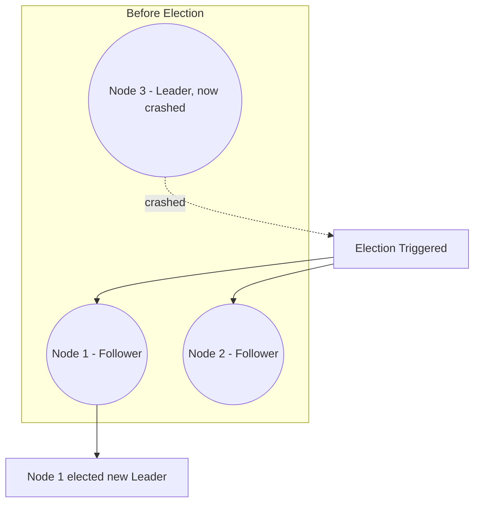
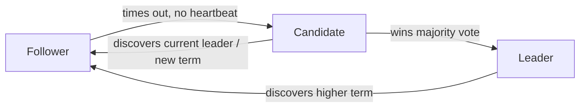
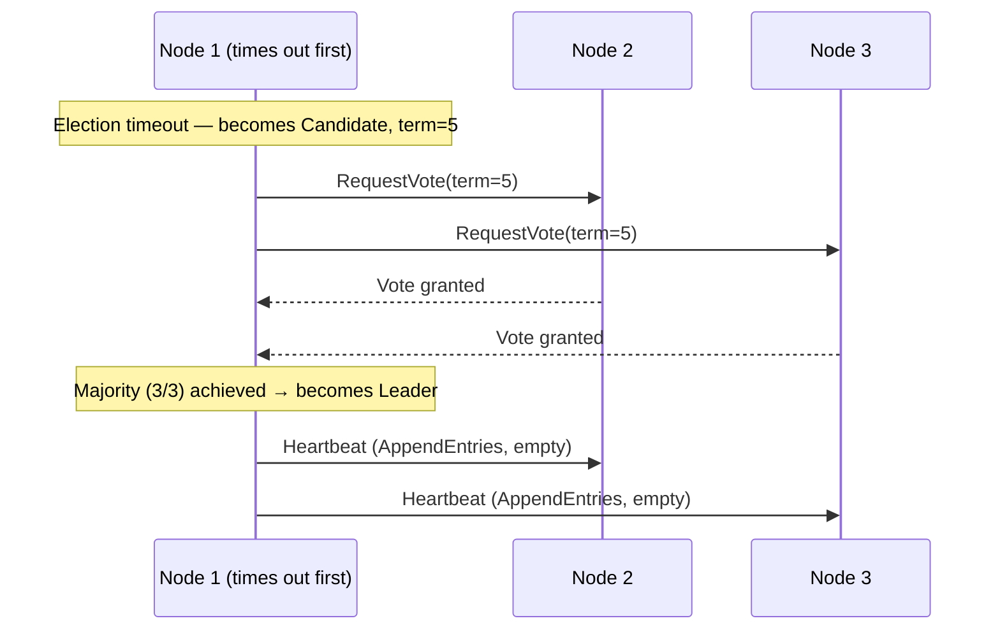
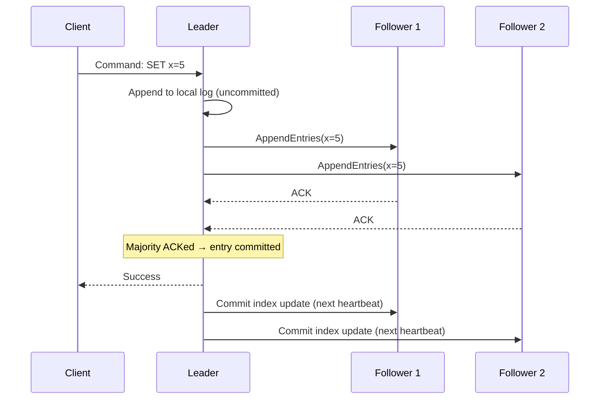
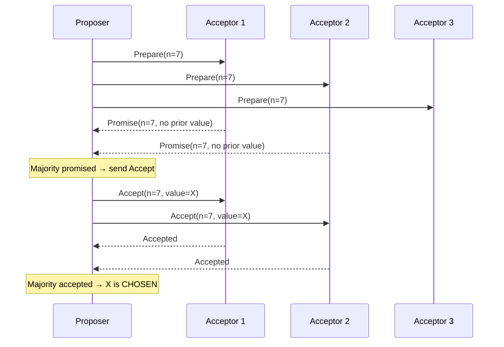
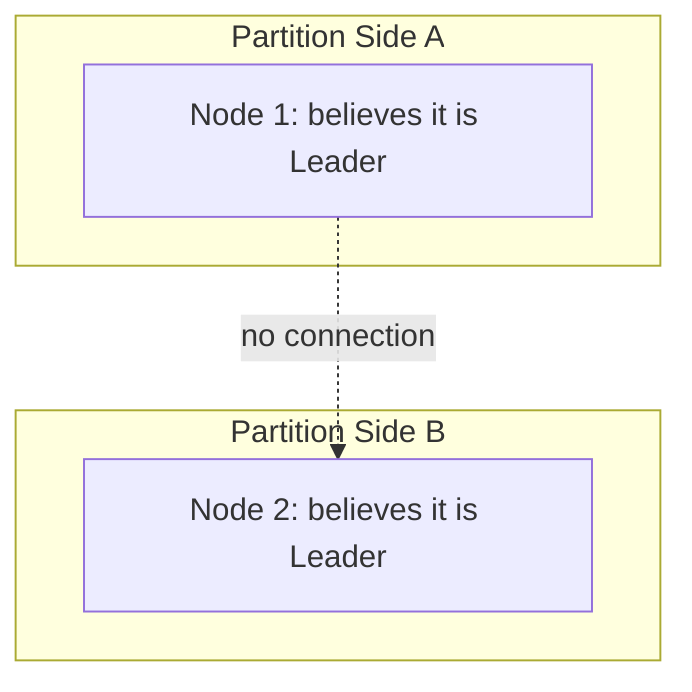
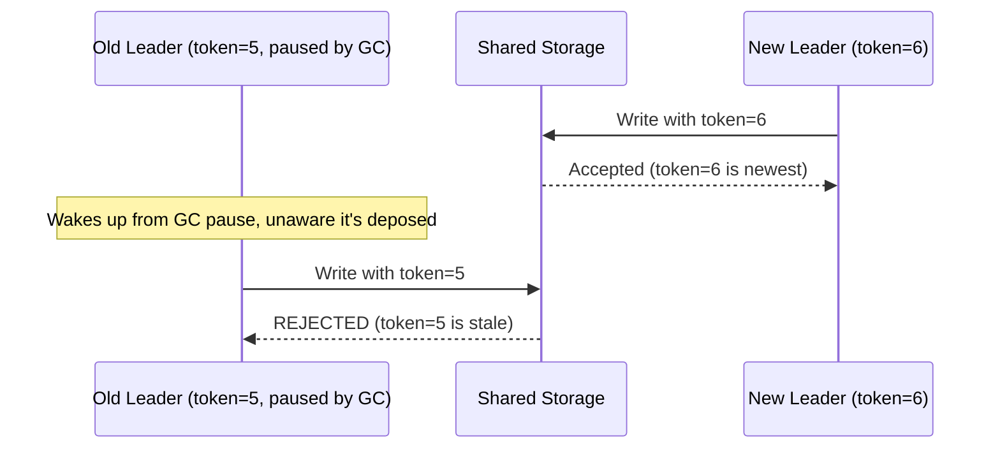

# Module 8 — Consensus Algorithms

> Builds on Modules 3 (Replication/Failover), 5 (Distributed Transactions), 6–7 (CAP/PACELC). Consensus algorithms are the machinery that makes safe leader election, log replication, and coordination possible — the missing piece that makes Module 3's "failover" safe rather than dangerous.

---

## 8.1 The Consensus Problem

**What is it?** Getting a group of nodes, communicating over an unreliable network, to **agree on a single value or a single sequence of operations** — even if some nodes crash, messages are delayed, or the network partitions.

**Why was it invented?** Recall Module 3's failover discussion: when a leader crashes, followers need to elect a new leader. But what if two followers, unable to see each other due to a network hiccup, both try to become leader simultaneously? Without a rigorous agreement protocol, you get **split brain** (Section 8.7) — two leaders both accepting writes, causing data corruption. Consensus algorithms solve this by guaranteeing that **at most one** value/leader is ever agreed upon, no matter what fails.

**Real-life analogy:** Imagine a jury of 7 people who must reach a single verdict, even though a few jurors might fall asleep (crash) or momentarily leave the room (network delay). The jury system requires a **majority** to agree, and has rules preventing two contradictory verdicts from both being declared "the decision" — that's precisely a consensus protocol.

### Formal Guarantees a Consensus Algorithm Must Provide

1. **Agreement** — no two correct nodes decide on different values.
2. **Validity** — the decided value must have been proposed by some node (you can't invent a value out of thin air).
3. **Termination** — every correct node eventually decides (the system doesn't hang forever) — though as we'll see, this is only guaranteed under certain network conditions (a well-known theoretical result, the **FLP impossibility**, shows that in a fully asynchronous network with even one faulty process, deterministic consensus cannot be *guaranteed* to terminate — real systems work around this with timeouts and randomization).

---

## 8.2 Leader Election — The Most Common Application

Most consensus algorithms in practice (Raft, Zab) are used to elect a **single leader** and keep everyone agreed on who that leader currently is — directly solving the "safe failover" problem left open in Module 3.

---

## 8.3 Quorum and Majority Voting

### Quorum

A **quorum** is the minimum number of nodes that must agree/participate for an operation (a vote, a commit, a leader election) to be considered valid.

### Why Majority (N/2 + 1)?

Nearly all practical consensus algorithms require a **strict majority** of nodes (`⌊N/2⌋ + 1`) to agree, rather than "all nodes" or "any single node."

**Mathematical intuition — why majority works:** If you require a majority to agree on any decision, then **any two majorities must overlap by at least one node** (pigeonhole principle — this is the same math as the quorum overlap rule from Module 3's `W + R > N`). This overlap guarantees that if one majority elected Leader A, a *different* majority cannot simultaneously and validly elect Leader B — because at least one node would have had to vote for both, which the protocol forbids.

**Example:** With 5 nodes, majority = 3. Two different groups of 3 nodes out of 5 *must* share at least one common node (since 3+3=6 > 5). That shared node cannot honestly vote for two different leaders in the same term, preventing split brain.

### Why Odd Numbers of Nodes Are Preferred

With `N=4`, majority = 3, but a partition splitting the cluster 2-2 means **neither side** has a majority — the whole system stalls (safe, but unavailable). With `N=5`, majority = 3, and a 3-2 split still lets the majority side (3) make progress. Using an **odd number of nodes** typically gives the best fault-tolerance-to-node-count ratio: `N=5` tolerates 2 failures, same as `N=6` (which needs more machines for no extra benefit).

| Cluster Size (N) | Majority Needed | Failures Tolerated |
|---|---|---|
| 3 | 2 | 1 |
| 4 | 3 | 1 (same as N=3, wastes a node) |
| 5 | 3 | 2 |
| 6 | 4 | 2 (same as N=5, wastes a node) |
| 7 | 4 | 3 |

---

## 8.4 Raft

Raft was explicitly designed (by Diego Ongaro and John Ousterhout, 2014) to be **easier to understand** than Paxos while providing equivalent guarantees — and has become the de facto standard for new systems (etcd, Consul, CockroachDB, TiKV all use Raft).

### Node States

### Step-by-Step: Leader Election

1. All nodes start as **Followers**.
2. Each follower has a randomized **election timeout** (e.g., 150–300ms). If a follower doesn't hear a **heartbeat** from a leader within this window, it assumes the leader is dead.
3. That follower becomes a **Candidate**, increments the current **term** (a monotonically increasing election counter), votes for itself, and requests votes from all other nodes.
4. Other nodes vote for the first candidate they hear from in that term (each node votes at most once per term).
5. If the candidate receives votes from a **majority**, it becomes the **Leader** for that term and starts sending heartbeats to assert authority.
6. If no candidate gets a majority (e.g., a split vote), the election **times out** and a new term/election begins with fresh randomized timeouts (randomization reduces the chance of repeated split votes).

### Log Replication in Raft

Once elected, the leader is the **only** node that accepts client writes. It appends each write to its local log, then replicates that log entry to followers.

**Step-by-step:**
1. Client sends a command to the Leader.
2. Leader appends the command to its local log (uncommitted).
3. Leader sends `AppendEntries` RPCs to all followers with the new log entry.
4. Each follower appends the entry to its own log and acknowledges.
5. Once the **leader** has confirmation from a **majority** (including itself), the entry is considered **committed**.
6. Leader applies the committed entry to its state machine and informs followers (via the next heartbeat) that this entry is committed, so they apply it too.

This is precisely the mechanism that makes Raft-based systems (etcd, Consul) safely usable for distributed locking/coordination and for MongoDB-style replica set elections (MongoDB's election protocol is heavily Raft-inspired).

### Heartbeats

The leader periodically sends **empty `AppendEntries`** messages (heartbeats) to all followers to assert "I'm still alive and still the leader," resetting followers' election timeouts. If heartbeats stop (leader crash or partition), followers eventually time out and trigger a new election.

---

## 8.5 Paxos

The original consensus algorithm, introduced by **Leslie Lamport** (1989/1998), and the theoretical foundation most other consensus algorithms (including Raft) build upon. Famous for being **notoriously difficult to understand and implement correctly** — one of the key motivations behind Raft's design.

### Roles

- **Proposers** — propose values.
- **Acceptors** — vote on proposed values.
- **Learners** — learn the final agreed-upon value.

(In practice, a single node often plays multiple roles.)

### High-Level Two-Phase Structure (Basic Paxos, single value)

**Phase 1 — Prepare/Promise:**
1. A proposer picks a proposal number `n` (must be higher than any it has used before) and sends `Prepare(n)` to a majority of acceptors.
2. Each acceptor promises not to accept any future proposal numbered less than `n`, and replies with the highest-numbered proposal it has already accepted (if any).

**Phase 2 — Accept:**
3. If the proposer receives promises from a majority, it sends `Accept(n, value)` — using either its own value, or (crucially) the **value from the highest-numbered proposal reported by any acceptor**, if one exists (this preserves safety — it can't just impose a brand new value if an earlier proposal might already have been chosen by a majority).
4. Acceptors accept the proposal unless they've already promised a higher-numbered proposal in the meantime.
5. Once a majority accepts, the value is **chosen**.

### Why Basic Paxos Is Hard to Use Directly

Basic Paxos only agrees on a **single value** — real systems need to agree on a **sequence** of values (a log of operations, like Raft's log). Running Basic Paxos repeatedly for every log entry, from scratch, is inefficient and the coordination of multiple competing proposers (dueling proposers can repeatedly out-number each other's proposal numbers, delaying progress indefinitely — a **liveness** problem, not a **safety** problem) makes plain Paxos impractical for production logs.

### Multi-Paxos

An optimization: elect a **stable leader** (called the "distinguished proposer") who can skip Phase 1 for most subsequent log entries (since it already knows no other proposer is competing), effectively reducing steady-state operation to something very similar to Raft's log replication — one round-trip per log entry instead of two.

**Multi-Paxos vs Raft:** Multi-Paxos and Raft solve the *same* problem and end up structurally very similar in practice (stable leader + log replication + majority commit) — Raft's main contribution is **presenting the same ideas far more clearly and prescriptively** (explicit terms, explicit leader election rules), which is why virtually all new systems choose Raft over "raw" Paxos today.

---

## 8.6 Zab (ZooKeeper Atomic Broadcast)

The consensus protocol underlying **Apache ZooKeeper**, purpose-built for **totally ordered broadcast** of state updates (not a general-purpose value-agreement protocol like Paxos, but tailored to ZooKeeper's specific need: replicate a sequence of state changes to all replicas in the same order).

### Key Characteristics

- Like Raft, Zab elects a single leader and uses majority-based log replication.
- Guarantees **strict ordering**: if a leader broadcasts update A before update B, every replica applies A before B (crucial for ZooKeeper's use cases like distributed locks and configuration management, where order matters).
- Has a distinct **recovery phase** after a leader failure, ensuring the new leader has the most up-to-date log before resuming normal operation (conceptually similar to Raft's requirement that only up-to-date candidates can be elected).

### ZooKeeper's Role in Distributed Systems

ZooKeeper (built on Zab) is frequently used by *other* distributed systems as a coordination service — e.g., older versions of Kafka used ZooKeeper for broker leader election and cluster metadata (Kafka has since moved to its own Raft-based protocol, KRaft, to remove the ZooKeeper dependency).

---

## 8.7 Split Brain

**What is it?** A dangerous failure mode where **two nodes both believe they are the leader** simultaneously, typically caused by a network partition that fools each side into thinking the other has failed.

### Why Consensus Algorithms Prevent This

Because leader election requires a **majority** vote, at most **one side** of any partition can contain a majority of nodes (Section 8.3's overlap argument). The minority side, even if it elects "a leader" internally, cannot gather a majority and — in a correctly implemented Raft/Paxos/Zab system — will not be treated as the legitimate leader by the rest of the cluster, and typically cannot even complete its own election or commit new log entries (since committing also requires majority acknowledgment).

### Fencing Tokens (Extra Safety Layer)

Even with correct consensus, an **old leader that hasn't yet realized it's been deposed** (e.g., due to a long GC pause) might still try to write to shared storage. A **fencing token** is a monotonically increasing number issued with each new leadership term; downstream storage systems reject writes carrying an older/stale token, providing defense-in-depth against a "zombie" former leader.

---

## 8.8 Network Partitions and Consensus

Consensus algorithms are explicitly **CP** (Module 6) systems: during a partition, the minority side deliberately becomes **unavailable** (cannot elect a leader, cannot commit new entries) rather than risk a split-brain inconsistency. This is a direct, deliberate design choice — consensus prioritizes safety over availability.

| Partition Scenario | Majority Side | Minority Side |
|---|---|---|
| 5-node cluster splits 3-2 | Continues operating normally (has majority) | Cannot elect a leader or commit writes; effectively frozen |
| 5-node cluster splits 1-4 | The 4-node side operates normally | The isolated single node cannot do anything |
| Partition heals | No action needed | Rejoins, catches up on missed log entries from the leader |

---

## 8.9 Comparison Table: Raft vs Paxos vs Zab

| Aspect | Raft | Paxos (Multi-Paxos) | Zab |
|---|---|---|---|
| Primary goal | General-purpose replicated log, understandability | General-purpose value/log agreement | Totally ordered broadcast for ZooKeeper |
| Leader concept | Explicit, first-class (terms, elections) | Implicit optimization (distinguished proposer) | Explicit leader + recovery phase |
| Ease of understanding | High (designed for this) | Low (famously subtle) | Medium |
| Used by | etcd, Consul, CockroachDB, TiKV, MongoDB (election logic inspired by it) | Google Chubby, Spanner (uses Paxos variants internally) | Apache ZooKeeper, older Kafka |
| Ordering guarantee | Total order of committed log entries | Total order (in Multi-Paxos steady state) | Strict total order (core design goal) |

---

## 8.10 Failure Scenarios Summary

| Scenario | What Happens | Why It's Safe |
|---|---|---|
| Leader crashes | Followers time out, new election begins | Randomized timeouts + majority vote prevent conflicting leaders |
| Network partition (majority/minority) | Majority side continues; minority freezes | Only one side can ever gather a majority |
| Split vote (no candidate gets majority) | Election times out, retried with new term | Randomized timeouts reduce repeated ties |
| Old leader wakes up after being deposed (GC pause, etc.) | Attempts writes with stale term/token | Followers/storage reject based on term number or fencing token |
| Slow follower falls behind | Leader keeps retrying `AppendEntries`, follower eventually catches up | Log replication is retried, not abandoned |

---

## 8.11 Interview Questions — Module 8

### Beginner
1. What problem does a consensus algorithm solve?
2. Why do consensus algorithms require a majority rather than all nodes or just one node?
3. What is split brain, and how does majority-based leader election prevent it?

### Intermediate
4. Walk through Raft's leader election process step by step, including the role of randomized timeouts.
5. Explain how log replication in Raft ensures an entry is only considered "committed" once safe from loss.
6. What is a fencing token, and what problem does it solve that plain majority-based consensus alone does not?

### Senior SDE-2/SDE-3
7. Compare Raft and Multi-Paxos. Why did Raft become more popular for new systems despite Paxos being older and foundational?
8. Design a 7-node coordination service using Raft. Explain how many node failures it can tolerate, and walk through what happens during a 4-3 network partition.
9. A leader in your Raft cluster experiences a 10-second garbage collection pause. During this pause, a new leader is elected. Explain, step by step, what prevents the old leader from corrupting data once it resumes.

### GATE-style / MCQ
10. In a 7-node Raft cluster, what is the minimum majority required to elect a leader or commit a log entry?
    a) 3
    b) 4
    c) 5
    d) 7
    *(Answer: b)*

11. Which of the following best describes why consensus algorithms are classified as CP under the CAP theorem?
    a) They always favor low latency
    b) They deliberately sacrifice availability on the minority side during a partition to preserve consistency
    c) They never require a majority
    d) They only work on a single node
    *(Answer: b)*

---

## 8.12 Exercises

**Beginner**
- For cluster sizes 3, 5, 7, and 9, compute the majority required and the number of failures tolerated.

**Intermediate**
- Draw a sequence diagram of a Raft election where the first candidate experiences a split vote (no majority), followed by a successful second election.

**Advanced / Production Scenario**
- Your 5-node Raft-based configuration service experiences a partition that isolates 2 nodes (including the current leader) from the other 3. Walk through, step by step, what each side does, and what happens when the partition heals.

**Whiteboard Interview Problem**
- "Design a distributed lock service using a Raft-based coordination system (like etcd or ZooKeeper). Explain how you'd prevent two clients from both believing they hold the same lock during a leader failover, referencing fencing tokens."

**Case Study**
- Research why Kafka moved away from ZooKeeper (Zab) to its own Raft-based protocol (KRaft), and summarize the operational motivations described in Kafka's official documentation/KIPs.

---

## 8.13 Practice Resources

- Raft Consensus Algorithm — official site with interactive visualization: https://raft.github.io/
- Ongaro & Ousterhout, "In Search of an Understandable Consensus Algorithm" (Raft paper): https://raft.github.io/raft.pdf
- Lamport, "Paxos Made Simple": https://lamport.azurewebsites.net/pubs/paxos-simple.pdf
- Apache ZooKeeper Docs — Internals (Zab): https://zookeeper.apache.org/doc/current/zookeeperInternals.html
- etcd Documentation — Raft implementation notes: https://etcd.io/docs/latest/learning/

---

## 8.14 Cheat Sheet — Module 8

- **Consensus** = getting nodes to agree on a value/log despite failures; requires **Agreement, Validity, Termination**.
- **Majority quorum** (`N/2 + 1`) guarantees any two majorities overlap — prevents two conflicting decisions (split brain) from both being validly reached.
- **Odd cluster sizes** are preferred (same fault tolerance as the next even size, with fewer nodes).
- **Raft**: explicit leader election (Follower → Candidate → Leader) using randomized timeouts + heartbeats; log replication requires majority ACK before commit. Designed for understandability.
- **Paxos**: Prepare/Promise + Accept two-phase protocol; foundational but hard to use directly for logs; **Multi-Paxos** adds a stable leader to skip Phase 1 in steady state (structurally similar to Raft).
- **Zab**: ZooKeeper's consensus protocol; guarantees strict total order of broadcasts; used for coordination services.
- **Split brain**: two leaders active simultaneously — prevented by majority requirement; **fencing tokens** add defense-in-depth against zombie old leaders.
- Consensus systems are inherently **CP** (Module 6) — minority side deliberately becomes unavailable during a partition rather than risk inconsistency.

---

**End of Module 8.**

Reply with "continue" or "next module" to proceed to **Module 9: NoSQL Databases**.
