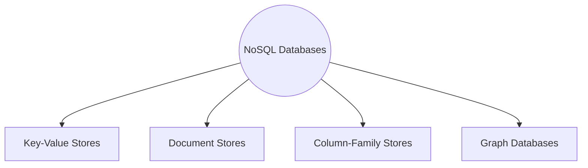
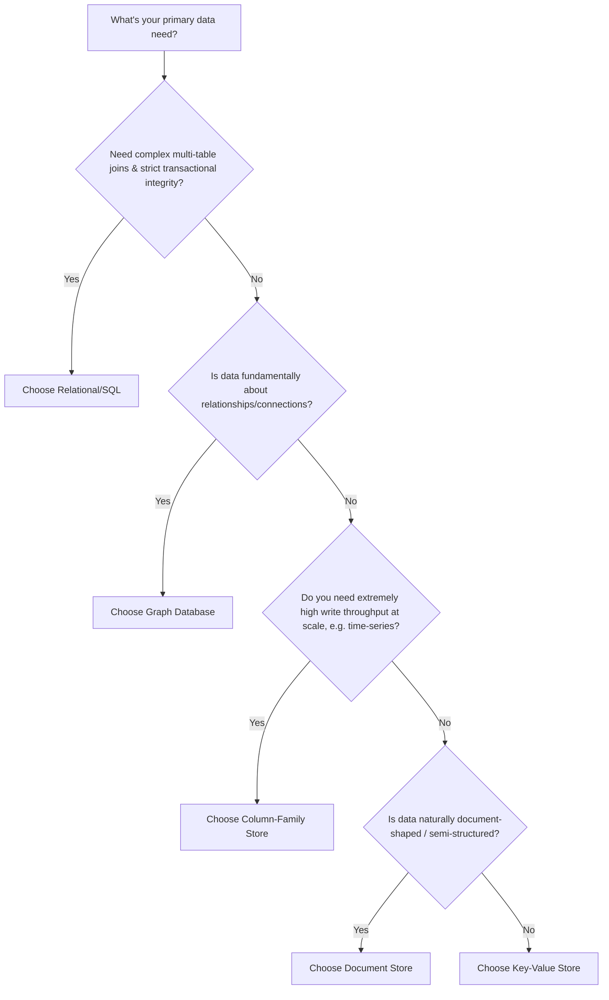

# Module 9 — NoSQL Databases

> Builds on Modules 1–8. Having covered the *mechanisms* (replication, sharding, consensus, CAP/PACELC), we now survey the *database families* that were purpose-built around these mechanisms rather than the traditional relational model.

---

## 9.1 Why NoSQL?

**What is it?** "NoSQL" (originally "No SQL," now more commonly understood as "Not Only SQL") refers to a broad category of databases that **don't use the traditional relational (tables, fixed schema, SQL joins) model** as their primary data model.

**Why was it invented? What problem does it solve?**

By the mid-2000s, companies like Google, Amazon, and Facebook hit real limits with traditional relational databases at massive scale:

1. **Rigid schemas** made it hard to iterate quickly on evolving data models (adding a column to a billion-row table is expensive/slow).
2. **Vertical scaling ceilings** (Module 1) — a single powerful RDBMS server eventually can't keep up with web-scale traffic.
3. **Joins across sharded data are expensive** — the relational model assumes data can be joined freely, which breaks down once you shard (Module 4) a relational table across many nodes.
4. **Not all data is naturally tabular** — social graphs, hierarchical documents, and simple key-value caches often don't map cleanly onto rows and columns.
5. **CAP/PACELC tradeoffs** (Modules 6–7) — many web-scale use cases (shopping carts, session data, activity feeds) can tolerate eventual consistency in exchange for high availability and low latency, something traditional RDBMS engines weren't originally optimized for.

**Real-life analogy:** A relational database is like a perfectly organized library with a strict card-catalog system — great for structured, well-defined queries, but slow to reorganize and not ideal for storing, say, loosely structured personal scrapbooks (documents) or a web of social connections (graphs). NoSQL databases are purpose-built shelving systems, each optimized for a *specific* shape of data and access pattern, rather than one-size-fits-all.

---

## 9.2 NoSQL vs Relational Databases — Comparison Table

| Aspect | Relational (SQL) | NoSQL |
|---|---|---|
| Schema | Fixed, defined upfront (schema-on-write) | Flexible/dynamic (schema-on-read), varies by type |
| Query language | SQL (standardized) | Varies by database (query APIs, sometimes SQL-like) |
| Joins | First-class, efficient (within one node/schema) | Generally discouraged/limited; data is denormalized instead |
| Scaling | Traditionally vertical; horizontal via sharding middleware | Built for horizontal scaling from the ground up |
| Consistency model | Strong (ACID) by default | Often tunable; many default to eventual consistency (AP-leaning, Module 6) |
| Best for | Complex relationships, transactional integrity, structured reporting | High-volume, high-velocity, flexible/evolving, distributed-by-default workloads |
| Examples | PostgreSQL, MySQL, Oracle, SQL Server | MongoDB, Cassandra, Redis, DynamoDB, Neo4j |

**Important nuance for interviews:** NoSQL is not "better" than SQL — it's a **different set of tradeoffs**. Many companies use **both** (polyglot persistence): relational databases for financial/transactional core data, NoSQL for caching, session storage, activity feeds, or graph relationships. The right question is never "SQL or NoSQL?" in isolation, but "what access pattern and consistency requirement does this specific piece of data have?"

---

## 9.3 The Four Major NoSQL Types



### 9.3.1 Key-Value Stores

**What is it?** The simplest NoSQL model: data is stored as a collection of **key → value** pairs, where the value is typically an opaque blob (string, JSON, binary) that the database doesn't inspect or index internally.

```
Key: "user:1001"     Value: "{ name: 'Asha', age: 29 }"
Key: "session:abcd"  Value: "{ userId: 1001, expiresAt: ... }"
```

- **Internal working:** Usually backed by a hash table or a sorted structure (like an LSM-tree, covered in earlier Storage Engine parts) mapping keys directly to values — lookups are typically O(1) or O(log n), with no query planning needed since there are no joins or complex predicates.
- **Advantages:** Extremely fast reads/writes; trivially shardable (hash the key — Module 4); simple mental model.
- **Disadvantages:** No querying by value content (can't ask "find all users over age 25" without scanning everything); no relationships between keys.
- **Industry usage:** Session storage, caching layers, feature flags, shopping cart state.
- **Examples:** Redis (Module 11), Amazon DynamoDB (also supports document-like access), Riak, Memcached (pure cache, non-persistent).

### 9.3.2 Document Stores

**What is it?** Data is stored as **semi-structured documents** (typically JSON, BSON, or XML), where each document can have a different structure, and fields within documents *can* be queried and indexed (unlike opaque key-value blobs).

```json
{
  "_id": "1001",
  "name": "Asha",
  "age": 29,
  "address": { "city": "Bengaluru", "country": "India" },
  "orders": [ { "orderId": "A1", "amount": 500 }, { "orderId": "A2", "amount": 300 } ]
}
```

- **Internal working:** Documents are typically stored in collections (analogous to tables, but without a fixed schema); indexes can be built on any field, including nested/array fields; related data is often **embedded** within a single document (denormalization) rather than joined across separate tables.
- **Advantages:** Flexible schema — different documents in the same collection can have different fields; natural fit for hierarchical/nested data (e.g., an order with embedded line items); good developer ergonomics (documents often map directly to application objects).
- **Disadvantages:** Denormalization can cause data duplication (if the same nested data appears in multiple documents, updating it means updating every copy); joins across collections are limited/expensive compared to relational joins.
- **Industry usage:** Content management, product catalogs, user profiles, mobile app backends.
- **Examples:** MongoDB (Module 10), CouchDB, Amazon DocumentDB, Firestore.

### 9.3.3 Column-Family Stores (Wide-Column Stores)

**What is it?** Data is organized into **rows identified by a key**, but each row can have a **different, dynamic set of columns**, and columns are physically grouped into "column families" for efficient storage and retrieval — this is neither pure relational (fixed columns) nor pure document (nested nesting), but a distinct middle-ground model inspired by Google's BigTable paper.

```
Row Key: "user:1001"
  Column Family "profile":  { name: "Asha", age: "29" }
  Column Family "activity": { last_login: "2026-07-01", login_count: "42" }

Row Key: "user:1002"
  Column Family "profile":  { name: "Ravi" }   <- notice: no "age" column here, that's OK
  Column Family "activity": { last_login: "2026-06-15" }
```

- **Internal working:** Physically, data for the *same column family* across many rows is stored together on disk (column-family-oriented storage), which makes scanning a specific column family across many rows very efficient — well suited for time-series and write-heavy workloads. This ties back to earlier Storage Engine discussions of columnar vs row-oriented storage layouts.
- **Advantages:** Extremely high write throughput (append-heavy workloads); flexible per-row schema; good compression (similar values grouped together).
- **Disadvantages:** Query patterns must generally be known in advance (you design your row keys and column families around your access patterns, unlike ad-hoc relational queries); limited support for ad-hoc joins/secondary queries.
- **Industry usage:** Time-series data, IoT sensor data, messaging systems, recommendation engines.
- **Examples:** Apache Cassandra (Module 12), Apache HBase, Google BigTable.

### 9.3.4 Graph Databases

**What is it?** Data is modeled explicitly as **nodes** (entities) and **relationships/edges** (connections between entities), with both nodes and edges able to carry properties — purpose-built for data that is fundamentally about *connections*, not just individual records.

```mermaid
graph LR
    Asha((Asha)) -->|FOLLOWS| Ravi((Ravi))
    Ravi -->|FOLLOWS| Meera((Meera))
    Asha -->|LIKES| Post1[Post: "Trip to Goa"]
    Meera -->|COMMENTED_ON| Post1
```

- **Internal working:** Unlike relational databases (where a "join" recomputes relationships at query time by matching foreign keys), graph databases **physically store relationships as first-class pointers/edges**, so traversing a relationship (e.g., "find all of Asha's friends' friends") is a direct pointer-following operation rather than an expensive join — this is often called **index-free adjacency**.
- **Advantages:** Extremely fast for deep, multi-hop relationship queries (social networks, fraud detection, recommendation engines) that would require many expensive joins in a relational database.
- **Disadvantages:** Less suited for simple tabular/aggregate queries (e.g., "sum of all sales this month") compared to relational or column-family stores; sharding a graph across nodes is notoriously difficult, since relationships can span arbitrary parts of the graph (a hard open problem in distributed graph databases).
- **Industry usage:** Social networks, fraud detection, recommendation systems, knowledge graphs, network/IT infrastructure mapping.
- **Examples:** Neo4j (Module 13), Amazon Neptune, ArangoDB (multi-model).

---

## 9.4 Comparison Table — The Four NoSQL Types

| Type | Data Model | Best For | Query Style | Example Systems |
|---|---|---|---|---|
| Key-Value | Opaque key → value | Caching, sessions, simple lookups | Get/Put/Delete by key only | Redis, DynamoDB, Memcached |
| Document | Semi-structured JSON/BSON documents | Flexible, nested application data | Query by any field, including nested | MongoDB, CouchDB, Firestore |
| Column-Family | Row key + dynamic columns grouped in families | High write throughput, time-series | Query by row key + column family; limited ad-hoc queries | Cassandra, HBase, BigTable |
| Graph | Nodes + edges with properties | Deep relationship traversal | Graph traversal query languages (e.g., Cypher) | Neo4j, Neptune, ArangoDB |

---

## 9.5 NoSQL vs Relational — Decision Tree



---

## 9.6 Cross-References to Earlier Modules

- **Sharding (Module 4):** NoSQL databases are almost universally designed with sharding built in from day one (e.g., Cassandra's consistent hashing, MongoDB's shard keys) — unlike relational databases, where sharding is often bolted on via middleware (Vitess) after the fact.
- **CAP/PACELC (Modules 6–7):** Most NoSQL databases lean **AP/PA-EL** (Cassandra, DynamoDB) by default, though several (MongoDB with majority concern) can be tuned toward CP/PC — this reflects their web-scale origins, where availability and low latency were prioritized over strict consistency.
- **Replication (Module 3):** Key-value and column-family stores commonly use leaderless replication (Dynamo-style); document stores like MongoDB typically use single-leader replica sets.
- **Storage Engines (earlier parts):** Column-family stores' physical layout is directly related to columnar storage concepts; most NoSQL write paths (Cassandra, RocksDB-backed stores) use LSM-tree-based storage engines for high write throughput, the same family of engine discussed in the Storage Engines module.

---

## 9.7 Failure Scenarios and Tradeoffs

| Scenario | Key-Value | Document | Column-Family | Graph |
|---|---|---|---|---|
| Node failure | Handled via replication (often leaderless) | Handled via replica set failover | Handled via replication + hinted handoff (Module 12) | Varies; often harder to shard-and-replicate cleanly |
| Schema change needed | Trivial (opaque value) | Easy — just add fields to new documents | Easy — add new columns to specific rows | Easy — add new node/edge properties |
| Complex relational query needed | Not supported — must redesign data model | Limited — may require denormalization or multiple queries | Not supported — must denormalize per access pattern | Natural fit if it's a relationship query |
| Very high write throughput needed | Good | Good | Excellent (designed for this) | Generally weaker |

---

## 9.8 Industry Usage Snapshot

| Company | NoSQL Type Used | Use Case |
|---|---|---|
| Amazon | Key-Value (DynamoDB) | Shopping cart, session data |
| Netflix | Column-Family (Cassandra) | Viewing history, recommendations backend |
| Facebook/Meta | Graph-like (TAO, built on MySQL+caching) | Social graph |
| LinkedIn | Graph concepts + Document | "People you may know," professional network |
| Discord | Column-Family (Cassandra → ScyllaDB) | Message storage at massive scale |
| Airbnb | Document (MongoDB, in parts) | Listings and flexible property data |

---

## 9.9 Interview Questions — Module 9

### Beginner
1. What does NoSQL stand for, and why is "Not Only SQL" considered a more accurate expansion than "No SQL"?
2. Name the four major NoSQL database types and give one example system for each.
3. What is the main structural difference between a key-value store and a document store?

### Intermediate
4. Why do column-family stores group columns into "families" physically on disk? What performance benefit does this give?
5. What is "index-free adjacency" in graph databases, and why does it make multi-hop queries faster than relational joins?
6. Explain why NoSQL databases are often described as "schema-on-read" instead of "schema-on-write."

### Senior SDE-2/SDE-3
7. Design the data model for a social media platform's "who follows whom" feature. Would you use a graph database, a document store, or a relational database? Justify with query pattern examples.
8. Your team stores time-series IoT sensor data (millions of writes/second) in a document store, and query performance is degrading. Would a column-family store be a better fit? Explain why, referencing physical storage layout.
9. A company wants to migrate a complex financial reporting system (heavy joins, strict transactional integrity) to a NoSQL database "to scale better." Critique this plan and propose an alternative architecture.

### GATE-style / MCQ
10. Which NoSQL type physically stores relationships as direct pointers rather than recomputing them via joins at query time?
    a) Key-Value
    b) Document
    c) Column-Family
    d) Graph
    *(Answer: d)*

11. Which NoSQL type is generally best suited for extremely high write-throughput, append-heavy workloads like time-series data?
    a) Key-Value
    b) Document
    c) Column-Family
    d) Graph
    *(Answer: c)*

---

## 9.10 Exercises

**Beginner**
- Model a simple "blog post with comments" use case as (a) a document, and (b) a set of relational tables. Compare the two designs.

**Intermediate**
- Design a column-family schema (row key + column families) for storing hourly temperature readings from 10,000 IoT sensors, optimized for "get the last 24 hours of readings for sensor X."

**Advanced / Production Scenario**
- Your product catalog (document store) has grown to require frequent "find all products where price > X AND category = Y AND in stock" queries, and performance is poor. Propose an indexing or redesign strategy.

**Whiteboard Interview Problem**
- "Design the data model for a fraud detection system that needs to find rings of accounts connected through shared devices, IP addresses, and payment methods." Justify choosing (or not choosing) a graph database.

**Case Study**
- Research Facebook's TAO system (a graph-like caching layer on top of sharded MySQL) and summarize how it provides graph-database-like access patterns without using a dedicated graph database engine.

---

## 9.11 Practice Resources

- MongoDB University — NoSQL fundamentals: https://learn.mongodb.com/
- Apache Cassandra Docs — Data modeling: https://cassandra.apache.org/doc/latest/cassandra/data_modeling/index.html
- Neo4j Docs — Graph data modeling: https://neo4j.com/docs/getting-started/data-modeling/
- Google BigTable Paper: https://research.google/pubs/pub27898/
- Amazon Dynamo Paper: https://www.allthingsdistributed.com/files/amazon-dynamo-sosp2007.pdf

---

## 9.12 Cheat Sheet — Module 9

- **NoSQL** = "Not Only SQL" — a family of non-relational databases built for flexible schemas and horizontal scale.
- **Key-Value**: simplest model, opaque values, blazing fast, no querying by content (Redis, DynamoDB).
- **Document**: semi-structured JSON/BSON, flexible schema, queryable fields, nested data (MongoDB, CouchDB).
- **Column-Family**: row key + dynamic columns grouped physically by family, excellent write throughput (Cassandra, HBase, BigTable).
- **Graph**: nodes + edges, index-free adjacency, best for deep relationship traversal (Neo4j, Neptune).
- NoSQL databases typically lean **AP/PA-EL** by default (Modules 6–7) and build sharding/replication in natively (Modules 3–4), unlike relational databases where these are often added later via middleware.
- **Polyglot persistence**: most large companies use multiple database types together, matched to each specific data shape/access pattern — "SQL vs NoSQL" is rarely an all-or-nothing decision.

---

**End of Module 9.**

Reply with "continue" or "next module" to proceed to **Module 10: MongoDB**.
