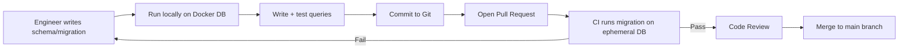
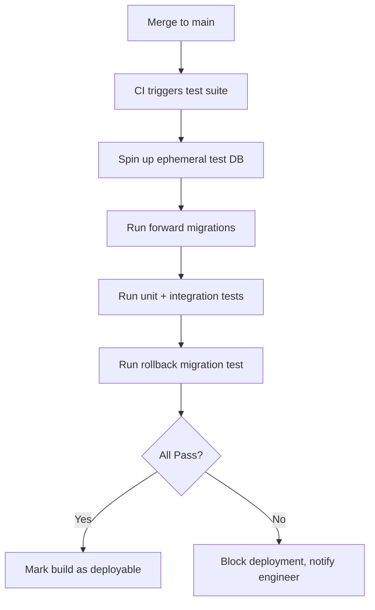
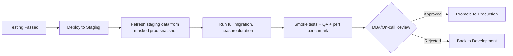
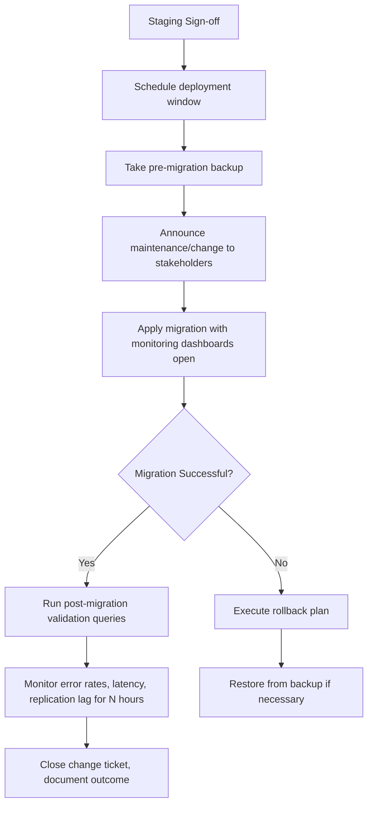
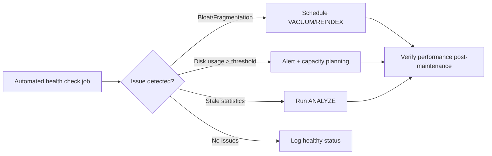
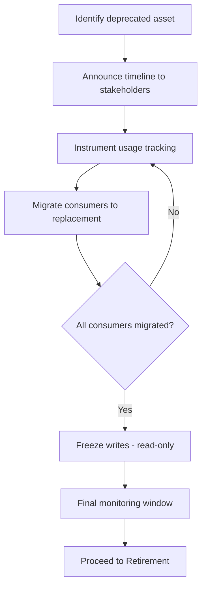
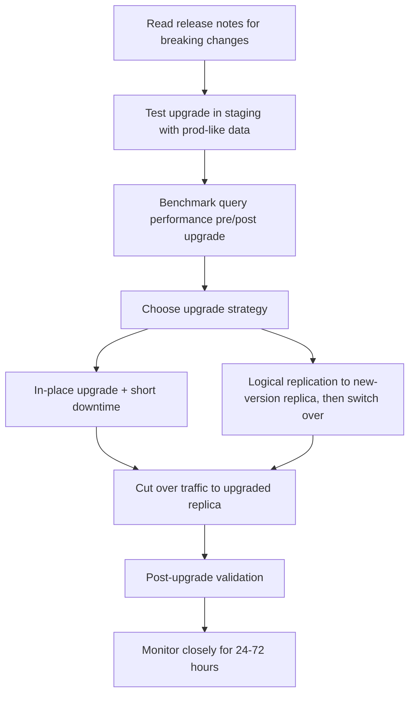
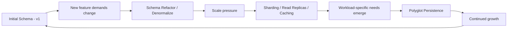

# Part 12 — Production Database Engineering & DBA Mastery

> **Prerequisite:** Parts 1–11 (ER Modeling, Normalization, SQL, Transactions, ACID, Indexing, B+ Trees, Query Optimization, MVCC, Recovery, Distributed Databases, NoSQL, Database Internals).
> **This document covers:** Module 1 of Part 12 only, per the "one module at a time" instruction. Reply "next" / "continue" to receive Module 2 (Database Security).

---

## Module 1: Production Database Lifecycle

### 1.0 Why This Module Exists

Everything you learned in Parts 1–11 (schema design, SQL, indexing, transactions, MVCC) answers the question **"how do databases work?"**. This module answers a different question: **"how does a database live, age, and eventually die inside a real company?"**

A database in a FAANG-scale company is not created once and left alone. It is **born** in a developer's laptop, **matures** through testing and staging gates, **serves millions of users** in production for years, gets **upgraded, patched, and re-architected** multiple times, and is eventually **deprecated and retired** when the product it served is sunset or replaced.

Understanding this lifecycle is what separates a "person who knows SQL" from a **Database Engineer / DBA** who can be trusted to run production systems. This is also one of the most common **System Design + Behavioral crossover** topics in Senior SDE-2/SDE-3 interviews — interviewers want to know you've thought about a schema change *after* it ships, not just when you designed it.

---

### 1.1 The Full Lifecycle — Big Picture

```
┌────────────┐   ┌─────────┐   ┌─────────┐   ┌─────────────┐   ┌─────────────┐   ┌──────────────┐   ┌───────────┐
│ DEVELOPMENT│──▶│ TESTING │──▶│ STAGING │──▶│  PRODUCTION │──▶│ MAINTENANCE │──▶│ DEPRECATION  │──▶│ RETIREMENT│
└────────────┘   └─────────┘   └─────────┘   └─────────────┘   └─────────────┘   └──────────────┘   └───────────┘
     ▲                                              │                  │
     │                                              ▼                  │
     └──────────────── DATABASE EVOLUTION (schema/version changes loop back) ◀─────┘
```

**Real-world analogy:** Think of a database like a **commercial aircraft**.
- **Development** = design & prototyping in the hangar.
- **Testing** = wind-tunnel and simulator tests.
- **Staging** = a test flight with no passengers.
- **Production** = commercial flights carrying real passengers (real user data/traffic).
- **Maintenance** = scheduled servicing between flights — you don't wait for the engine to fail.
- **Deprecation** = the aircraft model is no longer manufactured, but existing ones still fly.
- **Retirement** = the aircraft is decommissioned and scrapped.

Every stage has **gates** (checks that must pass before moving to the next stage), **owners** (who signs off), and **artifacts** (what gets produced).

---

### 1.2 Stage 1 — Development

**What is it?**
The phase where engineers design and build database schemas, write queries, and iterate rapidly on a **local or shared development database**, usually a lightweight or containerized instance.

**Why does it exist?**
To let engineers experiment, break things, and iterate **without any risk to real user data or real traffic**. Mistakes here cost nothing; the same mistake in production could mean data loss or downtime.

**What problem does it solve?**
Without an isolated dev environment, every schema experiment would directly threaten production data integrity and availability.

**Internal working / Step-by-step workflow**

1. Engineer spins up a local database (Docker container, SQLite file, or a shared dev instance).
2. Schema is defined using **migration files** (not manual `ALTER TABLE` in a GUI) — this is critical, covered deeply in Module 8.
3. Seed/synthetic data is loaded (never real PII in dev — see Module 2).
4. Engineer writes and tests queries, indexes, and constraints locally.
5. Code + migration are committed to version control (e.g., Git) and reviewed via Pull Request.
6. CI pipeline runs schema migration against an ephemeral database to catch syntax/logic errors early.



**Industry implementation**
- **Netflix / Uber:** Each microservice owns its schema; developers use local Docker Compose stacks mirroring production database versions.
- **Startups:** Often use a single shared "dev" Postgres/MySQL instance — cheaper, but riskier for schema collisions between engineers.

**PostgreSQL vs MySQL vs Oracle vs SQL Server — Development Nuances**

| Aspect | PostgreSQL | MySQL | Oracle | SQL Server |
|---|---|---|---|---|
| Local dev setup | Lightweight, Docker-friendly | Very lightweight, Docker-friendly | Heavy (needs Oracle XE / full install) | Requires Windows or SQL Server container (Linux support since 2017) |
| Schema-as-code tooling | Excellent (Flyway, Liquibase, Alembic, Sqitch) | Excellent (Flyway, Liquibase) | Supported but heavier (Liquibase, SQL Developer) | Supported (SSDT, Flyway) |
| Cost for dev licenses | Free (open source) | Free (Community Edition) | Free tier (XE) is feature-limited | Free Developer Edition is fully featured |
| Typical dev container size | ~80 MB (Alpine image) | ~140 MB | 2–4+ GB | 1.5+ GB |

**Advantages of a disciplined Development stage**
- Fast iteration, safe experimentation, catches bugs cheaply (bugs are 10–100x cheaper to fix in dev than production).
- Enables parallel work by multiple engineers without conflict.

**Disadvantages / Risks**
- Dev databases can drift from production configuration (different version, different extensions) → "works on my machine" bugs.
- Shared dev databases can have "noisy neighbor" issues (one engineer's bad migration breaks everyone).

**Best Practices**
- ✅ Use the **same major database version** in dev as production.
- ✅ Use **Infrastructure as Code** (Docker Compose / Terraform) so every engineer's dev DB is identical.
- ✅ All schema changes go through **migration files**, never manual changes.
- ✅ Use **synthetic or masked data**, never raw production PII.
- ✅ Enable query logging locally to catch N+1 queries early.

**Common Mistakes**
- ❌ Manually editing schema in a GUI tool and forgetting to write a migration file.
- ❌ Testing only with tiny datasets (10 rows) — index and performance issues only appear at scale.
- ❌ Using SQLite for local dev when production is PostgreSQL (subtle syntax/behavior differences cause bugs).

**Edge Cases**
- A migration that works on an empty dev database may fail or lock for hours on a production table with 500M rows (e.g., adding a `NOT NULL` column without a default on old MySQL/Postgres versions).
- Extension availability differs: a developer uses `pg_trgm` locally, but it isn't installed in production.

**Performance Implications**
- Dev environments hide performance problems because data volume is small; **always test with production-scale synthetic data before merging.**

**Security Implications**
- Leaked dev database credentials in `.env` files committed to Git is one of the most common real-world breach vectors.
- Never copy production data into dev without masking (violates GDPR/HIPAA — see Module 2).

**Interview Importance:** ⭐⭐⭐ (Common in "Tell me about a schema change you made" behavioral questions)

---

### 1.3 Stage 2 — Testing

**What is it?**
A dedicated environment (or set of automated test suites) where the database and its interactions with application code are **verified for correctness** before any human traffic touches it.

**Why does it exist?**
To catch **functional bugs** (wrong query results), **migration bugs** (schema changes breaking existing data), and **integration bugs** (application code assumptions about the schema) before staging/production.

**Types of Database Testing**

| Test Type | What it Checks | Example |
|---|---|---|
| Unit tests | Individual query/repository logic | `getUserById()` returns correct row |
| Integration tests | App + real DB interaction | Order creation writes to `orders` + `inventory` correctly in one transaction |
| Migration tests | Forward AND rollback migrations work | `ALTER TABLE ADD COLUMN` then `DROP COLUMN` restores prior state |
| Data integrity tests | Constraints, foreign keys, triggers fire correctly | Deleting a `customer` cascades correctly to `orders` |
| Load/performance tests | DB behavior under concurrent load | 10,000 concurrent `INSERT`s don't deadlock |
| Regression tests | Old bugs don't reappear | A previously-fixed race condition remains fixed |

**Step-by-step workflow**



**Industry implementation**
- Companies like **Stripe** run migration tests against a **production-schema clone** on every PR to guarantee zero-downtime migrations before they're even reviewed by a human.
- **Google** uses hermetic, fully isolated test databases per test run to avoid flaky shared-state tests.

**PostgreSQL vs MySQL vs Oracle vs SQL Server — Testing Nuances**

| Aspect | PostgreSQL | MySQL | Oracle | SQL Server |
|---|---|---|---|---|
| Ephemeral test DB speed | Fast (templates via `CREATE DATABASE ... TEMPLATE`) | Fast | Slower (heavier engine startup) | Moderate (LocalDB option for fast tests) |
| Transactional test rollback | `BEGIN...ROLLBACK` wrapping supported natively for test isolation | Supported | Supported | Supported |
| In-memory test option | N/A (no true in-memory mode) | N/A | N/A | N/A (but `tempdb` can be used cleverly) |

**Advantages**
- Confidence that a change is correct before it can affect real users.
- Prevents entire classes of "silent data corruption" bugs.

**Disadvantages**
- Slower feedback loop than pure unit tests (spinning up real databases takes time).
- Flaky tests due to shared test database state are a common source of CI pain.

**Best Practices**
- ✅ Every migration must have a **tested rollback path**.
- ✅ Use **transactional test isolation** (wrap each test in a transaction, roll back after) for speed.
- ✅ Test against **realistic data volumes**, not just empty tables.
- ✅ Include **negative tests** (constraint violations should fail as expected).

**Common Mistakes**
- ❌ Only testing the "happy path" — never testing constraint violations, deadlocks, or partial failures.
- ❌ Forgetting to test **backward compatibility**: old application code + new schema (relevant during rolling deployments — see Module 8).

**Edge Cases**
- A migration passes in testing (small dataset) but times out in production due to table lock duration scaling with row count.
- Foreign key constraint tests pass, but a `TRUNCATE` bypasses triggers in some databases and is missed in test coverage.

**Performance Implications**
- Load testing at this stage prevents surprises; skipping it is a top cause of production incidents (see Module 11).

**Security Implications**
- Test environments must **never** contain real production secrets or PII, even temporarily.

**Interview Importance:** ⭐⭐⭐⭐ (Zero-downtime migration testing is a favorite Senior SDE-2/SDE-3 question)

---

### 1.4 Stage 3 — Staging

**What is it?**
A **production-like environment** — same database engine version, similar (often anonymized/subset) data volume, same configuration — used for final validation before real deployment. Sometimes called "pre-prod" or "UAT" (User Acceptance Testing).

**Why does it exist?**
Testing environments are often synthetic and small. Staging exists to catch issues that **only appear at scale or under production-like configuration** — the last line of defense before real users are affected.

**What problem does it solve?**
- Configuration drift between test and production (different memory limits, different replication topology).
- "It worked in testing but broke in production" — staging closes this gap.

**Step-by-step workflow**

1. Deployment candidate is promoted from testing to staging.
2. Staging database is refreshed periodically from a **masked/anonymized production snapshot** (see Module 2 — Data Masking).
3. Full migration is run against staging, timing it to estimate production migration duration.
4. Smoke tests + manual QA + performance benchmarks run against staging.
5. On-call/DBA reviews the migration plan, checks for lock durations, and estimates blast radius.
6. Sign-off → promote to production.



**Industry implementation**
- **Amazon:** Uses "pre-prod" environments that mirror production infrastructure almost exactly, including replication topology and instance types, just at lower scale.
- **Banks/healthcare:** Staging is mandatory and often legally required (regulatory sign-off) before any schema change touches production financial/health data.

**PostgreSQL vs MySQL vs Oracle vs SQL Server — Staging Nuances**

| Aspect | PostgreSQL | MySQL | Oracle | SQL Server |
|---|---|---|---|---|
| Snapshot/clone tooling | `pg_dump`/`pg_basebackup`, or storage-level snapshots (EBS/ZFS) | `mysqldump`, Percona XtraBackup, storage snapshots | RMAN duplicate database | Database snapshots (native feature) |
| Config parity tooling | `postgresql.conf` diffing scripts | `my.cnf` diffing | Oracle Enterprise Manager baselines | Policy-Based Management |

**Advantages**
- Catches scale-dependent bugs, migration timing issues, and configuration drift before real users are affected.
- Allows load testing without any production risk.

**Disadvantages**
- Expensive to maintain a production-scale staging environment (storage + compute cost).
- Data refresh cycles can make staging "stale" relative to current production data shape.

**Best Practices**
- ✅ Staging config (memory, CPU, replication) should mirror production as closely as budget allows.
- ✅ Always **time the migration in staging** to predict production impact and communicate a maintenance window if needed.
- ✅ Rotate/refresh staging data regularly, always with **masked PII**.

**Common Mistakes**
- ❌ Staging on a tiny single-node instance while production is a multi-node replicated cluster — hides replication-lag bugs.
- ❌ Never refreshing staging data — testing against a schema shape that no longer matches production.

**Edge Cases**
- A migration that takes 2 seconds in staging (10GB table) may take 6 hours in production (2TB table) — **always scale-test timing estimates linearly/logarithmically based on table size**, don't assume constant time.

**Performance Implications**
- This is where you validate that a new index doesn't degrade write throughput, and that a new query plan (via `EXPLAIN ANALYZE`, Part 11) performs acceptably at real data volume.

**Security Implications**
- Staging must follow the **same access controls** as production (least privilege) — it's a common attacker target because it's sometimes under-secured yet contains real (masked) data structure.

**Interview Importance:** ⭐⭐⭐⭐

---

### 1.5 Stage 4 — Production

**What is it?**
The live environment serving **real users and real data**, where availability, correctness, and performance directly impact the business and end users.

**Why does it exist?**
This is the actual purpose of everything before it — production is where the database delivers business value.

**Internal working — What changes about "how you operate" once you're in production**

| Concern | Pre-Production | Production |
|---|---|---|
| Mistakes | Cheap, isolated | Expensive, user-facing, sometimes irreversible |
| Change process | Direct/ad-hoc | Change management, approvals, deployment windows |
| Monitoring | Optional | Mandatory, real-time (Module 4) |
| Backups | Optional | Mandatory, tested regularly (Module 7) |
| Access | Broad (all engineers) | Restricted (least privilege, audited — Module 2) |
| Rollback plan | Nice to have | **Mandatory before every deployment** |

**Step-by-step Production Deployment Workflow**



**Industry implementation**
- **Netflix:** Uses canary deployments — a schema/config change is applied to a small subset of production nodes first, monitored, then rolled out fully.
- **Uber:** Enforces "no direct production DB access" for engineers; all changes go through automated migration pipelines with mandatory DBA/SRE review for high-risk changes.

**PostgreSQL vs MySQL vs Oracle vs SQL Server — Production Nuances**

| Aspect | PostgreSQL | MySQL | Oracle | SQL Server |
|---|---|---|---|---|
| Online DDL support | Good since v11+ (many `ALTER TABLE` ops are metadata-only) | Good with `ALGORITHM=INSTANT/INPLACE` (5.6+) | Excellent (Oracle has long supported online redefinition) | Good (`ONLINE=ON` for many operations, Enterprise Edition) |
| Typical production uptime target | 99.9%–99.99% | 99.9%–99.99% | 99.99%+ (mission-critical enterprise) | 99.9%–99.99% |
| Common production topology | Primary + streaming replicas | Primary + replicas, Group Replication, InnoDB Cluster | RAC (Real Application Clusters), Data Guard | Always On Availability Groups |

**Advantages of a mature production process**
- Predictable, low-risk changes; fast incident response; high customer trust.

**Disadvantages / Costs**
- Slower change velocity due to necessary process/approvals — a deliberate trade-off for stability.

**Best Practices**
- ✅ **Always** have a tested rollback plan before deploying.
- ✅ Deploy during **low-traffic windows** when possible for high-risk changes.
- ✅ Use **feature flags** to decouple code deploys from schema activation (Module 8).
- ✅ Monitor **golden signals** (latency, errors, traffic, saturation) during and after every change.
- ✅ Maintain a **change log/runbook** for every production database modification.

**Common Mistakes**
- ❌ Running a schema migration without checking current table size/lock impact.
- ❌ No rollback plan — "we'll figure it out if it breaks."
- ❌ Deploying schema changes and application code that depends on them in a single non-backward-compatible step (breaks during rolling deploys).

**Edge Cases**
- A seemingly harmless `ADD COLUMN` with a default value can trigger a **full table rewrite** and long lock on older PostgreSQL/MySQL versions — must know your engine's version-specific behavior.
- Long-running transactions during a migration can block DDL indefinitely (lock queueing) — must set `lock_timeout`/`statement_timeout`.

**Performance Implications**
- Every production change has a "blast radius" — the DBA's job is to minimize lock duration, avoid full table scans/rewrites, and use online/incremental strategies (Module 8 covers zero-downtime migration in depth).

**Security Implications**
- Production is the **highest-value target** for attackers; strictest access controls, audit logging, and encryption apply here (Module 2).

**Interview Importance:** ⭐⭐⭐⭐⭐ (Nearly universal in Senior interviews: "Walk me through how you'd safely deploy a schema change to a table with 1 billion rows.")

---

### 1.6 Stage 5 — Maintenance

**What is it?**
Ongoing, often scheduled, operational work to keep a production database healthy: vacuuming, index rebuilding, statistics updates, patching, capacity monitoring, and routine health checks.

**Why does it exist?**
Databases degrade over time without maintenance — dead tuples accumulate, indexes fragment, statistics go stale (leading to bad query plans), and unpatched vulnerabilities accumulate risk.

**Categories of Maintenance**

| Category | Examples | Frequency |
|---|---|---|
| Routine housekeeping | `VACUUM`/`ANALYZE` (Postgres), `OPTIMIZE TABLE` (MySQL), statistics updates | Daily/Weekly (often automated) |
| Capacity management | Disk space monitoring, storage expansion | Continuous monitoring, periodic action |
| Patch management | Minor version security patches | Monthly/Quarterly |
| Major upgrades | Version upgrades (e.g., Postgres 14 → 16) | Yearly or per EOL schedule |
| Health checks | Replication lag checks, backup verification | Daily/Weekly |
| Index maintenance | Rebuilding bloated/fragmented indexes | As needed, monitored |

**Step-by-step Routine Maintenance Workflow**



**Industry implementation**
- **Autovacuum** in PostgreSQL runs continuously in the background — but large, high-write tables at companies like Instagram/Meta often need **manually tuned autovacuum settings** per table because defaults don't scale.
- **MySQL/InnoDB** relies less on manual vacuuming (uses purge threads for MVCC cleanup) but still needs periodic `OPTIMIZE TABLE` for heavily-updated tables to reclaim space.

**PostgreSQL vs MySQL vs Oracle vs SQL Server — Maintenance Nuances**

| Aspect | PostgreSQL | MySQL | Oracle | SQL Server |
|---|---|---|---|---|
| Dead row cleanup | `VACUUM` (manual or `autovacuum`) | InnoDB purge threads (automatic) | Automatic undo/PMON | Automatic (ghost record cleanup) |
| Statistics refresh | `ANALYZE` | `ANALYZE TABLE` | `DBMS_STATS` package | `UPDATE STATISTICS` / Auto Update Stats |
| Index maintenance | `REINDEX`, `REINDEX CONCURRENTLY` (v12+) | `OPTIMIZE TABLE`, `ALTER TABLE ... ENGINE=InnoDB` | Online index rebuild (`ALTER INDEX ... REBUILD ONLINE`) | `ALTER INDEX ... REBUILD/REORGANIZE` |
| Patch cadence | Quarterly minor releases | Quarterly minor releases | Quarterly Critical Patch Updates (CPU) | Monthly cumulative updates |

**Advantages**
- Prevents slow, silent performance degradation ("bloat creep") and reduces risk of sudden failure.
- Keeps the query planner's cost estimates accurate (fresh statistics = good query plans, Part 11 recap).

**Disadvantages**
- Maintenance operations (like `VACUUM FULL` or `OPTIMIZE TABLE`) can be I/O-intensive and, if not "concurrent"/"online," can lock tables.

**Best Practices**
- ✅ Automate routine maintenance; don't rely on manual intervention.
- ✅ Monitor **table/index bloat** proactively (dashboards, Module 4).
- ✅ Schedule heavy maintenance (full reindex, major upgrades) during low-traffic windows.
- ✅ Always test patches in staging before production rollout.

**Common Mistakes**
- ❌ Disabling autovacuum "because it's slowing things down" without tuning it — leads to catastrophic bloat and eventually transaction ID wraparound (a PostgreSQL-specific production-killing event).
- ❌ Ignoring disk usage growth trends until the disk is full (a top cause of full outages — Module 11).

**Edge Cases**
- **Transaction ID (XID) Wraparound** in PostgreSQL: if autovacuum can't keep up on a very old, very large table, the database can be forced into a **read-only emergency mode**. This is one of the most infamous PostgreSQL production incidents and a favorite senior-level interview topic.
- Rebuilding a huge index without the `CONCURRENTLY`/`ONLINE` option can lock writes for hours.

**Performance Implications**
- Well-maintained databases have stable, predictable latency. Neglected ones show gradually worsening p99 latency until a cliff-edge failure.

**Security Implications**
- Patch management **is** a security control — most database breaches exploit **known, unpatched CVEs**.

**Interview Importance:** ⭐⭐⭐⭐ (Autovacuum/XID wraparound is a classic "gotcha" senior Postgres question)

> 💡 **Callout — Interview Gold:** If asked *"What's the scariest PostgreSQL production incident you should know about even if you've never seen one?"* — the answer most interviewers want is **transaction ID wraparound**, because it demonstrates you understand MVCC internals from Part 11 connected to real operational consequences.

---

### 1.7 Stage 6 — Deprecation

**What is it?**
The formal process of announcing that a database, table, schema, or feature will **no longer be supported or actively developed**, while it may still be running for existing consumers during a transition period.

**Why does it exist?**
Systems evolve. A database designed for an old product architecture (e.g., monolith-era shared database) often needs to be phased out in favor of newer patterns (e.g., service-owned databases) — but you can't just delete it; consumers need time to migrate.

**Step-by-step Deprecation Workflow**

1. **Identify** the database/table/column to be deprecated (usage analysis — who reads/writes it?).
2. **Announce** deprecation with a clear timeline (e.g., "this table will be read-only in 3 months, deleted in 6").
3. **Add tooling** to detect and alert on continued usage (e.g., query logging tagged as deprecated).
4. **Migrate consumers** one by one to the replacement.
5. **Freeze writes** once all known consumers have migrated (make it read-only).
6. **Monitor** for any remaining silent readers before final removal.
7. Move to **Retirement**.



**Industry implementation**
- **Meta/Google:** Large internal databases go through formal "deprecation reviews" with a required sign-off from every dependent team before removal is approved.
- **AWS:** Deprecates old database engine versions (e.g., end-of-life for RDS MySQL 5.6) with published timelines, forcing customers to plan upgrades.

**Advantages**
- Reduces technical debt and operational surface area (fewer things to monitor, patch, and secure).
- Frees up infrastructure cost.

**Disadvantages**
- Risk of breaking a consumer nobody knew about ("hidden dependency") if usage tracking is incomplete.

**Best Practices**
- ✅ Never deprecate silently — always communicate timelines widely.
- ✅ Use **usage/access logging** before assuming nothing depends on an asset.
- ✅ Provide a **clear migration path** and support to dependent teams.

**Common Mistakes**
- ❌ Deleting/dropping a table immediately after "it looks unused" without a monitoring window — a classic cause of unexpected outages.

**Edge Cases**
- Batch jobs or analytics pipelines that run monthly/quarterly may appear "unused" in a 2-week monitoring window but break later.

**Interview Importance:** ⭐⭐⭐ (Good behavioral/system-design storytelling material)

---

### 1.8 Stage 7 — Retirement

**What is it?**
The final removal/decommissioning of a database — dropping tables, terminating instances, releasing infrastructure, and archiving data per compliance requirements.

**Why does it exist?**
To fully reclaim cost and reduce security/operational surface area once an asset is confirmed unused.

**Step-by-step Retirement Workflow**

1. Confirm zero traffic/usage over an extended monitoring window (deprecation stage).
2. Take a **final archival backup** (often required for compliance — financial/health data must be retained for years even if the live system is gone).
3. Revoke all access/credentials tied to the database.
4. Terminate/decommission the database instance.
5. Update documentation, architecture diagrams, and inventory/CMDB systems.
6. Securely delete or archive backups per data retention policy.

**Best Practices**
- ✅ Always take a final backup and store it per compliance retention rules (e.g., 7 years for financial records under SOX).
- ✅ Formally revoke IAM roles/credentials — orphaned credentials are a security risk.
- ✅ Document the retirement in your architecture/inventory system so future engineers don't wonder "does this still exist?"

**Common Mistakes**
- ❌ Forgetting to revoke access — retired databases with still-valid credentials are a real attack vector.
- ❌ Not retaining a compliance-mandated final backup, risking legal/regulatory penalties.

**Security Implications**
- Retirement is a security-critical stage: dangling DNS records, orphaned credentials, and forgotten snapshots are common sources of breaches long after a system is "dead."

**Interview Importance:** ⭐⭐ (Less commonly asked directly, but ties into compliance/security discussions)

---

### 1.9 Version Upgrades

**What is it?**
The process of moving a running database from one major or minor version to another (e.g., PostgreSQL 13 → 16, MySQL 5.7 → 8.0), gaining new features, performance improvements, and continued vendor support.

**Why does it exist?**
Database vendors release new versions with performance improvements, security patches, and new features; old versions eventually reach **End-of-Life (EOL)** and stop receiving security patches — running EOL software in production is both a security and compliance risk.

**Minor vs Major Upgrades**

| Type | Example | Risk Level | Typical Downtime |
|---|---|---|---|
| Patch/Minor | PostgreSQL 15.2 → 15.3 | Low | Seconds (usually just a restart) |
| Major | PostgreSQL 14 → 15, MySQL 5.7 → 8.0 | High (potential breaking changes, catalog/format changes) | Minutes to hours, unless using logical replication for near-zero downtime |

**Step-by-step Major Upgrade Workflow**



**Industry implementation**
- Large-scale companies almost always use the **logical-replication cutover** strategy (build a new-version replica, replicate data, cut over) for major upgrades to avoid extended downtime — this mirrors zero-downtime migration strategies covered fully in Module 8.

**PostgreSQL vs MySQL vs Oracle vs SQL Server — Upgrade Nuances**

| Aspect | PostgreSQL | MySQL | Oracle | SQL Server |
|---|---|---|---|---|
| In-place upgrade tool | `pg_upgrade` (fast, uses hard links) | `mysql_upgrade` (deprecated in 8.0+, mostly automatic) | Database Upgrade Assistant (DBUA) | SQL Server Setup in-place upgrade |
| Near-zero-downtime option | Logical replication / `pglogical` | Replication-based upgrade | Data Guard switchover, GoldenGate | Always On AG-based rolling upgrade |
| EOL support window | ~5 years per major version | ~5 years (LTS-style) EOL policy | Extended support can span a decade+ | ~10 years mainstream + extended support |

**Advantages of staying current**
- Continued security patches, performance improvements, new features (e.g., better query planner, new index types).

**Disadvantages / Risks**
- Application incompatibility with new default behaviors (e.g., MySQL 8.0 changed default authentication plugin, breaking some older client libraries).
- Extended-runtime risk during in-place upgrades on very large databases.

**Best Practices**
- ✅ Always read **release notes / breaking changes** before any major upgrade.
- ✅ Test the exact upgrade path in staging with production-scale data.
- ✅ Prefer **replication-based cutover** for large, low-downtime-tolerance systems.
- ✅ Have a tested **downgrade/rollback plan** (note: many databases do NOT support easy downgrades — plan accordingly, often via keeping the old primary as a fallback until confidence is high).

**Common Mistakes**
- ❌ Upgrading production without checking driver/ORM compatibility with the new version.
- ❌ Assuming an in-place upgrade tool scales linearly with data size without testing (`pg_upgrade` with `--link` mode is fast; without it, can be very slow).

**Edge Cases**
- Postgres major-version upgrades change the on-disk catalog format — `pg_upgrade` handles this, but any custom extensions must have compatible versions for the target release.
- MySQL upgrades between very old and very new versions sometimes require **intermediate hops** (can't always jump directly from 5.6 to 8.0).

**Interview Importance:** ⭐⭐⭐⭐ ("How would you upgrade a production database with zero downtime?" is an extremely common senior question.)

---

### 1.10 Database Evolution

**What is it?**
The continuous, iterative process by which a database's **schema, architecture, and even engine choice** change over time to match evolving application requirements, scale, and business needs — the "loop back" arrow in the lifecycle diagram.

**Why does it exist?**
No schema designed on day one survives unchanged for the life of a successful product. User growth, new features, and changing access patterns constantly pressure-test original design decisions from Parts 1–3 (ER modeling, normalization).

**Common Evolution Patterns**

| Evolution Pattern | Trigger | Example |
|---|---|---|
| Schema refactoring | New feature requirements | Splitting a monolithic `users` table into `users` + `user_preferences` + `user_addresses` |
| Denormalization | Read-performance pressure | Adding a redundant `order_count` column to `customers` to avoid expensive joins/counts |
| Sharding | Single-node capacity limits | Splitting a `messages` table across shards by `user_id` (covered fully in later scaling modules) |
| Polyglot persistence | Workload-specific needs | Moving session data from the primary relational DB to Redis; moving search to Elasticsearch |
| Engine migration | Cost, scale, or feature mismatch | Migrating from a single-node MySQL to a distributed SQL database like CockroachDB/YugabyteDB as global scale demands increase |



**Real-world analogy:** A database schema is like a **city's road network** — it's never "finished." As population (data) grows and traffic patterns (query patterns) change, you add lanes (indexes), build new roads (tables), and sometimes need entirely new infrastructure (new database engine) — you rarely tear down and rebuild the whole city at once; you evolve it incrementally, in production, while traffic keeps flowing.

**Industry implementation**
- **Uber** famously evolved from PostgreSQL → MySQL and re-architected schemas multiple times as scale requirements changed (documented in their public engineering blog).
- **Instagram** evolved its Django/PostgreSQL schema extensively with sharding by user ID as it scaled past hundreds of millions of users.

**Advantages**
- Keeps the system aligned with real usage patterns; prevents architecture from becoming a bottleneck.

**Disadvantages**
- Every evolution step carries migration risk (Module 8) and requires careful backward compatibility handling.

**Best Practices**
- ✅ Treat schema evolution as a **continuous, incremental process**, not a rare "big rewrite" event.
- ✅ Maintain **backward-compatible migrations** (expand-contract pattern — covered in depth in Module 8).
- ✅ Regularly review query patterns (Module 4/5) to catch when the schema no longer matches actual usage.

**Common Mistakes**
- ❌ Over-engineering the schema for imagined future scale on day one (premature optimization) instead of evolving it as real needs emerge.
- ❌ Under-investing in migration tooling, making every evolution step painful and risky.

**Interview Importance:** ⭐⭐⭐⭐⭐ (System design interviews almost always probe "how would this schema evolve as the product grows?")

---

### 1.11 Master Comparison Table — Lifecycle Stage Ownership & Risk

| Stage | Primary Owner | Typical Risk Level | Key Artifact Produced | Rollback Difficulty |
|---|---|---|---|---|
| Development | Software Engineer | Very Low | Migration file, PR | Trivial (local only) |
| Testing | Engineer + CI system | Low | Test reports | Trivial |
| Staging | QA / DBA / SRE | Medium | Sign-off, timing benchmarks | Easy |
| Production | DBA / SRE / On-call | High | Deployed change, monitoring data | Hard (requires rollback plan) |
| Maintenance | DBA | Medium | Health reports, cleaned-up storage | Moderate |
| Deprecation | Architecture team / DBA | Medium | Deprecation notice, migration plan | Moderate (can pause) |
| Retirement | DBA / Security | Low (if done correctly) | Final archive, decommission record | Irreversible |

---

### 1.12 Decision Tree — "What Stage Should This Change Go Through?"

```
Is this a schema/data change destined for production?
│
├─ NO → Local dev/testing only. Stop here.
│
└─ YES
    │
    ├─ Is it a read-only query change (no schema/data mutation)?
    │      └─ YES → Test → Staging (perf validation) → Production (low risk)
    │
    ├─ Is it an additive schema change (new table/column, nullable)?
    │      └─ YES → Test → Staging (timing benchmark) → Production
    │                (Follow expand-contract pattern, Module 8)
    │
    ├─ Is it a destructive change (DROP COLUMN/TABLE, data deletion)?
    │      └─ YES → Test → Staging → Deprecation process (usage monitoring)
    │                → Production (only after deprecation window closes)
    │
    └─ Is it a major version/engine upgrade?
           └─ YES → Test in staging with prod-scale data → Benchmark
                     → Choose in-place vs replication cutover
                     → Production (maintenance window + rollback plan)
```

---

### 1.13 Checklist — Production Readiness Gate

Before ANY change is promoted from staging to production, verify:

- [ ] Migration tested in staging with production-scale data
- [ ] Migration timing measured and communicated (maintenance window scheduled if needed)
- [ ] Rollback plan documented and tested
- [ ] Backward compatibility with currently-deployed application code verified
- [ ] Monitoring dashboards ready to watch during/after deployment (Module 4)
- [ ] Pre-change backup taken and verified restorable (Module 7)
- [ ] On-call/DBA aware and available during the change window
- [ ] Change ticket/documentation created for audit trail
- [ ] Security review complete if the change touches sensitive data (Module 2)

---

### 1.14 Cross-References to Other Parts/Modules

- Schema design decisions in Development stage → **Part 3–4 (ER Modeling, Normalization)**
- Transaction correctness in Testing stage → **Part 6–7 (Transactions, ACID, MVCC)**
- Index/query performance in Staging → **Part 9–10 (Indexing, B+ Trees, Query Optimization)**
- Zero-downtime migration mechanics → **Module 8 of this Part**
- Monitoring dashboards used in Production/Maintenance → **Module 4 of this Part**
- Backup/recovery in Retirement/Production → **Module 7 of this Part**
- Access control across all stages → **Module 2 of this Part**

---

## Exercises — Module 1

**Beginner**
1. List the seven stages of the production database lifecycle in order and give a one-sentence description of each.
2. Explain, in your own words, why a shared "dev" database is riskier than an isolated per-engineer local database.
3. What is the difference between "deprecation" and "retirement"?

**Intermediate**
4. You need to add a `NOT NULL` column with a default value to a 200-million-row production PostgreSQL table. Describe how you would test this change through Development → Testing → Staging → Production.
5. Explain why staging environments should use masked production data rather than fully synthetic data, and rather than raw production data.
6. Compare the risk profile of a minor version patch vs. a major version upgrade. What testing differs between them?

**Advanced Production Scenarios**
7. Your team wants to deprecate a legacy `orders_v1` table that a new `orders_v2` table has replaced. Design a full deprecation plan, including how you'd detect hidden/unexpected consumers.
8. A migration passed all tests in staging (5GB dataset, ran in 3 seconds) but has been running for 40 minutes in production (2TB dataset) and traffic is degrading. Walk through your diagnosis and decision process in real time.
9. Design the version-upgrade strategy for a MySQL 5.7 database (approaching EOL) serving a payments system that cannot tolerate more than 30 seconds of downtime.

**Debugging Exercise**
10. A junior engineer manually ran `ALTER TABLE users DROP COLUMN legacy_flag;` directly on production, bypassing the migration pipeline, and a downstream analytics job just failed. Walk through your incident response, root cause analysis, and what process changes you'd propose (ties into Module 11).

**Whiteboard / Interview Problem**
11. *"Walk me through how you would evolve a single-node MySQL database currently serving 50,000 QPS into an architecture that can serve 500,000 QPS, without a single hour of downtime, over a 6-month roadmap."* Sketch the stages, decisions, and risks at each step.

**Capstone-style Prompt**
12. For a hypothetical "Food Delivery App" (a full design is covered in Module 15's Capstone Projects), describe what the Development → Production lifecycle would look like for the initial launch of the `orders` table, and how you would evolve it a year later when the company expands to 10x more cities.

---

## Interview Questions — Module 1

**Theory / Conceptual**
- Q: Why shouldn't schema changes be applied directly in production without going through dev/test/staging?
- Q: What's the difference between a minor and major database version upgrade, and why does that distinction matter operationally?
- Q: What is "transaction ID wraparound" in PostgreSQL and why is it a lifecycle/maintenance concern?

**Scenario-Based (Senior SDE-2/SDE-3)**
- Q: "We need to migrate a heavily-used table's primary key from `INT` to `BIGINT` because we're about to run out of integer range, on a table with zero tolerance for downtime. Walk me through your full plan across all lifecycle stages."
- Q: "How would you design a deprecation process that guarantees you never break a hidden internal consumer of a database table?"
- Q: "Describe a time (real or hypothetical) where a database change passed staging but caused a production incident. What lifecycle gap would you add to prevent it?"

**Behavioral / HR crossover**
- Q: "Tell me about a database migration or upgrade you were involved in. What went well, what would you do differently?"

---

## Cheat Sheet — Module 1

```
LIFECYCLE:  Dev → Test → Staging → Production → Maintenance → Deprecation → Retirement
                                        ▲__________________Evolution loops back_________|

KEY RULES:
  • Never skip stages for "small" changes.
  • Every production change needs: backup + rollback plan + monitoring + sign-off.
  • Migrations = version-controlled files, never manual GUI edits.
  • Staging must mirror production config + use masked (not raw) data.
  • Deprecate with usage monitoring BEFORE deleting anything.
  • Major upgrades: prefer replication-based cutover for near-zero downtime.
  • PostgreSQL-specific danger: autovacuum neglect → XID wraparound → read-only emergency.
```

---

*(End of Module 1. Reply "next" or "continue" to receive Module 2: Database Security.)*
