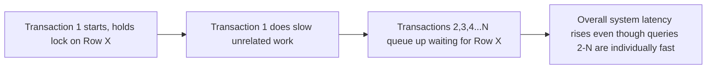
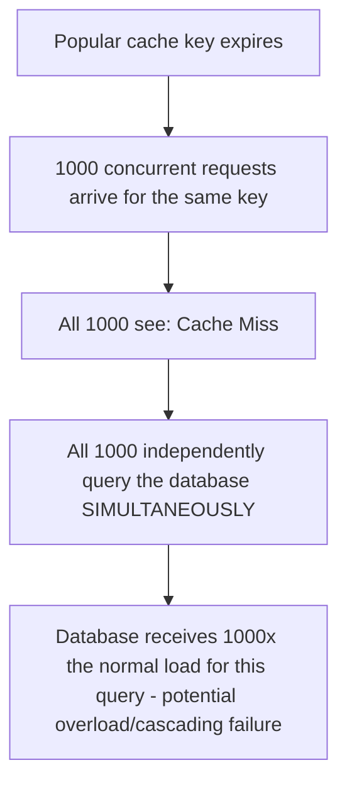

# Part 12 — Production Database Engineering & DBA Mastery

## Module 11: Common Production Failures

> **Recap:** Modules 1-10 gave you the tools to build, secure, monitor, scale, migrate, and choose databases correctly. This module is the **field manual for when things go wrong anyway** — because in production, they eventually will. Each failure below follows the same structure: **What happens → Why it happens → How to diagnose → How to resolve → How to prevent.** This is the single most heavily tested module for Senior SDE-2/SDE-3 "incident" and "production support" interview rounds.

### 11.0 Why This Module Exists

**Real-world analogy:** Modules 1-10 taught you to build and maintain a well-engineered building. This module is the fire department training — knowing exactly what to do the moment smoke appears, based on which room it's coming from, rather than improvising under pressure. Every failure here is a real, well-documented pattern that has happened at companies of every size, not a hypothetical.

---

### 11.1 Slow Queries

**What happens:** Individual queries take far longer than expected, degrading latency for the requests that depend on them.

**Why it happens:** Missing/unused indexes, stale statistics leading to bad query plans, unexpectedly large result sets, poor join strategies, or a query that used to be fast on a small table and never got revisited as the table grew (Module 1's "Database Evolution" theme).

**Diagnosis**
```sql
-- Find current slow queries in-flight (PostgreSQL)
SELECT pid, now() - query_start AS duration, query
FROM pg_stat_activity
WHERE state = 'active'
ORDER BY duration DESC;
```
Then `EXPLAIN ANALYZE` the offending query (Part 11 recap, Module 4/5 process).

**Resolution:** Add a missing index, rewrite the query, update statistics (`ANALYZE`), or restructure the schema (Module 5's Query/Index/Schema review process).

**Prevention:** Continuous `pg_stat_statements` review (Module 4), load testing before launch (Module 5), query review in code review culture.

**Interview Importance:** ⭐⭐⭐⭐⭐

---

### 11.2 Lock Contention

**What happens:** Multiple transactions compete for the same locks, causing queueing and rising latency even though no single query is inherently "slow."

**Why it happens:** Long-running transactions holding locks longer than necessary, missing indexes causing broader locks than needed (e.g., a full table scan under an isolation level that locks scanned rows), or high-concurrency writes to the same hot rows (Section 11.13).

**Diagnosis:** Use the blocking-query detection SQL from Module 4 (`pg_locks` join). Look for a small number of long-held locks blocking many waiters.



**Resolution:** Kill/terminate the blocking transaction if safe; shorten transaction scope (do slow work like external API calls OUTSIDE the transaction); ensure transactions are as short as possible.

**Prevention:** Code review standard: **never hold a database transaction open across a network call or slow computation.** Set `statement_timeout`/`lock_timeout` as a safety net.

**Interview Importance:** ⭐⭐⭐⭐⭐

---

### 11.3 Deadlocks

**What happens:** Two or more transactions each hold a lock the other needs, forming a cycle; the database detects this and aborts one transaction (the "victim").

**Why it happens:** Transactions acquiring the same set of resources (rows/tables) **in different orders**.

```
Transaction A: locks Row 1, then wants Row 2
Transaction B: locks Row 2, then wants Row 1
   → Circular wait → Deadlock → DB aborts one transaction
```

**Diagnosis:** Deadlock events are typically logged automatically by the database engine (check the error/deadlock log — `deadlock_timeout` logging in PostgreSQL, `SHOW ENGINE INNODB STATUS` in MySQL for the latest deadlock detail).

**Resolution:** The database resolves it automatically (aborts one transaction) — the real "resolution" is fixing the application's transaction ordering so it stops recurring.

**Prevention:** ✅ **Always acquire locks/access resources in a consistent, agreed-upon order** across all code paths (e.g., always lock the lower `id` first). Keep transactions short. Retry deadlock-victim transactions automatically at the application layer (deadlocks are expected occasionally in high-concurrency systems — design for graceful retry, not zero occurrence).

**Interview Importance:** ⭐⭐⭐⭐⭐

---

### 11.4 Connection Exhaustion

**What happens:** The database rejects new connections because `max_connections` (Module 3) has been reached.

**Why it happens:** No connection pooling (Module 5), a connection leak in application code (connections opened but never closed/returned), a traffic spike, or a downstream slowdown causing connections to be held longer than normal (cascading effect from Section 11.1/11.2).

**Diagnosis**
```sql
-- PostgreSQL: current connection count vs max
SELECT count(*) FROM pg_stat_activity;
SHOW max_connections;

-- Break down connections by state to spot leaks (many "idle in transaction" = leak)
SELECT state, count(*) FROM pg_stat_activity GROUP BY state;
```

**Resolution:** Restart the leaking application service if a leak is confirmed (temporary mitigation); introduce/scale connection pooling (PgBouncer/ProxySQL — Module 5).

**Prevention:** Always use connection pooling in production; set application-level connection pool timeouts; monitor connection usage as a first-class alert (Module 4).

**Interview Importance:** ⭐⭐⭐⭐⭐

---

### 11.5 Index Bloat

**What happens:** Indexes grow larger than necessary due to accumulated dead entries from updates/deletes, degrading both read performance (larger index to scan) and write performance (more overhead to maintain).

**Why it happens:** MVCC (Part 7 recap) means updates/deletes don't immediately remove old index entries — they're marked dead and cleaned up later by vacuum/purge processes (Module 1 recap). High-churn tables with insufficient vacuum tuning accumulate bloat faster than it's cleaned.

**Diagnosis:** Compare actual index size to an estimate of its "ideal" size (tools like `pgstattuple` in PostgreSQL, or bloat-estimation queries widely available in the ecosystem).

**Resolution:** `REINDEX CONCURRENTLY` (PostgreSQL 12+) or `OPTIMIZE TABLE` (MySQL) to rebuild bloated indexes without extended locking.

**Prevention:** Properly tuned autovacuum settings for high-churn tables (Module 1/3 recap) — this is the root-cause fix, not periodic manual reindexing as a workaround.

**Interview Importance:** ⭐⭐⭐

---

### 11.6 Replication Lag

**What happens:** A read replica falls significantly behind the primary, serving stale data or, in severe cases, becoming unusable as a failover candidate (Module 6 recap).

**Why it happens:** Replica hardware underpowered relative to write volume, network issues between primary and replica, a long-running query on the replica blocking replay of incoming changes, or a sudden burst of writes generating WAL/binlog faster than the replica can apply it.

**Diagnosis:** Use the replication lag monitoring queries from Module 4 (`pg_stat_replication`); correlate lag spikes with write volume/WAL generation rate graphs.

**Resolution:** Kill any long-running blocking query on the replica; if the replica is fundamentally under-provisioned, scale it up; if a specific write burst (e.g., a batch job) is the cause, throttle/batch it (Module 8's batched-backfill technique).

**Prevention:** Provision replicas with adequate headroom; alert proactively on rising lag trends, not just absolute thresholds (Module 4 recap); avoid long-running analytical queries on replicas meant for low-latency reads (route those to a dedicated reporting replica instead).

**Interview Importance:** ⭐⭐⭐⭐

---

### 11.7 Storage Full

**What happens:** The database's disk fills to capacity — often resulting in the database **halting entirely** (it can't write WAL/redo logs, so it can't safely accept writes, and depending on the engine, may become fully unavailable).

**Why it happens:** Inadequate capacity planning (Module 3 recap), an unexpected data growth spike, WAL/binlog accumulation from a stuck replication slot or a lagging replica (Module 6/7 recap edge case), or runaway logging.

**Diagnosis:** Disk usage monitoring dashboard (Module 4) should have caught this well before it became critical — if it didn't, check for: unused replication slots holding WAL, unexpectedly large temp files from a runaway query, or a genuine data growth spike.

```sql
-- PostgreSQL: check for replication slots that might be preventing WAL cleanup
SELECT slot_name, active, pg_size_pretty(pg_wal_lsn_diff(pg_current_wal_lsn(), restart_lsn)) AS retained_wal
FROM pg_replication_slots;
```

**Resolution:** Emergency disk expansion (often possible online on cloud-managed storage); drop/fix any stuck replication slots; clean up unnecessary large files/old logs if safe.

**Prevention:** Multi-threshold capacity alerting (Module 3 recap: warn at 70%, critical at 85%, never wait for 100%); monitor replication slot health specifically, since this is a well-known, easily-missed root cause.

**Interview Importance:** ⭐⭐⭐⭐⭐

---

### 11.8 Disk Corruption

**What happens:** Data on disk becomes unreadable or inconsistent due to hardware failure, filesystem corruption, or (rarely) a database engine bug.

**Why it happens:** Failing physical/virtual disk hardware, power loss during a write without proper fsync guarantees, filesystem bugs, or bit-rot on long-unread data.

**Diagnosis:** Database engine typically surfaces checksum failures or read errors (PostgreSQL supports `data_checksums` — enable this at initialization for early corruption detection, since it's not retroactively enabled without a full re-init). Hardware-level SMART disk monitoring can catch failing disks before full corruption.

**Resolution:** This is exactly the scenario **Module 7 (Backup & Disaster Recovery) exists for** — restore from a known-good backup, potentially combined with PITR to recover up to just before corruption began. There is often no way to "fix" corrupted data in place with confidence.

**Prevention:** Enable data checksums where supported; use reliable, redundant storage (RAID, cloud-provider-managed durability); validated, regularly-tested backups (Module 7's core principle) are the real safety net here.

**Interview Importance:** ⭐⭐⭐⭐

---

### 11.9 Memory Pressure

**What happens:** The database or OS runs low on available memory, potentially triggering swapping (using disk as overflow memory) — catastrophic for database performance since disk is orders of magnitude slower than RAM.

**Why it happens:** Overcommitted memory configuration (e.g., `work_mem` in PostgreSQL multiplied across many concurrent connections exceeding physical RAM — Module 3 recap), a memory leak in a long-running process, or genuinely growing working set outpacing provisioned memory.

**Diagnosis:** OS-level memory monitoring (Module 4) showing swap usage > 0 is an urgent signal; correlate with buffer cache hit ratio dropping simultaneously.

**Resolution:** Kill memory-hogging queries/connections if identifiable; reduce `work_mem`/connection count temporarily; add memory (vertical scale) if this is a sustained trend rather than a spike.

**Prevention:** Conservative `work_mem` sizing accounting for worst-case concurrent connections (Module 3 recap: `work_mem × max_connections` should not exceed available RAM in the worst case); connection pooling to bound concurrent connection count (Module 5).

**Interview Importance:** ⭐⭐⭐⭐

---

### 11.10 CPU Bottlenecks

**What happens:** Sustained high CPU utilization causes query queueing and rising latency across the board.

**Why it happens:** Inefficient queries doing excessive computation (e.g., complex regex, unindexed sorts), a sudden traffic spike beyond provisioned capacity, or background maintenance operations (vacuum, reindex) competing with foreground query load.

**Diagnosis:** CPU utilization dashboard (Module 4) combined with `pg_stat_activity`/`SHOW PROCESSLIST` to identify which specific queries are CPU-heavy at the moment.

**Resolution:** Kill/optimize the offending query; reschedule maintenance operations to lower-traffic windows (Module 1/3 recap); scale vertically or add read replicas to distribute load (Module 5).

**Prevention:** Query review discipline (Module 5); capacity planning with realistic headroom (Module 3); scheduling heavy maintenance during low-traffic windows.

**Interview Importance:** ⭐⭐⭐

---

### 11.11 Checkpoint Spikes

**What is it?**
A checkpoint is the periodic process where the database flushes all dirty (modified) in-memory pages to disk, ensuring a consistent recovery point. When checkpoints occur too infrequently or handle too much accumulated dirty data at once, they cause a sudden burst of I/O — a "checkpoint spike" — that can spike write latency system-wide for the checkpoint's duration.

**Why it happens:** `checkpoint_timeout`/`max_wal_size` (PostgreSQL) set too high, allowing too much dirty data to accumulate between checkpoints; a burst of write activity (batch job) accumulating a large amount of dirty data right before a scheduled checkpoint.

**Diagnosis:** Correlate write-latency spikes precisely with checkpoint start/completion log timestamps.

**Resolution:** Tune checkpoint frequency to spread I/O more evenly (`checkpoint_completion_target` in PostgreSQL smooths checkpoint I/O over a longer window rather than bursting it).

**Prevention:** Proactive checkpoint tuning as part of configuration baseline (Module 3), rather than reactive discovery during an incident.

**Interview Importance:** ⭐⭐⭐ (A favorite "deep PostgreSQL internals" senior question)

---

### 11.12 WAL / Log Explosion

**What happens:** Write-ahead log (or binlog/redo log) volume grows explosively, consuming disk rapidly and/or overwhelming replication bandwidth.

**Why it happens:** A bulk data load/migration (Module 8) generating massive WAL volume, a stuck replication slot preventing WAL cleanup (Section 11.7 recap), or an application bug causing excessive, unnecessary writes (e.g., updating a row in a tight loop when it should be updated once).

**Diagnosis:** WAL generation rate dashboard (Module 4); check for stuck replication slots; check for recently-deployed code with an unusual write pattern.

**Resolution:** Fix/throttle the offending write source; clean up stuck replication slots; if a legitimate bulk operation is the cause, ensure it's batched appropriately (Module 8's batched-backfill technique) to spread WAL generation over time.

**Prevention:** Monitor WAL generation rate as a first-class metric (Module 4); code review scrutiny for write-amplifying patterns; always batch large migrations.

**Interview Importance:** ⭐⭐⭐⭐

---

### 11.13 Hot Partitions / Hot Rows

**What happens:** A disproportionate share of traffic concentrates on a single partition/shard (hot partition) or a single row (hot row), creating a bottleneck even though the overall system has plenty of aggregate capacity.

**Why it happens:** A poorly-chosen shard/partition key with skewed distribution (e.g., sharding by `signup_date` when one recent date has vastly more activity than others — a "celebrity" or "thundering herd" scenario); a single frequently-updated counter row (e.g., a global "total views" counter updated on every page view) becoming a severe lock-contention bottleneck (directly connects to Section 11.2).

```
Well-distributed sharding:          Hot partition (bad key choice):
Shard 1: ████████ (25%)             Shard 1: ██ (5%)
Shard 2: ████████ (25%)             Shard 2: ██ (5%)
Shard 3: ████████ (25%)             Shard 3: ████████████████████ (85%) ← BOTTLENECK
Shard 4: ████████ (25%)             Shard 4: ██ (5%)
```

**Diagnosis:** Per-shard/per-partition load metrics showing severe imbalance; for hot rows, lock contention monitoring (Section 11.2) pointing repeatedly at the same row.

**Resolution (hot rows):** Split a single hot counter into multiple sharded sub-counters (e.g., 10 counter rows, sum them for reads, randomly distribute writes across them) — a classic, well-known pattern.
**Resolution (hot partitions):** Re-shard using a better-distributed key (e.g., hash-based instead of sequential/date-based), or split the hot partition further.

**Prevention:** Choose shard/partition keys based on **actual access pattern distribution analysis**, not convenience; anticipate "celebrity" skew scenarios in the data model design phase.

**Interview Importance:** ⭐⭐⭐⭐⭐ (Extremely common in system design interviews — "how do you handle a viral post getting way more traffic than others")

---

### 11.14 Cache Stampede

**What happens:** A popular cache entry expires, and a large number of concurrent requests **simultaneously** miss the cache and hit the database at once, overwhelming it — even though the database could easily handle the *steady-state* cached load.

**Why it happens:** A simple TTL-based cache-aside pattern (Module 5 recap) where many requests for the same key arrive in the narrow window right after expiry, all independently deciding "cache miss, go query the database," multiplying load by the concurrency of simultaneous requests.



**Resolution/Prevention (multiple complementary techniques)**

| Technique | How It Works |
|---|---|
| Request coalescing / locking | Only the FIRST request on a cache miss queries the DB; others wait for that result and reuse it |
| Jittered TTLs | Randomize TTL slightly per key so many keys don't expire at the exact same instant |
| Probabilistic early expiration | Recompute the cache entry slightly *before* actual expiry, probabilistically, spreading refresh load over time |
| Stale-while-revalidate | Serve the slightly-stale cached value immediately while asynchronously refreshing it in the background |

**Interview Importance:** ⭐⭐⭐⭐⭐

---

### 11.15 Network Partitions

**What happens:** A network failure splits cluster nodes into groups that can't communicate with each other, risking split-brain (Module 6 recap) if not handled via proper quorum.

**Why it happens:** Datacenter network equipment failure, cross-region connectivity issues, misconfigured firewall/security group rules cutting off communication between nodes.

**Diagnosis:** Cluster manager (Patroni/etcd — Module 6) logs showing loss of quorum contact; application-level connection errors to specific nodes while others remain reachable.

**Resolution:** This is exactly the scenario **Module 6's quorum-based failover design exists to handle safely** — the minority partition should automatically step back from accepting writes, while the majority partition (with quorum) elects a new leader if needed. The "resolution" is largely automatic if HA was correctly designed; manual intervention is needed only if the automated safeguards themselves are misconfigured.

**Prevention:** Properly configured quorum (odd node counts, Module 6 recap); redundant network paths between datacenters/regions where feasible; regular failover drills (Module 7) that specifically simulate network partition scenarios, not just clean node crashes.

**Interview Importance:** ⭐⭐⭐⭐⭐

---

### 11.16 Master Failure Diagnosis Decision Tree

```
Production incident: "database is having problems." Where do you start?
│
├─ Is the database completely unreachable?
│      ├─ Disk full? (Section 11.7) → check disk metrics first
│      ├─ Network partition? (Section 11.15) → check cluster manager/quorum status
│      └─ Process crashed? → check error logs, consider disk corruption (11.8)
│
├─ Is it reachable but slow/degraded?
│      ├─ Check CPU/Memory/Disk/IOPS saturation (11.9, 11.10)
│      ├─ Check connection count vs max (11.4)
│      ├─ Check for lock contention / blocking queries (11.2, 11.3, 11.13)
│      ├─ Check for a specific new slow query (11.1)
│      └─ Check WAL generation rate / checkpoint activity (11.11, 11.12)
│
├─ Are reads stale or replicas behaving oddly?
│      └─ Check replication lag (11.6)
│
└─ Is a specific downstream service seeing errors right after a cache event?
       └─ Consider cache stampede (11.14)
```

---

### 11.17 Master Comparison Table — Failure Modes at a Glance

| Failure | Primary Symptom | Fastest First Check | Primary Prevention |
|---|---|---|---|
| Slow queries | High latency, specific query | `pg_stat_activity` / slow query log | Index/query review (Module 5) |
| Lock contention | Rising latency, no single slow query | Blocking query detection SQL | Short transactions, code review |
| Deadlocks | Aborted transactions in logs | Deadlock log entries | Consistent lock ordering |
| Connection exhaustion | "too many connections" errors | Connection count vs max | Connection pooling |
| Index bloat | Slowly worsening perf over time | Index size vs. estimated ideal | Autovacuum tuning |
| Replication lag | Stale replica reads, failover risk | Replication lag dashboard | Adequate replica sizing, alerting |
| Storage full | Writes fail, DB may halt | Disk usage %, replication slots | Multi-threshold alerting |
| Disk corruption | Read errors, checksum failures | Engine corruption logs, SMART data | Checksums + validated backups |
| Memory pressure | Swap usage > 0 | OS memory/swap metrics | Conservative `work_mem` sizing |
| CPU bottleneck | Across-the-board latency rise | CPU utilization + active queries | Query review, capacity planning |
| Checkpoint spikes | Periodic write-latency bursts | Correlate with checkpoint logs | Checkpoint tuning |
| WAL explosion | Rapid disk growth, replication strain | WAL generation rate | Batched writes, slot monitoring |
| Hot partitions/rows | One shard/row bottlenecked, rest idle | Per-shard load distribution | Better key selection, counter sharding |
| Cache stampede | DB load spike right after cache expiry | Correlate DB spike with cache TTL | Coalescing, jittered TTL |
| Network partition | Cluster split, potential split-brain | Cluster manager quorum status | Odd node count, drills |

---

### 11.18 Checklist — Incident Response Readiness

- [ ] Runbooks exist for each major failure category above
- [ ] On-call engineers trained on the master diagnosis decision tree
- [ ] Monitoring/alerting (Module 4) covers every metric referenced in this module's diagnosis steps
- [ ] Backups validated and DR drilled (Module 7) as the ultimate safety net for unrecoverable failures
- [ ] Post-incident reviews conducted for every significant production failure, feeding back into prevention measures

---

### 11.19 Cross-References

This entire module is a synthesis of failure modes whose root causes and fixes trace back to nearly every prior module:
- Monitoring detection → **Module 4**
- Configuration root causes → **Module 3**
- HA/quorum handling of partitions → **Module 6**
- Backup/DR as the ultimate safety net → **Module 7**
- Migration-caused WAL/lock issues → **Module 8**
- Caching failure modes → **Module 5**
- Sharding/partitioning failure modes → **Module 10**

---

## Exercises — Module 11

**Beginner**
1. What's the difference between lock contention and a deadlock?
2. Why does connection exhaustion often happen even when the database itself has spare CPU/memory capacity?
3. Explain cache stampede in your own words with a simple analogy.

**Intermediate**
4. Design a monitoring/alerting configuration specifically aimed at catching disk-full incidents before they happen, including the replication slot edge case.
5. A production incident report says "checkout latency spiked for 30 seconds every hour, exactly on the hour." Propose a hypothesis and diagnostic steps.
6. Explain why a single global "total likes" counter is a bad design choice at scale, and describe the fix.

**Advanced Production Scenarios / Production Incident Simulations**
7. **Incident:** Replication lag on your only read replica has grown from 2 seconds to 10 minutes over the last hour, and your application is serving stale data to users. Walk through full diagnosis and remediation, including how you'd prevent recurrence.
8. **Incident:** Your primary database just became completely unresponsive. `df -h` shows the data disk at 100%. Walk through your immediate emergency response, in order of priority.
9. **Incident:** After a marketing campaign drove a traffic spike, your connection pool is exhausted, p99 latency has doubled, and you're seeing occasional deadlock log entries. Diagnose which of these is the root cause vs. a symptom, and propose your fix sequence.

**Whiteboard / Interview Problem**
10. *"A viral social media post is generating 100x normal traffic to a single row (the post's like-counter) and a single database shard (posts from today). Walk me through diagnosing this in real time and your both immediate and long-term fixes."*

---

## Interview Questions — Module 11

- Q: Walk me through your complete diagnostic process when you get paged for "database is slow" with no other context.
- Q: What causes a deadlock, and how do you prevent recurrence rather than just handling it when it happens?
- Q: Explain cache stampede and at least two techniques to prevent it.
- Q: How would you design a "hot counter" (e.g., view count on a viral post) to avoid lock contention at massive write concurrency?
- Q: What's the relationship between a stuck replication slot and a disk-full incident?

---

## Cheat Sheet — Module 11

```
INCIDENT TRIAGE ORDER: Unreachable? → check disk/network/crash.
                        Reachable but slow? → CPU/Mem/Disk → connections → locks → slow query → WAL/checkpoint.
                        Stale reads? → replication lag.
                        DB spike right after cache event? → cache stampede.

DEADLOCK FIX: consistent lock ordering + short transactions + app-level retry.
CONNECTION EXHAUSTION FIX: connection pooling (PgBouncer/ProxySQL) + leak detection.
DISK FULL FIX: multi-threshold alerts + check replication slots first.
HOT ROW FIX: shard the counter into N sub-rows, sum on read, random-write.
CACHE STAMPEDE FIX: request coalescing + jittered TTL + stale-while-revalidate.
NETWORK PARTITION FIX: quorum (Module 6) handles it automatically if configured correctly.

GOLDEN RULE: Every failure in this module has a monitoring signal (Module 4) that
             should have caught it BEFORE it became an incident. Post-incident review
             should always ask: "what alert should have fired earlier?"
```

---

*(End of Module 11. Reply "next" or "continue" to receive Module 12: Real-World Production Architectures.)*
