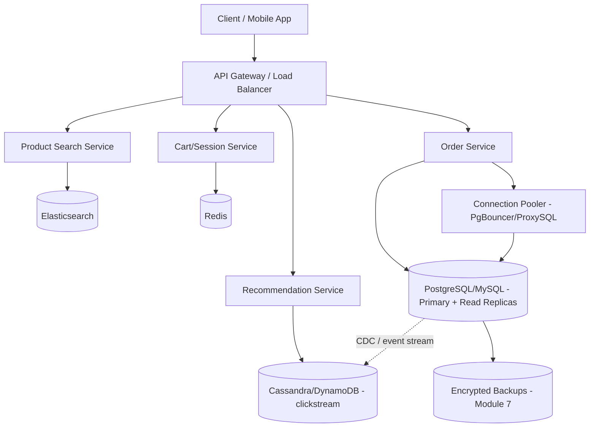
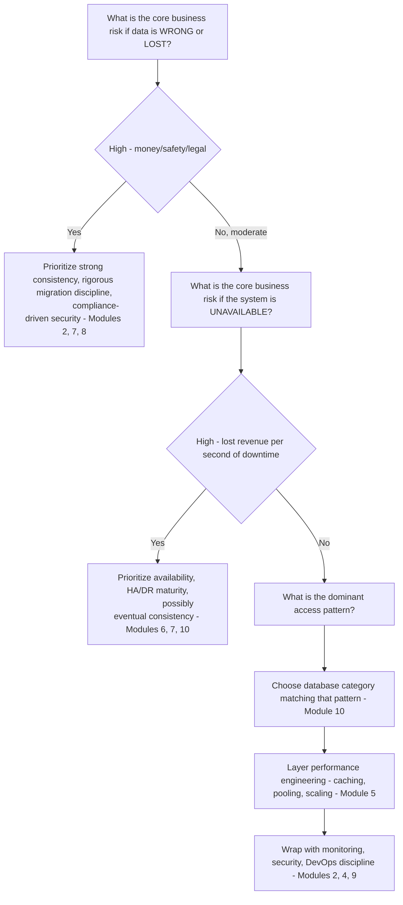

# Part 12 — Production Database Engineering & DBA Mastery

## Module 12: Real-World Production Architectures

> **Recap:** Modules 1-11 gave you every individual tool. This module shows how real companies **combine** them — the architecture patterns behind systems you use every day. This is where interview preparation gets concrete: "design something like X" questions are testing whether you understand *why* these companies made the choices they did, not whether you've memorized their exact stack.

### 12.0 A Note on This Module

The specifics of any company's internal architecture evolve constantly and are only partially public (via engineering blogs, conference talks, and open-source releases). This module presents **well-documented, publicly-discussed architectural patterns and trade-offs** associated with each company, framed as case studies in applying Modules 1-11 — not a claim of their exact current internal implementation. The value is in the **reasoning**, which remains valid regardless of the precise current stack.

---

### 12.1 Google

**Publicly documented pattern:** Google pioneered globally-distributed, strongly-consistent SQL with **Spanner** (Module 10 recap) — using synchronized atomic clocks (TrueTime) to solve a problem long thought impossible: strong consistency across globally distributed replicas without sacrificing availability in the way classic CAP theorem trade-offs would suggest.

**Why it matters architecturally:** Before Spanner, the industry consensus was "pick two of Consistency/Availability/Partition-tolerance." Google's engineering investment in extremely precise clock synchronization let them push the practical boundary of that trade-off — a good illustration that CAP theorem trade-offs are about **what's achievable given real-world uncertainty**, and reducing that uncertainty (via TrueTime) can shift what's possible.

**Trade-off lesson:** This level of engineering investment (custom hardware for atomic clock synchronization across global datacenters) is only justified at Google's scale and resource level — most companies correctly choose simpler HA/DR patterns (Modules 6-7) rather than attempting to reproduce this.

---

### 12.2 Amazon

**Publicly documented pattern:** Amazon's retail systems have long been associated with the philosophy behind **DynamoDB's** predecessor, "Dynamo" — a highly-available, eventually-consistent key-value store designed explicitly to prioritize **availability over strict consistency** for the shopping cart use case (Amazon's own published reasoning: a shopping cart should never reject a write, even during a partition — better to merge conflicting cart states later than lose an "add to cart" action).

**Why it matters architecturally:** This is a textbook, explicitly-reasoned CAP theorem trade-off (Part 8 recap) — Amazon chose **AP (Availability + Partition tolerance)** over strict consistency specifically because the business cost of a rejected write (lost sale) was judged higher than the cost of occasionally needing to merge conflicting cart data.

**Trade-off lesson:** The "right" consistency model is a **business decision**, not a purely technical one — Amazon's shopping cart reasoning is one of the most cited real-world examples of explicitly choosing eventual consistency for a well-justified business reason (Module 10's consistency-requirement question in practice).

---

### 12.3 Netflix

**Publicly documented pattern:** Netflix has extensively documented using **Cassandra** at massive scale for much of its member-facing data (viewing history, personalization data), citing Cassandra's masterless, multi-region-active-active architecture (Module 6/10 recap) as a fit for their requirement of surviving entire AWS region failures without downtime.

**Why it matters architecturally:** Netflix's famous **Chaos Engineering** practice (originating from tools like "Chaos Monkey") is a direct, extreme application of this handbook's **recovery drills** principle (Module 7 recap) — instead of periodically *testing* failure scenarios, they continuously *inject* real failures into production to prove resilience continuously, not just on a quarterly drill schedule.

**Trade-off lesson:** Choosing Cassandra traded query flexibility (Module 10's Cassandra weakness: query-first modeling) for write throughput and multi-region survivability — appropriate because Netflix's access patterns (mostly simple key-based lookups: "get this user's viewing history") fit Cassandra's strengths well.

---

### 12.4 Uber

**Publicly documented pattern:** Uber has publicly discussed migrating between database technologies multiple times as scale requirements changed (including moves between PostgreSQL and MySQL at different points, and building **Schemaless**, a custom sharding layer on top of MySQL) — a well-known real-world illustration of Module 1's "Database Evolution" concept in action at extreme scale.

**Why it matters architecturally:** Uber's trip data has an access pattern heavily keyed by trip ID and driver/rider location — favoring a sharding strategy (Module 5/10/11 recap) where the shard key is chosen deliberately to distribute load evenly and avoid the hot-partition problem (Module 11.13) that a naive time-based or sequential key would create.

**Trade-off lesson:** Uber's public engineering writing about *why* they moved between database technologies is one of the best real-world case studies of the **Module 10 decision process** playing out over years — no single database choice was "wrong" at the time it was made; the right choice changed as scale and requirements evolved.

---

### 12.5 Meta (Facebook)

**Publicly documented pattern:** Meta has long operated MySQL at extreme scale for core social-graph-adjacent data, layered with extensive **caching** (via Memcache, and later more advanced caching layers) in front of the database — a scaling strategy leaning heavily on Module 5's caching patterns rather than solely on database-level horizontal scaling.

**Why it matters architecturally:** At Meta's read volume, a caching layer absorbing the vast majority of read traffic (cache hit rates reported in the high 90s of percent) is what makes a relational database (with all its consistency/query-flexibility advantages — Module 10) viable at that scale, rather than requiring a full migration to a different data model.

**Trade-off lesson:** This demonstrates that **"scaling reads" and "scaling writes" are genuinely different problems** (Module 5's read-scaling vs. write-scaling distinction) — a well-designed caching layer can push a "traditional" relational database's effective read capacity far beyond what the raw database alone could sustain, delaying or avoiding the need for a more drastic architecture change.

---

### 12.6 Airbnb

**Publicly documented pattern:** Airbnb has publicly discussed operating MySQL (via infrastructure they've written about extensively, including tooling for online schema migrations) for core booking/reservation data, with strong emphasis on **safe schema migration practices** given the business-criticality of booking data correctness.

**Why it matters architecturally:** Booking/reservation systems have strict consistency requirements (you cannot double-book a listing) — this favors a traditional strongly-consistent relational database over an eventually-consistent NoSQL alternative, illustrating Module 10's consistency-requirement question resolving firmly toward strong consistency for this specific workload, even at large scale.

**Trade-off lesson:** Not every large-scale company needs to abandon relational databases for NoSQL — the right choice depends on the **specific consistency requirements of the specific workload** (a booking system's correctness requirements differ fundamentally from, say, a social media "likes" counter).

---

### 12.7 Stripe

**Publicly documented pattern:** Stripe, as a payments company, has publicly emphasized extremely rigorous approaches to **database migrations** (Module 8) and **data correctness**, given that payment data errors have direct, severe financial and trust consequences. Their engineering culture has been vocal about tooling for safe, tested, backward-compatible schema changes.

**Why it matters architecturally:** Payments systems represent close to the strictest possible requirements across nearly every module in this handbook simultaneously: strong ACID consistency (Part 6-7), rigorous security/compliance (Module 2 — PCI DSS), near-zero RTO/RPO (Module 6-7), and extremely careful migration discipline (Module 8) — a good synthesis example of why "it depends on the workload" is the correct answer to nearly every database design question.

**Trade-off lesson:** For businesses handling money, the cost of an availability trade-off gone wrong (double-charging a customer, losing a transaction record) is so severe that these companies generally accept **more operational complexity and cost** in exchange for stronger guarantees — the opposite trade-off from, say, a social media "like" counter.

---

### 12.8 PayPal

**Publicly documented pattern:** Similarly to Stripe, PayPal (as a long-established payments company operating at massive global scale) has publicly discussed extensive investment in database reliability engineering, encryption/compliance (Module 2 — PCI DSS), and multi-region disaster recovery (Module 7) given its role processing financial transactions globally.

**Trade-off lesson:** Payments companies consistently demonstrate that **compliance requirements (Module 2.12) directly shape architecture**, not just as an afterthought bolted onto a design — network segmentation, encryption, and audit requirements for PCI DSS influence fundamental choices about which systems can even touch card data.

---

### 12.9 WhatsApp

**Publicly documented pattern:** WhatsApp has historically been cited (particularly in its early, famously lean-team era) as an example of extreme efficiency achieved through deep, expert-level tuning of a relatively small number of database/infrastructure technologies (heavy use of Erlang for the messaging layer, with careful capacity planning and configuration tuning — Module 3 recap) rather than adopting a large number of specialized databases.

**Trade-off lesson:** This is a useful counterpoint to the "use many specialized databases" pattern seen elsewhere in this module — sometimes **deep mastery of fewer tools** (Module 3's configuration/parameter tuning discipline, applied expertly) outperforms the added operational complexity (Module 9 recap) of a highly polyglot architecture, especially for a lean team.

---

### 12.10 Banking Systems (General Pattern)

**Common architectural pattern across the banking industry:** Heavy reliance on mature enterprise RDBMSs (Oracle, DB2, SQL Server — Module 10 recap) for core ledger/transaction systems, given decades of proven reliability, mature tooling, and vendor support contracts with strong SLAs; extremely conservative approach to schema migrations (Module 8) and deployments, often with longer, more heavily-gated release cycles than typical tech companies; strict regulatory compliance (Module 2.12 — SOC 2 and country-specific banking regulations) driving audit logging and access control requirements.

**Why it matters architecturally:** Banking core systems prioritize **provable correctness and auditability** above almost all other concerns — this explains the continued heavy use of decades-old, extremely mature technology (like mainframe-adjacent systems and Oracle) even when newer, more "modern" alternatives exist, because the enterprise support, audit trail maturity, and proven track record matter more than adopting the latest technology.

---

### 12.11 Healthcare Systems (General Pattern)

**Common architectural pattern in healthcare:** Strict HIPAA compliance (Module 2.12) drives encryption-at-rest/in-transit as non-negotiable baseline requirements; strong emphasis on detailed audit logging (Module 2.7) for every access to patient records; often a mix of relational databases for structured clinical/billing data and specialized systems for medical imaging/document storage; strong data retention and backup requirements (Module 7) often mandated by law for many years.

**Trade-off lesson:** Healthcare architecture decisions are frequently driven as much by **regulatory requirement** as by pure technical/performance considerations — the "best" database choice must first satisfy compliance requirements (Module 2.12) before performance/scalability trade-offs are even considered.

---

### 12.12 E-commerce Platforms (General Pattern)

**Common architectural pattern across major e-commerce platforms:** Polyglot persistence (Module 10.8 recap) is the norm — a relational database (PostgreSQL/MySQL) for orders/inventory/payments requiring strong consistency, a search engine (Elasticsearch) for product discovery, a caching layer (Redis) for session/cart data and hot product pages, and often a wide-column or NoSQL store for clickstream/behavioral analytics data feeding recommendation systems.

**A representative composite architecture (synthesizing common public patterns across the industry, not any single specific company):**



**Trade-off lesson:** This composite pattern is the clearest real-world validation of **every major theme in this handbook working together**: security (Module 2) on the payment-adjacent order service, performance engineering (Module 5) via caching and pooling, monitoring (Module 4) across all components, HA (Module 6) on the primary order database, DR (Module 7) via encrypted geo-redundant backups, and deliberate polyglot database selection (Module 10) matching each service to its actual workload shape.

---

### 12.13 Master Comparison Table — Architectural Priorities by Domain

| Domain | Primary Priority | Consistency Model | Typical Database Choice | Key Trade-off |
|---|---|---|---|---|
| Global tech infra (Google-scale) | Global strong consistency at scale | Strong (via engineering investment) | Distributed SQL (Spanner-class) | Extreme engineering cost for extreme guarantees |
| E-commerce cart/session | Never reject a write | Eventual (deliberately) | Key-value (Dynamo-style) | Occasional conflict resolution vs. lost sales |
| Streaming/media metadata | Multi-region survivability | Tunable/eventual | Wide-column (Cassandra) | Query flexibility vs. write throughput/HA |
| Ride-sharing/logistics | Even load distribution, evolving scale | Strong for core transactional data | Evolving (sharded relational → specialized) | Migration discipline over years |
| Social graph reads | Massive read scale | Strong at DB, cached aggressively | Relational + heavy caching | Cache invalidation complexity vs. raw DB scaling |
| Bookings/reservations | No double-booking | Strong (mandatory) | Relational (MySQL/PostgreSQL) | Consistency over horizontal write scale |
| Payments | Correctness + compliance | Strong (mandatory) | Relational, heavily hardened | Operational complexity/cost over speed of iteration |
| Banking core systems | Provable correctness, audit | Strong (mandatory) | Enterprise RDBMS (Oracle/DB2) | Slower iteration, higher licensing cost, proven reliability |
| Healthcare records | Regulatory compliance | Strong, heavily audited | Relational + specialized document/imaging stores | Compliance constraints shape all other decisions |
| General e-commerce | Balanced, multi-workload | Mixed (strong for orders, eventual for recs) | Polyglot persistence | Operational complexity of running many systems |

---

### 12.14 Synthesizing the Lessons — A Framework for Analyzing Any Real Architecture

When studying any real company's public engineering writing (or answering a "design system X" interview question), apply this consistent lens, tying together the entire handbook:



---

### 12.15 Cross-References

This module is a synthesis point for the entire Part 12 — every case study above explicitly connects back to:
- **Module 2** (Security/Compliance) — Stripe, PayPal, Healthcare, Banking
- **Module 5** (Performance Engineering/Caching) — Meta, general e-commerce
- **Module 6** (High Availability) — Netflix's Chaos Engineering, Google's Spanner
- **Module 7** (Backup & DR) — Netflix's continuous resilience testing philosophy
- **Module 8** (Migrations) — Uber, Airbnb, Stripe
- **Module 10** (Database Selection) — Amazon's CAP trade-off, Netflix's Cassandra choice, Airbnb's relational choice
- **Module 11** (Production Failures) — Uber's shard-key design avoiding hot partitions

---

## Exercises — Module 12

**Beginner**
1. Why did Amazon choose eventual consistency for its shopping cart system, and what business reasoning justified it?
2. Why do banking core systems still commonly rely on decades-old enterprise RDBMS technology instead of newer alternatives?
3. What is Netflix's Chaos Engineering practice, and which module's principle does it extend to an extreme?

**Intermediate**
4. Compare the consistency requirements of a booking system (Airbnb-style) to a shopping cart (Amazon-style), and explain why they land on opposite sides of the CAP theorem trade-off despite both being e-commerce-adjacent.
5. Explain how a heavy caching layer (Meta-style) changes the calculus of Module 10's database selection decision — does it make the underlying database choice less important? Why or why not?
6. Why do payments companies like Stripe and PayPal invest disproportionately in migration discipline (Module 8) compared to companies in less regulated industries?

**Advanced Production Scenarios**
7. You're designing a ride-sharing app's core trip-tracking database. Drawing on Uber's publicly-documented evolution, propose a shard key strategy that avoids the hot-partition problem (Module 11.13), and explain how you'd expect this architecture to need to evolve as the company scales 100x.
8. Design the polyglot persistence architecture (Module 10.8 style) for a healthcare telemedicine platform, explicitly mapping each component's database choice to a specific compliance or performance requirement from this module's healthcare case study.

**Whiteboard / Interview Problem**
9. *"Using the framework from Section 12.14, walk me through how you'd approach designing the database architecture for a new fintech app that offers instant peer-to-peer payments — what questions would you ask first, and how would each answer shape your architecture?"*

---

## Interview Questions — Module 12

- Q: Why did Amazon's shopping cart system choose availability over strict consistency, and what does this teach about database design trade-offs generally?
- Q: How does Netflix's Chaos Engineering relate to the disaster recovery drilling practices covered in Module 7?
- Q: Why do different e-commerce sub-systems (cart, orders, recommendations) often use entirely different databases within the same company?
- Q: What role does regulatory compliance play in shaping database architecture for banking and healthcare systems, beyond pure technical considerations?
- Q: Using the "core business risk" framework, how would you decide between strong and eventual consistency for a new system you're designing?

---

## Cheat Sheet — Module 12

```
GOOGLE    → Spanner: engineering investment (TrueTime) pushes CAP trade-off boundary
AMAZON    → Dynamo/cart: deliberate AP choice — never reject a write, resolve conflicts later
NETFLIX   → Cassandra + Chaos Engineering: multi-region survival, continuously drilled
UBER      → Evolving sharded architecture: shard-key choice avoids hot partitions
META      → Relational + massive caching: caching solves read-scaling, not a DB swap
AIRBNB    → Relational for bookings: strong consistency mandatory (no double-booking)
STRIPE/PAYPAL → Payments: strong consistency + compliance + rigorous migrations, ALL AT ONCE
WHATSAPP  → Deep mastery of few tools > sprawling polyglot complexity, for a lean team
BANKING   → Enterprise RDBMS: provable correctness/audit > cutting-edge technology
HEALTHCARE→ Compliance (HIPAA) shapes architecture BEFORE performance considerations
E-COMMERCE→ Polyglot persistence is the default pattern at scale

FRAMEWORK: Business risk of WRONG/LOST data → Business risk of UNAVAILABLE →
           Dominant access pattern → Performance layer → Monitoring/Security/DevOps wrap
```

---

*(End of Module 12. Reply "next" or "continue" to receive Module 13: Complete Interview Mastery.)*
