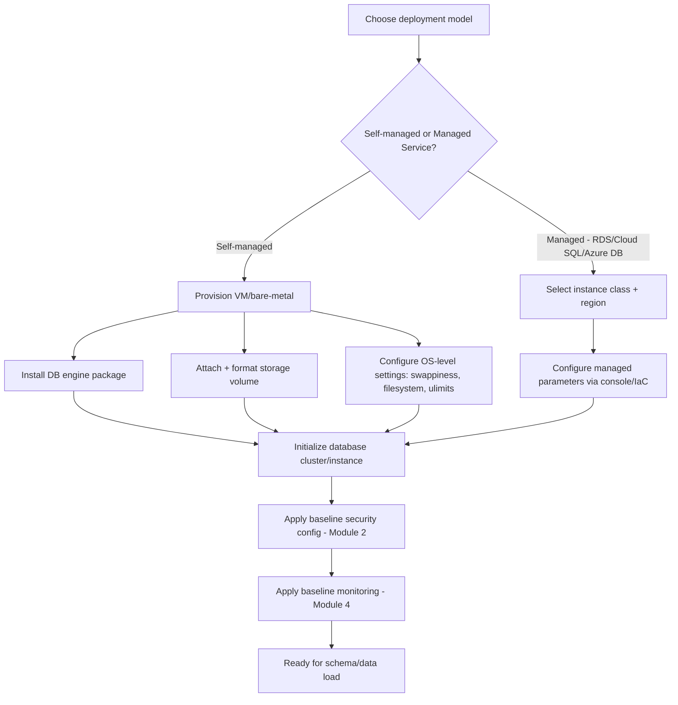
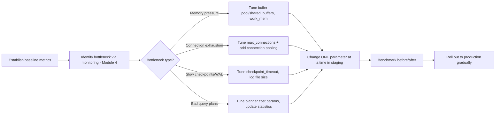
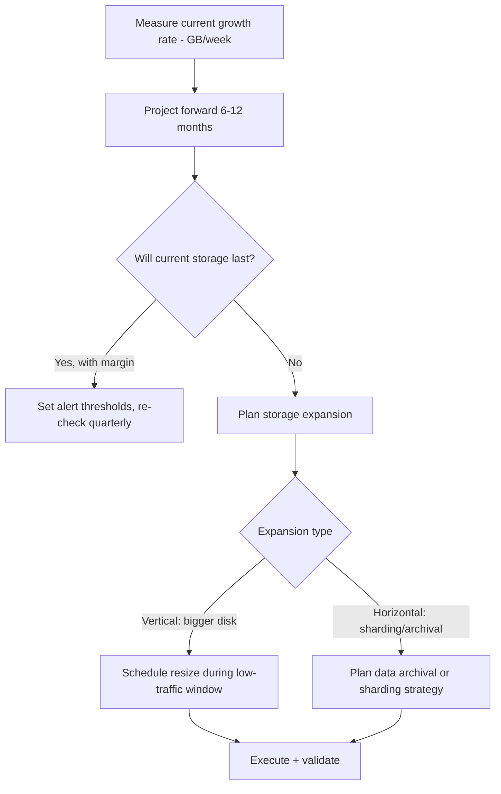
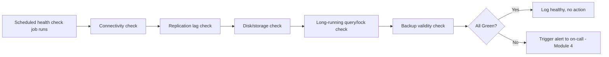
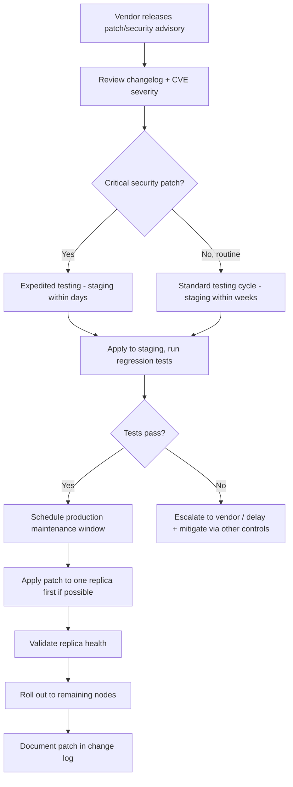

# Part 12 — Production Database Engineering & DBA Mastery

## Module 3: Database Administration (DBA)

> **Recap:** Module 1 = lifecycle. Module 2 = security. This module = the hands-on operational discipline of **installing, configuring, tuning, and keeping a database instance healthy** day to day. Where Module 1 covered *when* things happen and Module 2 covered *who can do what*, Module 3 covers *how the engine itself is set up and run*.

### 3.0 Why This Module Exists

A DBA's job is often invisible when done well — nobody notices a database that "just works." This module builds the muscle memory for the unglamorous but critical work: choosing the right configuration parameters, allocating storage correctly, planning capacity before you run out of it, and patching before a CVE is exploited. This is also exactly the material tested in **"design/operate a production database"** system design and operations interview rounds.

**Real-world analogy:** If Module 1 is the aircraft's flight schedule and Module 2 is airport security, Module 3 is the **ground crew and maintenance engineers** — the people who configure the engines correctly, check fuel/fluid levels (capacity planning), and run the pre-flight checklist (health checks) before every takeoff.

---

### 3.1 Database Installation

**What is it?**
The process of provisioning a database engine onto a server/VM/container/managed service, including OS-level prerequisites, storage attachment, and network setup.

**Why does it exist?**
Installation choices made on day one (OS, filesystem, storage type) are extremely expensive to change later and directly affect performance, reliability, and operational cost for the system's entire life.

**Step-by-step Installation Workflow**



**Deployment Model Comparison**

| Model | Control | Operational Burden | Cost Model | Example |
|---|---|---|---|---|
| Self-managed on VM/bare-metal | Full | High (you patch, backup, tune, monitor everything) | Infra cost only | PostgreSQL on EC2 |
| Managed DBaaS | Partial (vendor manages OS/patching/backups) | Low-Medium | Infra + management premium | AWS RDS, Cloud SQL, Azure Database |
| Serverless database | Minimal (auto-scaling, no instance sizing) | Very Low | Pay-per-use | Aurora Serverless, Neon, PlanetScale |
| Self-managed on Kubernetes | Full, containerized | High (needs Operators — Module 9) | Infra cost + ops complexity | PostgreSQL Operator, Percona Operator |

**OS-level prerequisites commonly tuned at install time**
- Filesystem choice (XFS/ext4 for Linux — XFS often preferred for large databases due to better handling of large files and parallel I/O).
- `vm.swappiness` lowered (databases should avoid swapping memory to disk).
- `ulimits` raised for open file descriptors (databases open many files/connections).
- Disk I/O scheduler tuned for SSD-backed storage.
- Huge pages configured (reduces memory management overhead for large buffer pools/shared buffers).

**PostgreSQL vs MySQL vs Oracle vs SQL Server — Installation Nuances**

| Aspect | PostgreSQL | MySQL | Oracle | SQL Server |
|---|---|---|---|---|
| Initialization command | `initdb` | `mysqld --initialize` | `dbca` (Database Configuration Assistant) or manual scripts | Setup wizard / `setup.exe` (or `mssql-conf` on Linux) |
| Typical install complexity | Low-Medium | Low | High (many moving parts: listener, tnsnames, ASM) | Medium |
| Container-friendliness | Excellent (official slim images) | Excellent | Poor-Medium (large images, licensing complexity) | Good (Linux containers supported since 2017) |

**Best Practices**
- ✅ Use **Infrastructure as Code** (Terraform/Ansible) for installation — reproducibility matters more than convenience.
- ✅ Separate data, WAL/log, and temp storage onto **different volumes** for I/O isolation where the engine supports it.
- ✅ Apply security hardening (Module 2) **before** the instance ever accepts external connections.

**Common Mistakes**
- ❌ Installing with default configuration and never revisiting it — defaults are conservative and rarely suited to production workloads.
- ❌ Co-locating data and WAL/transaction logs on the same disk for a high-write workload, causing I/O contention.

**Interview Importance:** ⭐⭐

---

### 3.2 Configuration & Parameter Tuning

**What is it?**
Adjusting engine-level settings that control memory allocation, concurrency, logging, and query planning behavior to match the specific workload and hardware.

**Why does it exist?**
Default configurations are deliberately conservative (designed to run on minimal hardware) — production workloads need tuning to use available resources effectively and behave predictably under load.

**Key Parameter Categories (using PostgreSQL/MySQL as reference, concepts apply broadly)**

| Category | PostgreSQL Parameter | MySQL Parameter | What It Controls |
|---|---|---|---|
| Memory | `shared_buffers` | `innodb_buffer_pool_size` | Main cache of data pages in memory |
| Memory (per-query) | `work_mem` | `sort_buffer_size`, `join_buffer_size` | Memory for sorts/joins before spilling to disk |
| Connections | `max_connections` | `max_connections` | Max concurrent client connections |
| WAL/Logging | `wal_buffers`, `checkpoint_timeout` | `innodb_log_file_size` | Write-ahead log behavior, checkpoint frequency |
| Query Planner | `random_page_cost`, `effective_cache_size` | `optimizer_switch` | Hints to the cost-based optimizer about hardware |
| Autovacuum/Cleanup | `autovacuum_*` params | `innodb_purge_threads` | Background cleanup tuning (Module 1 recap) |

**Step-by-step Tuning Workflow**



**Real-world analogy:** Tuning a database is like tuning a car engine for a specific track. The factory defaults get you from A to B safely on any road, but a race team adjusts fuel mixture, suspension, and tire pressure specifically for *this track's* conditions — and re-tunes when conditions (workload) change.

**Rule-of-thumb starting points (well-known industry heuristics — always validate via benchmarking, not blind application)**

| Setting | Common Starting Heuristic |
|---|---|
| PostgreSQL `shared_buffers` | ~25% of total system RAM |
| PostgreSQL `effective_cache_size` | ~50-75% of total system RAM |
| MySQL `innodb_buffer_pool_size` | ~60-70% of total system RAM (dedicated DB server) |
| `max_connections` | Kept as low as workload allows; use pooling (Module 5) instead of raising this unboundedly |

**Best Practices**
- ✅ Change **one parameter at a time** and benchmark — tuning is empirical, not guesswork.
- ✅ Always test parameter changes in staging with production-representative load first.
- ✅ Revisit configuration after major hardware or workload changes — a config tuned for 2019's traffic may be wrong for 2026's traffic.

**Common Mistakes**
- ❌ Copy-pasting "recommended production config" blog posts without understanding what each parameter does or validating against your actual workload.
- ❌ Setting `max_connections` extremely high "just in case" — each connection consumes memory overhead; better to use connection pooling (Module 5).

**Performance Implications:** This entire section IS performance — poor configuration is one of the top causes of "mysteriously slow" production databases that have perfectly fine schemas and queries.

**Interview Importance:** ⭐⭐⭐⭐

---

### 3.3 Tablespaces

**What is it?**
A logical storage container that maps database objects (tables, indexes) to physical storage locations, allowing DBAs to control **where** data physically lives.

**Why does it exist?**
Not all data has the same access pattern or importance — tablespaces let you place hot, frequently-accessed data on fast SSD storage and cold/archival data on cheaper storage, or isolate I/O-heavy indexes from data files.

**Concept across databases**

| Database | Tablespace Concept |
|---|---|
| PostgreSQL | Native `TABLESPACE` — maps to a directory on disk |
| MySQL (InnoDB) | Native tablespaces — system tablespace or per-table `file-per-table` |
| Oracle | Rich, mature tablespace model — heavily used for storage management (`SYSTEM`, `USERS`, `UNDO`, custom tablespaces) |
| SQL Server | Called **Filegroups** instead of tablespaces, conceptually equivalent |

```sql
-- PostgreSQL: create a tablespace on fast storage for hot data
CREATE TABLESPACE fast_ssd LOCATION '/mnt/nvme_ssd/pgdata';

CREATE TABLE hot_orders (...) TABLESPACE fast_ssd;

-- Move a table to archival/cheap storage
ALTER TABLE old_logs SET TABLESPACE cold_storage;
```

**Best Practices**
- ✅ Use tablespaces to separate hot vs. cold data, or to isolate indexes from tables for I/O balance.
- ✅ Plan tablespace layout **before** heavy data growth — moving data later is an expensive online operation.

**Interview Importance:** ⭐⭐ (More relevant in Oracle-heavy enterprise interviews)

---

### 3.4 Storage Allocation & Capacity Planning

**What is it?**
Proactively forecasting and provisioning disk space, IOPS, and throughput before the database needs them, rather than reactively responding to "disk full" alerts.

**Why does it exist?**
Running out of disk space is one of the most common — and completely preventable — causes of full production outages (a database that can't write WAL/redo logs typically halts entirely). Covered in depth as a failure scenario in Module 11.

**Step-by-step Capacity Planning Workflow**



**Capacity Planning Formula (simplified)**

```
Projected Storage Need = Current Size
                        + (Daily Growth Rate × Days Until Next Review)
                        + Index Overhead (typically 20-50% of table size)
                        + WAL/Log Retention Buffer
                        + Safety Margin (typically 20-30%)
```

**Key metrics to track**
- **Data growth rate** (GB/day or GB/week, per table)
- **Index bloat ratio**
- **IOPS utilization** vs. provisioned IOPS
- **Free disk space %** — alert well before critical (e.g., alert at 70%, page at 85%, not at 95%)

**Best Practices**
- ✅ Alert at **multiple thresholds** (warning at 70%, critical at 85%) — never wait until the disk is actually full.
- ✅ Include **index growth**, not just table data growth, in projections — indexes can be as large as or larger than the underlying table.
- ✅ Automate storage auto-scaling where supported by managed services, but still monitor and understand the cost implications.
- ✅ Plan for WAL/binlog retention growth, especially when replication lag increases (logs accumulate faster than they're purged).

**Common Mistakes**
- ❌ Only monitoring total disk usage and not accounting for temporary spikes (e.g., a `VACUUM FULL` or index rebuild needs significant temporary space).
- ❌ Ignoring IOPS/throughput capacity while only tracking raw GB — a disk can have "space" but be I/O saturated.

**Edge Cases**
- A runaway replication slot in PostgreSQL (an unused logical replication slot) can cause WAL to accumulate indefinitely, filling disk even though "normal" data growth looks fine — a well-known real-world incident pattern.

**Interview Importance:** ⭐⭐⭐⭐ (Classic senior/SRE-crossover question: "How do you prevent a database from running out of disk in production?")

---

### 3.5 Health Checks

**What is it?**
Automated, periodic verification that a database instance and its replicas are functioning correctly — not just "is it up," but "is it healthy in every dimension that matters."

**What a comprehensive health check covers**

| Dimension | Example Check |
|---|---|
| Availability | Can a connection be established and a trivial query executed? |
| Replication health | Is replication lag within acceptable bounds? (Module 4/6) |
| Storage health | Is free disk space above threshold? |
| Backup health | Did the last backup succeed and is it restorable? (Module 7) |
| Lock/blocking health | Are there long-running blocking transactions? |
| Performance health | Are p99 query latencies within SLO? |
| Certificate/credential health | Are TLS certs and credentials near expiry? (Module 2) |

**Step-by-step Health Check Workflow**



**Best Practices**
- ✅ Health checks should be **synthetic and continuous**, not just relying on humans noticing problems.
- ✅ Include **backup restorability** as a health check — a backup that can't be restored is not actually a backup (Module 7 theme).
- ✅ Differentiate between **liveness** (is the process running) and **readiness** (is it able to serve traffic correctly) checks, especially in containerized/Kubernetes deployments (Module 9).

**Interview Importance:** ⭐⭐⭐

---

### 3.6 Patch Management

**What is it?**
The process of applying vendor-released security and bug-fix patches (minor version updates) to a database engine in a controlled, low-risk way.

**Why does it exist?**
Unpatched databases are a top attack vector (Module 2 recap) — most real-world database breaches exploit **known, already-patched** vulnerabilities, not zero-days.

**Step-by-step Patch Management Workflow**



**Best Practices**
- ✅ Subscribe to vendor security mailing lists/advisories (e.g., PostgreSQL security page, Oracle CPU notifications) — don't wait to discover a CVE reactively.
- ✅ Maintain a **regular patch cadence** (e.g., monthly for routine patches) rather than "whenever we get around to it."
- ✅ Patch replicas/standbys first when possible, validate, then patch primaries — reduces blast radius.
- ✅ Distinguish **minor patches** (low risk, frequent) from **major upgrades** (high risk, covered in Module 1's Version Upgrades section) — different processes for each.

**Common Mistakes**
- ❌ Delaying security patches indefinitely due to fear of breaking changes — this is consistently how real breaches happen (running EOL or unpatched versions with known CVEs).
- ❌ Patching all nodes simultaneously with no staggered rollout, risking cluster-wide issues from a single bad patch.

**Interview Importance:** ⭐⭐⭐

---

### 3.7 Comparison Table — DBA Tooling by Database

| Function | PostgreSQL | MySQL | Oracle | SQL Server |
|---|---|---|---|---|
| Config file | `postgresql.conf` | `my.cnf` | `spfile`/`init.ora` | Registry / `sp_configure` |
| Connection access control | `pg_hba.conf` | `mysql.user` host field | `sqlnet.ora` | Server-level login rules |
| Storage container | Tablespaces | Tablespaces (InnoDB) | Tablespaces (rich model) | Filegroups |
| Admin GUI | pgAdmin | MySQL Workbench | Oracle Enterprise Manager | SQL Server Management Studio (SSMS) |
| Health/diagnostics view | `pg_stat_activity`, `pg_stat_replication` | `SHOW PROCESSLIST`, `performance_schema` | `V$SESSION`, AWR reports | Dynamic Management Views (DMVs) |

---

### 3.8 Checklist — New Database Instance Setup

- [ ] Deployment model chosen (self-managed vs. managed) with documented rationale
- [ ] Storage sized with capacity-planning projection for 6-12 months
- [ ] Data, WAL/log, and temp storage separated where supported
- [ ] Baseline configuration tuned to actual hardware (not defaults)
- [ ] Security hardening applied before accepting connections (Module 2)
- [ ] Monitoring and health checks configured before go-live (Module 4)
- [ ] Backup strategy configured and first backup validated (Module 7)
- [ ] Patch management subscription/process established
- [ ] Runbook documented for common DBA operations on this instance

---

### 3.9 Cross-References

- Configuration tuning directly affects the **Monitoring metrics** covered in Module 4.
- Capacity planning failures are a leading cause of the **Production Failures** covered in Module 11 (disk full, WAL explosion).
- Tablespace/storage separation supports the **Performance Engineering** strategies in Module 5.
- Patch management is a subset of the broader **Version Upgrades** process from Module 1.
- Health checks feed alerting pipelines detailed in Module 4.

---

## Exercises — Module 3

**Beginner**
1. What is the difference between a minor patch and a major version upgrade from a DBA's operational perspective?
2. Why should WAL/transaction logs ideally be stored on separate storage from data files?
3. List three things a comprehensive database health check should verify beyond "is the process running."

**Intermediate**
4. Given a PostgreSQL server with 64GB RAM dedicated entirely to the database, propose starting values for `shared_buffers` and `effective_cache_size`, and explain your reasoning.
5. Design a capacity planning spreadsheet/model for a table growing at 50GB/week, currently at 500GB, on a 2TB volume. When would you need to act, and what would you do?
6. Explain why "the disk isn't full yet" is not sufficient justification to delay capacity planning action.

**Advanced Production Scenarios**
7. A critical CVE is announced for your production MySQL version. Design your patch rollout plan for a 5-node cluster (1 primary, 4 replicas) with a requirement of zero downtime.
8. Your monitoring shows disk usage growing faster than expected, but table row counts look normal. Walk through your diagnostic process (consider the "unused replication slot" edge case).

**Whiteboard / Interview Problem**
9. *"You're the DBA for a database that's about to run out of disk space in 48 hours, and a size increase requires a maintenance window you don't have time to schedule normally. Walk me through your options and decision process."*

---

## Interview Questions — Module 3

- Q: What's the difference between a tablespace and a schema?
- Q: How would you tune a database server's memory configuration given its total RAM and workload type?
- Q: Design a patch management process that balances security urgency against production stability risk.
- Q: What metrics would you track for capacity planning, and how far in advance would you alert on projected exhaustion?

---

## Cheat Sheet — Module 3

```
DBA CORE RESPONSIBILITIES:
  Install → Configure/Tune → Allocate Storage → Plan Capacity →
  Health-Check → Patch → (loop, continuously)

CAPACITY PLANNING FORMULA:
  Projected Need = Current Size + (Growth Rate × Time Horizon)
                  + Index Overhead + Log Retention Buffer + Safety Margin

ALERT THRESHOLDS (disk space example): Warn @ 70% → Critical @ 85% → NEVER wait for 100%

PATCH RULE: Security patches get expedited testing; major upgrades get full lifecycle (Module 1).

GOLDEN RULE: Change ONE config parameter at a time, benchmark before/after, roll out gradually.
```

---

*(End of Module 3. Reply "next" or "continue" to receive Module 4: Monitoring & Observability.)*
