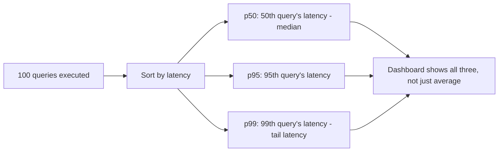
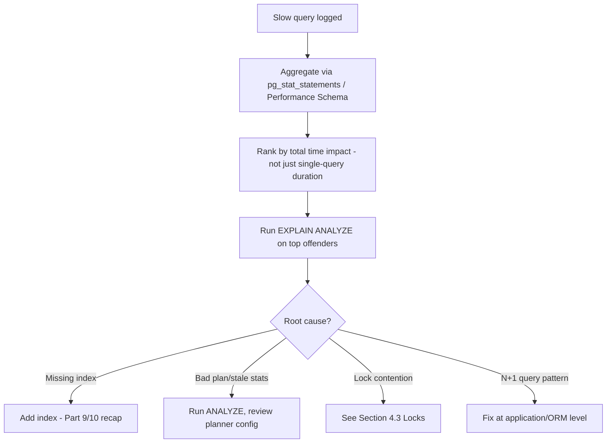
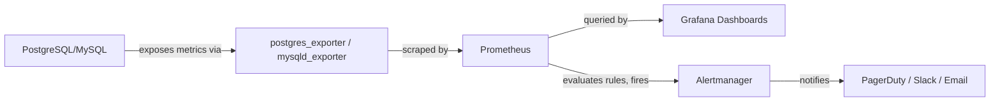

# Part 12 — Production Database Engineering & DBA Mastery

## Module 4: Monitoring & Observability

> **Recap:** Module 3 taught you how to configure and run a database. This module teaches you how to **know** whether it's actually healthy — because "it hasn't crashed yet" is not the same as "it's healthy." Monitoring is what turns DBA work from reactive firefighting into proactive engineering.

### 4.0 Why This Module Exists

**Real-world analogy:** A database without monitoring is like driving a car with no dashboard — no speedometer, no fuel gauge, no engine temperature light. You might drive fine for a while, but you'll find out about a problem (empty tank, overheating engine) only when it becomes a full breakdown, at the worst possible moment. Monitoring gives you the dashboard: continuous, quantified visibility into every subsystem, so you catch problems as gentle warnings, not five-alarm fires.

This is **the single most tested operational skill in Senior SDE-2/SDE-3 and SRE-crossover interviews** — "how would you detect/diagnose X" questions are monitoring questions in disguise.

---

### 4.1 The Observability Pyramid for Databases

```
                    ┌──────────────┐
                    │   ALERTS      │  ← "Wake someone up" (actionable, rare)
                    ├──────────────┤
                    │  DASHBOARDS   │  ← "What's happening right now" (visual, at-a-glance)
                    ├──────────────┤
                    │    METRICS    │  ← Numeric time-series (latency, throughput, CPU...)
                    ├──────────────┤
                    │     LOGS      │  ← Detailed event records (slow query log, error log)
                    ├──────────────┤
                    │    TRACES     │  ← Cross-service request paths touching the DB
                    └──────────────┘
```

Metrics and logs are the raw material; dashboards make them visible to humans; alerts make the important subset actionable. A mature observability setup has all five layers working together.

---

### 4.2 Core Database Metrics

#### 4.2.1 Query Latency

**What is it?** Time taken for a query to execute, typically tracked as percentiles (p50, p95, p99) rather than averages.

**Why percentiles, not averages?** An average can hide a bad tail — if 95% of queries take 2ms and 5% take 2 seconds, the average might look fine (~100ms) while 5% of your users have a terrible experience. **p99 latency is what users actually feel** during spikes; it's the standard metric in production SLOs.



#### 4.2.2 Throughput

**What is it?** Queries/transactions processed per second (QPS/TPS). Tracked alongside latency — rising throughput with stable latency is healthy scaling; rising throughput with rising latency signals saturation.

#### 4.2.3 Slow Queries

**What is it?** Queries exceeding a defined latency threshold, logged separately for investigation.

```sql
-- PostgreSQL: log queries slower than 500ms
ALTER SYSTEM SET log_min_duration_statement = '500ms';

-- MySQL: enable the slow query log
SET GLOBAL slow_query_log = 'ON';
SET GLOBAL long_query_time = 0.5;
```

**Workflow: From Slow Query Detection to Fix**



> 💡 **Callout:** Rank slow queries by **total cumulative time** (`calls × avg_duration`), not just single-slowest-query — a query that runs in 50ms but executes 1 million times a day often costs more total database time than one slow 5-second report query that runs once.

#### 4.2.4 Connections

**What is it?** Number of active/idle client connections. Approaching `max_connections` (Module 3) risks connection exhaustion errors, a common production incident (Module 11).

| State | Meaning |
|---|---|
| Active | Currently executing a query |
| Idle | Connected but not executing (normal, from pooling) |
| Idle in transaction | Connected, inside an open transaction, doing nothing — **dangerous**, holds locks/resources |

#### 4.2.5 Locks & Deadlocks

**What is it?** Locks are held by transactions to protect data consistency (Part 6-7 recap); monitoring tracks lock wait time and detects deadlocks (two transactions each waiting on the other, forcing the database to abort one).

```sql
-- PostgreSQL: find blocking queries
SELECT blocked_locks.pid AS blocked_pid,
       blocking_locks.pid AS blocking_pid,
       blocked_activity.query AS blocked_query,
       blocking_activity.query AS blocking_query
FROM pg_catalog.pg_locks blocked_locks
JOIN pg_catalog.pg_locks blocking_locks
  ON blocking_locks.locktype = blocked_locks.locktype
 AND blocking_locks.database IS NOT DISTINCT FROM blocked_locks.database
 AND blocking_locks.relation IS NOT DISTINCT FROM blocked_locks.relation
 AND blocking_locks.pid != blocked_locks.pid
JOIN pg_catalog.pg_stat_activity blocked_activity ON blocked_activity.pid = blocked_locks.pid
JOIN pg_catalog.pg_stat_activity blocking_activity ON blocking_activity.pid = blocking_locks.pid
WHERE NOT blocked_locks.granted;
```

**Deadlock Diagram**

```
Transaction A                    Transaction B
   │                                  │
   ▼                                  ▼
Locks Row 1 ─────X waits for──▶ Locks Row 2
   ▲                                  │
   └───────X waits for────────────────┘

  → Database detects the cycle, aborts one transaction (deadlock victim),
    lets the other proceed.
```

#### 4.2.6 Buffer Cache Hit Ratio

**What is it?** The percentage of data page requests served from memory (buffer cache) rather than requiring a disk read. A core indicator of whether your working set fits in memory.

```sql
-- PostgreSQL: cache hit ratio (should typically be > 99% for OLTP workloads)
SELECT
  sum(heap_blks_hit) / nullif(sum(heap_blks_hit) + sum(heap_blks_read), 0) AS cache_hit_ratio
FROM pg_statio_user_tables;
```

**Interpretation:** A consistently low hit ratio (<95-99% depending on workload) suggests either insufficient memory allocated to caching (Module 3 tuning) or a working set that's genuinely larger than available RAM (may need read replicas, caching layer, or a bigger instance).

#### 4.2.7 Index Usage

**What is it?** Tracking which indexes are actually used by queries vs. which sit unused, consuming write overhead and storage for no benefit.

```sql
-- PostgreSQL: find unused indexes
SELECT relname, indexrelname, idx_scan
FROM pg_stat_user_indexes
WHERE idx_scan = 0
ORDER BY pg_relation_size(indexrelid) DESC;
```

#### 4.2.8 Replication Lag

**What is it?** The delay between a write committed on the primary and that write becoming visible on a replica. Critical for read-replica correctness and failover readiness (Module 6).

```sql
-- PostgreSQL: check replication lag in bytes and time
SELECT client_addr, state,
       pg_wal_lsn_diff(pg_current_wal_lsn(), replay_lsn) AS lag_bytes
FROM pg_stat_replication;
```

**Why it matters operationally:** High replication lag means (a) read replicas may serve stale data (read-after-write consistency issues), and (b) a failover to a lagging replica means **data loss** of everything not yet replicated.

#### 4.2.9 WAL / Log Generation Rate

**What is it?** The rate at which write-ahead log (WAL in PostgreSQL, binlog/redo log in MySQL/Oracle) is generated. A sudden spike often indicates a bulk write operation, runaway job, or an inefficient query pattern generating excess writes.

**Why it matters:** Directly affects replication lag (more WAL to ship = more lag), disk usage (Module 3), and backup/recovery time (Module 7).

#### 4.2.10 System Resources — CPU, Memory, Disk, IOPS

| Resource | What to Watch | Warning Sign |
|---|---|---|
| CPU | Utilization %, especially sustained >80% | Query queueing, rising latency |
| Memory | Buffer cache hit ratio, swap usage | Swapping = catastrophic for DB performance |
| Disk | Free space %, write latency | Approaching capacity limits (Module 3) |
| IOPS | Utilized vs. provisioned IOPS | Throttling on cloud-provisioned storage |

---

### 4.3 Tools

| Tool | Type | What It's Best For |
|---|---|---|
| `pg_stat_statements` | PostgreSQL extension | Aggregated query performance stats (calls, total time, mean time) — the #1 tool for finding expensive queries |
| `EXPLAIN ANALYZE` | Built-in (all major DBs have an equivalent) | Per-query execution plan + actual runtime breakdown (Part 11 recap) |
| Prometheus | Metrics collection (open source, pull-based) | Time-series metrics storage, works with `postgres_exporter`/`mysqld_exporter` |
| Grafana | Visualization | Dashboards built on top of Prometheus/other data sources |
| CloudWatch | Cloud-native (AWS) | Managed monitoring for RDS/Aurora, integrates with alarms |
| Datadog | Commercial APM/monitoring | Full-stack observability including DB, app, infra correlation |
| New Relic | Commercial APM/monitoring | Similar to Datadog, strong APM tracing integration |

**Typical Prometheus + Grafana Architecture**



**Using `pg_stat_statements` to find the worst offenders**
```sql
SELECT query, calls, total_exec_time, mean_exec_time,
       total_exec_time / sum(total_exec_time) OVER () * 100 AS pct_of_total
FROM pg_stat_statements
ORDER BY total_exec_time DESC
LIMIT 10;
```

---

### 4.4 Dashboards — What a Production DB Dashboard Should Show

```
┌─────────────────────────────────────────────────────────────────┐
│  DATABASE HEALTH DASHBOARD                                        │
├───────────────────┬───────────────────┬───────────────────────────┤
│ Query Latency       │ Throughput (QPS)   │ Active Connections         │
│ p50/p95/p99 lines   │ line graph         │ vs max_connections gauge   │
├───────────────────┼───────────────────┼───────────────────────────┤
│ Buffer Cache Hit %  │ Replication Lag    │ Lock Wait Time             │
│ gauge, target >99%  │ per replica, in ms │ + deadlock count           │
├───────────────────┼───────────────────┼───────────────────────────┤
│ CPU / Memory / IOPS │ Disk Free Space %  │ WAL/Log Generation Rate    │
│ multi-line          │ gauge w/ threshold │ line graph                │
├───────────────────┴───────────────────┴───────────────────────────┤
│ Top 10 Slowest Queries (last 1h) — table with query, calls, time  │
└─────────────────────────────────────────────────────────────────┘
```

---

### 4.5 Alerts

**What is it?**
Automated notifications triggered when a metric crosses a defined threshold, routed to the right human/team.

**Designing Good Alerts**

| Principle | Explanation |
|---|---|
| Actionable | Every alert should have a clear "what do I do now" — alerts nobody acts on get ignored (alert fatigue) |
| Symptom-based, not cause-based | Alert on "p99 latency > 500ms" (a symptom users feel), investigate root cause after, rather than alerting on every possible internal cause separately |
| Multi-threshold | Warning vs. Critical severities routed differently (Slack vs. page on-call) |
| Avoid flapping | Use sustained-duration conditions ("high for 5 minutes"), not instantaneous spikes, to avoid noisy alerts |

**Example Alert Table**

| Metric | Warning Threshold | Critical Threshold | Action |
|---|---|---|---|
| Disk free space | < 30% | < 15% | Warning → plan; Critical → page on-call immediately |
| Replication lag | > 10s | > 60s | Warning → investigate; Critical → may block failover, page |
| p99 query latency | > 2x baseline | > 5x baseline | Investigate slow queries / locks |
| Connections used | > 70% of max | > 90% of max | Add pooling / investigate leak |
| Buffer cache hit ratio | < 98% | < 90% | Review memory config (Module 3) |
| Failed backup | N/A | Any failure | Page immediately (Module 7) |

**Interview Importance:** ⭐⭐⭐⭐ ("How would you design alerting for a production database?" is extremely common)

---

### 4.6 Decision Tree — "Something Feels Slow, Where Do I Look First?"

```
Users report slowness. Where do you look?
│
├─ Check p99 latency dashboard: is it actually elevated, or is it perception?
│      └─ Confirmed elevated → continue
│
├─ Check CPU/Memory/Disk/IOPS: is a resource saturated?
│      └─ YES → capacity issue → scale up/out, or find the runaway query (Module 5)
│      └─ NO → continue
│
├─ Check Lock/Blocking queries: is something holding locks?
│      └─ YES → find and resolve the blocking transaction
│      └─ NO → continue
│
├─ Check pg_stat_statements / slow query log: any new slow query pattern?
│      └─ YES → EXPLAIN ANALYZE it → index/query fix
│      └─ NO → continue
│
├─ Check Replication Lag: are reads hitting a lagging replica?
│      └─ YES → investigate replica health (Module 6)
│      └─ NO → continue
│
└─ Check for external factors: deployment just happened? Traffic spike?
       → Correlate with deployment timeline / traffic dashboards
```

---

### 4.7 Comparison Table — Native Monitoring Views by Database

| Purpose | PostgreSQL | MySQL | Oracle | SQL Server |
|---|---|---|---|---|
| Active sessions | `pg_stat_activity` | `SHOW PROCESSLIST` / `performance_schema` | `V$SESSION` | `sys.dm_exec_sessions` |
| Query stats | `pg_stat_statements` | `performance_schema.events_statements_summary_by_digest` | `V$SQL` | `sys.dm_exec_query_stats` |
| Lock info | `pg_locks` | `performance_schema.data_locks` | `V$LOCK` | `sys.dm_tran_locks` |
| Replication status | `pg_stat_replication` | `SHOW REPLICA STATUS` | Data Guard broker views | `sys.dm_hadr_*` |
| I/O stats | `pg_statio_*` | `performance_schema` I/O tables | AWR reports | `sys.dm_io_virtual_file_stats` |

---

### 4.8 Checklist — Production Monitoring Readiness

- [ ] p50/p95/p99 query latency tracked and dashboarded
- [ ] Throughput (QPS/TPS) tracked
- [ ] Slow query logging enabled with reasonable threshold
- [ ] `pg_stat_statements` (or equivalent) enabled and reviewed regularly
- [ ] Connection usage tracked against `max_connections`
- [ ] Lock waits and deadlock counts tracked
- [ ] Buffer cache hit ratio tracked
- [ ] Unused index report reviewed periodically
- [ ] Replication lag tracked per replica with alerting
- [ ] WAL/log generation rate tracked
- [ ] CPU, memory, disk, IOPS all dashboarded
- [ ] Alerts defined with clear warning/critical thresholds and routing
- [ ] Alerts are actionable and regularly reviewed to prevent alert fatigue
- [ ] Backup success/failure explicitly alerted (Module 7 crossover)

---

### 4.9 Cross-References

- Slow query diagnosis connects directly to **Part 9-11 (Indexing, B+ Trees, Query Optimization)**.
- Lock/deadlock monitoring connects to **Part 6-7 (Transactions, ACID, MVCC)**.
- Replication lag monitoring is essential for **Module 6 (High Availability)** failover decisions.
- Capacity metrics feed back into **Module 3's** capacity planning process.
- Alert-triggered investigations follow the diagnostic patterns detailed in **Module 11 (Common Production Failures)**.
- Audit logs from **Module 2** complement performance logs for a complete observability picture.

---

## Exercises — Module 4

**Beginner**
1. Explain why p99 latency is a better production metric than average latency, with a concrete numeric example.
2. What does a low buffer cache hit ratio suggest, and what are two possible remedies?
3. List the five layers of the observability pyramid in order.

**Intermediate**
4. Write a query (in PostgreSQL or MySQL syntax) to find the top 5 queries consuming the most *total* database time, not just the single slowest query.
5. Design an alert configuration table (metric, warning threshold, critical threshold, routing) for a production OLTP database supporting an e-commerce checkout flow.
6. Explain the difference between "idle" and "idle in transaction" connection states, and why the latter is dangerous.

**Advanced Production Scenarios**
7. Replication lag on one of three read replicas has been silently climbing for 2 hours and just crossed 5 minutes. Walk through your full diagnostic and remediation process.
8. Design a dashboard layout (sketch or describe panel-by-panel) for an on-call engineer to triage a "database is slow" incident within the first 60 seconds of looking at it.

**Performance Tuning Task**
9. Given a `pg_stat_statements` output showing a query with `calls=5,000,000` and `mean_exec_time=2ms` versus a query with `calls=10` and `mean_exec_time=8000ms`, which would you investigate first, and why? What if the second query is a nightly batch report?

**Whiteboard / Interview Problem**
10. *"Design the complete monitoring and alerting strategy for a payments database that must maintain 99.99% availability. What would you monitor, alert on, and how would you avoid alert fatigue?"*

---

## Interview Questions — Module 4

- Q: Walk me through your process for diagnosing "the database is slow" from first alert to root cause.
- Q: Why is buffer cache hit ratio an important metric, and what would you do if it suddenly dropped?
- Q: What's the difference between symptom-based and cause-based alerting, and why is symptom-based generally preferred?
- Q: How would you detect and respond to a deadlock in production?
- Q: What metrics would tell you a database is about to run out of connections, and how would you prevent it proactively?

---

## Cheat Sheet — Module 4

```
KEY METRICS TO ALWAYS TRACK:
  Latency (p50/p95/p99) · Throughput (QPS) · Connections · Locks/Deadlocks
  Buffer Cache Hit Ratio · Index Usage · Replication Lag · WAL Rate
  CPU · Memory · Disk · IOPS

TOOLS:
  pg_stat_statements → find expensive queries
  EXPLAIN ANALYZE    → understand ONE query's plan + actual runtime
  Prometheus+Grafana  → open-source metrics + dashboards
  CloudWatch/Datadog/New Relic → managed/commercial observability

TRIAGE ORDER when "it's slow":
  Latency confirmed? → Resource saturation? → Locks/blocking? →
  New slow query? → Replication lag? → External factor (deploy/traffic)?

ALERT DESIGN RULE: Symptom-based, actionable, multi-threshold, anti-flapping.
```

---

*(End of Module 4. Reply "next" or "continue" to receive Module 5: Performance Engineering.)*
