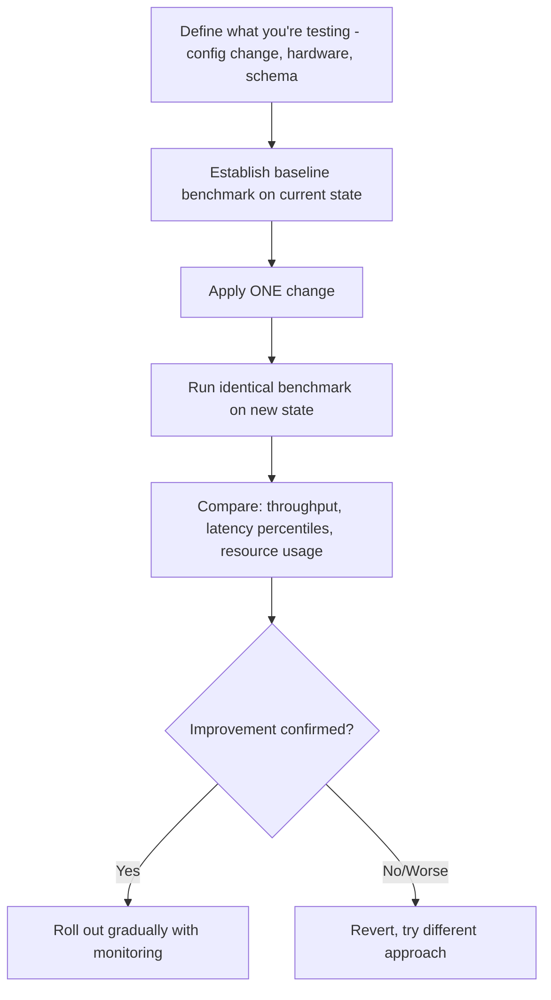
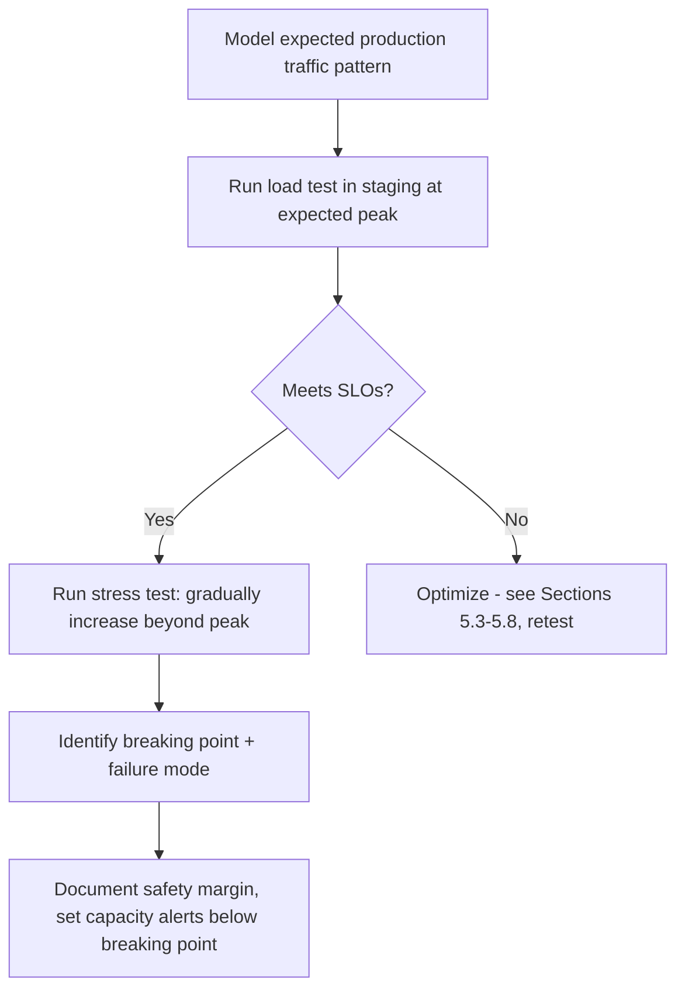
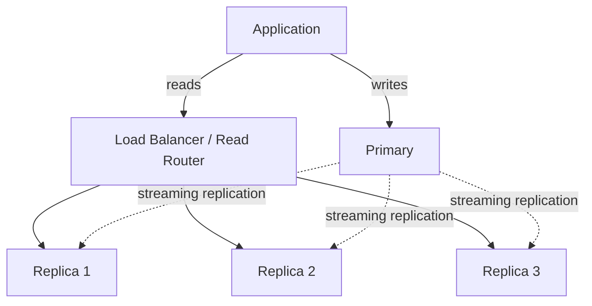
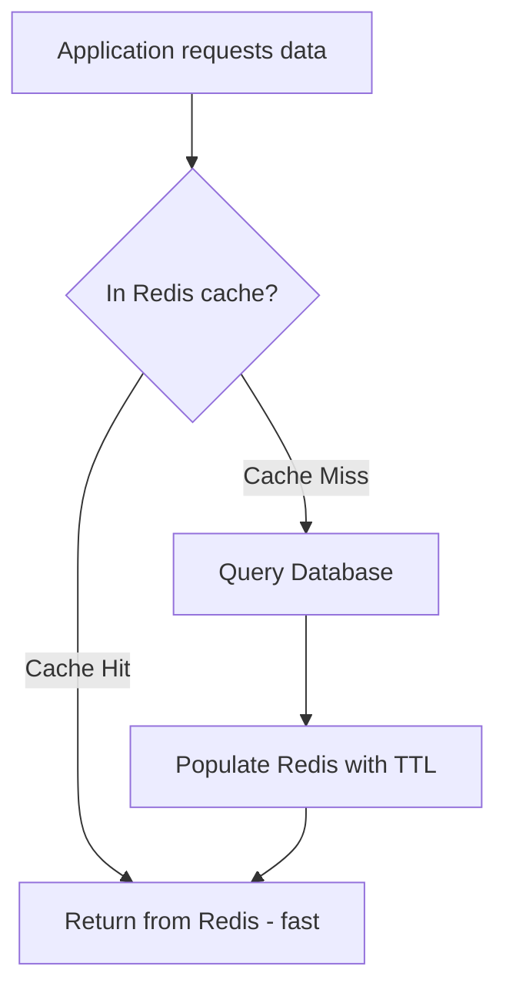
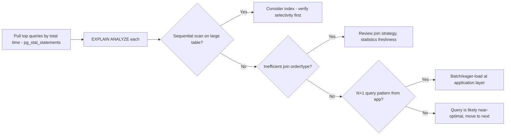
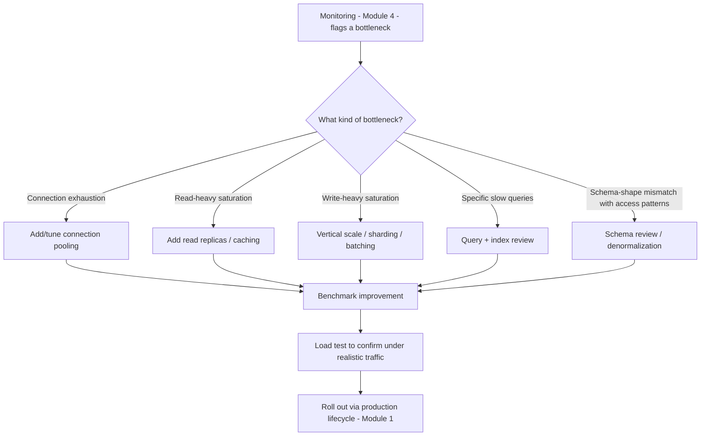

# Part 12 — Production Database Engineering & DBA Mastery

## Module 5: Performance Engineering

> **Recap:** Module 4 taught you how to **see** performance problems. This module teaches you how to **systematically fix and prevent** them — through benchmarking, connection management, scaling strategies, caching, and disciplined review processes.

### 5.0 Why This Module Exists

Monitoring (Module 4) tells you *that* something is slow. Performance Engineering is the disciplined practice of *making it fast and keeping it fast* — proactively, through testing before problems occur, and reactively, through structured optimization when they do.

**Real-world analogy:** If monitoring is the dashboard warning light, performance engineering is the pit crew — they don't just watch the gauges, they actively tune the car, change worn parts before they fail, and simulate race conditions in practice before the real race (production traffic).

---

### 5.1 Benchmarking

**What is it?**
Measuring a database's performance under controlled, repeatable conditions to establish a baseline, compare configurations, or validate that a change is actually an improvement.

**Why does it exist?**
Without benchmarks, performance tuning is guesswork — you can't know if a config change (Module 3) helped without a "before" and "after" number measured the same way.

**Common Benchmarking Tools**

| Tool | Database | What It Measures |
|---|---|---|
| `pgbench` | PostgreSQL | TPC-B-like transactional benchmark, built-in |
| `sysbench` | MySQL, PostgreSQL, others | OLTP read/write benchmarks, CPU/IO benchmarks |
| `HammerDB` | Multi-database (Oracle, SQL Server, PostgreSQL, MySQL) | TPC-C/TPC-H style benchmarks |
| `YCSB` (Yahoo Cloud Serving Benchmark) | NoSQL + SQL | Standardized workload mixes (read-heavy, write-heavy, etc.) |

```bash
# pgbench example: initialize + run a benchmark
pgbench -i -s 50 mydb              # initialize with scale factor 50
pgbench -c 20 -j 4 -T 60 mydb      # 20 clients, 4 threads, 60 seconds
```

**Step-by-step Benchmarking Workflow**



**Best Practices**
- ✅ Benchmark on **production-representative hardware and data volume** — a benchmark on a laptop with 1000 rows tells you little about a 500M-row production table.
- ✅ Change **one variable at a time**.
- ✅ Run benchmarks **multiple times** and look at distributions, not single runs (system noise affects individual runs).

**Interview Importance:** ⭐⭐⭐

---

### 5.2 Load Testing vs. Stress Testing

| Aspect | Load Testing | Stress Testing |
|---|---|---|
| Goal | Verify the system handles **expected** production traffic correctly | Find the **breaking point** — how far beyond expected load can it go before failing |
| Typical load | Realistic peak traffic (e.g., Black Friday-level QPS) | Traffic pushed until errors/failures occur |
| Key question answered | "Can we handle expected demand?" | "What happens when we exceed capacity, and how do we fail gracefully?" |
| When to run | Before major launches/events | Periodically, to understand safety margins |

**Step-by-step Load/Stress Test Workflow**



**Real-world analogy:** Load testing is checking your bridge holds the daily traffic it's designed for. Stress testing is finding out exactly how many trucks it takes before the bridge actually collapses — so you know your safety margin and can post accurate weight limits (capacity alerts) well below that point.

**Best Practices**
- ✅ Always know your **breaking point** before you're forced to discover it during a real traffic spike.
- ✅ Test **failure modes**, not just the breaking point itself — does the database degrade gracefully (queue/reject new connections) or catastrophically (crash, corrupt data)?

**Interview Importance:** ⭐⭐⭐

---

### 5.3 Connection Pooling

**What is it?**
A layer that maintains a small, reusable pool of database connections shared across many application requests, instead of opening a new database connection per request.

**Why does it exist?**
Establishing a new database connection is expensive (TCP handshake + TLS negotiation + authentication + backend process/thread creation). Application servers often handle far more concurrent requests than the database can efficiently support as direct connections — pooling bridges this gap.

**The Problem Pooling Solves — Visualized**

```
WITHOUT POOLING:                          WITH POOLING:
1000 app requests                         1000 app requests
      │                                          │
      ▼                                          ▼
1000 DB connections ──▶ DB struggles      Connection Pool (e.g., 20 connections)
(memory/CPU overload,                            │
 context-switch thrashing)                       ▼
                                           20 DB connections ──▶ DB handles easily
                                           (requests queue briefly, reused connections)
```

**PgBouncer (PostgreSQL)**

| Pooling Mode | Behavior |
|---|---|
| Session pooling | Connection assigned to client for the entire session — safest, least reuse benefit |
| Transaction pooling | Connection assigned only for the duration of a transaction — most common in production, high reuse |
| Statement pooling | Connection assigned per statement — most aggressive, breaks features like prepared statements/session state |

```ini
# pgbouncer.ini example
[databases]
mydb = host=127.0.0.1 port=5432 dbname=mydb

[pgbouncer]
pool_mode = transaction
max_client_conn = 1000
default_pool_size = 20
```

**ProxySQL (MySQL)**
- More than a pooler — also does query routing (read/write split), query caching, and load balancing across replicas.

**Best Practices**
- ✅ Use **transaction pooling mode** for most web application workloads — best balance of safety and connection reuse.
- ✅ Be aware transaction pooling breaks session-level features (e.g., `SET` statements, advisory locks, prepared statement caching across requests) — test thoroughly.
- ✅ Size the pool based on `(number of CPU cores × 2) + effective spindle count` as a classic starting heuristic for the *database-side* pool size — application-side pool sizing depends on concurrency needs.

**Common Mistakes**
- ❌ Setting the application's connection pool size far higher than the database can handle, defeating the purpose.
- ❌ Using transaction pooling mode with application code that relies on session state (e.g., temp tables, `SET search_path`), causing subtle bugs.

**Interview Importance:** ⭐⭐⭐⭐ (Extremely common — "why do we need connection pooling" and "session vs transaction pooling" are frequent questions)

---

### 5.4 Read Scaling

**What is it?**
Distributing read queries across multiple database replicas to increase total read capacity beyond what a single node can serve.

**Step-by-step Read Scaling Architecture**



**Considerations**
- **Replication lag** (Module 4) means replicas may serve slightly stale data — must design for eventual consistency on reads, or route read-after-write-critical queries to the primary.
- **Read routing** can be done at the application layer, via a proxy (ProxySQL, PgBouncer with routing rules), or via managed service features (e.g., AWS RDS reader endpoints).

**Best Practices**
- ✅ Route **read-your-own-write** critical operations (e.g., "show the order I just placed") to the primary or use session-consistency tricks (e.g., wait for replica to catch up, or read from primary briefly after a write).
- ✅ Monitor per-replica lag and remove/avoid routing to a lagging replica.

**Interview Importance:** ⭐⭐⭐⭐

---

### 5.5 Write Scaling

**What is it?**
Increasing write throughput capacity beyond a single primary node — fundamentally harder than read scaling because writes must maintain consistency.

**Strategies**

| Strategy | How It Works | Trade-off |
|---|---|---|
| Vertical scaling | Bigger primary instance (more CPU/RAM/IOPS) | Simple but has a hard ceiling and cost grows non-linearly |
| Sharding | Partition data across multiple independent primaries by a shard key | Complex (cross-shard queries/transactions are hard) but near-linear scalability |
| Batching writes | Combine multiple small writes into fewer, larger transactions | Reduces per-write overhead, adds latency/complexity |
| Async/queue-based writes | Buffer writes through a message queue, write to DB asynchronously | Improves perceived throughput, adds eventual-consistency complexity |
| Distributed SQL databases | Engines like CockroachDB/YugabyteDB/Spanner natively distribute writes | Removes manual sharding complexity, but is an architecture/engine choice (Module 10) |

**Interview Importance:** ⭐⭐⭐⭐⭐ (Core to almost every "design a system at scale" interview)

---

### 5.6 Caching & Redis Integration

**What is it?**
Storing frequently-accessed, expensive-to-compute, or slow-to-fetch data in a fast in-memory store (like Redis or Memcached) in front of the database, to reduce database load and latency.

**Caching Patterns**

| Pattern | How It Works | Trade-off |
|---|---|---|
| Cache-aside (lazy loading) | App checks cache first; on miss, reads DB and populates cache | Simple, most common; risk of cache stampede (Module 11) on mass expiry |
| Write-through | Every write goes to cache AND database synchronously | Cache always consistent, but write latency includes both |
| Write-behind (write-back) | Write goes to cache immediately, asynchronously flushed to DB | Fast writes, but risk of data loss if cache fails before flush |
| Read-through | Cache itself is responsible for loading from DB on miss (cache library handles it) | Cleaner app code, less common without specific caching frameworks |



**Best Practices**
- ✅ Always set a **TTL (time-to-live)** on cached entries to bound staleness.
- ✅ Use **cache invalidation** on writes for data that must be immediately consistent, rather than relying solely on TTL expiry.
- ✅ Guard against **cache stampede** (many requests simultaneously missing cache after expiry) using techniques like request coalescing, jittered TTLs, or probabilistic early expiration (also covered in Module 11).

**Common Mistakes**
- ❌ Caching data without an invalidation strategy, leading to stale reads that are hard to debug.
- ❌ Treating the cache as a source of truth — always be able to reconstruct cache content from the database.

**Interview Importance:** ⭐⭐⭐⭐⭐

---

### 5.7 Query Optimization Review (Recap + Production Process)

**What is it?**
An ongoing, structured practice of reviewing production queries for inefficiency — not a one-time Part 9-11 exercise, but a continuous production discipline.

**Step-by-step Query Review Process**



**Recap connection to Part 9-11:** This is where B+ Tree index theory, `EXPLAIN ANALYZE` plan reading, and cost-based optimizer understanding from earlier parts get applied **repeatedly, as a habit**, not just during initial schema design.

---

### 5.8 Index Review

**What is it?**
Periodic auditing of existing indexes for: (a) unused indexes wasting write overhead and storage, (b) missing indexes causing slow queries, (c) redundant/overlapping indexes.

```sql
-- Find redundant indexes (PostgreSQL) - simplified concept
-- An index on (a, b, c) makes a standalone index on (a) or (a, b) often redundant
SELECT indrelid::regclass AS table, indexrelid::regclass AS index, indkey
FROM pg_index
ORDER BY table;
```

**Index Review Checklist**
- [ ] Any indexes with zero scans in the last N days? → Consider dropping (verify against seasonal/batch job usage first)
- [ ] Any large tables with sequential scans dominating their query patterns? → Consider adding an index
- [ ] Any overlapping/redundant indexes (e.g., `(a)` and `(a, b)` both existing when `(a,b)` covers both use cases)? → Consolidate
- [ ] Any indexes larger than the table itself (common with poorly chosen composite indexes)? → Review necessity

**Trade-off Reminder (Part 9-10 recap):** Every index speeds up reads on that column but slows down writes (`INSERT`/`UPDATE`/`DELETE` must maintain the index too) and consumes storage — index review is fundamentally a recurring cost-benefit exercise, not a "more is always better" activity.

---

### 5.9 Schema Review

**What is it?**
Periodically revisiting table design as usage patterns evolve — the practical, ongoing counterpart to Module 1's "Database Evolution" concept.

**Common Schema Review Findings**

| Finding | Typical Fix |
|---|---|
| Over-normalized schema causing excessive joins on hot paths | Selective denormalization for read-heavy access patterns |
| Wide tables with rarely-accessed columns slowing scans | Vertical partitioning — split into a "core" and "extended" table |
| Data types larger than necessary (e.g., `BIGINT` where `INT` suffices, or vice versa risking overflow) | Right-size data types |
| Missing constraints allowing bad data to accumulate | Add `CHECK`/`NOT NULL`/foreign key constraints (carefully, with migration plan from Module 8) |
| Large tables with no partitioning, causing slow maintenance operations | Consider table partitioning by date/range/hash |

**Interview Importance:** ⭐⭐⭐⭐

---

### 5.10 Master Performance Engineering Flow



---

### 5.11 Comparison Table — Pooling/Proxy Tools

| Tool | Database | Extra Features Beyond Pooling |
|---|---|---|
| PgBouncer | PostgreSQL | Lightweight, pooling only |
| Pgpool-II | PostgreSQL | Pooling + read/write split + load balancing |
| ProxySQL | MySQL | Pooling + query routing + query caching + rewriting |
| RDS Proxy | AWS-managed (MySQL/PostgreSQL) | Managed pooling, IAM auth integration |

---

### 5.12 Checklist — Performance Engineering Review (Quarterly Cadence Recommended)

- [ ] Latest benchmark results compared against historical baseline
- [ ] Connection pool configuration reviewed against current traffic patterns
- [ ] Read replica count/lag reviewed against read traffic growth
- [ ] Write throughput headroom reviewed against growth projections
- [ ] Cache hit rate reviewed; stale/ineffective cache keys identified
- [ ] Top 10 queries by total time reviewed via `pg_stat_statements`
- [ ] Unused and redundant indexes identified and cleaned up
- [ ] Schema reviewed against current (not original) access patterns
- [ ] Load/stress test results updated for current traffic scale

---

### 5.13 Cross-References

- Query/index review builds directly on **Part 9-11 (Indexing, B+ Trees, Query Optimization)**.
- Monitoring metrics from **Module 4** are the trigger inputs for this module's workflows.
- Write scaling via sharding connects to distributed database concepts, expanded further in **Module 10 (Database Selection)**.
- Caching stampede failure mode is covered again from a failure-analysis angle in **Module 11**.
- Schema review is the practical execution of **Module 1's "Database Evolution"** concept.

---

## Exercises — Module 5

**Beginner**
1. What's the difference between load testing and stress testing?
2. Why is a new database connection expensive to establish, and how does pooling help?
3. Name the four caching patterns and one trade-off for each.

**Intermediate**
4. Design a connection pooling configuration (mode + sizing) for a web application with 50 app server instances, each capable of 100 concurrent requests, connecting to a database that comfortably handles 200 concurrent connections.
5. A `pg_stat_statements` review shows an index on `orders(customer_id)` with `idx_scan = 0` over 30 days. What steps would you take before dropping it?
6. Explain read-your-own-write consistency problems in a read-replica architecture and two ways to solve them.

**Advanced Production Scenarios**
7. Design a write-scaling strategy for an order-processing table currently at 5,000 writes/second on a single primary, projected to hit 50,000 writes/second in 18 months.
8. Your cache layer just went down entirely during peak traffic, and now every request is hitting the database directly (cache stampede). Walk through your immediate incident response and your longer-term architectural fix.

**Performance Tuning Task**
9. Given a query doing a full table scan on a 100M-row table filtered by `status = 'pending'` where only 0.1% of rows have that status, propose and justify an indexing strategy.

**Whiteboard / Interview Problem**
10. *"Design the full performance architecture (pooling, read scaling, write scaling, caching) for a ride-sharing app's trip-tracking database expected to grow from 1,000 to 1,000,000 QPS over 2 years."*

---

## Interview Questions — Module 5

- Q: Explain transaction pooling vs. session pooling in PgBouncer, and when you'd choose each.
- Q: How would you scale database writes when vertical scaling has hit its ceiling?
- Q: What is cache stampede and how do you prevent it?
- Q: Walk me through your process for identifying and fixing the top database performance bottleneck in a system you've never seen before.
- Q: When would you choose to denormalize a schema, and what are the risks?

---

## Cheat Sheet — Module 5

```
BENCHMARK BEFORE/AFTER — always, one variable at a time.

CONNECTION POOLING: transaction mode = default choice for web apps.
  PgBouncer (Postgres) · ProxySQL (MySQL) · Pgpool-II · RDS Proxy

SCALING:
  Reads  → replicas + caching (easier, near-linear)
  Writes → vertical scale → sharding → distributed SQL (harder, real trade-offs)

CACHING PATTERNS: cache-aside (most common) · write-through · write-behind · read-through
  ALWAYS set a TTL. ALWAYS have an invalidation strategy. GUARD against stampede.

REVIEW CADENCE: Query review + Index review + Schema review = recurring quarterly discipline,
  not a one-time design-phase activity.
```

---

*(End of Module 5. Reply "next" or "continue" to receive Module 6: High Availability.)*
