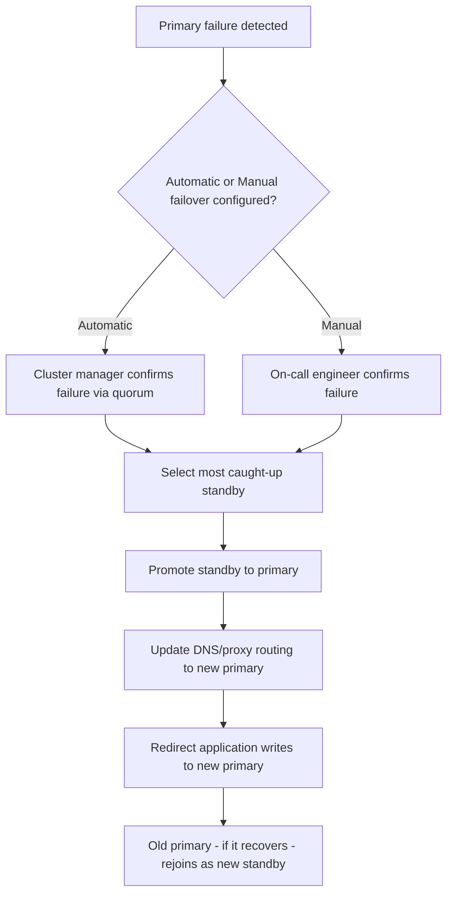
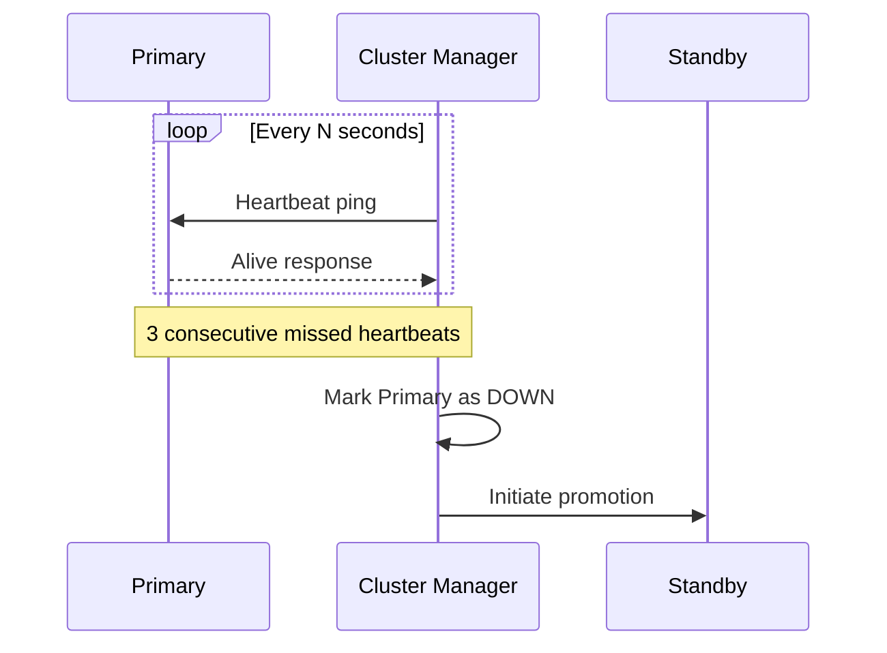
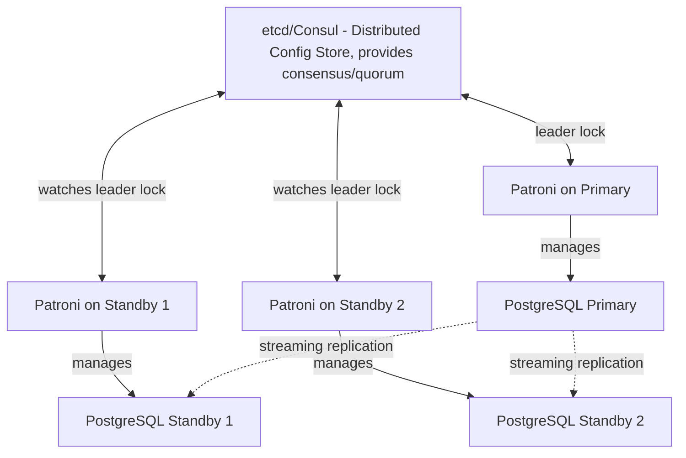
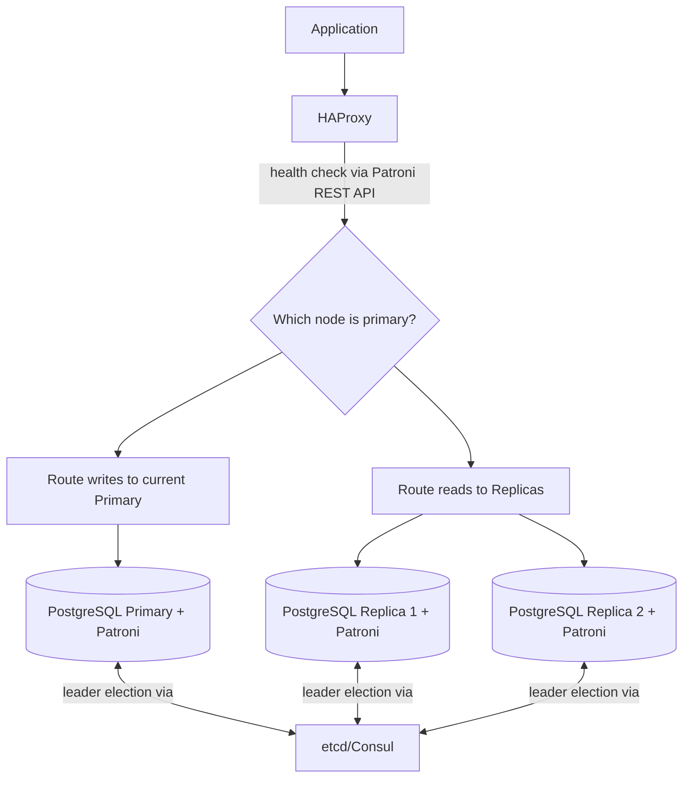

# Part 12 — Production Database Engineering & DBA Mastery

## Module 6: High Availability

> **Recap:** Module 5 made the database fast. This module makes it **stay up** — surviving hardware failure, network partitions, and even entire datacenter outages without (or with minimal) disruption to users.

### 6.0 Why This Module Exists

Every piece of hardware eventually fails — disks die, servers crash, network links drop. High Availability (HA) is the engineering discipline of designing a database system so that **no single failure takes down the whole service**. This is one of the most heavily tested System Design topics at every level, because it forces you to reason about trade-offs between consistency, availability, and complexity — the practical, operational face of the CAP theorem you studied conceptually in Part 8 (Distributed Databases).

**Real-world analogy:** A single-engine plane is grounded the moment its one engine fails. A commercial jet has multiple engines specifically so that losing one doesn't bring the plane down — it can still fly (perhaps with reduced performance) to a safe landing. HA architecture is building your database with "extra engines" and an automatic system to notice a failed engine and compensate immediately.

---

### 6.1 High Availability — Core Concepts

**What is it?**
A system design property where the database remains available (able to serve reads and/or writes) despite the failure of any single component.

**Key Metrics**

| Metric | Meaning |
|---|---|
| **Uptime %** | e.g., 99.9% ("three nines") = ~8.7 hours downtime/year; 99.99% ("four nines") = ~52 minutes/year |
| **RTO (Recovery Time Objective)** | How long it takes to restore service after a failure |
| **RPO (Recovery Point Objective)** | How much data (measured in time) you can afford to lose in a failure |

```
Uptime Target Table:
99%      → ~3.65 days downtime/year   (rarely acceptable for production)
99.9%    → ~8.76 hours downtime/year  (typical baseline SLA)
99.99%   → ~52.6 minutes downtime/year (high-availability standard)
99.999%  → ~5.26 minutes downtime/year (mission-critical, e.g., payments/telecom)
```

---

### 6.2 Active-Passive Architecture

**What is it?**
One primary node handles all reads and writes; one or more standby (passive) nodes replicate data but do not serve traffic under normal operation. On primary failure, a standby is promoted.

```
        ┌─────────────┐
Writes ─▶│   PRIMARY    │
Reads  ─▶│  (Active)    │
        └──────┬──────┘
               │ replication
               ▼
        ┌─────────────┐
        │   STANDBY    │  ← idle, ready to be promoted
        │  (Passive)   │
        └─────────────┘
```

**Why does it exist?**
Simplicity and strong consistency — since only one node accepts writes at a time, there's no risk of conflicting writes from two nodes (a problem Active-Active must solve).

**Advantages**
- Simple to reason about; no write-conflict resolution needed.
- Standby can also serve as a read replica (Module 5) if configured for hot-standby reads.

**Disadvantages**
- Standby resources are "wasted" if purely passive (no read traffic).
- Failover takes time (detection + promotion), causing a brief write unavailability window.

**Interview Importance:** ⭐⭐⭐⭐

---

### 6.3 Active-Active Architecture

**What is it?**
Multiple nodes accept both reads AND writes simultaneously, typically in different regions/datacenters, with changes synchronized (synchronously or asynchronously) between them.

```
   Region A                          Region B
┌─────────────┐                  ┌─────────────┐
│  Node A      │◀── sync/async ──▶│  Node B      │
│ (Active)     │   replication    │ (Active)     │
└─────────────┘                  └─────────────┘
   ▲                                  ▲
   │ reads+writes                     │ reads+writes
Users near A                      Users near B
```

**Why does it exist?**
- Lower latency for geographically distributed users (write to the nearest node).
- No "wasted" standby capacity — every node does useful work.
- Better write availability — if one region fails, the other keeps accepting writes.

**The Core Challenge: Write Conflicts**
If Node A and Node B both accept a write to the *same row* at nearly the same time, which one wins? This is the central hard problem of Active-Active.

**Conflict Resolution Strategies**

| Strategy | How It Works |
|---|---|
| Last-Write-Wins (LWW) | Timestamp-based; simplest but can silently lose data |
| Application-level conflict resolution | App defines merge logic (e.g., "sum the counters" instead of overwrite) |
| CRDTs (Conflict-free Replicated Data Types) | Data structures mathematically designed to merge without conflicts |
| Sharding by region (avoid the problem) | Each region "owns" a subset of data (e.g., by user's home region), avoiding same-row concurrent writes entirely |

**PostgreSQL vs MySQL vs Oracle vs SQL Server — Active-Active Support**

| Database | Native Active-Active Support |
|---|---|
| PostgreSQL | Not natively multi-master; achieved via extensions (BDR) or external tools |
| MySQL | Group Replication can be configured multi-primary (use with caution due to conflict complexity) |
| Oracle | **RAC (Real Application Clusters)** — mature, widely used active-active shared-storage clustering |
| SQL Server | Not natively multi-master in the traditional sense; Always On is primarily Active-Passive per database |
| CockroachDB / YugabyteDB / Spanner | Natively distributed, active-active by design (Module 10) |

**Interview Importance:** ⭐⭐⭐⭐⭐ (A favorite senior/staff-level system design deep-dive)

---

### 6.4 Failover — Automatic vs. Manual

**What is it?**
The process of promoting a standby/replica to become the new primary after the original primary fails.

**Step-by-step Failover Workflow**



**Automatic Failover**

| Advantage | Disadvantage |
|---|---|
| Fast (seconds, not requiring a human to wake up) | Risk of "false positive" failover from a transient network blip (split-brain risk) |
| Reduces on-call burden | Requires robust failure detection (quorum) to avoid over-triggering |

**Manual Failover**

| Advantage | Disadvantage |
|---|---|
| Human judgment avoids false-positive failovers | Slower (human needs to be paged, assess, act) — longer RTO |
| Simpler to implement correctly | Not suitable for systems needing sub-minute RTO |

**Best Practice:** Most modern production systems use **automatic failover with safeguards** (quorum-based detection, minimum lag thresholds for promotion candidates) rather than a strict manual-only or naive-automatic-only approach.

**Interview Importance:** ⭐⭐⭐⭐⭐

---

### 6.5 Heartbeats

**What is it?**
Periodic "are you alive" signals exchanged between nodes in a cluster, used to detect failures.



**Design considerations**
- **Heartbeat interval** and **failure threshold** (e.g., "3 missed heartbeats = down") directly trade off **detection speed vs. false-positive risk**. Too aggressive → false failovers on transient network blips. Too lax → slow detection, longer downtime.

**Interview Importance:** ⭐⭐⭐

---

### 6.6 Quorum

**What is it?**
A voting mechanism requiring a **majority** of nodes to agree before taking a cluster-altering action (like declaring a primary dead and promoting a new one) — this prevents **split-brain** scenarios.

**Why does it exist?**
Imagine a network partition splits a 3-node cluster into a group of 1 (the actual primary, isolated) and a group of 2 (two standbys that can talk to each other but not the primary). Without quorum, BOTH sides might think they should have a primary — resulting in **two primaries accepting writes simultaneously (split-brain)**, causing data divergence and corruption.

```
        Network Partition Occurs
                  │
   ┌──────────────┴──────────────┐
   │                              │
Group A (1 node)          Group B (2 nodes)
[Old Primary]              [Standby1, Standby2]
   │                              │
   │  Without quorum: might       │  With quorum (needs majority
   │  keep thinking it's          │  of 3 = 2 nodes): Group B has
   │  primary → SPLIT BRAIN       │  quorum, safely promotes a
   │                              │  new primary. Group A (1 node,
   │                              │  no quorum) steps down/refuses writes.
```

**Quorum formula:** For a cluster of N nodes, quorum = `floor(N/2) + 1`. This is why **odd numbers of nodes** (3, 5, 7) are preferred — they avoid tie votes that even numbers can produce.

**Interview Importance:** ⭐⭐⭐⭐⭐ (Split-brain and quorum are among the most common HA interview topics)

---

### 6.7 Cluster Managers & Replication Managers

**What is it?**
Software that monitors cluster node health (via heartbeats), makes quorum-based failure decisions, and orchestrates failover — the "brain" coordinating HA.

#### 6.7.1 Patroni (PostgreSQL)

**What is it?** A widely-used open-source tool for automating PostgreSQL HA — manages leader election, failover, and configuration, using an external Distributed Configuration Store (DCS) like etcd, ZooKeeper, or Consul for quorum/consensus.



**How it works, step by step:**
1. Patroni instances on each node compete to hold a "leader lock" in the DCS (etcd/Consul/ZooKeeper).
2. The node holding the lock is the primary; it must periodically renew the lock (like a lease).
3. If the primary's Patroni fails to renew the lock (crash, network partition), the lock expires.
4. Remaining Patroni instances (via DCS consensus, which itself uses quorum internally) race to acquire the lock.
5. The winner promotes its local PostgreSQL to primary and updates routing.

#### 6.7.2 Keepalived

**What is it?** Provides **VRRP (Virtual Router Redundancy Protocol)**-based virtual IP failover — a floating IP address that automatically moves to a healthy node, so clients always connect to a stable IP regardless of which physical node is currently primary.

#### 6.7.3 HAProxy

**What is it?** A high-performance TCP/HTTP load balancer/proxy commonly placed in front of a database cluster to route traffic to the current primary (for writes) and distribute traffic among replicas (for reads), often combined with health checks that query Patroni's REST API to know which node is currently primary.

**Typical Combined Architecture**



**Best Practices**
- ✅ Use an **odd number of nodes** in the consensus store (etcd/Consul/ZooKeeper) to avoid split votes.
- ✅ Set **conservative promotion criteria** — never promote a standby that's too far behind (data loss risk), prefer the most caught-up candidate.
- ✅ Test failover regularly ("game days" / chaos engineering) — an HA setup that's never been tested is not proven to work.

**Common Mistakes**
- ❌ Running the consensus store (etcd) on the same nodes as the database with no separation — a resource spike on the DB node can destabilize the very system meant to detect its failure.
- ❌ Never rehearsing failovers — the first real failover shouldn't be the first *tested* failover.

**Interview Importance:** ⭐⭐⭐⭐⭐

---

### 6.8 Comparison Table — HA Tooling by Database

| Database | Common HA Stack |
|---|---|
| PostgreSQL | Patroni + etcd/Consul + HAProxy/Pgpool-II, or managed (RDS Multi-AZ, Cloud SQL HA) |
| MySQL | Orchestrator, MySQL InnoDB Cluster (Group Replication + MySQL Router), or managed (RDS Multi-AZ) |
| Oracle | RAC (Real Application Clusters) + Data Guard for cross-region DR |
| SQL Server | Always On Availability Groups + Windows Server Failover Clustering (WSFC) |

---

### 6.9 Decision Tree — Choosing an HA Architecture

```
What's your primary requirement?
│
├─ Strong consistency, simple mental model, single-region acceptable?
│      └─ YES → Active-Passive with automatic failover (Patroni/Always On/RDS Multi-AZ)
│
├─ Need lowest latency for globally distributed users, can tolerate
│   eventual consistency or careful conflict handling?
│      └─ YES → Active-Active (region-sharded writes, or CRDT-based, or
│                distributed SQL engine like CockroachDB/Spanner - Module 10)
│
├─ Regulatory/compliance requires geographically separated DR site,
│   but not necessarily active-active serving?
│      └─ YES → Active-Passive primary + async cross-region standby
│                (this overlaps with Module 7's Disaster Recovery)
│
└─ Sub-minute RTO absolutely required (e.g., payments)?
       └─ YES → Automatic failover with aggressive but quorum-safe heartbeat
                 tuning + regularly rehearsed failover drills
```

---

### 6.10 Checklist — HA Readiness

- [ ] Odd number of nodes in consensus/quorum store
- [ ] Automatic failover configured with safeguards against split-brain
- [ ] Promotion logic prefers the most caught-up standby (minimizes data loss)
- [ ] Virtual IP or proxy-based routing so clients don't need manual reconfiguration on failover
- [ ] RTO and RPO targets explicitly defined and tested against
- [ ] Failover has been **tested in a game day / chaos exercise**, not just configured on paper
- [ ] Read traffic routing correctly excludes lagging or failed replicas
- [ ] Runbook exists for both automatic-failover-gone-wrong and manual failover scenarios

---

### 6.11 Cross-References

- Replication lag monitoring (Module 4) directly feeds failover promotion decisions here.
- CAP theorem trade-offs from **Part 8 (Distributed Databases)** are the theoretical foundation for the Active-Active conflict discussion.
- Cross-region standby overlaps with **Module 7 (Backup & Disaster Recovery)** — HA handles node failure; DR handles site/region failure.
- Distributed SQL engines (CockroachDB, Spanner) that natively solve Active-Active are covered in **Module 10 (Database Selection)**.
- Split-brain is analyzed further as a failure scenario in **Module 11 (Common Production Failures)**.

---

## Exercises — Module 6

**Beginner**
1. Define RTO and RPO and explain the difference with an example.
2. Why are odd numbers of nodes preferred in a quorum-based cluster?
3. What is split-brain, and why is it dangerous for a database?

**Intermediate**
4. Design an Active-Passive PostgreSQL HA setup using Patroni, etcd, and HAProxy. Sketch the architecture and explain what happens step-by-step when the primary crashes.
5. Compare automatic vs. manual failover for a database serving an internal analytics tool (low criticality) vs. a payments processing database (high criticality). Justify different choices for each.
6. Explain why Active-Active architectures need conflict resolution strategies, and describe one.

**Advanced Production Scenarios**
7. Your 5-node etcd cluster backing Patroni just experienced a network partition splitting it into a group of 2 and a group of 3. Walk through what happens and why the outcome is safe.
8. Design a failover testing ("game day") plan for a production HA database cluster — what would you test, how often, and how would you measure success?

**Whiteboard / Interview Problem**
9. *"Design a highly available database architecture for a global e-commerce platform with users in the US, Europe, and Asia, requiring sub-100ms write latency for local users and 99.99% availability. Discuss the Active-Active vs. Active-Passive trade-off explicitly."*

---

## Interview Questions — Module 6

- Q: What is split-brain and how does quorum prevent it?
- Q: Walk me through what happens, step by step, when a primary database node crashes in a Patroni-managed cluster.
- Q: When would you choose Active-Active over Active-Passive, and what new problems does Active-Active introduce?
- Q: How would you tune heartbeat interval and failure thresholds, and what's the trade-off?
- Q: What's the difference between High Availability and Disaster Recovery?

---

## Cheat Sheet — Module 6

```
ACTIVE-PASSIVE: one writer, simple, standard choice. Failover = promote a standby.
ACTIVE-ACTIVE:  multiple writers, lower latency globally, needs conflict resolution.

QUORUM = floor(N/2) + 1.  Use ODD node counts. Prevents split-brain.

HA STACK (Postgres example): Patroni (orchestration) + etcd/Consul (consensus)
                              + HAProxy/Pgpool (routing)

RTO = how fast you recover.  RPO = how much data you can lose.

GOLDEN RULE: An HA setup you haven't tested with a real failover drill
             is a THEORY, not a GUARANTEE.
```

---

*(End of Module 6. Reply "next" or "continue" to receive Module 7: Backup & Disaster Recovery.)*
