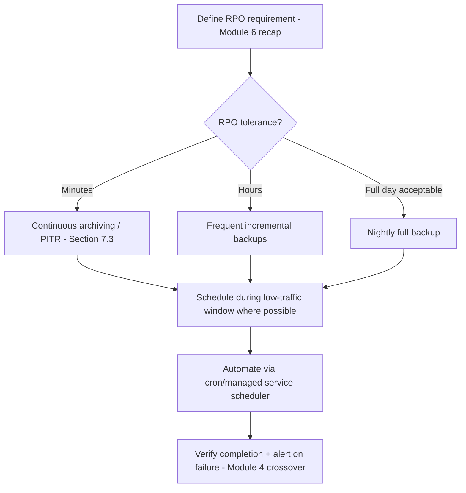
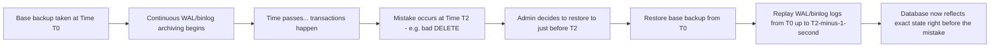
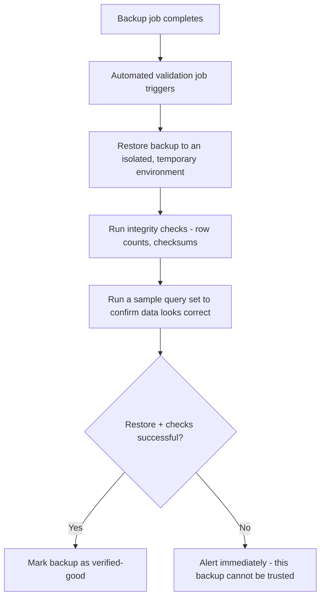
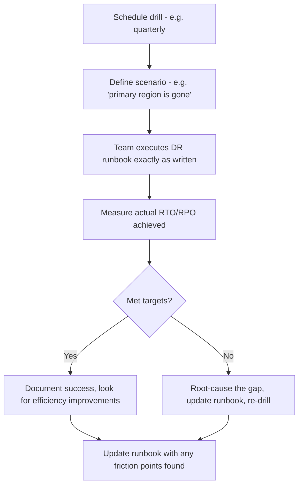

# Part 12 — Production Database Engineering & DBA Mastery

## Module 7: Backup & Disaster Recovery (Production)

> **Recap:** Module 6 (High Availability) protects against **node failure** — a server dies, a replica takes over, service continues. This module protects against everything HA can't: **data corruption, accidental deletion, ransomware, and entire-region disasters** — the scenarios where you need to go back in time, not just switch to another live copy.

### 7.0 Why This Module Exists — HA vs. DR

**Critical distinction, frequently tested in interviews:**

| | High Availability (Module 6) | Disaster Recovery (this module) |
|---|---|---|
| Protects against | Single node/hardware failure | Data corruption, human error, region-wide disaster |
| Data on standby | Real-time replica of current (possibly corrupted) state | Point-in-time snapshots you can roll back to |
| If you `DROP TABLE` by accident | HA doesn't help — the replica also drops the table (it replicates everything, including mistakes) | DR saves you — restore from a backup taken before the mistake |
| Typical mechanism | Replication + automatic failover | Backups + restore procedures |

**Real-world analogy:** HA is like having a spare tire (handles one flat instantly). DR is like having car insurance and a photo record of the car before the trip (handles the car being totaled, stolen, or crashed in a way a spare tire can't fix). You need both — they solve different classes of failure.

**Why does it exist?**
Because **replication faithfully copies mistakes too**. A `DROP TABLE customers;` or a ransomware encryption event propagates to every HA replica in seconds. The only real protection is a backup taken *before* the bad event, kept independently.

---

### 7.1 Backup Policies

**What is it?**
A documented, organization-wide standard defining what gets backed up, how often, how long backups are retained, and where they're stored.

**Key Policy Dimensions**

| Dimension | Typical Choices |
|---|---|
| Backup type | Full, Incremental, Differential |
| Frequency | Full weekly + incremental daily; or continuous (PITR) |
| Retention | 7 daily, 4 weekly, 12 monthly, 7 yearly (a common "grandfather-father-son" scheme) |
| Storage location | Separate from primary storage; ideally a different region/provider |
| Encryption | Always encrypted at rest (Module 2 recap) |

**Backup Types Explained**

```
FULL BACKUP:        [████████████████████]  entire database, every time
INCREMENTAL:        [████] [█] [█] [█]       only changes since the LAST backup (any type)
DIFFERENTIAL:       [████] [██] [███] [████] only changes since the LAST FULL backup
```

| Type | Restore Speed | Backup Speed | Storage Used |
|---|---|---|---|
| Full | Fast (single restore) | Slow, resource-intensive | High |
| Incremental | Slower (must replay full + every incremental in sequence) | Fast | Low |
| Differential | Medium (full + one differential) | Medium | Medium |

**Interview Importance:** ⭐⭐⭐⭐

---

### 7.2 Backup Scheduling

**What is it?**
The concrete cadence and automation of when backups run, balancing data safety against system load (backups are I/O/CPU intensive).

**Step-by-step Backup Scheduling Workflow**



**Best Practices**
- ✅ Schedule heavy full backups during **low-traffic windows** to minimize performance impact.
- ✅ Automate scheduling — never rely on a human remembering to run a backup.
- ✅ **Alert immediately on backup failure** — a silently-failing backup job is one of the most dangerous production blind spots (you don't find out until you desperately need a restore).

**Common Mistakes**
- ❌ Backing up to the **same server/disk** as the primary database — a single disk failure destroys both.
- ❌ Not monitoring backup job success/failure as a first-class alert (Module 4 recap).

**Interview Importance:** ⭐⭐⭐

---

### 7.3 Point-in-Time Recovery (PITR)

**What is it?**
The ability to restore a database to its exact state at **any specific moment in time** (not just at the moment of the last full backup), by combining a base backup with a continuous stream of transaction logs (WAL in PostgreSQL, binlog in MySQL, redo logs in Oracle).

**Why does it exist?**
Without PITR, if a mistake happens 3 hours after last night's backup, you lose those 3 hours of legitimate data when restoring. PITR lets you replay logs up to *just before* the mistake, preserving everything else.

**How PITR Works — Step by Step**



```sql
-- PostgreSQL: recovery.conf / postgresql.conf style target (v12+ uses postgresql.conf + signal file)
restore_command = 'cp /wal_archive/%f %p'
recovery_target_time = '2026-07-18 09:59:59'
```

```bash
# MySQL: PITR via binlog replay after restoring a base backup
mysqlbinlog --stop-datetime="2026-07-18 09:59:59" binlog.000123 | mysql -u root -p
```

**PostgreSQL vs MySQL vs Oracle vs SQL Server — PITR Mechanism**

| Database | Log Used for PITR | Tooling |
|---|---|---|
| PostgreSQL | WAL (Write-Ahead Log) | `pg_basebackup` + WAL archiving, or tools like `pgBackRest`, `Barman` |
| MySQL | Binary log (binlog) | `mysqldump`/`xtrabackup` + `mysqlbinlog` replay |
| Oracle | Redo logs + Archive logs | RMAN (Recovery Manager) — very mature PITR tooling |
| SQL Server | Transaction log | Full backup + transaction log backups, `RESTORE ... WITH STOPAT` |

**Best Practices**
- ✅ Archive transaction logs **continuously**, not just at backup time — this is what makes fine-grained PITR possible.
- ✅ Test PITR restores regularly (Section 7.5) — knowing the *theory* works is not the same as having *proven* it works on your actual data.

**Interview Importance:** ⭐⭐⭐⭐⭐ ("How would you recover from an accidental DELETE that happened 2 hours ago?" is a near-universal senior DBA question)

---

### 7.4 Backup Validation

**What is it?**
The practice of actually **restoring** a backup (not just confirming the backup file was created) to verify it's usable.

**Why does it exist?**
> 💡 **The single most important principle in this module:** *"A backup that has never been restored is not a backup — it's a hope."* Corrupted backup files, incomplete archives, and silently broken restore scripts are extremely common, and are only discovered — catastrophically — when a real restore is attempted during an actual emergency.

**Step-by-step Backup Validation Workflow**



**Best Practices**
- ✅ Automate restore-testing on a **regular schedule** (e.g., weekly), not just "we'll check it if we ever need it."
- ✅ Validate against **checksums/row counts**, and ideally run a few known business-logic queries to confirm semantic correctness, not just "the restore command didn't error."

**Interview Importance:** ⭐⭐⭐⭐⭐

---

### 7.5 Disaster Recovery Planning

**What is it?**
The documented, organization-wide plan for how to recover the entire database (and dependent systems) after a catastrophic event — not just a single table restore, but scenarios like "our entire primary datacenter is gone."

**Components of a DR Plan**

| Component | Purpose |
|---|---|
| RTO/RPO targets | Defined per system criticality (Module 6 recap) |
| DR site/region | Where the recovery environment lives |
| Runbook | Step-by-step recovery procedure, written so anyone on-call can follow it under pressure |
| Roles & responsibilities | Who declares a disaster, who executes recovery, who communicates to stakeholders |
| Communication plan | How customers/stakeholders are informed during an outage |
| Recovery drills | Scheduled practice runs (Section 7.7) |

**DR Strategy Tiers**

| Tier | Strategy | RTO | RPO | Cost |
|---|---|---|---|---|
| Backup & Restore | Backups stored off-site, restored on demand | Hours to days | Hours (since last backup) | Lowest |
| Pilot Light | Minimal DR environment always running, scaled up on disaster | Tens of minutes | Minutes | Low-Medium |
| Warm Standby | Scaled-down but fully functional replica running continuously | Minutes | Seconds to minutes | Medium-High |
| Hot Standby / Multi-Region Active-Active | Full-scale replica actively serving traffic | Near-zero | Near-zero | Highest |


**Interview Importance:** ⭐⭐⭐⭐⭐

---

### 7.6 Geo-redundancy & Multi-region Deployment

**What is it?**
Storing backups (and often live standby databases) in a **geographically separate region** from the primary, so a regional disaster (natural disaster, regional cloud provider outage, regional network failure) doesn't destroy both the primary and its recovery data.

```
   PRIMARY REGION (e.g., us-east-1)          DR REGION (e.g., us-west-2)
┌────────────────────────────┐          ┌────────────────────────────┐
│  Primary DB                 │          │  Warm Standby DB            │
│  Local backups (fast RTO)   │  async   │  (continuously replicated)  │
│                              │─────────▶│                              │
│  Backups ALSO shipped to    │replication│  Backup copies also stored  │
│  DR region storage           │          │  here independently          │
└────────────────────────────┘          └────────────────────────────┘
```

**Why does it exist?**
A backup stored in the same region/datacenter as the primary is destroyed by the same disaster (fire, flood, regional power grid failure, regional cloud provider outage) that takes down the primary — geo-redundancy is what makes a backup a genuine disaster recovery asset rather than a false sense of security.

**Best Practices**
- ✅ Store backups in **at least one geographically distant region**, ideally with a different failure domain than the primary.
- ✅ For mission-critical systems, consider a **different cloud provider or on-premise fallback** entirely (protects against provider-wide outages), balanced against added complexity/cost.

**Interview Importance:** ⭐⭐⭐⭐

---

### 7.7 Recovery Drills

**What is it?**
Scheduled, deliberate exercises where the team actually executes the DR plan — including declaring a simulated disaster and restoring/failing over to the DR environment — to prove the plan works and keep the team's muscle memory current.

**Step-by-step Recovery Drill Workflow**



**Real-world analogy:** This is a fire drill. You don't want the first time your team evacuates a burning building to be during an *actual* fire — you practice under safe conditions so the real event is executed calmly and correctly.

**Best Practices**
- ✅ Drills should be run by the **actual on-call rotation**, not just senior DBAs who "already know how" — the point is testing whether *anyone* on-call can execute it.
- ✅ Treat every friction point discovered during a drill as a **required runbook update**, not a one-off inconvenience.
- ✅ Vary drill scenarios (single table restore, full region failure, corrupted backup discovered mid-restore) to cover different failure classes.

**Interview Importance:** ⭐⭐⭐⭐

---

### 7.8 Recovery Automation

**What is it?**
Reducing the manual, error-prone steps of disaster recovery through scripted/automated tooling — critical because during a real disaster, stressed humans following a 40-step manual runbook make mistakes.

**What to automate**
- Backup verification (Section 7.4) — should already run without human involvement.
- DR environment provisioning (Infrastructure as Code — Module 9 crossover) — spin up the DR environment identically every time.
- Failover/promotion steps — scripted, idempotent, tested.
- Post-recovery validation queries — automatically confirm data integrity after restore.

**Best Practices**
- ✅ Aim for **one-click (or one-command) recovery** wherever feasible — every manual step is a chance for human error under pressure.
- ✅ Keep automation **tested via the same drills** as the manual runbook — automation that's never run in a drill is just as unproven as an untested manual plan.

**Interview Importance:** ⭐⭐⭐

---

### 7.9 Master Backup & DR Architecture Diagram

```
                         ┌──────────────────────┐
                         │   Primary Database     │
                         │   (Region A)            │
                         └──────────┬─────────────┘
                    ┌───────────────┼────────────────┐
                    ▼                ▼                 ▼
          ┌──────────────┐ ┌─────────────────┐ ┌─────────────────┐
          │ Local Backups │ │ Continuous WAL/  │ │ Async Replica     │
          │ (fast restore)│ │ Binlog Archiving │ │ (Region B - DR)   │
          └──────────────┘ └────────┬─────────┘ └─────────────────┘
                                     ▼
                         ┌──────────────────────┐
                         │ Off-site/Cross-region  │
                         │ Encrypted Backup Store │
                         └──────────┬─────────────┘
                                     ▼
                         ┌──────────────────────┐
                         │ Automated Restore Test │
                         │ (validates backups     │
                         │  are actually usable)  │
                         └──────────────────────┘
```

---

### 7.10 Checklist — Backup & DR Readiness

- [ ] Backup policy documented: type, frequency, retention, storage location
- [ ] Backups stored in a **geographically separate region** from primary
- [ ] Backups encrypted at rest and access-controlled (Module 2 crossover)
- [ ] Continuous transaction log archiving enabled for PITR
- [ ] Backup job success/failure explicitly monitored and alerted (Module 4 crossover)
- [ ] Automated restore validation running on a regular schedule
- [ ] Documented DR plan with clear RTO/RPO targets per system tier
- [ ] DR runbook written for execution by any on-call engineer, not just experts
- [ ] Recovery drills scheduled and executed regularly, with results documented
- [ ] Recovery steps automated/scripted wherever feasible

---

### 7.11 Decision Tree — Choosing a DR Strategy Tier

```
What RTO/RPO does this system require?
│
├─ Hours of downtime acceptable, some data loss tolerable?
│      └─ Backup & Restore tier is sufficient
│
├─ Tens of minutes RTO needed, minutes of RPO?
│      └─ Pilot Light or Warm Standby tier
│
├─ Near-zero RTO/RPO required (e.g., payments, real-time trading)?
│      └─ Hot Standby / Active-Active multi-region (Module 6 crossover)
│
└─ Regardless of tier chosen:
       ALWAYS validate backups regularly and run recovery drills.
```

---

### 7.12 Cross-References

- HA (Module 6) vs. DR (this module) is a foundational distinction tested constantly in interviews — know it cold.
- PITR relies on WAL/binlog mechanisms first introduced in **Part 7 (Recovery, MVCC)**.
- Backup encryption and access control tie back to **Module 2 (Security)**.
- Backup job monitoring/alerting is a direct application of **Module 4 (Monitoring)**.
- Recovery automation connects to **Module 9 (DevOps & Databases)** — Infrastructure as Code for DR environment provisioning.
- "Storage Full" and "Disk Corruption" failure scenarios in **Module 11** are exactly the situations this module's backups exist to recover from.

---

## Exercises — Module 7

**Beginner**
1. Explain the difference between High Availability and Disaster Recovery with a concrete example of a failure each one handles that the other doesn't.
2. What is PITR and why is it more powerful than restoring only from the last full backup?
3. Why is "we have a backup" not sufficient — what additional step is required to trust it?

**Intermediate**
4. Design a backup policy (type, frequency, retention) for an e-commerce database with an RPO requirement of 15 minutes and a compliance requirement to retain data for 7 years.
5. Walk through, step by step, how you would restore a PostgreSQL database to exactly 10:45 AM this morning, given a nightly full backup and continuous WAL archiving.
6. Explain why backups must be stored in a different geographic region than the primary database, with a real-world disaster scenario as justification.

**Advanced Production Scenarios**
7. A backup job has been silently failing for 3 weeks (misconfigured cron job) and was only discovered during an actual restore attempt after a data corruption incident. Design the monitoring/alerting changes needed to prevent this from ever happening again.
8. Design a full recovery drill scenario simulating "entire primary AWS region is unavailable" for a warm-standby multi-region architecture. What would you test, and how would you measure success?

**Whiteboard / Interview Problem**
9. *"Design the complete backup and disaster recovery strategy for a banking system with a legal requirement of RPO ≤ 5 minutes and RTO ≤ 15 minutes, including backup types, PITR, geo-redundancy, and drill cadence."*

---

## Interview Questions — Module 7

- Q: What's the difference between High Availability and Disaster Recovery, and why do you need both?
- Q: How would you recover a table that was accidentally dropped 2 hours ago?
- Q: What does it mean for a backup to be "validated," and why is validation necessary?
- Q: Design a DR strategy for a system with strict RPO/RTO requirements, explaining your choice of DR tier.
- Q: Why should backup storage be geographically separated from the primary database?

---

## Cheat Sheet — Module 7

```
HA = survives node failure (replicates everything, including mistakes)
DR = survives data corruption / region disaster (point-in-time recovery)

BACKUP TYPES: Full (slow backup, fast restore) · Incremental (fast backup, slow restore)
              · Differential (middle ground)

PITR = Base Backup + Continuous WAL/Binlog Replay → restore to ANY exact moment

DR TIERS (increasing cost, decreasing RTO/RPO):
  Backup & Restore → Pilot Light → Warm Standby → Hot Standby/Active-Active

GOLDEN RULE #1: A backup that has never been restored is not a backup.
GOLDEN RULE #2: Store backups in a different region. Test recovery via real drills.
```

---

*(End of Module 7. Reply "next" or "continue" to receive Module 8: Database Migrations.)*
