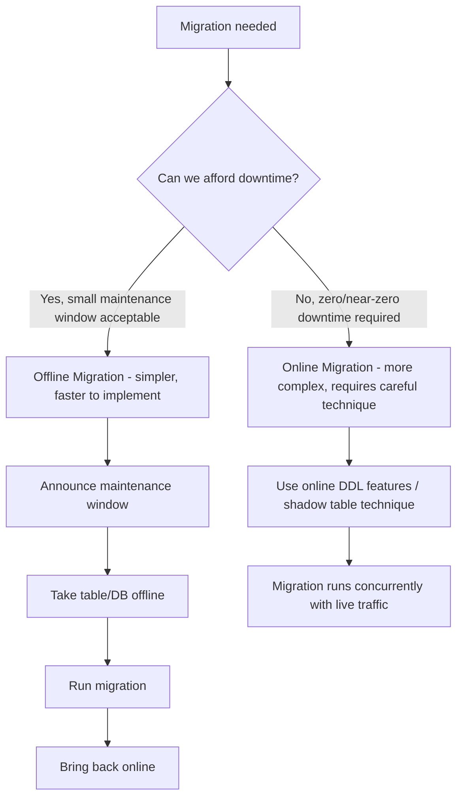
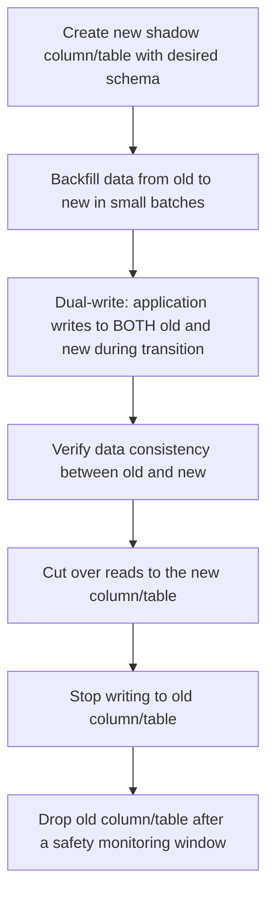
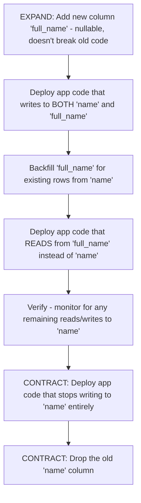
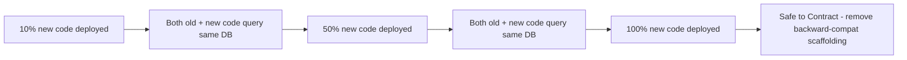
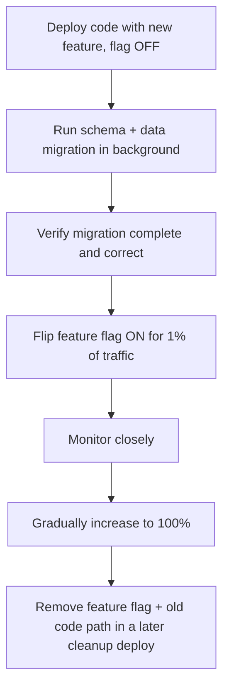
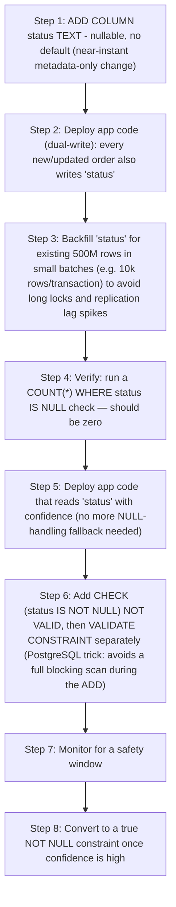

# Part 12 — Production Database Engineering & DBA Mastery

## Module 8: Database Migrations

> **Recap:** Module 1 mentioned migrations as version-controlled files; Module 6/7 built the safety nets (HA/DR) underneath production. This module is the deep dive on **how to actually change a live production schema and its data safely** — the single most common source of real-world production incidents, and one of the richest topics for senior interviews.

### 8.0 Why This Module Exists

**Real-world analogy:** Migrating a production database schema is like renovating a hospital while it's still treating patients. You can't just close the doors and remodel (that's downtime) — you need to move walls, add rooms, and reroute plumbing while patients keep flowing through, with zero moments where a patient falls through a hole in the floor. Every technique in this module exists to answer one question: **how do we change the structure without ever leaving the data (or the application) in a broken, inconsistent state?**

---

### 8.1 Schema Migration vs. Data Migration

| | Schema Migration | Data Migration |
|---|---|---|
| **What changes** | Structure: tables, columns, indexes, constraints | Content: the actual row values |
| **Example** | `ALTER TABLE users ADD COLUMN email_verified BOOLEAN` | Backfilling `email_verified = true` for all existing rows based on some rule |
| **Typical risk** | Locking, blocking writes during DDL | Long-running batch job load, resource contention |
| **Typical tooling** | Migration frameworks (Flyway, Liquibase, Alembic) | Custom scripts, ETL tools, batched application code |

They're often combined: adding a column (schema) *then* backfilling its values (data) *then* eventually enforcing a `NOT NULL` constraint (schema again) — this three-step pattern is core to the Expand-Contract pattern (Section 8.5).

---

### 8.2 Online vs. Offline Migration

**What is it?**
- **Offline migration:** The database (or the affected table) is taken out of service — no reads/writes allowed — while the migration runs. Simple, but causes downtime.
- **Online migration:** The migration runs while the database continues serving live traffic, using techniques to avoid or minimize locking.



**When offline migration is still the right choice**
- Internal tools with low uptime requirements.
- Truly massive structural changes where online techniques add more risk than a well-communicated short maintenance window.
- Early-stage startups where engineering time is better spent elsewhere and traffic/users are minimal.

**Interview Importance:** ⭐⭐⭐⭐

---

### 8.3 Locking Behavior — Why Migrations Are Risky

**What's actually happening internally**
Most DDL operations require some form of lock on the affected table. The critical question is: **what kind of lock, and for how long?**

| Operation | Typical Lock Behavior (varies by DB/version) |
|---|---|
| `ADD COLUMN` (nullable, no default) | Metadata-only, near-instant (modern PostgreSQL/MySQL) |
| `ADD COLUMN ... DEFAULT <value>` | Historically required a full table rewrite (locks entire table for the duration); modern PostgreSQL (11+) and MySQL (8.0+ with `INSTANT` algorithm) optimize this to be near-instant for simple cases |
| `ADD COLUMN NOT NULL` (no default) | Requires validating existing rows — can lock/scan the whole table |
| `CREATE INDEX` | Can lock table against writes for the duration unless using a concurrent/online option |
| `ALTER TABLE ... TYPE` (changing a column's data type) | Almost always requires a full table rewrite — highest risk |
| `DROP COLUMN` | Often fast (metadata-only in many engines), but the space isn't necessarily reclaimed immediately |

```sql
-- DANGEROUS on a huge table: locks for the full index build duration
CREATE INDEX idx_orders_customer ON orders(customer_id);

-- SAFE: builds the index without blocking writes (PostgreSQL)
CREATE INDEX CONCURRENTLY idx_orders_customer ON orders(customer_id);

-- MySQL equivalent: online DDL
ALTER TABLE orders ADD INDEX idx_orders_customer (customer_id), ALGORITHM=INPLACE, LOCK=NONE;
```

**Best Practice:** ✅ **Always** know the exact locking behavior of a DDL operation on your specific database version before running it on a large production table — "it's just adding a column" is not a safe assumption without version-specific verification.

**Interview Importance:** ⭐⭐⭐⭐⭐

---

### 8.4 Zero-Downtime Migration Techniques

#### 8.4.1 `CONCURRENTLY` / Online DDL / Shadow Table Technique

For changes too risky for direct online DDL (e.g., changing a column type on a massive table), the general pattern is:



This is exactly the technique tools like **`gh-ost`** and **`pt-online-schema-change`** (Percona Toolkit) automate for MySQL: they create a shadow table, copy data in batches, capture ongoing changes via triggers or binlog, and perform a fast atomic rename at the end.

```
BEFORE:                          DURING (shadow table):              AFTER:
┌───────────┐                    ┌───────────┐  ┌──────────────┐    ┌──────────────┐
│  orders    │                    │  orders    │  │ orders_new    │    │ orders_new    │
│  (old      │                    │  (old      │  │ (new schema,  │    │ (renamed to   │
│  schema)   │                    │  schema)   │  │  backfilling) │    │  'orders')    │
└───────────┘                    └───────────┘  └──────────────┘    └──────────────┘
                                   ▲ live traffic     ▲ batch copy +
                                                        triggers capture
                                                        ongoing changes
```

#### 8.4.2 The Expand-Contract Pattern (a.k.a. Parallel Change)

**What is it?**
The gold-standard pattern for making **backward-compatible** schema changes safely across a rolling deployment (Section 8.6) — critical because during a rolling deploy, old and new application code run **simultaneously** for a period.

**Step-by-step (example: renaming a column from `name` to `full_name`)**



**Why this works:** At every single step, **both the old and new application code versions can run against the current schema without errors** — this is the property that makes it safe during a rolling deployment where you can't guarantee all instances update atomically.

**Interview Importance:** ⭐⭐⭐⭐⭐ (This is arguably THE most important concept in this entire module for senior interviews)

---

### 8.5 Deployment Strategies and Their Interaction with Migrations

#### 8.5.1 Blue-Green Deployment

**What is it?** Two complete, identical production environments ("Blue" = currently live, "Green" = new version being deployed). Traffic is switched all at once from Blue to Green after the Green environment is fully validated.

```
   BEFORE CUTOVER                          AFTER CUTOVER
┌─────────────┐                        ┌─────────────┐
│ BLUE (live)  │◀── all traffic         │ BLUE (idle,  │
│ v1 app + DB  │                        │  standby)    │
└─────────────┘                        └─────────────┘
┌─────────────┐                        ┌─────────────┐
│ GREEN        │  (being validated)     │ GREEN (live) │◀── all traffic
│ v2 app + DB  │                        │ v2 app + DB  │
└─────────────┘                        └─────────────┘
```

**Database implication:** Blue-Green is straightforward for stateless application servers, but the **database is usually shared** between Blue and Green (you can't easily "duplicate" a live production database with all its data for every deploy) — so schema changes must still be **backward-compatible** with both versions during the transition, making Expand-Contract essential even in a Blue-Green setup.

#### 8.5.2 Rolling Deployment

**What is it?** New application code is deployed to a subset of servers at a time (e.g., 10% → 50% → 100%), rather than all at once.

**Database implication:** This is exactly the scenario that makes **Expand-Contract mandatory** — for a period, some servers run old code and some run new code, both hitting the same database simultaneously. Any non-backward-compatible schema change will break the old-code servers until they're all updated.



#### 8.5.3 Feature Flags

**What is it?** A mechanism to toggle new functionality on/off at runtime without a deployment, often used to decouple **"deploying code"** from **"activating a feature that depends on a schema change."**

**Why it matters for migrations:** You can deploy application code that's *capable* of using a new column/table, but keep the feature flag off until the data migration/backfill (Section 8.1) is fully complete and verified — separating the risk of "did the code deploy correctly" from "is the data ready" into two independently controllable steps.



**Interview Importance:** ⭐⭐⭐⭐

---

### 8.6 Migration Tooling

| Tool | Language/Ecosystem | Approach |
|---|---|---|
| **Flyway** | Java-centric, but polyglot | Versioned, plain SQL migration files (`V1__create_users.sql`), applied in strict order, tracks applied migrations in a metadata table |
| **Liquibase** | Java-centric, but polyglot | Supports SQL, XML, YAML, or JSON changesets; supports rollback definitions and more complex changeset dependencies |
| **Alembic** | Python (SQLAlchemy ecosystem) | Python-based migration scripts, auto-generates migrations by diffing ORM models against the current DB schema |
| **gh-ost** | MySQL-specific | Triggerless online schema change tool (uses binlog streaming instead of triggers, lower overhead) |
| **pt-online-schema-change** | MySQL-specific (Percona Toolkit) | Trigger-based shadow-table online schema change |

**Example: Flyway migration file naming convention**
```
V1__create_users_table.sql
V2__add_email_column.sql
V3__backfill_email_verified.sql
V4__add_not_null_constraint_email_verified.sql
```

**Example: Alembic auto-generated migration (Python)**
```python
def upgrade():
    op.add_column('users', sa.Column('email_verified', sa.Boolean(), nullable=True))

def downgrade():
    op.drop_column('users', 'email_verified')
```

**Best Practices**
- ✅ Every migration tool run should be **idempotent and version-controlled** — the same migration applied twice should be safe (or the tool should prevent re-application).
- ✅ Every migration should have a **tested rollback/downgrade path** (Module 1 recap).
- ✅ Migration files are applied through **CI/CD pipelines**, never run manually and ad-hoc against production (Module 9 crossover).

**Interview Importance:** ⭐⭐⭐

---

### 8.7 Step-by-Step: A Complete Zero-Downtime Migration Example

**Scenario:** Add a `NOT NULL` `status` column to a 500-million-row `orders` table in production PostgreSQL, with zero downtime.



```sql
-- Step 1
ALTER TABLE orders ADD COLUMN status TEXT;

-- Step 3 (batched backfill pseudocode - run repeatedly until zero rows affected)
UPDATE orders SET status = 'unknown'
WHERE status IS NULL
  AND id IN (SELECT id FROM orders WHERE status IS NULL LIMIT 10000);

-- Step 6 (PostgreSQL trick: add constraint without a blocking full-table validation)
ALTER TABLE orders ADD CONSTRAINT status_not_null CHECK (status IS NOT NULL) NOT VALID;
ALTER TABLE orders VALIDATE CONSTRAINT status_not_null; -- scans without blocking writes
```

> 💡 **Callout — Interview Gold:** The `NOT VALID` + `VALIDATE CONSTRAINT` two-step trick in PostgreSQL is a favorite senior-level detail — it demonstrates you know that a naive `ADD CONSTRAINT ... NOT NULL` would take a long, disruptive lock on a huge table, while this approach adds the constraint instantly and validates it in a separate, non-blocking pass.

---

### 8.8 Comparison Table — Migration Risk by Change Type

| Change Type | Risk Level | Recommended Technique |
|---|---|---|
| Add nullable column | Low | Direct online DDL |
| Add column with default (modern DB versions) | Low-Medium | Direct online DDL (verify version behavior) |
| Add `NOT NULL` constraint to existing column | Medium-High | `NOT VALID` + `VALIDATE CONSTRAINT` pattern, or backfill-then-constrain |
| Add index | Medium | `CONCURRENTLY` / online DDL algorithm |
| Change column data type | High | Shadow column/table + dual-write + cutover |
| Rename column | Medium | Expand-Contract (add new, dual-write, migrate reads, drop old) |
| Drop column | Low-Medium | Deprecation window (Module 1) before actual drop |
| Split one table into two | High | Shadow table + dual-write + batch backfill + cutover |

---

### 8.9 Checklist — Safe Production Migration

- [ ] Migration tested in staging with production-scale data and timing measured (Module 1 recap)
- [ ] Locking behavior of every DDL statement verified for your exact database version
- [ ] Change is backward-compatible with currently-deployed application code (Expand-Contract)
- [ ] Large backfills are batched, not single giant transactions
- [ ] Migration applied via version-controlled tooling (Flyway/Liquibase/Alembic), never manual/ad-hoc
- [ ] Rollback/downgrade path defined and tested
- [ ] Monitoring dashboards open during migration execution (replication lag, lock waits, latency)
- [ ] Feature flag in place if activation should be decoupled from deployment
- [ ] Post-migration validation query confirms correctness
- [ ] Old schema elements (columns/tables) removed only after a safety monitoring window

---

### 8.10 Cross-References

- Migration files as version-controlled artifacts were introduced in **Module 1 (Development stage)**.
- Lock/blocking monitoring during migrations uses the techniques from **Module 4**.
- Rolling deployment's need for Expand-Contract connects to **Module 9 (DevOps & Databases)** — CI/CD pipelines that execute these deploys.
- Batched backfills reduce WAL generation spikes and replication lag, tying back to **Module 4 and Module 6**.
- This module's "shadow table" cutover technique is architecturally similar to the "logical replication cutover" used for version upgrades in **Module 1**.

---

## Exercises — Module 8

**Beginner**
1. What's the difference between a schema migration and a data migration, with an example of each?
2. Why is adding a `NOT NULL` constraint riskier than adding a nullable column?
3. Explain the Expand-Contract pattern in your own words with a simple example.

**Intermediate**
4. Design the full Expand-Contract migration plan to rename a column `qty` to `quantity` on a heavily-used production table, ensuring compatibility during a rolling deployment.
5. Explain why `CREATE INDEX CONCURRENTLY` is safer than a plain `CREATE INDEX` on a production table, and what trade-off it makes in exchange for that safety.
6. A colleague proposes changing a column's data type from `VARCHAR(50)` to `VARCHAR(255)` directly with a single `ALTER TABLE`. Evaluate the risk and propose a safer approach if needed.

**Advanced Production Scenarios**
7. Design a zero-downtime migration plan to split a monolithic `users` table (with 200 columns accumulated over years) into `users_core` and `users_extended`, for a table with 1 billion rows and continuous write traffic.
8. Your batched backfill job (Section 8.7 style) is causing replication lag to spike above your alert threshold every time it runs. Redesign the backfill approach to avoid this.

**Whiteboard / Interview Problem**
9. *"Walk me through, in complete step-by-step detail, how you would migrate a primary key column from INT to BIGINT on a production table with 2 billion rows and zero tolerance for downtime, that is actively receiving 10,000 writes/second."*

---

## Interview Questions — Module 8

- Q: What is the Expand-Contract pattern and why is it necessary during rolling deployments?
- Q: Why can `ALTER TABLE ... ADD COLUMN ... DEFAULT <value>` be dangerous on older database versions, and how do modern versions optimize it?
- Q: Explain the `NOT VALID` + `VALIDATE CONSTRAINT` trick in PostgreSQL and what problem it solves.
- Q: How do feature flags help decouple code deployment risk from data migration risk?
- Q: Compare `gh-ost`/`pt-online-schema-change`-style shadow table migrations to native online DDL — when would you choose each?

---

## Cheat Sheet — Module 8

```
SCHEMA MIGRATION = structure change.  DATA MIGRATION = content change. Often paired.

EXPAND-CONTRACT PATTERN (the gold standard):
  1. EXPAND: add new column/table (backward compatible)
  2. Dual-write old + new
  3. Backfill existing data
  4. Migrate reads to new
  5. Stop writing old
  6. CONTRACT: drop old

RISK LADDER (low → high):
  Add nullable column < Add index (use CONCURRENTLY) < Add NOT NULL (use NOT VALID trick)
  < Change data type / rename / split table (shadow table + dual-write)

TOOLING: Flyway/Liquibase/Alembic (schema versioning) ·
         gh-ost/pt-online-schema-change (MySQL online shadow-table changes)

GOLDEN RULE: A migration must be safe for BOTH old and new app code to run against,
             simultaneously, at every intermediate step.
```

---

*(End of Module 8. Reply "next" or "continue" to receive Module 9: DevOps & Databases.)*
