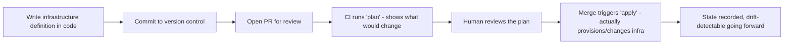
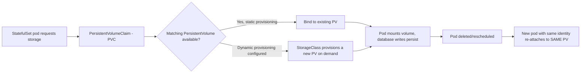
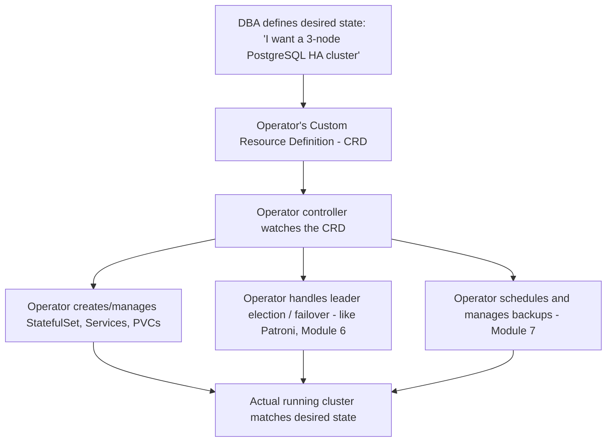
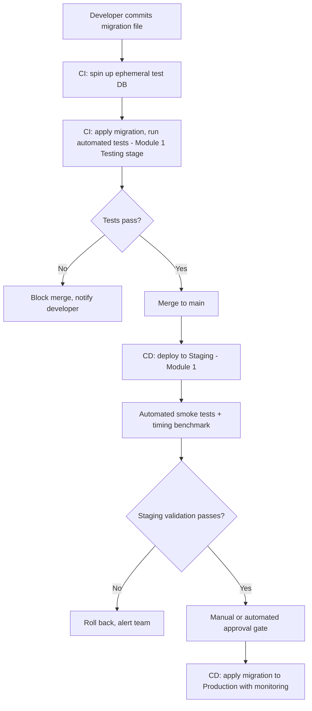

# Part 12 — Production Database Engineering & DBA Mastery

## Module 9: DevOps & Databases

> **Recap:** Modules 1-8 covered *what* needs to happen (lifecycle, security, tuning, monitoring, HA, DR, migrations). This module covers the **tooling and automation culture** that makes all of that repeatable, version-controlled, and executed by machines instead of error-prone humans typing commands at 2 AM.

### 9.0 Why This Module Exists

**Real-world analogy:** Everything in Modules 1-8 is like knowing surgical procedures. DevOps is the operating room, the sterilization process, and the checklist system that ensures those procedures are performed the *same correct way* every single time, by any qualified surgeon, without relying on any one person's memory. Databases have historically lagged behind stateless application services in DevOps maturity — because they hold state, you can't just "throw away and recreate" a database container the way you can a web server. This module covers how modern teams close that gap.

---

### 9.1 Infrastructure as Code (IaC)

**What is it?**
Defining database infrastructure (instances, storage, networking, configuration, users) in version-controlled configuration files, rather than manually clicking through a cloud console.

**Why does it exist?**
Manual infrastructure setup is unreproducible, undocumented, and error-prone ("configuration drift" — Module 3 recap: dev, staging, and production silently diverge over time when humans configure each by hand).

**Common Tools**

| Tool | Approach |
|---|---|
| Terraform | Declarative, multi-cloud, widely used for provisioning DB instances (RDS, Cloud SQL, etc.) |
| Pulumi | Declarative IaC using general-purpose programming languages (Python, TypeScript, Go) |
| AWS CloudFormation | AWS-native declarative IaC |
| Ansible | Procedural/declarative hybrid, often used for OS-level and application configuration on top of provisioned infrastructure |

```hcl
# Terraform example: provisioning a PostgreSQL RDS instance
resource "aws_db_instance" "production_db" {
  identifier              = "orders-db-prod"
  engine                  = "postgres"
  engine_version          = "16.3"
  instance_class          = "db.r6g.xlarge"
  allocated_storage       = 500
  storage_encrypted       = true
  multi_az                = true
  backup_retention_period = 30
  deletion_protection     = true
}
```

**Step-by-step IaC Workflow**



**Best Practices**
- ✅ Every environment (dev/staging/production — Module 1 recap) should be provisioned from the **same IaC templates**, with only variables (size, instance count) differing.
- ✅ Store IaC state securely (e.g., Terraform remote state with locking) to prevent concurrent conflicting changes.
- ✅ Review infrastructure changes with the **same rigor as code changes** — a `terraform apply` that deletes a production database is a real, well-documented category of incident.

**Interview Importance:** ⭐⭐⭐⭐

---

### 9.2 Docker & Database Containers

**What is it?**
Packaging a database engine and its dependencies into a container image for consistent, portable deployment.

**Why databases are different from stateless containers**
A web server container can be killed and recreated instantly with zero data loss — it's stateless. A database container holds **state** that must survive container restarts, which requires careful volume management (Section 9.3).

```dockerfile
# Simplified example: a custom PostgreSQL image with extensions pre-installed
FROM postgres:16
RUN apt-get update && apt-get install -y postgresql-16-postgis-3
COPY init-scripts/ /docker-entrypoint-initdb.d/
```

**When containerized databases make sense**

| Use Case | Containerize? |
|---|---|
| Local development | ✅ Yes — fast, consistent, disposable |
| CI/CD test environments | ✅ Yes — ephemeral, spun up per test run |
| Small-to-medium production workloads | ✅ Often, via Kubernetes StatefulSets/Operators (Section 9.3-9.4) |
| Massive-scale, latency-sensitive production (e.g., core payments DB) | ⚠️ Many large companies still prefer dedicated VMs/bare-metal or managed DBaaS for the most critical databases, though containerized production databases are increasingly common and mature |

**Interview Importance:** ⭐⭐⭐

---

### 9.3 Kubernetes for Databases: StatefulSets & Persistent Volumes

**What is it?**
Kubernetes' primitives specifically designed for stateful workloads like databases, as opposed to the stateless `Deployment` primitive used for typical web services.

#### 9.3.1 Why Not a Regular `Deployment`?

A standard Kubernetes `Deployment` treats all pod replicas as interchangeable and disposable — perfect for stateless web servers, wrong for databases where:
- Each replica has a **distinct identity** (this pod is the primary, that pod is replica #2).
- Each replica needs **stable network identity** (a consistent hostname, not a random one on every restart).
- Each replica needs its **own persistent storage** that survives pod rescheduling.

#### 9.3.2 StatefulSets

**What is it?** A Kubernetes controller that manages pods with:
- **Stable, predictable pod names** (e.g., `postgres-0`, `postgres-1`, `postgres-2` — not random suffixes).
- **Stable network identity** via a headless service (each pod gets a consistent DNS name).
- **Ordered, graceful deployment and scaling** (pods created/deleted in order, one at a time).
- **Persistent storage per pod**, retained across rescheduling.

```yaml
apiVersion: apps/v1
kind: StatefulSet
metadata:
  name: postgres
spec:
  serviceName: "postgres"
  replicas: 3
  selector:
    matchLabels:
      app: postgres
  template:
    metadata:
      labels:
        app: postgres
    spec:
      containers:
      - name: postgres
        image: postgres:16
        volumeMounts:
        - name: pgdata
          mountPath: /var/lib/postgresql/data
  volumeClaimTemplates:
  - metadata:
      name: pgdata
    spec:
      accessModes: [ "ReadWriteOnce" ]
      resources:
        requests:
          storage: 500Gi
```

#### 9.3.3 Persistent Volumes (PV) & Persistent Volume Claims (PVC)

**What is it?**
- **Persistent Volume (PV):** An actual piece of storage (e.g., an EBS volume, a network disk) provisioned in the cluster.
- **Persistent Volume Claim (PVC):** A request by a pod for storage matching certain criteria (size, access mode) — Kubernetes binds the claim to an available PV.



**Why this matters:** When a database pod crashes and Kubernetes reschedules it (possibly on a different physical node), the StatefulSet + PVC combination ensures it comes back with **the exact same data**, not a fresh empty volume — critical, non-negotiable behavior for any stateful workload.

**Interview Importance:** ⭐⭐⭐⭐

---

### 9.4 Operators

**What is it?**
A Kubernetes pattern where domain-specific operational knowledge (how to fail over a database, how to take a backup, how to scale replicas) is encoded into custom Kubernetes controllers, extending Kubernetes to understand database-specific operations beyond generic pod/volume management.

**Why does it exist?**
StatefulSets handle generic "keep stateful pods running with stable storage" — but they don't know anything about **PostgreSQL replication**, **failover promotion**, or **backup scheduling**. Operators encode that domain expertise as software, effectively automating what a human DBA would otherwise do manually (directly connecting Module 6's HA concepts to Kubernetes automation).

**Popular Database Operators**

| Operator | Database | Capabilities |
|---|---|---|
| Zalando Postgres Operator / CloudNativePG | PostgreSQL | Automated HA, failover, backups, connection pooling |
| Percona Operator | MySQL, MongoDB, PostgreSQL | HA clustering, backup/restore automation |
| MySQL Operator (Oracle) | MySQL | InnoDB Cluster management within Kubernetes |
| Vitess Operator | MySQL (sharded) | Manages Vitess's sharding/scaling layer |



**Real-world analogy:** A StatefulSet is like a generic property manager who ensures each apartment (pod) has stable utilities and storage. An Operator is a specialized building superintendent who additionally knows *this specific building's* fire-safety procedures, elevator maintenance schedule, and emergency evacuation plan (database-specific operational knowledge).

**Interview Importance:** ⭐⭐⭐⭐

---

### 9.5 CI/CD for Databases

**What is it?**
Extending Continuous Integration/Continuous Deployment pipelines — normally associated with application code — to include database schema migrations (Module 8) and infrastructure changes (Section 9.1) as automated, tested, gated pipeline steps.

**Step-by-step Database CI/CD Pipeline**



**Best Practices**
- ✅ Database migrations go through the **same CI/CD rigor** as application code — no manual/ad-hoc production changes (Module 1/8 recap).
- ✅ Use **migration tooling** (Flyway/Liquibase/Alembic — Module 8) integrated directly into the pipeline, not run manually by a human at deploy time.
- ✅ Gate risky migrations (large table changes) with **explicit manual approval**, even in an otherwise fully automated pipeline.

**Interview Importance:** ⭐⭐⭐⭐

---

### 9.6 GitOps

**What is it?**
An operational model where **Git is the single source of truth** for both application and infrastructure state — an automated agent continuously reconciles the actual running system to match what's declared in Git, rather than humans/pipelines pushing changes imperatively.

**GitOps vs. Traditional CI/CD Push Model**

```
TRADITIONAL (Push):                       GITOPS (Pull):
CI Pipeline ──pushes changes──▶ Cluster    Git Repo (desired state)
                                                  ▲
                                                  │ continuously watched/pulled
                                                  │
                                          GitOps Agent (e.g., ArgoCD/Flux)
                                                  │
                                                  ▼
                                              Cluster (reconciled to match Git)
```

**Why it matters for databases:** Database Operators (Section 9.4) are often managed via GitOps — the desired cluster topology (3 replicas, specific version, backup schedule) lives declaratively in Git, and the GitOps agent + Operator together continuously ensure the live cluster matches that declaration, self-healing drift automatically.

**Best Practices**
- ✅ Never manually `kubectl edit` a database resource in production — change the Git source and let the GitOps agent reconcile, preserving the audit trail and preventing drift.

**Interview Importance:** ⭐⭐⭐

---

### 9.7 Database-as-a-Service (DBaaS)

**What is it?**
Fully managed database offerings where the cloud provider handles installation, patching, backups, and often HA/failover, in exchange for reduced operational control.

**Examples**

| Provider | Offering |
|---|---|
| AWS | RDS (managed traditional engines), Aurora (cloud-native re-architected MySQL/PostgreSQL-compatible) |
| GCP | Cloud SQL, AlloyDB, Cloud Spanner |
| Azure | Azure Database for PostgreSQL/MySQL/SQL Server, Cosmos DB |
| Third-party | MongoDB Atlas, PlanetScale (MySQL/Vitess), Neon (serverless Postgres), CockroachDB Cloud |

**Self-Managed vs. DBaaS Trade-off Table**

| Aspect | Self-Managed | DBaaS |
|---|---|---|
| Operational burden | High (you do everything from Modules 1-8) | Low-Medium (vendor handles patching, backups, often HA) |
| Cost | Infra only, but engineering time is real cost | Higher unit cost, but lower engineering/ops overhead |
| Customization/tuning control | Full (every parameter in Module 3 accessible) | Partial (many low-level parameters locked down) |
| Time to production | Slower (must build all Module 1-8 practices yourself) | Faster (most operational maturity built-in) |
| Vendor lock-in risk | Low | Medium-High, especially for cloud-native engines like Aurora/Spanner |

**Best Practices**
- ✅ For most companies without a dedicated large DBA team, **DBaaS is the pragmatic default** — building equivalent HA/DR/monitoring maturity in-house (Modules 4, 6, 7) takes significant sustained engineering investment.
- ✅ Reserve self-managed infrastructure for cases with **specific requirements DBaaS can't meet** (extreme customization, cost at massive scale, specific compliance/data-residency needs, or specialized extensions).

**Interview Importance:** ⭐⭐⭐⭐ ("When would you choose managed vs. self-hosted?" is a very common question)

---

### 9.8 Master DevOps-for-Databases Architecture

```
┌─────────────────────────────────────────────────────────────────────┐
│                          GIT REPOSITORY                                │
│   Infra-as-Code (Terraform) + DB Migrations (Flyway) + Operator CRDs  │
└───────────────────────────────┬─────────────────────────────────────┘
                                  │
              ┌───────────────────┼───────────────────┐
              ▼                    ▼                    ▼
     ┌────────────────┐  ┌──────────────────┐  ┌────────────────────┐
     │  CI Pipeline     │  │  GitOps Agent      │  │  CD Pipeline         │
     │  (test migrations│  │  (ArgoCD/Flux -    │  │  (apply migrations   │
     │   in ephemeral DB│  │   reconciles K8s   │  │   via Flyway/Liquibase│
     │   - Module 1/8)  │  │   state to Git)    │  │   to Staging → Prod) │
     └────────────────┘  └──────────────────┘  └────────────────────┘
                                  │
                                  ▼
                     ┌────────────────────────┐
                     │   Kubernetes Cluster      │
                     │  ┌──────────────────┐   │
                     │  │ Database Operator  │   │
                     │  │ (manages HA, backup │   │
                     │  │  via StatefulSet +  │   │
                     │  │  PVCs)              │   │
                     │  └──────────────────┘   │
                     └────────────────────────┘
```

---

### 9.9 Decision Tree — Self-Managed vs. Kubernetes vs. DBaaS

```
Do you have a dedicated DBA/platform team with deep operational expertise?
│
├─ NO → Strongly prefer DBaaS (RDS/Cloud SQL/Aurora/etc.)
│         Reserve engineering time for product work, not reinventing Modules 1-8.
│
└─ YES
    │
    ├─ Do you already run Kubernetes for other workloads, and need
    │   tight integration/portability across clouds?
    │      └─ YES → Consider Kubernetes + Operator (CloudNativePG, Percona Operator)
    │
    ├─ Do you need maximum control/customization at extreme scale,
    │   with cost sensitivity justifying dedicated infrastructure?
    │      └─ YES → Self-managed on VMs/bare-metal with your own
    │                Patroni/HAProxy stack (Module 6)
    │
    └─ Otherwise → DBaaS remains the pragmatic default even with
                     an experienced team, unless a specific requirement forces otherwise.
```

---

### 9.10 Checklist — DevOps Maturity for Databases

- [ ] All database infrastructure defined as code (Terraform/Pulumi/CloudFormation)
- [ ] No manual, unreviewed changes to production infrastructure
- [ ] Database migrations run through automated CI/CD, never manually
- [ ] Ephemeral test databases used in CI for migration testing (Module 1 recap)
- [ ] If containerized: StatefulSets + PVCs used, never bare Deployments, for any stateful database workload
- [ ] If on Kubernetes: an appropriate Operator manages HA/backup/failover domain logic
- [ ] GitOps (if adopted) treats Git as the sole source of truth; no drift via manual `kubectl edit`
- [ ] Explicit, documented decision on self-managed vs. DBaaS with rationale

---

### 9.11 Cross-References

- CI/CD pipeline testing stages connect directly to **Module 1 (Testing/Staging)**.
- Operators automate the exact HA mechanics (leader election, failover) covered in **Module 6**.
- Operators also automate backup scheduling from **Module 7**.
- Migration tooling (Flyway/Liquibase/Alembic) integrated into CI/CD was introduced in **Module 8**.
- DBaaS vs. self-managed trade-offs feed directly into **Module 10 (Database Selection)** decisions.

---

## Exercises — Module 9

**Beginner**
1. Why can't a standard Kubernetes `Deployment` be safely used for a database, and what does a `StatefulSet` provide instead?
2. What is the difference between a Persistent Volume and a Persistent Volume Claim?
3. Name two things a database Kubernetes Operator can automate that a plain StatefulSet cannot.

**Intermediate**
4. Design a CI/CD pipeline for database migrations that includes ephemeral test databases, staging validation, and a manual approval gate for high-risk changes.
5. Compare GitOps (pull-based) to traditional CI/CD (push-based) deployment models, and explain why GitOps pairs well with Kubernetes Operators for databases.
6. A startup with 3 backend engineers and no dedicated DBA is choosing between self-managed PostgreSQL on Kubernetes and AWS RDS. Make and justify a recommendation.

**Advanced Production Scenarios**
7. Design the full Infrastructure-as-Code + CI/CD + Operator architecture for a company running PostgreSQL on Kubernetes across dev, staging, and production, ensuring configuration parity (Module 1/3 recap) across all three.
8. Your team's `terraform apply` accidentally targeted the production database resource with a destructive change due to a misconfigured workspace. Design safeguards to prevent this class of incident going forward.

**Whiteboard / Interview Problem**
9. *"Design the complete DevOps architecture for deploying and operating a PostgreSQL HA cluster on Kubernetes, from Git commit to a validated production migration, including all the tooling you'd use at each stage."*

---

## Interview Questions — Module 9

- Q: Why do databases need StatefulSets instead of Deployments in Kubernetes?
- Q: What is a Kubernetes Operator, and how does it relate to the HA concepts (Patroni, failover) from Module 6?
- Q: When would you choose a managed DBaaS over self-hosting a database, and what are you trading away?
- Q: Explain how GitOps changes the operational model compared to traditional push-based CI/CD.
- Q: How would you integrate database migrations into a CI/CD pipeline safely?

---

## Cheat Sheet — Module 9

```
IaC: Terraform/Pulumi/CloudFormation — infra defined in version control, reviewed like code.

KUBERNETES FOR DATABASES:
  StatefulSet → stable identity + storage per pod
  PV/PVC      → persistent storage surviving pod rescheduling
  Operator    → encodes DB-specific ops knowledge (HA, failover, backups)

CI/CD FOR DATABASES: migrations tested in ephemeral DBs → staged → gated → production
  (This is Module 1's lifecycle + Module 8's migration safety, automated.)

GITOPS: Git = source of truth. Agent (ArgoCD/Flux) reconciles cluster to match Git. Pull, not push.

DBAAS vs SELF-MANAGED: no dedicated DBA team → default to DBaaS (RDS/Cloud SQL/Aurora).
```

---

*(End of Module 9. Reply "next" or "continue" to receive Module 10: Database Selection.)*
